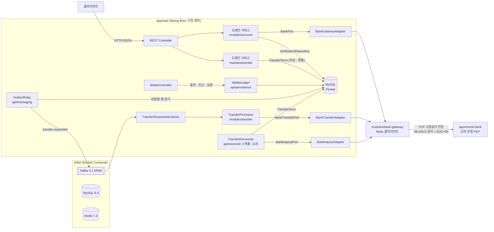
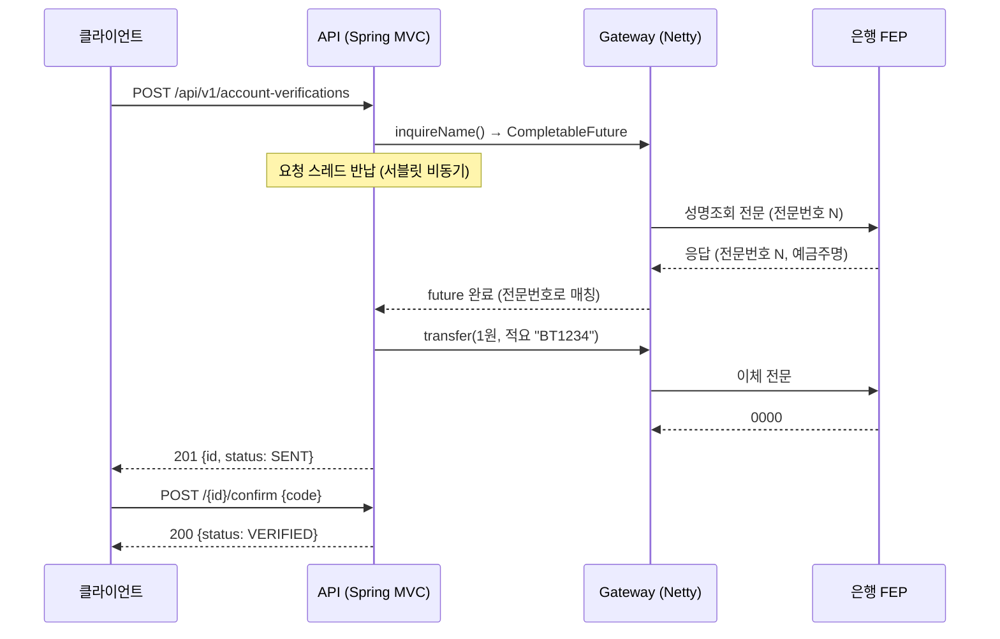
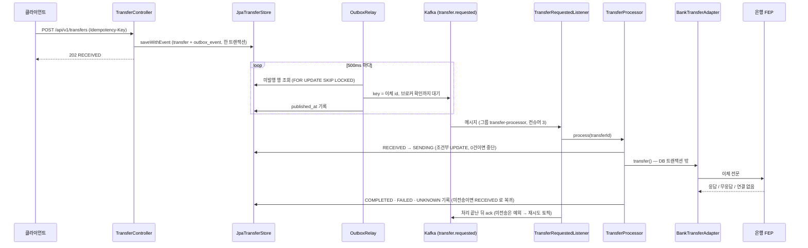
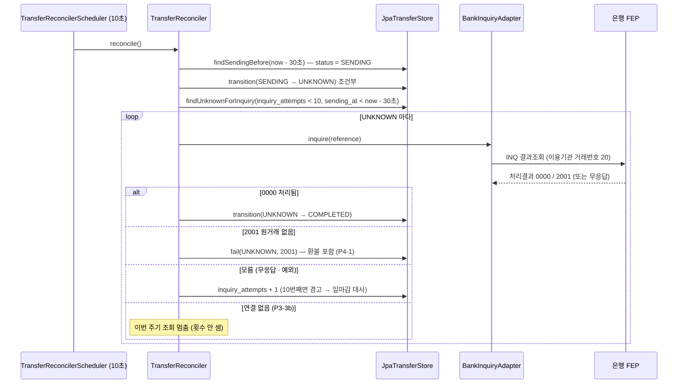
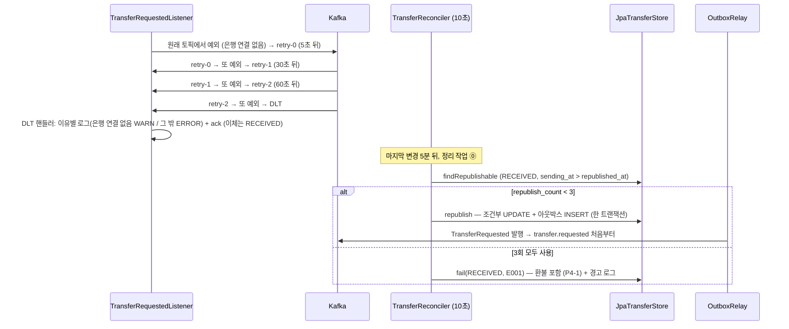
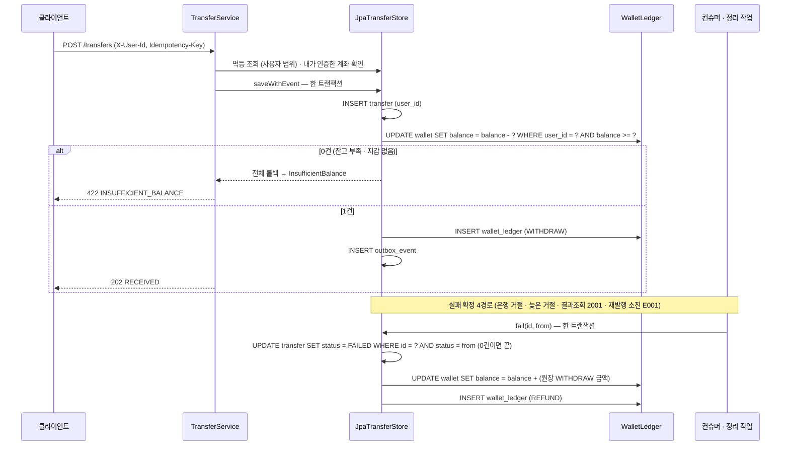

# ARCHITECTURE — 구조와 흐름

> 기준: P4-1 원화 잔고 (2026-10-26, PR #11 리뷰 중). P3 완료(P3-3b PR #9 머지). P3 · P4 의 진행 상황은 아래 [§6](#6-진행-상황-p3--p4)에 적는다.

## 1. 한눈에 보기



- **모듈러 모놀리스**: 배포는 `apps/api` 하나, 경계는 Gradle 모듈로 나눈다. 나중(P8)에 경계를 그대로 서비스로 떼어낸다.
- **포트/어댑터**: 도메인은 인터페이스(포트)만 알고, Netty·DB 를 붙이는 구현(어댑터)은 `apps/api` 에서 조립한다.
- **사용자 식별**: `X-User-Id` 를 `RequestUserResolver` 한 곳에서 꺼낸다 (인증은 범위 밖, P4-1).

## 2. 모듈

| 모듈 | 역할 | 의존 (Gradle) | 프레임워크 |
|---|---|---|---|
| `modules/bank-protocol` | 전문 모델(`sealed interface BankMessage`), 고정길이 직렬화, Netty 프레임 디코더/코덱 | `netty-handler` (api) | Netty |
| `modules/bank-gateway` | 은행 접속 클라이언트: 폴링, 재접속(지수 백오프), 전문번호 기반 응답 매칭, 타임아웃 | `bank-protocol` (api) | Netty |
| `modules/account` | 1원 계좌인증 도메인 + 포트(`BankPort`, `VerificationRepository`, `CodeGenerator`) | **없음** | 없음 |
| `modules/transfer` | 출금이체 도메인: 상태 전이, 사용자 범위 멱등 접수, 실패 확정 포트 `fail()`, 거래번호, 처리(`TransferProcessor`), 정리 작업(`TransferReconciler`) + 포트(`TransferStore`, `VerifiedAccounts`, `ReferenceGenerator`, `BankTransferPort`, `BankInquiryPort`) | **없음** | 없음 |
| `apps/api` | REST API, 예외 → HTTP 매핑, 조립(`AppConfiguration`), 어댑터, 잔고 SQL(`WalletLedger`), JPA 저장소(`persistence/`), Kafka 발행 · 소비(`messaging/`) | `account`, `transfer`, `bank-gateway` | Spring Boot 4 (MVC, JPA, Kafka) |
| `apps/mock-bank` | 모의 은행 FEP 서버. 실행 가능 + 테스트 픽스처 | `bank-protocol` (api) | Netty |

의존 방향 (화살표 = "의존한다"):

```
apps/api ──▶ modules/account            (도메인, 의존 없음)
   │
   ├──────▶ modules/transfer           (도메인, 의존 없음)
   │
   └──────▶ modules/bank-gateway ──▶ modules/bank-protocol ──▶ netty
apps/mock-bank ─────────────────────▶ modules/bank-protocol
(test) bank-gateway, apps/api ──▶ apps/mock-bank
```

규칙: `account` 의 build 파일에 Netty·Spring 이 없으므로, 도메인에서 import 하면 **컴파일이 실패한다**. 경계는 문서가 아니라 빌드가 강제한다.

### 소스 지도
```
apps/api/src/main/kotlin/.../api/
  BankTransferApplication.kt        # main
  config/AppConfiguration.kt        # 빈 조립, BankGatewayAdapter(BankPort 구현), 설정 프로퍼티
  config/BankTransferAdapter.kt     # BankTransferPort 구현: 게이트웨이 예외를 완료 · 거절 · 결과 모름 · 미전송으로 분류
  config/BankInquiryAdapter.kt      # BankInquiryPort 구현: 확실한 답(0000 · 2001)만 확정, 나머지는 모름 (예외 없음)
  web/AccountVerificationController.kt
  web/TransferController.kt         # POST/GET /api/v1/transfers (X-User-Id, Idempotency-Key, 202/200)
  web/RequestUser.kt                # X-User-Id → RequestUser (헤더를 읽는 유일한 곳), WebConfiguration
  web/WalletController.kt           # POST /api/v1/wallet/deposits (관리 · 테스트용), GET /api/v1/wallet
  web/ApiExceptionHandler.kt        # 도메인/게이트웨이 예외 → ProblemDetail + code (표준 Spring 오류에도 code)
  persistence/                      # JPA 엔티티 · 리포지토리 · JpaVerificationRepository · JpaTransferStore (transfer + 차감 + outbox_event 한 트랜잭션, 조건부 상태 UPDATE, fail() = 전이 + 환불)
  persistence/WalletLedger.kt       # 충전 · 차감 · 환불 · 잔고 · 보류 SQL 한 곳 (P4-2 이음새)
  messaging/MessagingConfiguration.kt     # 토픽 · 릴레이 · 프로세서 조립, 재시도 토픽 전용 스케줄러 (RetryTopicSchedulerWrapper)
  messaging/OutboxRelay.kt                # 폴링 퍼블리셔 (SKIP LOCKED, 발행 확인 후 published_at)
  messaging/TransferRequestedListener.kt  # transfer.requested 컨슈머 (수동 ack, @RetryableTopic 재시도 토픽 · @DltHandler)
  reconcile/ReconcileConfiguration.kt     # 정리 작업 조립 + 10초 스케줄러 (TransferReconcilerScheduler), transfer.reconcile.* 설정
apps/api/src/main/resources/db/migration/
  V1__init.sql · V2__transfer_republish.sql · V3__wallet.sql   # V2: republish_count · republished_at (P3-3b), V3: wallet · wallet_ledger · user_id (P4-1)
modules/account/.../account/
  AccountVerification.kt            # 엔티티, 포트, 예외 (sealed class)
  AccountVerificationService.kt     # 성명조회 → 1원 이체 → 코드 확인, 해시 저장 (InMemory 저장소는 테스트용)
modules/transfer/.../transfer/
  Transfer.kt                       # 상태 · 엔티티 · 명령 · 이벤트 · 포트 · 예외
  TransferService.kt                # 접수 규칙(검증 · 사용자 범위 멱등 · 내가 인증한 계좌 · 거래번호 재시도 · 잔고 부족 422), 거래번호 생성기
  TransferProcessor.kt              # 처리 규칙(조건부 SENDING → 은행 호출 → 결과 4분류 기록, 정리 작업과 경합 시 확정 결과 우선)
  TransferReconciler.kt             # 정리 작업(은행에 못 보낸 RECEIVED 재발행 · 포기, 멈춘 SENDING → UNKNOWN, UNKNOWN → 결과조회 → 확정). 은행에 묻기만 한다
modules/bank-gateway/.../gateway/BankGatewayClient.kt
modules/bank-protocol/.../protocol/
  BankMessage.kt · Header.kt · FixedLength.kt · BankMessageSerializer.kt
  netty/AsciiLengthFieldFrameDecoder.kt · netty/BankCodec.kt
apps/mock-bank/.../mockbank/MockBankServer.kt
```

## 3. 런타임 흐름: 1원 계좌인증



- 인증코드는 원문 대신 `SHA-256(id + code)` 로 저장. 유효시간 5분, 실패 5회면 잠금. 시도 횟수는 저장소의 원자적 `update` 로 갱신.
- 상태: `SENT → VERIFIED | EXPIRED | LOCKED`.

## 4. 은행 연동 (bank-gateway · bank-protocol)

| 관심사 | 구현 | 근거 |
|---|---|---|
| 프레이밍 | `LengthFieldBasedFrameDecoder` 상속, ASCII 길이("0052") 해석만 교체. 숫자가 아니면 연결 종료 | [ADR-0002](docs/adr/0002-netty-framing-and-response-matching.md) |
| 응답 매칭 | 전문번호 → `CompletableFuture` 맵, `orTimeout(3s)`, 완료 시 제거 | ADR-0002 |
| 링크 체크 | `IdleStateHandler`: 쓰기 30초 유휴 → 폴링, 읽기 90초 유휴 → 끊기 | [protocol.md §6](docs/protocol.md) |
| 재접속 | 1초부터 두 배씩 최대 30초 | 〃 |
| 전문 모델 | Kotlin `sealed interface` + `when` → 업무 누락이 컴파일 에러 | |

알려진 한계: 응답이 요청을 보낸 인스턴스로 돌아온다는 전제(단일 연결). 인스턴스가 여러 대면 응답 라우팅이 필요하다.

## 5. 로컬 인프라 (P3-0)
Docker Compose 한 파일로 MySQL 8.4 · Kafka 4.1(KRaft 단일 노드) · Redis 7.4. 리스너는 컨테이너용 `kafka:29092` / PC 용 `localhost:9092` 로 분리, 토픽 자동 생성 끔, 데이터는 이름 있는 볼륨.
CI `infra-smoke` 잡이 같은 파일을 띄워 `verify.sh` 로 읽기/쓰기를 확인한다. → [ADR-0003](docs/adr/0003-local-infra-docker-compose.md), [infra/README.md](infra/README.md)

## 6. 진행 상황 (P3 · P4)
- P3-1 접수 ✅ (ADR-0004). P3-2 처리 ✅ (ADR-0005). P3-3a 결과조회 · 정리 작업 ✅ (ADR-0006). P3-3b 재시도 토픽 · DLT · 제한 재발행 ✅ (ADR-0007). P4-1 원화 잔고 🟡 (ADR-0008, PR #11 리뷰 중 — 머지 때 ✅).

### P3-2 처리 흐름


- 중복 메시지는 `RECEIVED → SENDING` 조건부 UPDATE 가 막는다(0건이면 은행에 보내지 않고 ack). 결과를 모르면 `UNKNOWN` 으로 두고 다시 보내지 않는다.
- 미전송이면 `RECEIVED` 로 되돌리고 컨슈머가 예외를 던진다 → 재시도 토픽(5s · 30s · 60s) → DLT (P3-3b, 아래).
- 은행 응답 뒤 DB 기록이 실패하면 `SENDING` 으로 남는다 (아래 P3-3a 정리 작업 대상).
- 근거와 한계: [ADR-0005](docs/adr/0005-kafka-delivery-and-consumer-idempotency.md)

### P3-3a 정리 작업 흐름


- 정리 작업은 은행에 **다시 보내지 않고 묻기만 한다** (`BankTransferPort` 를 쓰지 않는다). 상태 변경은 모두 조건부라 컨슈머와 겹쳐도 한쪽만 반영된다.
- 컨슈머가 은행의 확정 결과(완료 · 거절)를 늦게 받으면 `UNKNOWN → COMPLETED/FAILED` 로 기록한다. 이미 반대 결과로 확정돼 있으면 `CONFLICT` 경고만 남긴다.
- 스케줄러 스레드 2개: 발행기(0.5초)와 정리 작업(10초)이 서로 막지 않는다.
- 근거와 한계: [ADR-0006](docs/adr/0006-inquire-instead-of-resend.md) · 전문 [protocol.md](docs/protocol.md) v0.2

### P3-3b 재시도 · 재발행 흐름


- 재시도 중인 메시지는 같은 파티션의 뒤 메시지를 막지 않는다 (논블로킹). 대신 재시도 메시지는 순서가 바뀌는데, 이체당 메시지가 1개라 무해하다.
- 재시도 토픽으로 넘긴 레코드의 오프셋은 단계마다 프레임워크가 커밋한다 (`commitRecovered`). 수동 ack 와 함께 쓸 때의 함정을 `RetryTopicFlowTest` 가 AdminClient 로 증명한다.
- 재발행 기준은 은행에 보내려 한 흔적(`sending_at > republished_at`)이다. 흔적이 없는 `RECEIVED`(발행 · 소비 문제)는 횟수를 쓰지 않고 복구를 기다린다.
- 결과조회 중 연결 없음은 그 주기의 조회를 멈추고 횟수를 세지 않는다.
- 근거와 한계: [ADR-0007](docs/adr/0007-retry-topic-and-bounded-republish.md)

합의된 방향 요약. 전체는 [P3 설계 문서](docs/superpowers/specs/2026-10-19-p3-transfer-design.md), 단계별 결정은 구현 PR 의 ADR(0004~0007)로 남긴다.
- P3 는 4단계: **P3-1 접수**(transfer 모듈, JPA/MySQL/Flyway, Idempotency-Key, 아웃박스) → **P3-2 처리**(폴링 퍼블리셔 → Kafka → 컨슈머 → 은행) → **P3-3a 결과조회**(규격 v0.2, 정리 작업) → **P3-3b 재시도**(재시도 토픽·DLT, 제한 재발행).
- 범위: 서비스 모계좌 → **1원인증을 마친 계좌**로의 출금이체만. 잔액·동시성은 P4.
- 새 모듈 `modules/transfer` (순수 Kotlin) + 포트 `TransferStore`(`saveWithEvent` · 조건부 `transition`), `VerifiedAccounts`, `BankTransferPort`.
- 상태: `RECEIVED → SENDING → COMPLETED | FAILED | UNKNOWN`, `UNKNOWN → (결과조회) → COMPLETED | FAILED`, `RECEIVED → FAILED`(E001, 재발행 한도 뒤, P3-3b). **타임아웃은 실패로 확정하지 않는다.**
- 1원인증 저장소도 메모리 → MySQL(JPA) 로 옮겼다 (P3-1).

### P4-1 원화 잔고 흐름


- 잔고는 상태에 따라 움직인다: `RECEIVED` · `SENDING` · `UNKNOWN` = 빠진 채(보류, `GET /wallet` 의 `pending`), `COMPLETED` = 빠진 채(확정), `FAILED` = 복원. `CONFLICT` 는 잔고를 건드리지 않고 경고만 남긴다 (수동 확인, P5 대사).
- 별도 락 없이 조건부 UPDATE 한 문장의 행 락과 `CHECK (balance >= 0)` 으로 음수를 막는다. 출금 INSERT 를 차감보다 먼저 두어 같은 키 경합의 진 쪽이 지갑을 건드리지 않는다.
- `WalletLedger` 가 잔고 SQL 의 유일한 곳이라 P4-2 에서 비관적 · 낙관적 · Redis 분산락으로 바꿔 끼우는 이음새다.
- 근거와 한계: [ADR-0008](docs/adr/0008-wallet-debit-on-intake-refund-on-failure.md)

## 7. 관련 문서
- 데이터베이스 모델 · 테이블 정의: [docs/database.md](docs/database.md)
- 전문 규격: [docs/protocol.md](docs/protocol.md)

## 8. 설계 결정 색인
| ADR | 결정 |
|---|---|
| [0001](docs/adr/0001-modular-monolith-ports.md) | 모듈러 모놀리스 + 포트/어댑터 |
| [0002](docs/adr/0002-netty-framing-and-response-matching.md) | Netty 프레이밍과 전문번호 기반 응답 매칭 |
| [0003](docs/adr/0003-local-infra-docker-compose.md) | 로컬 인프라는 Docker Compose 한 파일 |
| [0004](docs/adr/0004-idempotency-key-and-transactional-outbox.md) | 출금 접수는 Idempotency-Key + DB UNIQUE, 처리 신호는 트랜잭셔널 아웃박스 |
| [0005](docs/adr/0005-kafka-delivery-and-consumer-idempotency.md) | 아웃박스는 적어도 한 번 발행, 중복은 컨슈머의 상태 조건부 UPDATE 로 차단, 결과 모름은 재전송 금지 |
| [0006](docs/adr/0006-inquire-instead-of-resend.md) | 결과를 모르는 이체는 다시 보내지 않고 이용기관 거래번호로 은행에 물어서 확정 |
| [0007](docs/adr/0007-retry-topic-and-bounded-republish.md) | 은행에 못 보낸 출금은 논블로킹 재시도 토픽 + 은행 시도 흔적 기준의 제한 재발행, 포기는 FAILED E001 |
| [0008](docs/adr/0008-wallet-debit-on-intake-refund-on-failure.md) | 원화 잔고는 접수 트랜잭션에서 조건부 UPDATE 로 차감, 실패 확정 시 같은 트랜잭션에서 환불, 원장은 append-only |
