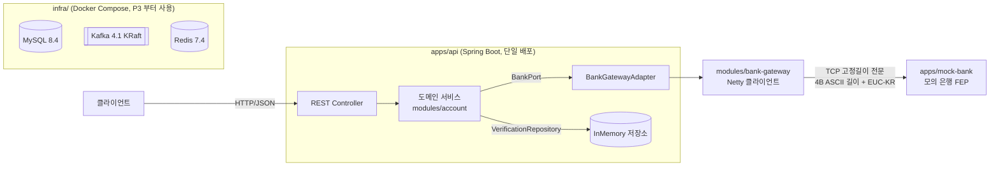
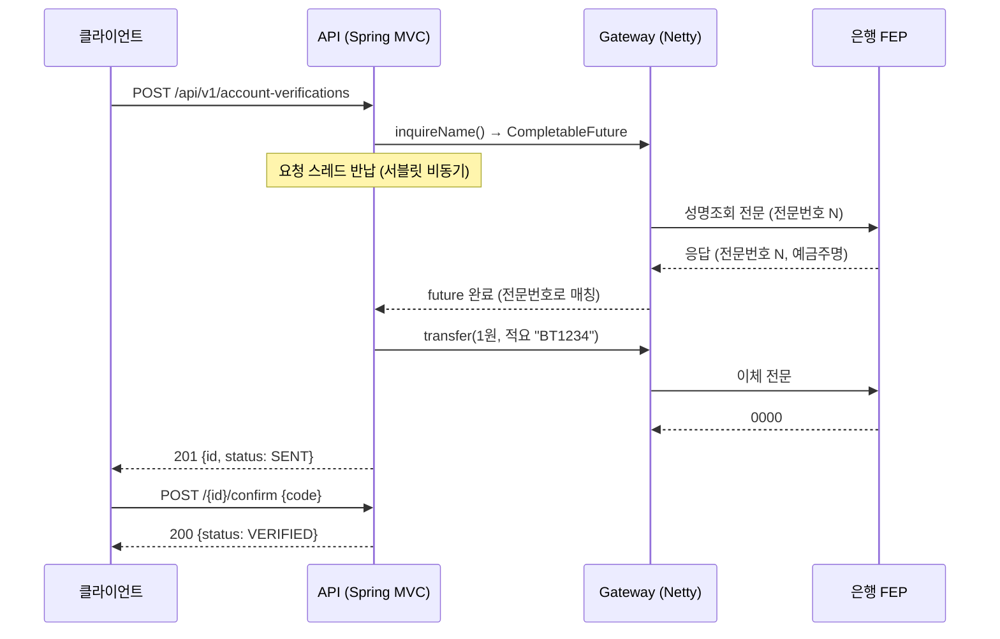

# ARCHITECTURE — 구조와 흐름

> 기준: P3-0 완료 (2026-10-16). P3(입출금 비동기)는 설계 중이며 아래 [§6](#6-다음-구조-p3-설계-중)에 합의된 방향만 적는다.

## 1. 한눈에 보기



- **모듈러 모놀리스**: 배포는 `apps/api` 하나, 경계는 Gradle 모듈로 나눈다. 나중(P8)에 경계를 그대로 서비스로 떼어낸다.
- **포트/어댑터**: 도메인은 인터페이스(포트)만 알고, Netty·DB 를 붙이는 구현(어댑터)은 `apps/api` 에서 조립한다.

## 2. 모듈

| 모듈 | 역할 | 의존 (Gradle) | 프레임워크 |
|---|---|---|---|
| `modules/bank-protocol` | 전문 모델(`sealed interface BankMessage`), 고정길이 직렬화, Netty 프레임 디코더/코덱 | `netty-handler` (api) | Netty |
| `modules/bank-gateway` | 은행 접속 클라이언트: 폴링, 재접속(지수 백오프), 전문번호 기반 응답 매칭, 타임아웃 | `bank-protocol` (api) | Netty |
| `modules/account` | 1원 계좌인증 도메인 + 포트(`BankPort`, `VerificationRepository`, `CodeGenerator`) | **없음** | 없음 |
| `apps/api` | REST API, 예외 → HTTP 매핑, 조립(`AppConfiguration`), 어댑터 | `account`, `bank-gateway` | Spring Boot 4 (MVC) |
| `apps/mock-bank` | 모의 은행 FEP 서버. 실행 가능 + 테스트 픽스처 | `bank-protocol` (api) | Netty |

의존 방향 (화살표 = "의존한다"):

```
apps/api ──▶ modules/account            (도메인, 의존 없음)
   │
   └──────▶ modules/bank-gateway ──▶ modules/bank-protocol ──▶ netty
apps/mock-bank ─────────────────────▶ modules/bank-protocol
(test) bank-gateway, apps/api ──▶ apps/mock-bank
```

규칙: `account` 의 build 파일에 Netty·Spring 이 없으므로, 도메인에서 import 하면 **컴파일이 실패한다**. 경계는 문서가 아니라 빌드가 강제한다.

### 소스 지도
```
apps/api/src/main/kotlin/.../api/
  BankTransferApplication.kt        # main
  config/AppConfiguration.kt        # 빈 조립, BankGatewayAdapter(BankPort 구현), 설정 프로퍼티
  web/AccountVerificationController.kt
  web/ApiExceptionHandler.kt        # 도메인/게이트웨이 예외 → ProblemDetail + code
modules/account/.../account/
  AccountVerification.kt            # 엔티티, 포트, 예외 (sealed class)
  AccountVerificationService.kt     # 성명조회 → 1원 이체 → 코드 확인, 해시 저장, InMemory 저장소
modules/bank-gateway/.../gateway/BankGatewayClient.kt
modules/bank-protocol/.../protocol/
  BankMessage.kt · Header.kt · FixedLength.kt · BankMessageSerializer.kt
  netty/AsciiLengthFieldFrameDecoder.kt · netty/BankCodec.kt
apps/mock-bank/.../mockbank/MockBankServer.kt
```

## 3. 런타임 흐름: 1원 계좌인증



- 인증코드는 원문 대신 `SHA-256(id + code)` 로 저장. 유효시간 5분, 실패 5회면 잠금. 시도 횟수는 저장소의 원자적 `update` 로 갱신.
- 상태: `SENT → VERIFIED | EXPIRED | LOCKED`.

## 4. 은행 연동 (bank-gateway · bank-protocol)

| 관심사 | 구현 | 근거 |
|---|---|---|
| 프레이밍 | `LengthFieldBasedFrameDecoder` 상속, ASCII 길이("0052") 해석만 교체. 숫자가 아니면 연결 종료 | [ADR-0002](docs/adr/0002-netty-framing-and-response-matching.md) |
| 응답 매칭 | 전문번호 → `CompletableFuture` 맵, `orTimeout(3s)`, 완료 시 제거 | ADR-0002 |
| 링크 체크 | `IdleStateHandler`: 쓰기 30초 유휴 → 폴링, 읽기 90초 유휴 → 끊기 | [protocol.md §6](docs/protocol.md) |
| 재접속 | 1초부터 두 배씩 최대 30초 | 〃 |
| 전문 모델 | Kotlin `sealed interface` + `when` → 업무 누락이 컴파일 에러 | |

알려진 한계: 응답이 요청을 보낸 인스턴스로 돌아온다는 전제(단일 연결). 인스턴스가 여러 대면 응답 라우팅이 필요하다.

## 5. 로컬 인프라 (P3-0)
Docker Compose 한 파일로 MySQL 8.4 · Kafka 4.1(KRaft 단일 노드) · Redis 7.4. 리스너는 컨테이너용 `kafka:29092` / PC 용 `localhost:9092` 로 분리, 토픽 자동 생성 끔, 데이터는 이름 있는 볼륨.
CI `infra-smoke` 잡이 같은 파일을 띄워 `verify.sh` 로 읽기/쓰기를 확인한다. → [ADR-0003](docs/adr/0003-local-infra-docker-compose.md), [infra/README.md](infra/README.md)

## 6. 다음 구조: P3 (설계 중)
합의된 방향 (설계 문서가 확정되면 `docs/superpowers/specs/` 와 ADR 로 옮긴다):
- P3 는 3단계: **P3-1 접수**(transfer 모듈, JPA/MySQL/Flyway, Idempotency-Key, 아웃박스) → **P3-2 처리**(폴링 퍼블리셔 → Kafka → 컨슈머 → 은행) → **P3-3 실패**(재시도 토픽·DLT, 결과조회 전문).
- 범위: 서비스 모계좌 → **1원인증을 마친 계좌**로의 출금이체만. 잔액·동시성은 P4.
- 새 모듈 `modules/transfer` (순수 Kotlin) + 포트 `TransferStore.saveWithEvent`, `VerifiedAccounts`, `BankTransferPort`.
- 상태: `RECEIVED → SENDING → COMPLETED | FAILED | UNKNOWN`, `UNKNOWN → (결과조회) → COMPLETED | FAILED`. **타임아웃은 실패로 확정하지 않는다.**
- 1원인증 저장소도 메모리 → MySQL(JPA) 로 옮긴다.

## 7. 설계 결정 색인
| ADR | 결정 |
|---|---|
| [0001](docs/adr/0001-modular-monolith-ports.md) | 모듈러 모놀리스 + 포트/어댑터 |
| [0002](docs/adr/0002-netty-framing-and-response-matching.md) | Netty 프레이밍과 전문번호 기반 응답 매칭 |
| [0003](docs/adr/0003-local-infra-docker-compose.md) | 로컬 인프라는 Docker Compose 한 파일 |
