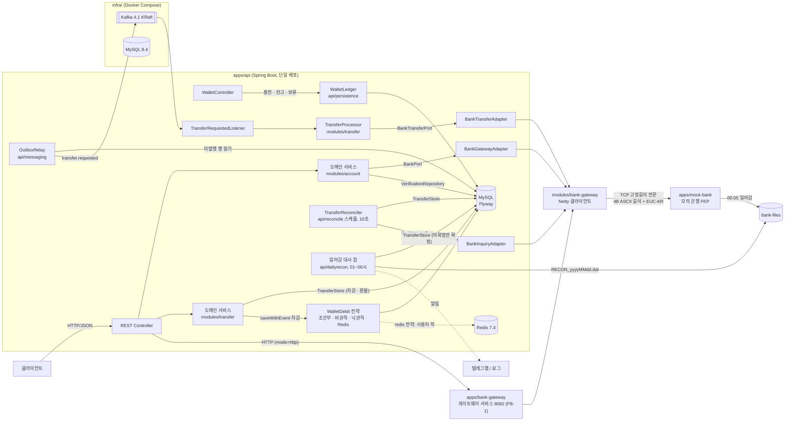
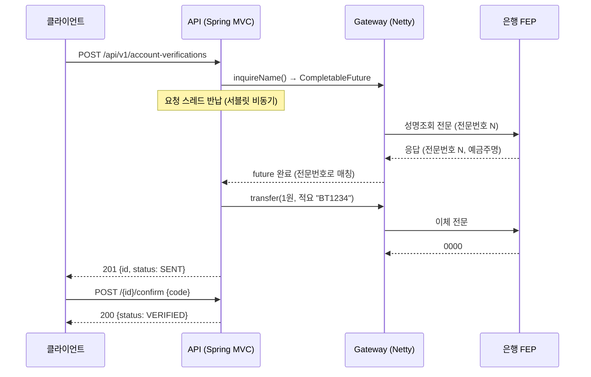
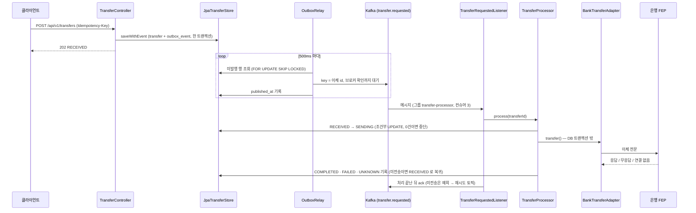
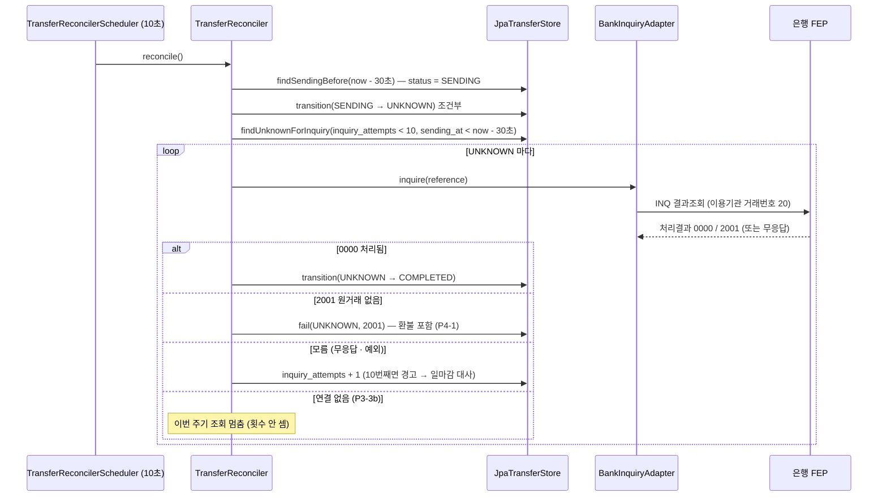
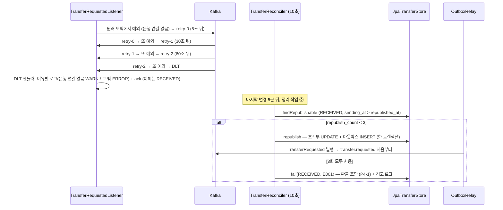
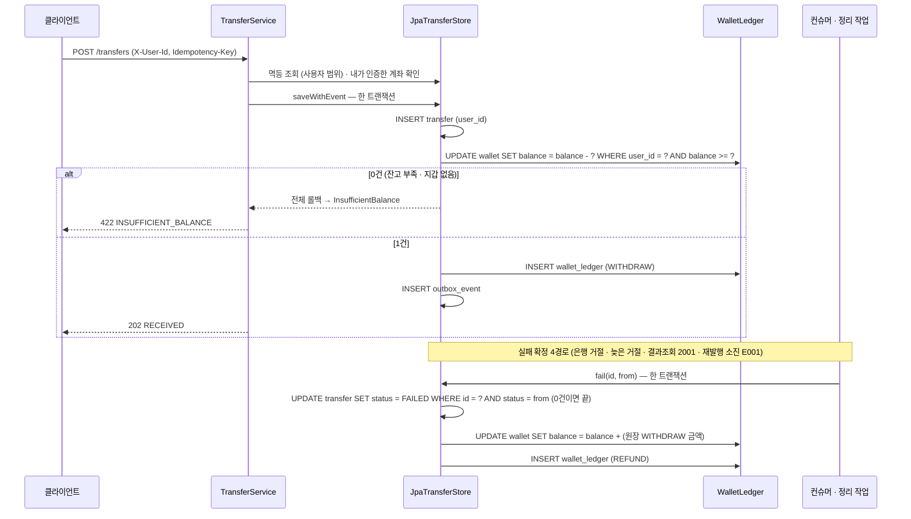
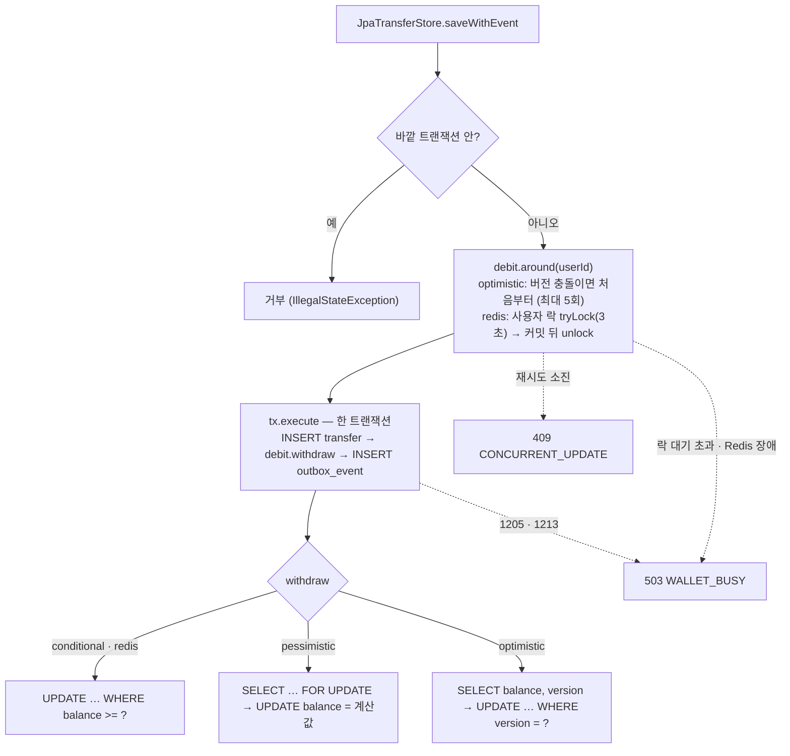
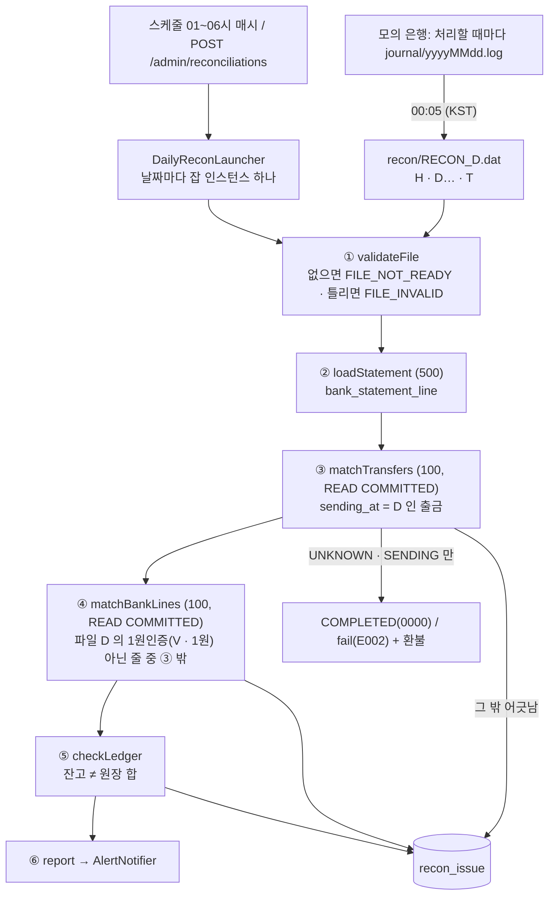

# ARCHITECTURE — 구조와 흐름

> 기준: P8-1 은행 게이트웨이 서비스 분리 (2026-11-10, PR 대기 — [ADR-0015](docs/adr/0015-bank-gateway-service.md), 기본은 `direct` 라 아래 그림의 직결 경로가 평소 모양). P5-1 일마감 대사 · 점검 시간 · 알림 완료 (2026-10-30, PR #15 머지). P4-2 잔고 차감 락 전략 완료 (2026-10-28, PR #13 머지). P4-1 원화 잔고 완료 (2026-10-26, PR #11 머지). P3 완료(P3-3b PR #9 머지). P3 ~ P5 의 진행 상황은 아래 [§6](#6-진행-상황-p3--p5)에 적는다.

## 1. 한눈에 보기



- **모듈러 모놀리스**: 배포는 `apps/api` 하나, 경계는 Gradle 모듈로 나눈다. 나중(P8)에 경계를 그대로 서비스로 떼어낸다.
- **포트/어댑터**: 도메인은 인터페이스(포트)만 알고, Netty·DB 를 붙이는 구현(어댑터)은 `apps/api` 에서 조립한다.
- **사용자 식별**: `X-User-Id` 를 `RequestUserResolver` 한 곳에서 꺼낸다 (인증은 범위 밖, P4-1).
- **잔고 차감 방식**은 기동 설정 `wallet.debit-strategy` 로 하나를 고른다 (ADR-0009).
- **은행 점검 시간**(23:50 ~ 00:10 KST)에는 은행을 건드리는 웹 요청이 503 이고 게이트웨이가 송신을 보류한다 — 날짜 경계를 은행 파일과 맞춘다 (ADR-0010).

## 2. 모듈

| 모듈 | 역할 | 의존 (Gradle) | 프레임워크 |
|---|---|---|---|
| `modules/bank-protocol` | 전문 모델(`sealed interface BankMessage`), 고정길이 직렬화, Netty 프레임 디코더/코덱 | `netty-handler` (api) | Netty |
| `modules/bank-gateway` | 은행 접속 클라이언트: 폴링, 재접속(지수 백오프), 전문번호 기반 응답 매칭, 타임아웃 | `bank-protocol` (api) | Netty |
| `modules/account` | 1원 계좌인증 도메인 + 포트(`BankPort`, `VerificationRepository`, `CodeGenerator`) | **없음** | 없음 |
| `modules/transfer` | 출금이체 도메인: 상태 전이, 사용자 범위 멱등 접수, 실패 확정 포트 `fail()`, 거래번호, 처리(`TransferProcessor` — begin · finish 로 나뉨, P6-1), 정리 작업(`TransferReconciler`) + 포트(`TransferStore`, `VerifiedAccounts`, `ReferenceGenerator`, `BankTransferPort` · `SuspendBankTransferPort`(P6-1), `BankInquiryPort`) | **없음** | 없음 |
| `modules/account-infra` | 1원인증의 바깥 어댑터를 두 앱이 같이 쓰도록 모았다 (P6-2): JPA 엔티티 · 저장소(`JpaVerificationRepository`), 은행 응답 해석(`holderNameOf` · `requireOk` · `BankRejectedException`), 오류 계약 기대표(test fixtures). 테이블 소유(Flyway)는 `apps/api` 그대로 | `account`, `bank-gateway` | Spring Data JPA |
| `apps/api` | REST API, 예외 → HTTP 매핑, 조립(`AppConfiguration`), 어댑터, 잔고 SQL(`WalletLedger` · 차감 전략 `WalletDebit`), JPA 저장소(`persistence/`), Kafka 발행 · 소비(`messaging/`) | `account`, `transfer`, `bank-gateway` | Spring Boot 4 (MVC, JPA, Kafka) |
| `apps/api-reactive` | WebFlux(Reactor Netty) 별도 앱, 포트 8081. 1원인증 요청 `POST /api/v1/account-verifications` 하나만 (코루틴 · Reactor 두 판). Kafka · 스케줄러 · 배치 · Flyway 없음 (P6-2, [ADR-0013](docs/adr/0013-web-verification-webflux-comparison.md)) | `account`, `account-infra`, `bank-gateway`, `transfer` (참조 번호 생성기 `RandomReferenceGenerator` 하나) | Spring WebFlux |
| `modules/bank-gateway-http` | 게이트웨이 HTTP 계약(DTO · 경로 · 오류 코드), 실패 분류(`BankNotSentException` 만 "안 보냄"), `BankGateway` 의 HTTP 클라이언트 두 판(WebClient · JDK `HttpClient`), 테스트 픽스처(`TcpCutProxy` · `GatewayProcess`) (P8-1, [ADR-0015](docs/adr/0015-bank-gateway-service.md)) | `bank-gateway` (api) | Reactor Netty WebClient · JDK HttpClient |
| `apps/bank-gateway` | 은행 FEP 연결 하나를 가지고 내부 HTTP API 3개로 노출. 포트 8082, 서버 두 판(WebFlux 기본 · MVC 비동기), 오류 → 503 `BANK_NOT_SENT` · 504 · 502, `/actuator/health/bankConnection`. DB · Kafka 없음 (P8-1) | `bank-gateway`, `bank-gateway-http` | Spring WebFlux / MVC |
| `apps/mock-bank` | 모의 은행 FEP 서버. 실행 가능 + 테스트 픽스처 | `bank-protocol` (api) | Netty |

의존 방향 (화살표 = "의존한다"):

```
apps/api ──▶ modules/account            (도메인, 의존 없음)
   │
   ├──────▶ modules/transfer           (도메인, 의존 없음)
   │
   └──────▶ modules/bank-gateway ──▶ modules/bank-protocol ──▶ netty
apps/api ──▶ modules/account-infra     (1원인증 JPA 저장소 · 은행 응답 해석)
apps/api-reactive ──▶ modules/account, modules/account-infra, modules/bank-gateway, modules/transfer (RandomReferenceGenerator)
apps/api, apps/api-reactive ──▶ modules/bank-gateway-http   (mode=http 일 때 쓰는 클라이언트)
apps/bank-gateway ──▶ modules/bank-gateway, modules/bank-gateway-http
apps/mock-bank ─────────────────────▶ modules/bank-protocol
(test) bank-gateway, apps/api ──▶ apps/mock-bank
```

참고: `bank-gateway-http` 가 spring-webflux · reactor-netty 를 끌고 오므로 `apps/api` 런타임 클래스패스에도 `direct` 모드에서 들어 있다 (웹 타입은 그대로 SERVLET, Boot 의 `WebClient.Builder` 자동 설정과 기본 `RestClient.create()` 의 요청 팩토리가 Reactor Netty 로 바뀌는 정도).

규칙: `account` 의 build 파일에 Netty·Spring 이 없으므로, 도메인에서 import 하면 **컴파일이 실패한다**. 경계는 문서가 아니라 빌드가 강제한다.

### 소스 지도
```
apps/api/src/main/kotlin/.../api/
  BankTransferApplication.kt        # main
  config/AppConfiguration.kt        # 빈 조립, BankGatewayAdapter(BankPort 구현), 설정 프로퍼티
  config/BankTransferAdapter.kt     # BankTransferPort 구현 + 분류 규칙 classifyBankFailure (두 판 공용): 완료 · 거절 · 결과 모름 · 미전송
  config/SuspendBankTransferAdapter.kt  # SuspendBankTransferPort 구현 (await, 취소는 다시 던짐, P6-1)
  config/BankInquiryAdapter.kt      # BankInquiryPort 구현: 확실한 답(0000 · 2001)만 확정, 나머지는 모름 (예외 없음)
  config/WalletDebitConfiguration.kt  # wallet.* 설정, 차감 전략 하나 선택, redis 일 때만 RedissonClient
  web/AccountVerificationController.kt
  web/TransferController.kt         # POST/GET /api/v1/transfers (X-User-Id, Idempotency-Key, 202/200)
  web/RequestUser.kt                # X-User-Id → RequestUser (헤더를 읽는 유일한 곳), WebConfiguration
  web/WalletController.kt           # POST /api/v1/wallet/deposits (관리 · 테스트용), GET /api/v1/wallet
  web/ApiExceptionHandler.kt        # 도메인/게이트웨이 예외 → ProblemDetail + code (표준 Spring 오류에도 code)
  persistence/                      # JPA 엔티티 · 리포지토리 · JpaVerificationRepository · JpaTransferStore (transfer + 차감 + outbox_event 한 트랜잭션, 조건부 상태 UPDATE, fail() = 전이 + 환불)
  persistence/WalletLedger.kt       # 충전 · 환불 · 잔고 · 보류 SQL, 원장 기록 (차감 SQL 은 WalletDebit 전략)
  persistence/WalletDebit.kt        # 차감 이음새(around · withdraw) + 조건부 · 비관적
  persistence/OptimisticWalletDebit.kt  # version 비교 + 트랜잭션 전체 재시도
  persistence/RedisWalletDebit.kt   # Redisson 사용자 락(바깥) + 조건부 UPDATE(안), redissonConfig
  messaging/MessagingConfiguration.kt     # 토픽 · 릴레이 · 프로세서 조립, 재시도 토픽 전용 스케줄러 (RetryTopicSchedulerWrapper)
  messaging/OutboxRelay.kt                # 폴링 퍼블리셔 (SKIP LOCKED, 발행 확인 후 published_at)
  messaging/TransferRequestedListener.kt  # transfer.requested 컨슈머 — 블로킹 판, 기본 (수동 ack, @RetryableTopic 재시도 토픽 · @DltHandler)
  messaging/SuspendingTransferRequestedListener.kt  # 같은 컨슈머의 코루틴 판 (P6-1): 은행 await · DB 는 IO 디스패처 · 은행 동시 호출 상한
  messaging/TransferRequestedHandling.kt  # 두 판의 공용: key 읽기 · 결과 마무리(CONFLICT · RETRY_LATER) · DLT 로그 · 알림, @RetryableTopic 값
  messaging/ConsumerConfiguration.kt      # transfer.consumer.* 설정, 모드에 맞는 리스너 하나만 조립
  reconcile/ReconcileConfiguration.kt     # 정리 작업 조립 + 10초 스케줄러 (TransferReconcilerScheduler), transfer.reconcile.* 설정
  batch/DatedJobLauncher.kt                # 날짜별 잡 시작 · 시작 경합 처리 · 동시 실행 가드 (대사 · 보존 배치 공용, P5-2)
  dailyrecon/                             # 일마감 대사 (P5-1, Spring Batch 6)
    DailyRecon.kt                         #   이름 · 상수 · 설정(daily-recon.*)
    DailyReconJobConfiguration.kt         #   잡 · 6단계 · 스텝 범위 리더 · 쓰기
    DailyReconSteps.kt                    #   태스클릿(① ⑤ ⑥) · 파일 리더(②) · 판정 쓰기(③ ④) · 파일 예외
    ReconRepository.kt                    #   대사 SQL (은행 줄 · 이슈 · 잔고 검증)
    ReconSummary.kt                       #   요약 · 완료 알림
    DailyReconLauncher.kt                 #   실행 · 동시 실행 가드(SingleRunGuard) · 실패 알림
    DailyReconScheduler.kt                #   01 ~ 06시 매시 회차
  retention/                              # 보존 배치 (P5-2, Spring Batch 6)
    DataRetention.kt                      #   이름 · 기준 시각(RetentionPolicy) · 설정(data-retention.*)
    RetentionRepository.kt                #   삭제 SQL 두 문장 (이 단계의 핵심 조건)
    PurgeTasklet.kt                       #   한 번 불릴 때 DELETE … LIMIT n 한 문장
    DataRetentionJobConfiguration.kt      #   잡 · 두 단계 · READ COMMITTED
    DataRetentionLauncher.kt              #   실행 · 건수 합 · 실패 알림
    DataRetentionScheduler.kt             #   매일 06:30
  alert/                                  # 알림 (P5-1)
    Alert.kt                              #   포트 AlertNotifier · 본문(가림 · 20건 · 4,096자)
    TelegramNotifier.kt · LogNotifier.kt · AlertConfiguration.kt   # 구현 선택: 토큰 · chat id 가 둘 다 있으면 텔레그램, 아니면 로그
  web/BankMaintenanceGuard.kt             # 점검 시간 503 BANK_MAINTENANCE + Retry-After (P5-1)
  web/ReconciliationController.kt         # POST /admin/reconciliations (P5-1)
  web/RetentionController.kt              # POST /admin/retention-runs (P5-2)
apps/api/src/main/resources/db/migration/
  V1__init.sql · V2__transfer_republish.sql · V3__wallet.sql · V4__daily_reconciliation.sql · V5__data_retention.sql   # V2: republish_count · republished_at (P3-3b), V3: wallet · wallet_ledger · user_id (P4-1), V4: Batch 메타 · bank_statement_line · recon_issue (P5-1), V5: idx_verification_purge (P5-2)
modules/account/.../account/
  AccountVerification.kt            # 엔티티, 포트, 예외 (sealed class)
  AccountVerificationService.kt     # 성명조회 → 1원 이체 → 코드 확인, 해시 저장 (InMemory 저장소는 테스트용)
modules/transfer/.../transfer/
  Transfer.kt                       # 상태 · 엔티티 · 명령 · 이벤트 · 포트 · 예외
  TransferService.kt                # 접수 규칙(검증 · 사용자 범위 멱등 · 내가 인증한 계좌 · 거래번호 재시도 · 잔고 부족 422), 거래번호 생성기
  TransferProcessor.kt              # 처리 규칙(조건부 SENDING → 은행 호출 → 결과 4분류 기록, 정리 작업과 경합 시 확정 결과 우선)
  TransferReconciler.kt             # 정리 작업(은행에 못 보낸 RECEIVED 재발행 · 포기, 멈춘 SENDING → UNKNOWN, UNKNOWN → 결과조회 → 확정). 은행에 묻기만 한다
  StatementMatching.kt              # 일마감 대사 판정 StatementMatcher(순수 함수) · 확정 StatementSettler (P5-1)
modules/bank-gateway/.../gateway/BankGatewayClient.kt   # SendGate: 점검 시간에는 보내지 않고 "연결 없음" 과 같은 길 (P5-1)
modules/bank-gateway/.../gateway/BankMaintenanceWindow.kt   # 점검 시간 순수 객체 (P5-1)
modules/bank-protocol/.../protocol/
  BankMessage.kt · Header.kt · FixedLength.kt · BankMessageSerializer.kt
  ReconFile.kt                      # 대사 파일(H · D · T) 형식: 쓰기 · 읽기 · 검증 (P5-1)
  netty/AsciiLengthFieldFrameDecoder.kt · netty/BankCodec.kt
apps/mock-bank/.../mockbank/MockBankServer.kt
apps/mock-bank/.../mockbank/BankJournal.kt · MockBankOptions.kt   # 일자별 거래 기록 · 00:05 일마감 · --bank-files / --close-day (P5-1)
load/                               # k6 부하 측정 (시나리오 · 시드 · 정리 · 검증 · run.sh), docs/perf/ 결과
```

## 3. 런타임 흐름: 1원 계좌인증



- 인증코드는 원문 대신 `SHA-256(id + code)` 로 저장. 유효시간 5분, 실패 5회면 잠금. 시도 횟수는 저장소의 원자적 `update` 로 갱신.
- 상태: `SENT → VERIFIED | EXPIRED | LOCKED`.
- 요청 흐름은 네 판이 있다 (P6-2): MVC 비동기(위 그림, 기본) · MVC 블로킹(대조군) · WebFlux 코루틴 · WebFlux Reactor. 판정은 한 벌, 다른 것은 기다리는 방법과 JDBC 를 도는 스레드 — [ADR-0013](docs/adr/0013-web-verification-webflux-comparison.md).
- `spring.threads.virtual.enabled=true` 면 MVC 두 판의 같은 코드가 가상 스레드에서 돈다 (Tomcat 요청 · 뒤처리 실행기) — 블로킹 판도 Tomcat 200 천장이 사라진다. 기본은 끔: Java 21 에서 냉시동 교착이 확인돼서다 (P7, [ADR-0014](docs/adr/0014-virtual-threads.md)).

## 4. 은행 연동 (bank-gateway · bank-protocol)

| 관심사 | 구현 | 근거 |
|---|---|---|
| 프레이밍 | `LengthFieldBasedFrameDecoder` 상속, ASCII 길이("0052") 해석만 교체. 숫자가 아니면 연결 종료 | [ADR-0002](docs/adr/0002-netty-framing-and-response-matching.md) |
| 응답 매칭 | 전문번호 → `CompletableFuture` 맵, `orTimeout(3s)`, 완료 시 제거 | ADR-0002 |
| 링크 체크 | `IdleStateHandler`: 쓰기 30초 유휴 → 폴링, 읽기 90초 유휴 → 끊기 | [protocol.md §6](docs/protocol.md) |
| 재접속 | 1초부터 두 배씩 최대 30초 | 〃 |
| 전문 모델 | Kotlin `sealed interface` + `when` → 업무 누락이 컴파일 에러 | |

알려진 한계: 응답이 요청을 보낸 인스턴스로 돌아온다는 전제(단일 연결). 인스턴스가 여러 대면 응답 라우팅이 필요하다.

## 5. 로컬 인프라 (P3-0)
Docker Compose 한 파일로 MySQL 8.4 · Kafka 4.1(KRaft 단일 노드) · Redis 7.4. 리스너는 컨테이너용 `kafka:29092` / PC 용 `localhost:9092` 로 분리, 토픽 자동 생성 끔, 데이터는 이름 있는 볼륨.
CI `infra-smoke` 잡이 같은 파일을 띄워 `verify.sh` 로 읽기/쓰기를 확인한다. → [ADR-0003](docs/adr/0003-local-infra-docker-compose.md), [infra/README.md](infra/README.md)

## 6. 진행 상황 (P3 ~ P5)
- P3-1 접수 ✅ (ADR-0004). P3-2 처리 ✅ (ADR-0005). P3-3a 결과조회 · 정리 작업 ✅ (ADR-0006). P3-3b 재시도 토픽 · DLT · 제한 재발행 ✅ (ADR-0007). P4-1 원화 잔고 ✅ (ADR-0008). P4-2 잔고 차감 락 전략 ✅ (ADR-0009). P5-1 일마감 대사 · 점검 시간 · 알림 ✅ (ADR-0010). P5-2 보존 배치 ✅ (ADR-0011).

### P3-2 처리 흐름


- 중복 메시지는 `RECEIVED → SENDING` 조건부 UPDATE 가 막는다(0건이면 은행에 보내지 않고 ack). 결과를 모르면 `UNKNOWN` 으로 두고 다시 보내지 않는다.
- 미전송이면 `RECEIVED` 로 되돌리고 컨슈머가 예외를 던진다 → 재시도 토픽(5s · 30s · 60s) → DLT (P3-3b, 아래).
- 은행 응답 뒤 DB 기록이 실패하면 `SENDING` 으로 남는다 (아래 P3-3a 정리 작업 대상).
- 컨슈머는 두 판이 있다 (P6-1, [ADR-0012](docs/adr/0012-consumer-coroutines.md)): 위 그림은 기본인 블로킹 판이다. `transfer.consumer.mode=coroutine` 이면 `SuspendingTransferRequestedListener` 가 은행 호출 자리(세마포어 permit)를 잡은 뒤 `begin`(DB, IO 디스패처) → 은행 `await`(스레드를 잡지 않음) 을 하고, 자리를 비운 다음 `finish`(DB, IO 디스패처) 로 같은 판정을 부른다. 자리를 `begin` 보다 먼저 잡는 것은 `SENDING` 인 채 자리를 기다리다 정리 작업이 환불한 뒤 송금되는 일을 막으려는 것이다. 은행 응답 뒤 코드는 Netty 이벤트 루프에서 이어지므로 DB 호출을 거기서 옮긴다. 같은 파티션 안 처리 순서는 지키지 않는다.
- `spring.threads.virtual.enabled=true` 면 블로킹 판 리스너 컨테이너가 가상 스레드에서 돈다. 리스너가 한 건씩 처리하는 구조는 그대로라 동시에 기다리는 출금도 3 그대로다 (P7, [ADR-0014](docs/adr/0014-virtual-threads.md)).
- 근거와 한계: [ADR-0005](docs/adr/0005-kafka-delivery-and-consumer-idempotency.md)

### P3-3a 정리 작업 흐름


- 정리 작업은 은행에 **다시 보내지 않고 묻기만 한다** (`BankTransferPort` 를 쓰지 않는다). 상태 변경은 모두 조건부라 컨슈머와 겹쳐도 한쪽만 반영된다.
- 컨슈머가 은행의 확정 결과(완료 · 거절)를 늦게 받으면 `UNKNOWN → COMPLETED/FAILED` 로 기록한다. 이미 반대 결과로 확정돼 있으면 `CONFLICT` 경고만 남긴다.
- 스케줄러 스레드 4개: 발행기(0.5초) · 정리 작업(10초) · 일마감 대사(01 ~ 06시) · 보존 배치(06:30)가 서로 막지 않는다 (P5-2 에서 3 → 4). 가상 스레드를 켜면 풀 크기 대신 작업마다 가상 스레드다 (`SimpleAsyncTaskScheduler`, P7).
- 근거와 한계: [ADR-0006](docs/adr/0006-inquire-instead-of-resend.md) · 전문 [protocol.md](docs/protocol.md) v0.2

### P3-3b 재시도 · 재발행 흐름


- 재시도 중인 메시지는 같은 파티션의 뒤 메시지를 막지 않는다 (논블로킹). 대신 재시도 메시지는 순서가 바뀌는데, 이체당 메시지가 1개라 무해하다.
- 재시도 토픽으로 넘긴 레코드의 오프셋은 단계마다 프레임워크가 커밋한다 (`commitRecovered`). 수동 ack 와 함께 쓸 때의 함정을 `RetryTopicFlowTest` 가 AdminClient 로 증명한다.
- 재발행 기준은 은행에 보내려 한 흔적(`sending_at > republished_at`)이다. 흔적이 없는 `RECEIVED`(발행 · 소비 문제)는 횟수를 쓰지 않고 복구를 기다린다.
- 결과조회 중 연결 없음은 그 주기의 조회를 멈추고 횟수를 세지 않는다.
- 근거와 한계: [ADR-0007](docs/adr/0007-retry-topic-and-bounded-republish.md)

합의된 방향 요약. 전체는 [P3 설계 문서](docs/superpowers/specs/2026-10-19-p3-transfer-design.md), 단계별 결정은 구현 PR 의 ADR(0004~0007)로 남긴다.
- P3 는 4단계: **P3-1 접수**(transfer 모듈, JPA/MySQL/Flyway, Idempotency-Key, 아웃박스) → **P3-2 처리**(폴링 퍼블리셔 → Kafka → 컨슈머 → 은행) → **P3-3a 결과조회**(규격 v0.2, 정리 작업) → **P3-3b 재시도**(재시도 토픽·DLT, 제한 재발행).
- 범위: 서비스 모계좌 → **1원인증을 마친 계좌**로의 출금이체만. 잔액·동시성은 P4.
- 새 모듈 `modules/transfer` (순수 Kotlin) + 포트 `TransferStore`(`saveWithEvent` · 조건부 `transition`), `VerifiedAccounts`, `BankTransferPort`.
- 상태: `RECEIVED → SENDING → COMPLETED | FAILED | UNKNOWN`, `UNKNOWN → (결과조회) → COMPLETED | FAILED`, `RECEIVED → FAILED`(E001, 재발행 한도 뒤, P3-3b). **타임아웃은 실패로 확정하지 않는다.**
- 1원인증 저장소도 메모리 → MySQL(JPA) 로 옮겼다 (P3-1).

### P4-1 원화 잔고 흐름


- 잔고는 상태에 따라 움직인다: `RECEIVED` · `SENDING` · `UNKNOWN` = 빠진 채(보류, `GET /wallet` 의 `pending`), `COMPLETED` = 빠진 채(확정), `FAILED` = 복원. `CONFLICT` 는 잔고를 건드리지 않고 경고만 남긴다 (수동 확인. 일마감 대사가 다음 날 기록 · 알림, P5-1).
- 별도 락 없이 조건부 UPDATE 한 문장의 행 락과 `CHECK (balance >= 0)` 으로 음수를 막는다. 출금 INSERT 를 차감보다 먼저 두어 같은 키 경합의 진 쪽이 지갑을 건드리지 않는다.
- 차감 SQL 은 P4-2 에서 `WalletDebit` 전략으로 옮겼다 (아래).
- 근거와 한계: [ADR-0008](docs/adr/0008-wallet-debit-on-intake-refund-on-failure.md)

### P4-2 잔고 차감 전략


- 전략은 기동 때 하나다 (`wallet.debit-strategy`). 환불 · 충전은 전략과 무관한 원자적 UPDATE 다.
- Redis 락은 같은 사용자 요청을 DB 앞에서 줄 세울 뿐이고 정확성은 DB(조건부 UPDATE + `CHECK`)가 지킨다.
- 네 전략의 비용 비교: [docs/perf/p4-2-lock-comparison.md](docs/perf/p4-2-lock-comparison.md). 근거: [ADR-0009](docs/adr/0009-wallet-debit-strategies-and-lock-comparison.md)

### P5-1 일마감 대사 흐름


- 판정은 `StatementMatcher`(순수 함수), 확정은 `StatementSettler`(기존 조건부 전이 · `fail`). 조건부 전이가 0건이면 다시 읽어 판정(최대 3회) — 그래서 ③ ④ 는 `READ COMMITTED` 다.
- ③ 의 확정 UPDATE 는 "`sending_at` 이 아직 D일 안" 도 조건으로 건다 — 읽은 뒤 다시 보내진 출금을 환불하지 않게(이중 지급). 그런 건은 `RESENT_LATER`(확정 · 이슈 없음, 그 날짜의 대사가 맡는다).
- 실패하면 멈춘 단계 · 청크부터 다시 한다 (결과 같음, 이중 환불 없음). 날짜마다 잡 인스턴스 하나라 끝난 날짜는 거부하고 동시 실행은 하나만 돈다 (`SingleRunGuard` 가 Spring Batch 6 시작 경로의 틈을 막는다).
- 점검 시간(23:50 ~ 00:10) 덕분에 "D일 송신" = "파일 D" 다. 근거: [ADR-0010](docs/adr/0010-daily-reconciliation.md)

### P5-2 보존 배치
- 매일 06:30(KST) `dataRetentionJob`: ① 발행 뒤 7일 지난 `outbox_event` ② `VERIFIED` 가 아니고 만료 뒤 30일 지난 `account_verification`. 금융 기록은 지우지 않는다 ([database.md §4-9](docs/database.md)).
- 호출마다 `DELETE … LIMIT 1000` 한 문장 = READ COMMITTED 트랜잭션 하나. 삭제 트랜잭션이 열려 있어도 아웃박스 INSERT 가 들어가는 것을 `RetentionLockTest` 로 확인했다 (트랜잭션 길이는 재지 않았다).
- 대사와 같은 잡 저장소 · 시작 경합 처리(`DatedJobLauncher`) · 알림. 건수는 인스턴스의 모든 실행의 합. 근거: [ADR-0011](docs/adr/0011-data-retention.md)

## 7. 관련 문서
- 데이터베이스 모델 · 테이블 정의: [docs/database.md](docs/database.md)
- 전문 규격: [docs/protocol.md](docs/protocol.md)

## 8. 설계 결정 색인
| ADR | 결정 |
|---|---|
| [0001](docs/adr/0001-modular-monolith-ports.md) | 모듈러 모놀리스 + 포트/어댑터 |
| [0002](docs/adr/0002-netty-framing-and-response-matching.md) | Netty 프레이밍과 전문번호 기반 응답 매칭 |
| [0003](docs/adr/0003-local-infra-docker-compose.md) | 로컬 인프라는 Docker Compose 한 파일 |
| [0004](docs/adr/0004-idempotency-key-and-transactional-outbox.md) | 출금 접수는 Idempotency-Key + DB UNIQUE, 처리 신호는 트랜잭셔널 아웃박스 |
| [0005](docs/adr/0005-kafka-delivery-and-consumer-idempotency.md) | 아웃박스는 적어도 한 번 발행, 중복은 컨슈머의 상태 조건부 UPDATE 로 차단, 결과 모름은 재전송 금지 |
| [0006](docs/adr/0006-inquire-instead-of-resend.md) | 결과를 모르는 이체는 다시 보내지 않고 이용기관 거래번호로 은행에 물어서 확정 |
| [0007](docs/adr/0007-retry-topic-and-bounded-republish.md) | 은행에 못 보낸 출금은 논블로킹 재시도 토픽 + 은행 시도 흔적 기준의 제한 재발행, 포기는 FAILED E001 |
| [0008](docs/adr/0008-wallet-debit-on-intake-refund-on-failure.md) | 원화 잔고는 접수 트랜잭션에서 조건부 UPDATE 로 차감, 실패 확정 시 같은 트랜잭션에서 환불, 원장은 append-only |
| [0009](docs/adr/0009-wallet-debit-strategies-and-lock-comparison.md) | 잔고 차감은 전략 인터페이스로 바꿔 끼우고(조건부 · 비관적 · 낙관적 · Redis), Redis 락은 DB 앞의 줄 세우기로만 |
| [0010](docs/adr/0010-daily-reconciliation.md) | 일마감 대사는 은행 대사 파일과 맞추고 결과를 모르는 출금만 자동 확정, 점검 시간으로 날짜 경계, API 앱 안의 Spring Batch |
| [0011](docs/adr/0011-data-retention.md) | 보존 배치는 일회성 데이터 두 종류만 READ COMMITTED 로 나눠 지우고, 금융 기록은 지우지 않는다 |
| [0012](docs/adr/0012-consumer-coroutines.md) | 출금 컨슈머의 은행 대기를 suspend 리스너로도 만들어 설정으로 고르고, 판정은 한 곳, DB 는 IO 디스패처, 은행 동시 호출 상한 (제안) |
| [0013](docs/adr/0013-web-verification-webflux-comparison.md) | 웹 1원인증 경로는 네 판(MVC 블로킹 · 비동기, WebFlux 코루틴 · Reactor)을 같은 도구로 비교하고, WebFlux 는 별도 앱, 판정 · 어댑터는 한 벌, 끊기면 취소 (제안) |
| [0014](docs/adr/0014-virtual-threads.md) | 가상 스레드는 Boot 설정 하나로 켜고, 성능은 코루틴만큼이지만 Java 21 냉시동 교착 때문에 기본은 끈다 |
| [0015](docs/adr/0015-bank-gateway-service.md) | 은행 게이트웨이를 별도 서비스(동기 HTTP)로 분리, 실패 분류 · 재시도 끔 · 송신 취소 안 함은 그대로, 기본은 `direct` 유지 (제안) |
