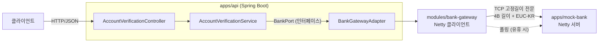
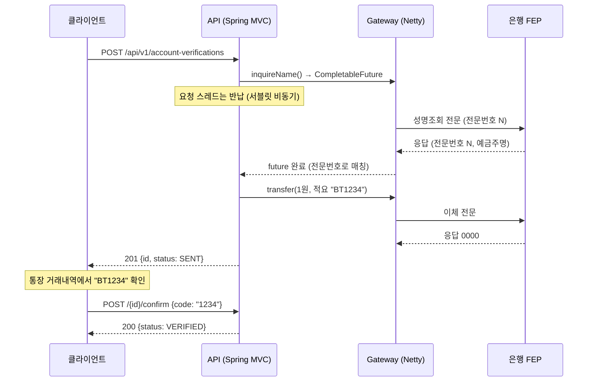

# bank-transfer — 은행 연동 송금 서비스 (Kotlin · Spring Boot · Netty)

은행 FEP 와 **고정길이 전문(TCP)** 으로 통신하는 송금·계좌인증 서비스를 처음부터 다시 만드는 프로젝트입니다.
예전에 가상자산 거래소와 은행을 잇는 입출금 미들웨어(Java 8, Spring Boot 1.5, Netty, Kafka)를 개발·운영하면서 겪은 문제를,
지금의 스택(Kotlin, Spring Boot 4, Netty 4.2, Java 21)으로 어떻게 다르게 풀 수 있는지 단계별로 검증합니다.

> 회사 코드는 한 줄도 쓰지 않았습니다. 전문 규격과 은행은 모두 이 프로젝트에서 새로 정의한 **모의(Mock)** 입니다.

## 문서

| 문서 | 언제 읽나 |
|---|---|
| [ARCHITECTURE.md](ARCHITECTURE.md) | 모듈 구조 · 의존 방향 · 런타임 흐름 · 설계 결정 색인 |
| [SETUP.md](SETUP.md) | 새 PC 에서 개발 환경 만들기 (JDK 21, IntelliJ, Docker, Git Bash) |
| [OPERATION.md](OPERATION.md) | 실행 · 포트 · 설정 · 모의 은행 시나리오 · 장애 대응 · CI |
| [HANDOVER.md](HANDOVER.md) | 지금 어디까지 왔고 다음에 무엇을 하는지 |
| [CHANGELOG.md](CHANGELOG.md) | 단계별 변경 이력 |
| [docs/database.md](docs/database.md) | DB 모델 · 테이블 정의 · 인덱스 · 시간대(KST) 정책 |
| [CLAUDE.md](CLAUDE.md) | 이 저장소의 작업 규칙 (AI 에이전트 · 기여자용) |

## 지금 되는 것

- **1원 계좌인증 API**: 예금주 성명조회 → 인증코드를 적요에 실어 1원 이체 → 사용자가 통장에서 본 코드로 확인
- **은행 게이트웨이(Netty 클라이언트)**: 길이헤더 프레이밍, 폴링 전문으로 회선 확인, 지수 백오프 재접속, 전문번호 기반 응답 매칭
- **모의 은행 FEP(Netty 서버)**: 같은 전문 규격으로 응답, 무응답 계좌로 타임아웃 재현, 처리 후 무응답 계좌(`9990000000002`)와 결과조회 응답
- **출금이체 접수 API (P3-1)**: `Idempotency-Key` 로 멱등 접수(202), 1원인증 계좌만 허용, 이체와 처리 신호(아웃박스)를 한 트랜잭션에 저장. MySQL(Flyway) 사용
- **출금이체 처리 (P3-2)**: 아웃박스 → Kafka(`transfer.requested`) → 컨슈머 → 은행 → `COMPLETED` / `FAILED` / `UNKNOWN`. 발행은 적어도 한 번, 중복 메시지는 상태 조건부 UPDATE 로 막고, 결과를 모르면 다시 보내지 않음 ([ADR-0005](docs/adr/0005-kafka-delivery-and-consumer-idempotency.md))
- **결과조회와 정리 작업 (P3-3a)**: 응답을 못 받은 이체(`UNKNOWN`)와 30초 넘게 멈춘 `SENDING` 을 다시 보내지 않고, 이용기관 거래번호로 은행에 결과조회(`INQ`, 전문 규격 v0.2)해 보낸 지 30초 유예 뒤 10초마다 `COMPLETED` / `FAILED` 로 확정. 10번 물어도 모르면 멈추고 경고(일마감 대사 대상) ([ADR-0006](docs/adr/0006-inquire-instead-of-resend.md))
- **재시도 토픽 · 제한 재발행 (P3-3b)**: 은행에 보내지도 못한 출금은 재시도 토픽(5s · 30s · 60s, 뒤 메시지를 막지 않음) → DLT → 정리 작업이 아웃박스로 최대 3번 다시 발행, 그래도 안 되면 FAILED E001 (돈은 움직이지 않음). 결과조회 중 연결 없음은 시도로 세지 않음 ([ADR-0007](docs/adr/0007-retry-topic-and-bounded-republish.md))
- **원화 잔고 (P4-1)**: 사용자(`X-User-Id`)별 원화 잔고와 append-only 원장. 출금 접수 트랜잭션에서 조건부 UPDATE 로 차감(잔고 부족 422), 실패로 확정되면 같은 트랜잭션에서 환불, 결과를 모르는 출금은 보류로 묶음. 동시 출금 100건에도 잔고는 음수가 되지 않음. 멱등키 · 1원인증 · 조회는 사용자 범위 ([ADR-0008](docs/adr/0008-wallet-debit-on-intake-refund-on-failure.md))
- **테스트 202개**: 전문 직렬화, 쪼개진 TCP 패킷, 동시 요청 50건 매칭, 타임아웃, 재접속, API 통합(HTTP → TCP), MySQL · Kafka 통합(Testcontainers: 같은 키 동시 10건, 아웃박스 원자성, 발행기 2개 동시 발행 · 접수가 발행기에 막히지 않음, 같은 메시지 두 번 → 은행 1건, 처리 후 무응답 → 결과조회로 확정 · 입금 1건, 은행 장애 → 재시도 토픽 → DLT → 재발행 → 입금 1건, 동시 출금 100건 → 정확히 10건 · 잔고 0, 실패 확정 경로마다 환불)

## 구조



| 모듈 | 역할 | 의존 |
|---|---|---|
| `modules/bank-protocol` | 전문 모델(sealed class), 고정길이 직렬화, Netty 프레임 디코더/인코더 | Netty |
| `modules/bank-gateway` | 은행 접속 클라이언트: 폴링, 재접속, 응답 매칭, 타임아웃 | bank-protocol |
| `modules/account` | 1원 계좌인증 도메인. **Spring·Netty 를 모른다** | 없음 |
| `modules/transfer` | 출금이체 도메인: 상태 전이, 멱등 접수, 거래번호. **Spring·JPA 를 모른다** | 없음 |
| `apps/api` | REST API, 조립(wiring), 예외 → HTTP 매핑 | account, transfer, bank-gateway |
| `apps/mock-bank` | 모의 은행 FEP 서버 (실행 가능, 테스트 픽스처) | bank-protocol |

`account` 는 `BankPort` 인터페이스만 알고, Netty 로 실제 연결하는 어댑터는 `apps/api` 에 있습니다.
도메인 규칙을 프레임워크 없이 테스트할 수 있고, 나중에 모듈을 서비스로 떼어낼 때 경계가 그대로 남습니다 (모듈러 모놀리스).

### 1원 계좌인증 흐름



## 실행

### IntelliJ
> API 는 MySQL 과 Kafka 가 필요하다 (P3-2 부터 Kafka). 먼저 `docker compose -f infra/docker-compose.yml --env-file infra/.env up -d --wait`

1. **JDK 21 지정**: `Settings > Build, Execution, Deployment > Build Tools > Gradle > Gradle JVM` 을 21 로, `File > Project Structure > SDK` 도 21 로.
2. 오른쪽 위 실행 목록에 `.run/` 의 구성이 자동으로 뜹니다.
   - `0. Mock Bank + API` : 모의 은행(9090)과 API(8080)를 한 번에 실행
   - `1. Mock Bank (9090)` / `2. API (8080)` : 하나씩 실행 (벌레 아이콘으로 디버그)
   - `3. All Tests` : 테스트 202개
   - `4. API (재발행 손 확인)` : 재시도 간격 2초 · 4초 · 8초, 재발행 대기 30초로 줄인 API (P3-3b 손 확인용, [`http/transfer.http`](http/transfer.http) 8절)
3. `http/account-verification.http` 를 열고 요청 왼쪽 ▶ 버튼으로 호출합니다.
   1번 요청이 응답의 `id` 를 저장하고, 모의 은행 콘솔의 `적요='BT1234'` 숫자를 2번 요청의 `code` 에 넣으면 `VERIFIED` 가 됩니다.

> 디버깅 추천 위치: `BankGatewayClient.send` (요청 등록), `ClientHandler.channelRead0` (전문번호로 응답 매칭), `AccountVerificationService.request` (성명조회 → 1원 이체 연결).

### 로컬 인프라 (P3 부터 필요)

Docker Desktop 이 있으면 MySQL · Kafka · Redis 를 한 번에 띄웁니다. Windows 는 **Git Bash** 에서 실행하세요 (PowerShell 의 `bash` 는 WSL 로 연결됩니다). 자세한 내용은 [infra/README.md](infra/README.md).

```bash
cp infra/.env.example infra/.env
docker compose -f infra/docker-compose.yml --env-file infra/.env up -d --wait
bash infra/verify.sh
```

### 터미널

> API 는 MySQL 과 Kafka 가 필요하다 (P3-2 부터 Kafka). 먼저 `docker compose -f infra/docker-compose.yml --env-file infra/.env up -d --wait`

요구사항: JDK 21 (Gradle 은 래퍼가 내려받습니다)

```bash
./gradlew build                                   # 컴파일 + 테스트 202개
./gradlew :apps:mock-bank:run --args="9090"       # 터미널 1: 모의 은행
./gradlew :apps:api:bootRun                       # 터미널 2: API (localhost:8080)
```

```bash
# 1) 인증 요청 (Windows 셸은 한글 인코딩 문제로 파일로 보내는 게 안전)
echo '{"bankCode":"090","accountNo":"1002123456789","holderName":"홍길동"}' > req.json
curl -X POST localhost:8080/api/v1/account-verifications -H 'Content-Type: application/json' -H 'X-User-Id: user-1' --data-binary @req.json
# {"id":"3bad7a91-...","status":"SENT","expiresAt":"...","verifiedAt":null}

# 2) 모의 은행 로그에서 통장 적요 확인
# [통장] 1002123456789 입금 1원 적요='BT6542'

# 3) 코드 확인
curl -X POST localhost:8080/api/v1/account-verifications/{id}/confirm -H 'Content-Type: application/json' -H 'X-User-Id: user-1' -d '{"code":"6542"}'
# {"id":"3bad7a91-...","status":"VERIFIED",...}

# 4) (P4-1) 출금하려면 먼저 충전 (관리 · 테스트용), 잔고 · 보류 확인
curl -X POST localhost:8080/api/v1/wallet/deposits -H 'Content-Type: application/json' -H 'X-User-Id: user-1' -d '{"amount":100000}'
curl localhost:8080/api/v1/wallet -H 'X-User-Id: user-1'
```

| 상황 | HTTP | code |
|---|---|---|
| 예금주명 불일치 | 422 | `HOLDER_NAME_MISMATCH` |
| 없는 계좌 | 404 | `ACCOUNT_NOT_FOUND` |
| 틀린 코드 | 400 | `WRONG_CODE` (+ `remainingAttempts`) |
| 5회 실패 | 423 | `VERIFICATION_LOCKED` |
| 유효시간(5분) 경과 | 410 | `VERIFICATION_EXPIRED` |
| 은행 무응답 | 504 | `BANK_TIMEOUT` |
| 은행 연결 없음 | 503 | `BANK_UNAVAILABLE` |
| `X-User-Id` 없음 | 400 | `USER_ID_REQUIRED` |

## 예전 시스템과 무엇을 다르게 했나

| 주제 | 예전 (Java 8, Netty 4.1) | 이 프로젝트 |
|---|---|---|
| 프레이밍 | `ByteToMessageDecoder` 직접 구현, 길이 상태를 필드로 보관 | `LengthFieldBasedFrameDecoder` 상속, ASCII 길이 해석만 교체 |
| 링크 체크 | `java.util.Timer` 로 5분마다 폴링 | `IdleStateHandler`: 쓰기 유휴 시 폴링, 읽기 유휴 시 연결 종료 |
| 재접속 | 3초 고정, 무한 | 1초부터 두 배씩, 최대 30초 (지수 백오프) |
| 응답 대기 | 요청 스레드가 DB 를 1초마다 조회 (블로킹) | 전문번호 → `CompletableFuture` 맵, 응답이 오면 이벤트 루프가 완료 (논블로킹) |
| 인증코드 저장 | - | 원문 대신 SHA-256 해시, 시도 횟수 원자적 갱신 |
| 전문 모델 | 바이트 배열 필드 + 수동 오프셋 | Kotlin `sealed interface` + `when` 으로 누락을 컴파일 에러로 |

자세한 설계 이유: [docs/adr](docs/adr) · 전문 규격: [docs/protocol.md](docs/protocol.md)

## 로드맵

- [x] **P0** Gradle 멀티모듈, Kotlin, Spring Boot 4, CI
- [x] **P1** 1원 계좌인증 API (동기 계약, 논블로킹 대기)
- [x] **P2** Netty 모의 은행, 프레이밍, 폴링, 재접속, 응답 매칭
- [x] **P3-0** 로컬 인프라: Docker Compose 로 MySQL 8.4 · Kafka 4.1(KRaft) · Redis 7.4, CI 연기 테스트 → [infra/](infra/README.md) · [ADR-0003](docs/adr/0003-local-infra-docker-compose.md)
- [x] **P3** 입출금 비동기 처리: Kafka + Transactional Outbox + 멱등키 + DLT
  - [x] P3-1 접수: Idempotency-Key · 아웃박스 · 1원인증 MySQL 이전 → [ADR-0004](docs/adr/0004-idempotency-key-and-transactional-outbox.md)
  - [x] P3-2 처리: 폴링 퍼블리셔 → Kafka → 컨슈머 → 은행 → [ADR-0005](docs/adr/0005-kafka-delivery-and-consumer-idempotency.md)
  - [x] P3-3a 결과조회: 규격 v0.2 · 정리 작업 (PR #7) → [ADR-0006](docs/adr/0006-inquire-instead-of-resend.md)
  - [x] P3-3b 재시도: 재시도 토픽 · DLT · 제한 재발행 (PR #9) → [ADR-0007](docs/adr/0007-retry-topic-and-bounded-republish.md)
- [ ] **P4** 잔액 동시성: 비관적 락 vs 낙관적 락 vs Redis 분산락, k6 부하테스트
  - [x] P4-1 원화 잔고: 접수 차감 · 실패 환불 · 사용자 범위 (PR #11) → [ADR-0008](docs/adr/0008-wallet-debit-on-intake-refund-on-failure.md)
  - [ ] P4-2 같은 차감을 비관적 락 · 낙관적 락 · Redis 분산락으로 바꿔 k6 로 비교
- [ ] **P5** Spring Batch 일마감 대사 + 텔레그램 알림
- [ ] **P6** WebFlux / Coroutines 버전과 성능 비교
- [ ] **P7** Virtual Thread 적용 비교
- [ ] **P8** 모듈 분리(MSA), Docker Compose → Kubernetes
- [ ] **P9** 관측성: Micrometer, Prometheus, Grafana

## 기술 스택

Kotlin 2.3 · Java 21 · Spring Boot 4.1 (Spring MVC, Validation, Actuator) · Spring Data JPA (Hibernate 7) · Flyway · MySQL 8.4 · Spring Kafka (Kafka 4.1) · Testcontainers · Netty 4.2 · JUnit 5 · Gradle 9 (Kotlin DSL) · GitHub Actions
