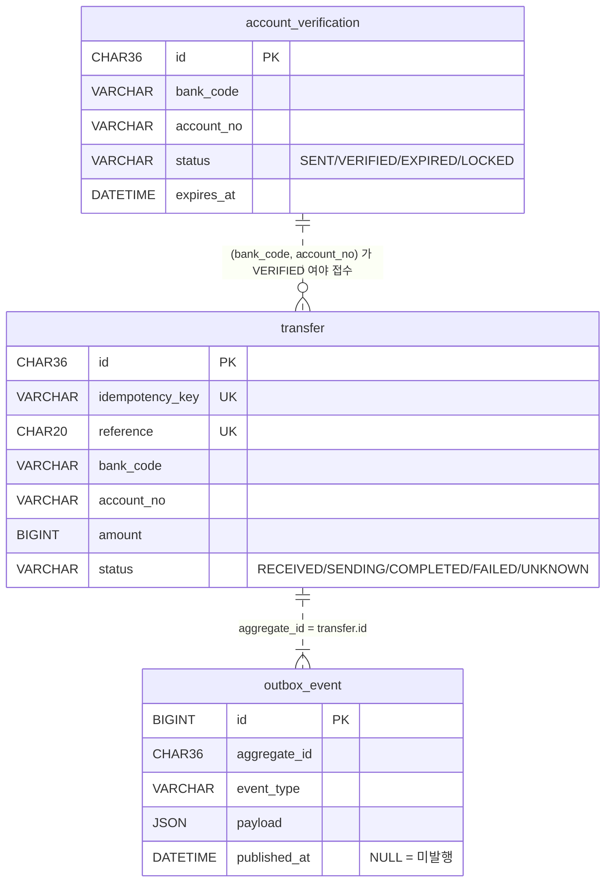

# 데이터베이스 — 모델 정의와 구조

> 기준: P3-3a (Flyway `V1__init.sql` 적용, P3-2 · P3-3a 는 스키마 변경 없음). 1원인증 · 이체 · 아웃박스 테이블이 MySQL 에 있다.
> 이 문서가 스키마의 기준이다. 마이그레이션을 추가할 때 이 문서도 같은 PR 에서 고친다.
> 설계 배경: [P3 설계 문서](superpowers/specs/2026-10-19-p3-transfer-design.md) §2~§6

## 1. 개요

| 항목 | 값 | 비고 |
|---|---|---|
| DBMS | MySQL 8.4 (LTS) | 로컬은 `infra/docker-compose.yml`, 테스트는 Testcontainers |
| 스키마 | `bank_transfer` | |
| 문자셋 / 정렬 | `utf8mb4` / `utf8mb4_0900_ai_ci` | 한글 · 이모지(4바이트)까지. MySQL `utf8` 은 3바이트라 쓰지 않는다 |
| 키 컬럼 정렬 | `transfer.idempotency_key` · `reference` 는 `ascii` / `ascii_bin` | 기본 정렬(`_ai_ci`)은 대소문자 · 악센트를 구분하지 않아 `Order-1` 과 `order-1` 이 같은 키로 취급된다. 키는 바이트 그대로 비교해야 한다 |
| 엔진 | InnoDB | 트랜잭션, 행 잠금, 클러스터드 PK |
| 계정 | 앱 `bank` (스키마 권한만) / 관리 `root` (로컬 전용) | 비밀번호는 `infra/.env` (git 제외) |
| 스키마 관리 | Flyway (`apps/api/src/main/resources/db/migration`) | JPA `ddl-auto=validate` — 엔티티가 스키마를 바꾸지 않는다 |
| 접근 방식 | Spring Data JPA (Hibernate) + 필요한 곳은 네이티브 SQL | `FOR UPDATE SKIP LOCKED`, 조건부 UPDATE |
| 시간대 설정 | JDBC `connectionTimeZone=Asia/Seoul` · Hibernate `jdbc.time_zone=Asia/Seoul` + `type.preferred_instant_jdbc_type=TIMESTAMP` | 마지막 설정이 없으면 Hibernate 7 이 Instant 를 UTC 로 쓴다 |

## 2. 시간대 정책 — 한국시간(KST)으로 저장

**결정**: DB 의 시각 컬럼은 **한국시간(Asia/Seoul, +09:00) 벽시계 값**을 `DATETIME(6)` 으로 저장한다. 애플리케이션 코드는 `Instant` 로 다루고, 변환은 JDBC/Hibernate 설정 한 곳에서만 한다.

| 계층 | 설정 | 값 |
|---|---|---|
| MySQL 서버 | `--default-time-zone` (Compose · Testcontainers 동일) | `+09:00` |
| JDBC URL | `connectionTimeZone` · `forceConnectionTimeZoneToSession` | `Asia/Seoul` · `true` |
| Hibernate | `spring.jpa.properties.hibernate.jdbc.time_zone` · `hibernate.type.preferred_instant_jdbc_type` | `Asia/Seoul` + `hibernate.type.preferred_instant_jdbc_type: TIMESTAMP` |
| 도메인 코드 | `Instant` + 주입한 `Clock` | 시간대를 모른다 (테스트에서 시간 고정) |
| JVM 기본 시간대 | 건드리지 않는다 (`TimeZone.setDefault` 금지) | 서버 OS 설정에 따라 결과가 바뀌지 않게 |

`forceConnectionTimeZoneToSession=true` + `Asia/Seoul` 은 MySQL 의 시간대 테이블이 있어야 동작한다. 공식 이미지와 RDS 에는 들어 있고, 직접 설치한 MySQL 은 `mysql_tzinfo_to_sql` 로 채워야 한다.

**KST 로 정한 이유**
- 국내 은행과만 연동한다. 전문의 `전문일시`, 은행 거래내역, 일마감 대사(P5)의 기준일이 모두 **KST 날짜**다. 저장도 같은 기준이면 "오늘 거래"를 `WHERE created_at >= '2026-10-19 00:00:00'` 처럼 그대로 조회할 수 있다.
- UTC 로 저장하면 KST 자정이 UTC 전날 15:00 이라, 대사·통계 쿼리마다 변환이 들어가고 운영자가 DB 를 직접 볼 때 9시간을 머릿속으로 더해야 한다. 금융 업무에서 날짜 경계 실수는 "그날 거래가 다른 날로 집계"되는 사고로 이어진다.
- 한국은 서머타임이 없어 KST ↔ UTC 변환이 항상 +9시간이다. 벽시계 값으로 저장해도 모호한 시각이 생기지 않는다.

**대가와 대비**
- 해외 리전 · 다른 시간대 서비스와 섞이면 변환이 필요하다 → 그때는 컬럼 의미가 바뀌는 큰 변경이므로 ADR 로 다룬다.
- `DATETIME` 은 시간대 정보를 담지 않는다. 그래서 **모든 계층이 같은 시간대를 쓰는지 테스트로 고정**한다 (P3-1: `Instant` 저장 → 네이티브 SQL 로 읽은 값이 KST 벽시계 시각과 같은지).
- `TIMESTAMP` 를 쓰지 않는 이유: 세션 시간대에 따라 읽히는 값이 바뀌고, 2038년 한계가 있다.

## 3. ERD



점선 관계는 **논리적 관계**이고 **외래키(FK)를 걸지 않는다**.
- `account_verification` 과 `transfer` 는 다른 모듈(account / transfer)의 데이터다. P8 에서 서비스를 나누면 DB 도 나뉠 수 있으므로 모듈 경계를 넘는 FK 를 만들지 않는다 ([ADR-0001](adr/0001-modular-monolith-ports.md)). 검증은 코드(`VerifiedAccounts` 포트)가 한다.
- `outbox_event` 는 여러 종류의 집합(aggregate)을 담을 수 있는 범용 테이블이라 특정 테이블에 FK 를 걸지 않는다.

## 4. 테이블 정의

### 4-1. `account_verification` — 1원 계좌인증 (account 모듈, P3-1)
| 컬럼 | 타입 | NULL | 설명 |
|---|---|---|---|
| `id` | `CHAR(36)` | N | PK. UUID 문자열 |
| `bank_code` | `VARCHAR(3)` | N | 은행코드 (예 `090`) |
| `account_no` | `VARCHAR(16)` | N | 계좌번호 (숫자만) |
| `holder_name` | `VARCHAR(20)` | N | 성명조회로 확인한 예금주명 |
| `code_hash` | `CHAR(64)` | N | `SHA-256(id + 인증코드)` 16진수. 원문 코드는 저장하지 않는다 |
| `status` | `VARCHAR(10)` | N | `SENT` · `VERIFIED` · `EXPIRED` · `LOCKED` |
| `failed_attempts` | `INT` | N | 틀린 코드 입력 횟수 (5회면 `LOCKED`) |
| `expires_at` | `DATETIME(6)` | N | 유효시각 (발송 + 5분) |
| `verified_at` | `DATETIME(6)` | Y | 인증 완료 시각 |
| `created_at` | `DATETIME(6)` | N | 생성 시각 |

인덱스: `idx_verification_account (bank_code, account_no, status)` — "이 계좌가 VERIFIED 인가?" 조회.

### 4-2. `transfer` — 출금이체 (transfer 모듈, P3-1)
| 컬럼 | 타입 | NULL | 설명 |
|---|---|---|---|
| `id` | `CHAR(36)` | N | PK. UUID 문자열. API 응답의 `id` |
| `idempotency_key` | `VARCHAR(64)` ascii_bin | N | 클라이언트가 보낸 `Idempotency-Key` (보이는 ASCII 1~64자). ascii_bin (대소문자·악센트 구분, 바이트 비교). **UNIQUE** |
| `reference` | `CHAR(20)` ascii_bin | N | 이용기관 거래번호. `T` + KST `yyMMdd` + 무작위 13자. 은행 전문 · 결과조회의 업무 키. ascii_bin (대소문자·악센트 구분, 바이트 비교). **UNIQUE** |
| `request_hash` | `CHAR(64)` | N | `SHA-256(bankCode\|accountNo\|amount\|memo)`. 같은 키 다른 내용 판별 |
| `bank_code` | `VARCHAR(3)` | N | 받는 은행 |
| `account_no` | `VARCHAR(16)` | N | 받는 계좌 (VERIFIED 여야 접수) |
| `amount` | `BIGINT` | N | 금액, 원 단위. 1 ~ 10,000,000 |
| `memo` | `VARCHAR(20)` | N | 적요 (EUC-KR 20바이트 이내) |
| `status` | `VARCHAR(10)` | N | `RECEIVED` · `SENDING` · `COMPLETED` · `FAILED` · `UNKNOWN` |
| `bank_response_code` | `VARCHAR(4)` | Y | 은행 응답코드 (`0000`, `1001` …) |
| `sending_at` | `DATETIME(6)` | Y | `SENDING` 으로 바뀐 시각. 멈춘 건 탐지 기준. 미전송으로 `RECEIVED` 에 되돌려도 남으므로 대상은 `status = SENDING` 과 함께 고른다 |
| `inquiry_attempts` | `INT` | N | 결과조회에도 답이 없던 횟수 (정리 작업이 10에서 멈춘다), 기본 0 |
| `created_at` | `DATETIME(6)` | N | 접수 시각 |
| `updated_at` | `DATETIME(6)` | N | 마지막 변경 시각 |
| `version` | `BIGINT` | N | JPA `@Version` 낙관적 락 |

인덱스:
- `uk_transfer_idempotency (idempotency_key)` — 중복 접수 차단 (동시 요청의 마지막 방어선)
- `uk_transfer_reference (reference)` — 거래번호 충돌 차단, 결과조회 응답 매핑
- `idx_transfer_status (status, sending_at)` — 정리 작업의 "30초 넘은 SENDING", "UNKNOWN 목록" 조회

### 4-3. `outbox_event` — 트랜잭셔널 아웃박스 (P3-1 생성, P3-2 부터 발행)
| 컬럼 | 타입 | NULL | 설명 |
|---|---|---|---|
| `id` | `BIGINT AUTO_INCREMENT` | N | PK. 발행 순서 기준. 발행할 때 메시지의 `eventId` 가 된다 |
| `aggregate_id` | `CHAR(36)` | N | 대상 집합 id (`transfer.id`). Kafka 메시지 key |
| `event_type` | `VARCHAR(50)` | N | `TransferRequested` |
| `payload` | `JSON` | N | `{"transferId", "occurredAt"}`. eventId 는 이 행의 `id` 라 발행할 때 `JSON_SET(payload, '$.eventId', id)` 로 메시지에 붙인다 |
| `created_at` | `DATETIME(6)` | N | 이벤트 기록 시각 (이체 저장과 같은 트랜잭션) |
| `published_at` | `DATETIME(6)` | Y | Kafka 발행 완료 시각. `NULL` = 미발행. 브로커가 받았다고 확인한 뒤 `NOW(6)`로 기록한다. `NOW(6)` 은 세션 시간대를 따르고, 세션 시간대는 JDBC `forceConnectionTimeZoneToSession=true` + `connectionTimeZone=Asia/Seoul` 이 KST 로 맞춘다 (서버 시간대만의 결과가 아니다, §2) |

인덱스: `idx_outbox_unpublished (published_at, id)` — `WHERE published_at IS NULL ORDER BY id LIMIT 100` 를 인덱스만으로 처리.

발행 메시지 모양 (`transfer.requested`, [ADR-0005](adr/0005-kafka-delivery-and-consumer-idempotency.md)): key = `aggregate_id`(이체 id), value = `{"transferId", "occurredAt", "eventId"}`. 같은 이체의 메시지는 같은 파티션으로 간다.

## 5. 상태 값
상태는 MySQL `ENUM` 이 아니라 `VARCHAR` + Kotlin `enum` 으로 둔다. 값을 추가할 때 `ALTER TABLE ... MODIFY ENUM` (테이블 재작성 위험) 없이 코드만 바꾸면 되고, 허용 전이는 도메인이 검증한다.

| 테이블 | 값 | 종결 |
|---|---|---|
| `account_verification.status` | `SENT` → `VERIFIED` / `EXPIRED` / `LOCKED` | `VERIFIED`, `EXPIRED`, `LOCKED` |
| `transfer.status` | `RECEIVED` → `SENDING` → `COMPLETED` / `FAILED` / `UNKNOWN`, `UNKNOWN` → `COMPLETED` / `FAILED` | `COMPLETED`, `FAILED` |

전이 규칙 전체: [설계 문서 §3](superpowers/specs/2026-10-19-p3-transfer-design.md#3-상태-모델).

## 6. 동시성 · 잠금
| 상황 | 방법 | SQL 모양 |
|---|---|---|
| 같은 `Idempotency-Key` 동시 접수 | UNIQUE 위반을 잡아 기존 건 반환 | `INSERT …` → UNIQUE 위반(`DataIntegrityViolationException`)을 도메인 예외로 변환 → 트랜잭션 밖에서 `SELECT` |
| 1원인증 코드 확인 동시 요청 | 비관적 락 | `SELECT … FROM account_verification WHERE id = ? FOR UPDATE` |
| 아웃박스 발행 (앱 여러 대) | 잠긴 행 건너뛰기 | `SELECT … WHERE published_at IS NULL ORDER BY id LIMIT 100 FOR UPDATE SKIP LOCKED`. 발행기는 READ COMMITTED 로 돈다: 기본 REPEATABLE READ 에서는 gap 락 때문에 접수의 INSERT 가 막힌다 ([ADR-0005](adr/0005-kafka-delivery-and-consumer-idempotency.md)) |
| 이체 상태 변경 (중복 메시지) | 조건부 UPDATE | `UPDATE transfer SET status='SENDING', sending_at=? … WHERE id=? AND status='RECEIVED'` → 0건이면 건너뜀 |
| 정리 작업과 컨슈머가 같은 이체를 확정 | 조건부 UPDATE (`UNKNOWN` 에서만 확정) | `UPDATE transfer SET status=?, bank_response_code=? … WHERE id=? AND status='UNKNOWN'` → 0건이면 다른 쪽이 먼저 확정한 것이라 건너뜀. 결과조회 횟수 증가도 `AND status='UNKNOWN'` 조건부다 |
| 엔티티 동시 수정 | 낙관적 락 | `@Version` → `… WHERE id=? AND version=?` |

잔액 차감의 락 비교(비관적 · 낙관적 · Redis 분산락)는 P4 에서 이 표에 추가한다.

## 7. 명명 · 타입 규칙
- 테이블 · 컬럼: `snake_case`, 테이블은 단수형 (`transfer`).
- PK 는 `id`. 인덱스 접두어: UNIQUE `uk_<table>_<컬럼>`, 일반 `idx_<table>_<용도>`.
- 시각: `DATETIME(6)` (마이크로초, KST). 접미어 `_at`.
- 금액: `BIGINT` 원 단위. `DECIMAL`·부동소수점 쓰지 않는다 (원화는 소수점이 없다).
- 불리언이 필요하면 `TINYINT(1)` 대신 상태 컬럼으로 표현할 수 있는지 먼저 본다.
- 개인정보 원문(인증코드)은 저장하지 않는다. 계좌번호 마스킹: `Transfer.toString()` 은 뒤 4자리만 남겨 로그에 원문이 찍히지 않는다. API 응답 마스킹은 인증 도입 때 적용한다.

## 8. 마이그레이션 규칙 (Flyway)
- 파일명: `V<번호>__<설명>.sql` (예 `V1__init.sql`, `V2__transfer_reference_index.sql`).
- **이미 적용된 파일은 고치지 않는다.** 바꿀 게 있으면 새 버전을 추가한다 (체크섬 불일치로 기동 실패).
- 앱 기동 시 자동 적용. 테스트(Testcontainers)도 같은 파일로 스키마를 만든다.
- 큰 테이블 변경(인덱스 추가 등)은 운영 반영 방법(온라인 DDL)을 PR 에 적는다.
- 로컬 초기화: `docker compose -f infra/docker-compose.yml --env-file infra/.env down -v` 후 다시 `up`.

## 9. 운영 조회 예시
```sql
-- 접속: docker compose -f infra/docker-compose.yml exec mysql mysql -ubank -p bank_transfer

-- 처리 상태별 건수
SELECT status, COUNT(*) FROM transfer GROUP BY status;

-- 30초 넘게 SENDING 에 멈춘 건 (정리 작업 대상)
SELECT id, reference, sending_at FROM transfer
 WHERE status = 'SENDING' AND sending_at < NOW(6) - INTERVAL 30 SECOND;

-- 결과조회 한도에 닿은 UNKNOWN (일마감 대사 대상)
SELECT id, reference, inquiry_attempts FROM transfer WHERE status = 'UNKNOWN' AND inquiry_attempts >= 10;

-- 아직 Kafka 로 안 나간 이벤트
SELECT id, aggregate_id, created_at FROM outbox_event WHERE published_at IS NULL ORDER BY id LIMIT 20;

-- 발행 지연: 미발행 중 가장 오래된 것
SELECT MIN(created_at) FROM outbox_event WHERE published_at IS NULL;

-- 오늘(KST) 완료된 출금 합계
SELECT COUNT(*), SUM(amount) FROM transfer
 WHERE status = 'COMPLETED' AND updated_at >= CURDATE();

-- 인덱스를 타는지 확인
EXPLAIN SELECT id FROM outbox_event WHERE published_at IS NULL ORDER BY id LIMIT 100;
```

## 10. 검토 중 · 다음 단계
- **PK 타입**: 지금은 읽기 쉬운 `CHAR(36)` 무작위 UUID. InnoDB 는 PK 순서로 데이터를 저장하므로 무작위 값은 삽입 시 페이지 분할이 생기고 보조 인덱스도 커진다. P4 부하테스트에서 `BINARY(16)` · 시간순 UUID(v7) · `BIGINT` 와 삽입 성능을 비교해 결정한다.
- **데이터 보존**: 발행된 `outbox_event`, 만료된 `account_verification` 정리는 P5 배치.
- **잔액 테이블**: P4 에서 추가.
- **읽기 성능**: 조회 API 가 늘면 실행계획(`EXPLAIN ANALYZE`) 결과를 이 문서에 남긴다.

## 변경 이력
| 날짜 | 변경 | 관련 |
|---|---|---|
| 2026-10-19 | 최초 작성: P3 스키마 설계, 시간대 KST 정책 | P3 설계 문서 |
| 2026-10-19 | V1 적용 (P3-1). payload 에서 eventId 제외, Hibernate Instant 설정 추가 | PR (P3-1) |
| 2026-10-19 | `idempotency_key` · `reference` 를 `ascii_bin` 으로 (대소문자·악센트 구분), 키는 보이는 ASCII 1~64자만 허용 | 최종 리뷰 (P3-1) |
| 2026-10-20 | 스키마 변경 없음. 아웃박스 발행 메시지 모양 · `published_at` 기록 방식, 동시성 표(SKIP LOCKED · 조건부 UPDATE) 확정, 운영 조회 추가 | PR #5 (P3-2) |
| 2026-10-21 | 스키마 변경 없음. `inquiry_attempts` 의미(결과조회에도 답이 없던 횟수, 10에서 멈춤), 정리 작업 ↔ 컨슈머 경합의 조건부 UPDATE, 한도에 닿은 `UNKNOWN` 운영 쿼리 | [PR #7](https://github.com/hyeokjinON/bank-transfer/pull/7) (P3-3a) |
