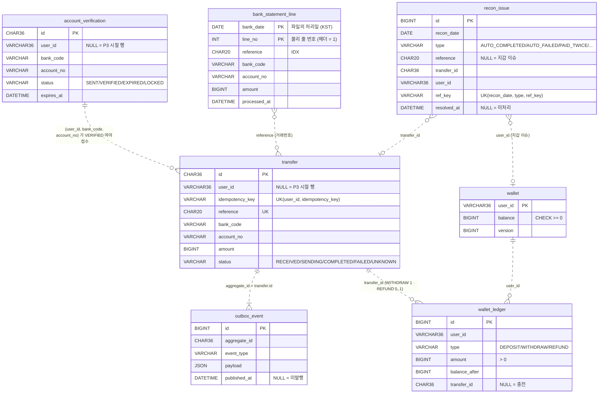

# 데이터베이스 — 모델 정의와 구조

> 기준: P5-1 (Flyway `V1` ~ `V4` 적용). 1원인증 · 이체 · 아웃박스 · 지갑 · 원장 · 대사(은행 줄 · 이슈) 테이블과 Spring Batch 메타 표가 MySQL 에 있다.
> 이 문서가 스키마의 기준이다. 마이그레이션을 추가할 때 이 문서도 같은 PR 에서 고친다.
> 설계 배경: [P3 설계 문서](superpowers/specs/2026-10-19-p3-transfer-design.md) §2~§6 · [P4-1 설계](superpowers/specs/2026-10-26-p4-1-wallet-balance-design.md) · [P4-2 설계](superpowers/specs/2026-10-27-p4-2-lock-comparison-design.md) · [P5-1 설계](superpowers/specs/2026-10-29-p5-1-daily-reconciliation-design.md)

## 1. 개요

| 항목 | 값 | 비고 |
|---|---|---|
| DBMS | MySQL 8.4 (LTS) | 로컬은 `infra/docker-compose.yml`, 테스트는 Testcontainers |
| 스키마 | `bank_transfer` | |
| 문자셋 / 정렬 | `utf8mb4` / `utf8mb4_0900_ai_ci` | 한글 · 이모지(4바이트)까지. MySQL `utf8` 은 3바이트라 쓰지 않는다 |
| 키 컬럼 정렬 | `transfer.idempotency_key` · `reference` 는 `ascii` / `ascii_bin`. `user_id`(wallet · wallet_ledger · transfer · account_verification) 도 `ascii_bin` | 기본 정렬(`_ai_ci`)은 대소문자 · 악센트를 구분하지 않아 `Order-1` 과 `order-1` 이 같은 키로 취급된다. 키는 바이트 그대로 비교해야 한다. 사용자 id 도 같아서 `User-1` 과 `user-1` 은 다른 사용자다 |
| 엔진 | InnoDB | 트랜잭션, 행 잠금, 클러스터드 PK |
| 계정 | 앱 `bank` (스키마 권한만) / 관리 `root` (로컬 전용) | 비밀번호는 `infra/.env` (git 제외) |
| 스키마 관리 | Flyway (`apps/api/src/main/resources/db/migration`) | JPA `ddl-auto=validate` — 엔티티가 스키마를 바꾸지 않는다 |
| 접근 방식 | Spring Data JPA (Hibernate) + 필요한 곳은 네이티브 SQL. 잔고는 `WalletLedger`(JDBC — 충전 · 환불 · 원장) + 차감 전략 `WalletDebit`(조건부 · 비관적 · 낙관적 · Redis, 설정 `wallet.debit-strategy`) | `FOR UPDATE SKIP LOCKED`, 조건부 UPDATE |
| 시간대 설정 | JDBC `connectionTimeZone=Asia/Seoul` · Hibernate `jdbc.time_zone=Asia/Seoul` + `type.preferred_instant_jdbc_type=TIMESTAMP` | 마지막 설정이 없으면 Hibernate 7 이 Instant 를 UTC 로 쓴다 |

## 2. 시간대 정책 — 한국시간(KST)으로 저장

**결정**: DB 의 시각 컬럼은 **한국시간(Asia/Seoul, +09:00) 벽시계 값**을 `DATETIME(6)` 으로 저장한다. 애플리케이션 코드는 `Instant` 로 다루고, 변환은 JDBC/Hibernate 설정 한 곳에서만 한다.

| 계층 | 설정 | 값 |
|---|---|---|
| MySQL 서버 | `--default-time-zone` (Compose · Testcontainers 동일) | `+09:00` |
| JDBC URL | `connectionTimeZone` · `forceConnectionTimeZoneToSession` | `Asia/Seoul` · `true` |
| Hibernate | `spring.jpa.properties.hibernate.jdbc.time_zone` · `hibernate.type.preferred_instant_jdbc_type` | `Asia/Seoul` + `hibernate.type.preferred_instant_jdbc_type: TIMESTAMP` |
| 도메인 코드 | `Instant` + 주입한 `Clock` | 시간대를 모른다 (테스트에서 시간 고정) |
| JVM 기본 시간대 | 건드리지 않는다 (`TimeZone.setDefault` 금지) | 서버 OS 설정에 따라 결과가 바뀌지 않게 |

**예외**: Spring Batch 메타 표(`BATCH_*`)의 시각은 Spring Batch 가 `LocalDateTime.now()` 로 쓴다 = JVM 기본 시간대. `TimeZone.setDefault` 를 쓰지 않으므로 바꾸지 않는다 — 대사 결과의 기준은 업무 표(`recon_issue` 등, KST)다.

`forceConnectionTimeZoneToSession=true` + `Asia/Seoul` 은 MySQL 의 시간대 테이블이 있어야 동작한다. 공식 이미지와 RDS 에는 들어 있고, 직접 설치한 MySQL 은 `mysql_tzinfo_to_sql` 로 채워야 한다.

**KST 로 정한 이유**
- 국내 은행과만 연동한다. 전문의 `전문일시`, 은행 거래내역, 일마감 대사(P5)의 기준일이 모두 **KST 날짜**다. 저장도 같은 기준이면 "오늘 거래"를 `WHERE created_at >= '2026-10-19 00:00:00'` 처럼 그대로 조회할 수 있다.
- UTC 로 저장하면 KST 자정이 UTC 전날 15:00 이라, 대사·통계 쿼리마다 변환이 들어가고 운영자가 DB 를 직접 볼 때 9시간을 머릿속으로 더해야 한다. 금융 업무에서 날짜 경계 실수는 "그날 거래가 다른 날로 집계"되는 사고로 이어진다.
- 한국은 서머타임이 없어 KST ↔ UTC 변환이 항상 +9시간이다. 벽시계 값으로 저장해도 모호한 시각이 생기지 않는다.

**대가와 대비**
- 해외 리전 · 다른 시간대 서비스와 섞이면 변환이 필요하다 → 그때는 컬럼 의미가 바뀌는 큰 변경이므로 ADR 로 다룬다.
- `DATETIME` 은 시간대 정보를 담지 않는다. 그래서 **모든 계층이 같은 시간대를 쓰는지 테스트로 고정**한다 (P3-1: `Instant` 저장 → 네이티브 SQL 로 읽은 값이 KST 벽시계 시각과 같은지).
- `TIMESTAMP` 를 쓰지 않는 이유: 세션 시간대에 따라 읽히는 값이 바뀌고, 2038년 한계가 있다.

## 3. ERD



점선 관계는 **논리적 관계**이고 **외래키(FK)를 걸지 않는다**.
- `account_verification` 과 `transfer` 는 다른 모듈(account / transfer)의 데이터다. P8 에서 서비스를 나누면 DB 도 나뉠 수 있으므로 모듈 경계를 넘는 FK 를 만들지 않는다 ([ADR-0001](adr/0001-modular-monolith-ports.md)). 검증은 코드(`VerifiedAccounts` 포트)가 한다.
- `outbox_event` 는 여러 종류의 집합(aggregate)을 담을 수 있는 범용 테이블이라 특정 테이블에 FK 를 걸지 않는다.
- `wallet_ledger` 는 append-only 기록이라 이체 행 삭제 · 보존 정책(P5-2)과 묶지 않는다. `wallet` 도 마찬가지로 FK 없이 `user_id` 로만 잇는다.
- `bank_statement_line` · `recon_issue` 도 FK 없이 거래번호(`reference`) · `transfer_id` · `user_id` 로만 잇는다 — 은행 쪽 기록은 우리에게 없는 거래번호를 담을 수 있고, 이슈는 이체 행과 수명이 다르다.

## 4. 테이블 정의

### 4-1. `account_verification` — 1원 계좌인증 (account 모듈, P3-1)
| 컬럼 | 타입 | NULL | 설명 |
|---|---|---|---|
| `id` | `CHAR(36)` | N | PK. UUID 문자열 |
| `user_id` | `VARCHAR(36)` ascii_bin | Y | 인증을 요청한 사용자 (`X-User-Id`). 확인 · 출금 계좌 확인은 이 사용자만. P3 시절 행은 NULL (누구에게도 인정되지 않는다). V3 (P4-1) |
| `bank_code` | `VARCHAR(3)` | N | 은행코드 (예 `090`) |
| `account_no` | `VARCHAR(16)` | N | 계좌번호 (숫자만) |
| `holder_name` | `VARCHAR(20)` | N | 성명조회로 확인한 예금주명 |
| `code_hash` | `CHAR(64)` | N | `SHA-256(id + 인증코드)` 16진수. 원문 코드는 저장하지 않는다 |
| `status` | `VARCHAR(10)` | N | `SENT` · `VERIFIED` · `EXPIRED` · `LOCKED` |
| `failed_attempts` | `INT` | N | 틀린 코드 입력 횟수 (5회면 `LOCKED`) |
| `expires_at` | `DATETIME(6)` | N | 유효시각 (발송 + 5분) |
| `verified_at` | `DATETIME(6)` | Y | 인증 완료 시각 |
| `created_at` | `DATETIME(6)` | N | 생성 시각 |

인덱스:
- `idx_verification_account (bank_code, account_no, status)` — "이 계좌가 VERIFIED 인가?" 조회 (P3)
- `idx_verification_user_account (user_id, bank_code, account_no, status)` — 출금 계좌 확인 ("이 사용자가 이 계좌를 인증했는가?", V3)

### 4-2. `transfer` — 출금이체 (transfer 모듈, P3-1)
| 컬럼 | 타입 | NULL | 설명 |
|---|---|---|---|
| `id` | `CHAR(36)` | N | PK. UUID 문자열. API 응답의 `id` |
| `user_id` | `VARCHAR(36)` ascii_bin | Y | 출금한 사용자. 이 사용자의 지갑에서 차감 · 환불. P3 시절 행은 NULL (조회 · 멱등 조회 모두 `user_id = ?` 라 보이지 않고, 차감한 적이 없어 환불도 없다). V3 (P4-1) |
| `idempotency_key` | `VARCHAR(64)` ascii_bin | N | 클라이언트가 보낸 `Idempotency-Key` (보이는 ASCII 1~64자). ascii_bin (대소문자·악센트 구분, 바이트 비교). `(user_id, idempotency_key)` **UNIQUE** |
| `reference` | `CHAR(20)` ascii_bin | N | 이용기관 거래번호. `T` + KST `yyMMdd` + 무작위 13자. 은행 전문 · 결과조회의 업무 키. ascii_bin (대소문자·악센트 구분, 바이트 비교). **UNIQUE** |
| `request_hash` | `CHAR(64)` | N | `SHA-256(bankCode\|accountNo\|amount\|memo)`. 같은 키 다른 내용 판별 |
| `bank_code` | `VARCHAR(3)` | N | 받는 은행 |
| `account_no` | `VARCHAR(16)` | N | 받는 계좌 (VERIFIED 여야 접수) |
| `amount` | `BIGINT` | N | 금액, 원 단위. 1 ~ 10,000,000 |
| `memo` | `VARCHAR(20)` | N | 적요 (EUC-KR 20바이트 이내) |
| `status` | `VARCHAR(10)` | N | `RECEIVED` · `SENDING` · `COMPLETED` · `FAILED` · `UNKNOWN` |
| `bank_response_code` | `VARCHAR(4)` | Y | 은행 응답코드 (`0000`, `1001` …). `E001` · `E002` 는 은행 코드가 아니라 자체 코드: `E001` = 은행에 보내지 못하고 포기(`RECEIVED → FAILED`, 돈은 움직이지 않음), `E002` = 일마감 대사로 은행 미처리 확정(`UNKNOWN`/`SENDING → FAILED`, 돈은 움직이지 않았고 환불됨, P5-1). `E001` 과 구분한다. 일마감 대사의 자동 완료는 결과조회 확정과 같은 `0000` |
| `sending_at` | `DATETIME(6)` | Y | `SENDING` 으로 바뀐 시각. 멈춘 건 탐지 기준. 미전송으로 `RECEIVED` 에 되돌려도 남으므로 대상은 `status = SENDING` 과 함께 고른다 |
| `inquiry_attempts` | `INT` | N | 결과조회에도 답이 없던 횟수 (정리 작업이 10에서 멈춘다), 기본 0 |
| `republish_count` | `INT` | N | 정리 작업이 아웃박스로 다시 발행한 횟수 (3에서 멈추고 FAILED E001), 기본 0. V2 (P3-3b) |
| `republished_at` | `DATETIME(6)` | Y | 마지막 재발행 시각. `sending_at` 이 이보다 늦어야(재발행 뒤 은행에 보내려다 못 보냈어야) 다음 재발행 대상 |
| `created_at` | `DATETIME(6)` | N | 접수 시각 |
| `updated_at` | `DATETIME(6)` | N | 마지막 변경 시각 |
| `version` | `BIGINT` | N | JPA `@Version` 낙관적 락 |

인덱스:
- `uk_transfer_user_idempotency (user_id, idempotency_key)` — 사용자 범위 중복 접수 차단 (동시 요청의 마지막 방어선). NULL 은 서로 다른 값이라 P3 행끼리 충돌하지 않는다 (V3 에서 전역 `uk_transfer_idempotency` 를 대체)
- `uk_transfer_reference (reference)` — 거래번호 충돌 차단, 결과조회 응답 매핑
- `idx_transfer_status (status, sending_at)` — 정리 작업의 "30초 넘은 SENDING", "30초 유예가 지난 UNKNOWN 목록" 조회. 재발행 대상(`status = 'RECEIVED'`) 조회도 이 인덱스의 앞 컬럼으로 좁힌다
- `idx_transfer_user (user_id, created_at)` — 지갑의 보류 금액(내 `RECEIVED` · `SENDING` · `UNKNOWN` 합), 사용자별 출금 목록 (V3)

### 4-3. `outbox_event` — 트랜잭셔널 아웃박스 (P3-1 생성, P3-2 부터 발행)
| 컬럼 | 타입 | NULL | 설명 |
|---|---|---|---|
| `id` | `BIGINT AUTO_INCREMENT` | N | PK. 발행 순서 기준. 발행할 때 메시지의 `eventId` 가 된다 |
| `aggregate_id` | `CHAR(36)` | N | 대상 집합 id (`transfer.id`). Kafka 메시지 key |
| `event_type` | `VARCHAR(50)` | N | `TransferRequested`. 재발행도 같은 `TransferRequested` 한 줄을 더 쓴다 (P3-3b) |
| `payload` | `JSON` | N | `{"transferId", "occurredAt"}`. eventId 는 이 행의 `id` 라 발행할 때 `JSON_SET(payload, '$.eventId', id)` 로 메시지에 붙인다 |
| `created_at` | `DATETIME(6)` | N | 이벤트 기록 시각 (이체 저장과 같은 트랜잭션) |
| `published_at` | `DATETIME(6)` | Y | Kafka 발행 완료 시각. `NULL` = 미발행. 브로커가 받았다고 확인한 뒤 `NOW(6)`로 기록한다. `NOW(6)` 은 세션 시간대를 따르고, 세션 시간대는 JDBC `forceConnectionTimeZoneToSession=true` + `connectionTimeZone=Asia/Seoul` 이 KST 로 맞춘다 (서버 시간대만의 결과가 아니다, §2) |

인덱스: `idx_outbox_unpublished (published_at, id)` — `WHERE published_at IS NULL ORDER BY id LIMIT 100` 를 인덱스만으로 처리.

발행 메시지 모양 (`transfer.requested`, [ADR-0005](adr/0005-kafka-delivery-and-consumer-idempotency.md)): key = `aggregate_id`(이체 id), value = `{"transferId", "occurredAt", "eventId"}`. 같은 이체의 메시지는 같은 파티션으로 간다.

### 4-4. `wallet` — 사용자 원화 잔고 (P4-1)
| 컬럼 | 타입 | NULL | 설명 |
|---|---|---|---|
| `user_id` | `VARCHAR(36)` ascii_bin | N | PK. `X-User-Id` 값 |
| `balance` | `BIGINT` | N | 잔고 (원). `CHECK (balance >= 0)` = `ck_wallet_balance_non_negative` — 조건부 차감의 2차 방어선 |
| `version` | `BIGINT` | N | 바뀔 때마다 +1. 낙관적 락 전략(P4-2)이 `WHERE version = ?` 로 쓴다 — 충전 · 환불도 올리므로 그 사이 바뀌면 충돌로 잡힌다 |
| `created_at` · `updated_at` | `DATETIME(6)` | N | 생성 · 마지막 변경 시각 |

지갑은 첫 충전 때 만들어진다 (`INSERT … ON DUPLICATE KEY UPDATE`). 지갑이 없으면 잔고 0 이다 (조회는 0, 출금은 잔고 부족).

### 4-5. `wallet_ledger` — 원화 원장, append-only (P4-1)
| 컬럼 | 타입 | NULL | 설명 |
|---|---|---|---|
| `id` | `BIGINT AUTO_INCREMENT` | N | PK. 기록 순서 |
| `user_id` | `VARCHAR(36)` ascii_bin | N | 사용자 |
| `type` | `VARCHAR(10)` | N | `DEPOSIT`(충전) · `WITHDRAW`(접수 차감) · `REFUND`(실패 확정 환불) |
| `amount` | `BIGINT` | N | 항상 양수, 방향은 `type` (`ck_ledger_amount_positive`) |
| `balance_after` | `BIGINT` | N | 이 기록 직후 잔고 (같은 트랜잭션이 지갑 행 락을 쥔 채 읽은 값) |
| `transfer_id` | `CHAR(36)` | Y | 출금 id. `DEPOSIT` 은 NULL |
| `created_at` | `DATETIME(6)` | N | 기록 시각 |

인덱스:
- `uk_ledger_transfer_type (transfer_id, type)` — 같은 이체에 출금 · 환불이 두 번 기록될 수 없다 (이중 환불 2차 방어, NULL 은 여러 개 허용)
- `idx_ledger_user (user_id, id)` — 사용자별 원장 · 합계

수정 · 삭제하지 않는다. 불일치를 찾는 쿼리는 §9. 일마감 대사(P5-1)가 매일 "잔고 ≠ 원장 합" 을 `BALANCE_LEDGER_MISMATCH` 이슈로 남기고(§4-8), 보정은 원장을 고치지 않고 원인을 찾아 사람이 한다.

### 4-6. Spring Batch 메타 표 (P5-1)
일마감 대사 잡의 실행 기록을 Spring Batch 6 의 JDBC 잡 저장소가 담는다. 날짜마다 잡 인스턴스 하나, 실행마다 한 줄이다.

| 표 | 역할 |
|---|---|
| `BATCH_JOB_INSTANCE` | 잡 이름 + 식별 파라미터 해시 `JOB_KEY` **유니크** = 날짜마다 인스턴스 하나. 처음 시작 경합의 진 쪽이 여기서 `DuplicateKeyException` |
| `BATCH_JOB_EXECUTION` | 실행마다 한 줄 (`STATUS` · `EXIT_CODE` · 시작 · 끝). 실패한 날짜를 다시 돌리면 새 실행이 생긴다 |
| `BATCH_JOB_EXECUTION_PARAMS` | 파라미터 `reconDate` |
| `BATCH_STEP_EXECUTION` | 단계마다 한 줄 (읽기 · 쓰기 · 커밋 · 롤백 수) |
| `BATCH_JOB_EXECUTION_CONTEXT` · `BATCH_STEP_EXECUTION_CONTEXT` | 재시작 지점, ③ ④ 의 판정별 건수 `verdict.*` |
| `BATCH_JOB_INSTANCE_SEQ` · `BATCH_JOB_EXECUTION_SEQ` · `BATCH_STEP_EXECUTION_SEQ` | id 시퀀스 3개 (표 + 초기 행) |

V4 가 `spring-batch-core` 6.0.5 의 `schema-mysql.sql` 을 그대로 만든다(`spring.batch.jdbc.initialize-schema=never`). 직접 고치지 않는다 (Spring Batch 가 쓴다). 시각은 JVM 기본 시간대다 (§2 예외).

### 4-7. `bank_statement_line` — 은행 대사 파일의 상세 줄 (P5-1)
| 컬럼 | 타입 | NULL | 설명 |
|---|---|---|---|
| `bank_date` | `DATE` | N | PK. 파일의 처리일 (KST) |
| `line_no` | `INT` | N | PK. 파일 안의 **물리 줄 번호** (헤더 = 1) — 운영자가 파일에서 바로 찾는다 |
| `reference` | `CHAR(20)` ascii_bin | N | 이용기관 거래번호 (`T…` 출금, `V…` 1원인증) |
| `bank_code` | `VARCHAR(3)` | N | 은행코드 |
| `account_no` | `VARCHAR(16)` | N | 계좌번호 |
| `amount` | `BIGINT` | N | 금액 (원) |
| `processed_at` | `DATETIME(6)` | N | 은행 처리 시각 (KST) |
| `loaded_at` | `DATETIME(6)` | N | 적재 시각 |

인덱스:
- PK `(bank_date, line_no)` — 같은 파일을 다시 넣으면 중복 INSERT 가 무시된다 (`ON DUPLICATE KEY UPDATE` no-op). 은행 파일은 한 번 보내면 바뀌지 않는다는 가정이다 ([ADR-0010](adr/0010-daily-reconciliation.md)).
- `idx_statement_reference (reference)` — 거래번호로 **모든 날짜의** 줄을 찾는다 (이중 지급 · 늦은 처리).

append-only. 대사가 읽기만 하고 고치지 않는다.

### 4-8. `recon_issue` — 대사가 찾은 어긋남 · 자동 확정 기록 (P5-1)
| 컬럼 | 타입 | NULL | 설명 |
|---|---|---|---|
| `id` | `BIGINT AUTO_INCREMENT` | N | PK |
| `recon_date` | `DATE` | N | 대사일 (KST) |
| `type` | `VARCHAR(40)` | N | `AUTO_COMPLETED` · `AUTO_FAILED` (자동 확정의 감사 기록) · `AMOUNT_OR_ACCOUNT_MISMATCH` · `COMPLETED_NOT_AT_BANK` · `REFUNDED_BUT_PAID` · `PAID_BUT_RECEIVED`(**긴급**) · `UNKNOWN_REFERENCE` · `BALANCE_LEDGER_MISMATCH` · `PAID_TWICE`(**긴급**) |
| `reference` | `CHAR(20)` ascii_bin | Y | 거래번호. 지갑 이슈(`BALANCE_LEDGER_MISMATCH`)는 NULL |
| `transfer_id` | `CHAR(36)` | Y | 우리 출금 id (없는 거래번호면 NULL) |
| `user_id` | `VARCHAR(36)` ascii_bin | Y | 출금한 사용자 · 지갑 이슈의 사용자 |
| `our_value` | `VARCHAR(200)` | Y | 판정 시점의 우리 쪽: 상태 · 금액 · 계좌 (예 `UNKNOWN 2000 090-9990000000002`). 지갑 이슈는 `balance=…` |
| `bank_value` | `VARCHAR(200)` | Y | 은행 줄들: `금액 은행-계좌 날짜#줄` (여러 줄이면 `; `). 지갑 이슈는 `ledgerSum=…` |
| `ref_key` | `VARCHAR(36)` ascii_bin | N | `COALESCE(reference, user_id)` **STORED 생성 컬럼**. 둘 다 없으면 INSERT 가 실패한다 |
| `created_at` | `DATETIME(6)` | N | 기록 시각 |
| `resolved_at` | `DATETIME(6)` | Y | 사람이 처리한 시각. `NULL` = 미처리 |
| `resolution_note` | `VARCHAR(500)` | Y | 처리 내용 |

인덱스:
- `uk_recon_issue (recon_date, type, ref_key)` — 같은 날 · 같은 종류 · 같은 키는 한 번만: 잡을 어디서 다시 시작해도 이슈가 늘지 않는다
- `idx_recon_issue_open (resolved_at, recon_date)` — 아직 처리하지 않은 이슈 조회 (§9)

append-only — 사람이 `resolved_at` · `resolution_note` 만 채운다. DB 에는 계좌 원문이 있다 — 알림으로 나갈 때만 가린다.

## 5. 상태 값
상태는 MySQL `ENUM` 이 아니라 `VARCHAR` + Kotlin `enum` 으로 둔다. 값을 추가할 때 `ALTER TABLE ... MODIFY ENUM` (테이블 재작성 위험) 없이 코드만 바꾸면 되고, 허용 전이는 도메인이 검증한다.

| 테이블 | 값 | 종결 |
|---|---|---|
| `account_verification.status` | `SENT` → `VERIFIED` / `EXPIRED` / `LOCKED` | `VERIFIED`, `EXPIRED`, `LOCKED` |
| `transfer.status` | `RECEIVED` → `SENDING` → `COMPLETED` / `FAILED` / `UNKNOWN`, `UNKNOWN` → `COMPLETED` / `FAILED`, `RECEIVED` → `FAILED` (E001, 재발행 한도 뒤) | `COMPLETED`, `FAILED` |
| `wallet_ledger.type` | `DEPOSIT` · `WITHDRAW` · `REFUND` (상태가 아니라 기록 종류) | – |

전이 규칙 전체: [설계 문서 §3](superpowers/specs/2026-10-19-p3-transfer-design.md#3-상태-모델).

**출금 상태별 잔고** (P4-1, [ADR-0008](adr/0008-wallet-debit-on-intake-refund-on-failure.md)):

| 출금 상태 | 잔고 |
|---|---|
| `RECEIVED` · `SENDING` · `UNKNOWN` | 빠진 채 (보류 — `GET /wallet` 의 `pending`) |
| `COMPLETED` | 빠진 채 (확정) |
| `FAILED` | 복원 (같은 트랜잭션에서 `REFUND`) |
| `CONFLICT` 발생 | 손대지 않음 + 경고 (수동 확인. 일마감 대사가 다음 날 `REFUNDED_BUT_PAID` 등으로 기록 · 알림, P5-1) |

## 6. 동시성 · 잠금
| 상황 | 방법 | SQL 모양 |
|---|---|---|
| 같은 `Idempotency-Key` 동시 접수 | UNIQUE 위반을 잡아 기존 건 반환 | `INSERT …` → UNIQUE 위반(`DataIntegrityViolationException`)을 도메인 예외로 변환 → 트랜잭션 밖에서 `SELECT` |
| 1원인증 코드 확인 동시 요청 | 비관적 락 | `SELECT … FROM account_verification WHERE id = ? FOR UPDATE` |
| 아웃박스 발행 (앱 여러 대) | 잠긴 행 건너뛰기 | `SELECT … WHERE published_at IS NULL ORDER BY id LIMIT 100 FOR UPDATE SKIP LOCKED`. 발행기는 READ COMMITTED 로 돈다: 기본 REPEATABLE READ 에서는 gap 락 때문에 접수의 INSERT 가 막힌다 ([ADR-0005](adr/0005-kafka-delivery-and-consumer-idempotency.md)) |
| 이체 상태 변경 (중복 메시지) | 조건부 UPDATE | `UPDATE transfer SET status='SENDING', sending_at=? … WHERE id=? AND status='RECEIVED'` → 0건이면 건너뜀 |
| 정리 작업과 컨슈머가 같은 이체를 확정 | 조건부 UPDATE (`UNKNOWN` 에서만 확정) | `UPDATE transfer SET status=?, bank_response_code=? … WHERE id=? AND status='UNKNOWN'` → 0건이면 다른 쪽이 먼저 확정한 것이라 건너뜀. 결과조회 횟수 증가도 `AND status='UNKNOWN'` 조건부다 |
| 재발행 (정리 작업 여러 대 · 컨슈머와 겹침) | 조건부 UPDATE + 같은 트랜잭션 아웃박스 INSERT | `UPDATE transfer SET republish_count = republish_count + 1, republished_at = ? … WHERE id = ? AND status = 'RECEIVED' AND republish_count = ?` → 1건일 때만 `INSERT INTO outbox_event`. 포기는 `fail(RECEIVED, E001)` — 조건부 전이와 환불이 한 트랜잭션 |
| 엔티티 동시 수정 | 낙관적 락 | `@Version` → `… WHERE id=? AND version=?` |
| 잔고 차감 — `conditional` (기본, P4-1) | 조건부 UPDATE 한 문장 + CHECK, 접수 트랜잭션 안 | `INSERT transfer …` → `UPDATE wallet SET balance = balance - ?, version = version + 1 … WHERE user_id = ? AND balance >= ?` → 0건이면 롤백(422) → `INSERT wallet_ledger`(WITHDRAW) → `INSERT outbox_event`. 같은 `(user_id, 키)` 는 `transfer` UNIQUE 에서 먼저 멈춰 지갑을 건드리지 않는다 |
| 잔고 차감 — `pessimistic` (P4-2) | 행 X 락 먼저 | `SELECT balance FROM wallet WHERE user_id = ? FOR UPDATE` → 없거나 모자라면 롤백(422) → `UPDATE wallet SET balance = ?(계산값), version = version + 1 …`. 락을 쥔 동안 환불 · 충전도 기다린다 |
| 잔고 차감 — `optimistic` (P4-2) | `version` 비교, 충돌이면 트랜잭션 전체 재시도 | `SELECT balance, version`(락 없음) → 모자라면 422 → `UPDATE wallet SET balance = ?, version = ? + 1 … WHERE user_id = ? AND version = ?` → 0건이면 출금 INSERT 까지 롤백하고 처음부터 (최대 5회, 10~50ms) → 다 쓰면 409 |
| 잔고 차감 — `redis` (P4-2) | Redisson 사용자 락(트랜잭션 바깥) + 조건부 UPDATE | `lock:wallet:{userId}` `tryLock`(3초) → 트랜잭션(`conditional` 과 같은 SQL) → 커밋 뒤 `unlock`. 못 잡거나 Redis 에 닿지 않으면 503. 정확성은 DB 가 지킨다 |
| 락 대기 한도 (모든 트랜잭션) | `innodb_lock_wait_timeout = 5` (Hikari `connection-init-sql`) | 넘으면 1205, 데드락은 1213 → 둘 다 503 `WALLET_BUSY` (`JpaTransferStore` 한 곳). 기본 50초는 커넥션 · 톰캣 스레드를 오래 붙잡는다 |
| 환불 (컨슈머 · 정리 작업 겹침) | 조건부 전이 1건일 때만 + 원장 UNIQUE | `UPDATE transfer SET status = 'FAILED' … WHERE id = ? AND status = ?` → 1건이면 `SELECT amount FROM wallet_ledger WHERE transfer_id = ? AND type = 'WITHDRAW'` → `UPDATE wallet SET balance = balance + ?` → `INSERT wallet_ledger`(REFUND). 한 트랜잭션 |
| 충전 | `INSERT … ON DUPLICATE KEY UPDATE` | 지갑이 없으면 만들고 있으면 더한다 + `INSERT wallet_ledger`(DEPOSIT) |
| 일마감 대사 ③ ④ (P5-1) | READ COMMITTED 청크 + 조건부 전이 | 0건이면 다시 읽어 판정(최대 3회). REPEATABLE READ 면 청크 첫 읽기의 스냅숏이라 바뀐 상태를 못 본다 |
| 같은 날짜 대사 동시 실행 (P5-1) | 잡 인스턴스 UNIQUE + 실행 중 확인 + SingleRunGuard | 처음 시작 경합은 UNIQUE 에서 진 쪽이 DuplicateKeyException → 409 RECON_RUNNING. 실패한 날짜의 동시 재시작은 가드가 나중 실행을 멈춘다 |

네 전략의 처리량 · 지연 비교(k6)는 [docs/perf/p4-2-lock-comparison.md](perf/p4-2-lock-comparison.md), 결정은 [ADR-0009](adr/0009-wallet-debit-strategies-and-lock-comparison.md).

## 7. 명명 · 타입 규칙
- 테이블 · 컬럼: `snake_case`, 테이블은 단수형 (`transfer`).
- PK 는 `id`. 인덱스 접두어: UNIQUE `uk_<table>_<컬럼>`, 일반 `idx_<table>_<용도>`.
- 시각: `DATETIME(6)` (마이크로초, KST). 접미어 `_at`.
- 금액: `BIGINT` 원 단위. `DECIMAL`·부동소수점 쓰지 않는다 (원화는 소수점이 없다).
- 불리언이 필요하면 `TINYINT(1)` 대신 상태 컬럼으로 표현할 수 있는지 먼저 본다.
- 개인정보 원문(인증코드)은 저장하지 않는다. 계좌번호 마스킹: `Transfer.toString()` 은 뒤 4자리만 남겨 로그에 원문이 찍히지 않는다. API 응답 마스킹은 인증 도입 때 적용한다.

## 8. 마이그레이션 규칙 (Flyway)
- 파일명: `V<번호>__<설명>.sql` (예 `V1__init.sql`, `V2__transfer_republish.sql`, `V3__wallet.sql`, `V4__daily_reconciliation.sql`).
- **이미 적용된 파일은 고치지 않는다.** 바꿀 게 있으면 새 버전을 추가한다 (체크섬 불일치로 기동 실패).
- 앱 기동 시 자동 적용. 테스트(Testcontainers)도 같은 파일로 스키마를 만든다.
- 큰 테이블 변경(인덱스 추가 등)은 운영 반영 방법(온라인 DDL)을 PR 에 적는다.
- 로컬 초기화: `docker compose -f infra/docker-compose.yml --env-file infra/.env down -v` 후 다시 `up`.

## 9. 운영 조회 예시
```sql
-- 접속: docker compose -f infra/docker-compose.yml exec mysql mysql -ubank -p bank_transfer

-- 처리 상태별 건수
SELECT status, COUNT(*) FROM transfer GROUP BY status;

-- 30초 넘게 SENDING 에 멈춘 건 (정리 작업 대상)
SELECT id, reference, sending_at FROM transfer
 WHERE status = 'SENDING' AND sending_at < NOW(6) - INTERVAL 30 SECOND;

-- 결과조회 대상 (30초 유예가 지난 UNKNOWN)
SELECT id, reference, inquiry_attempts FROM transfer
 WHERE status = 'UNKNOWN' AND inquiry_attempts < 10 AND sending_at < NOW(6) - INTERVAL 30 SECOND ORDER BY updated_at;

-- 결과조회 한도에 닿은 UNKNOWN (일마감 대사 대상)
SELECT id, reference, inquiry_attempts FROM transfer WHERE status = 'UNKNOWN' AND inquiry_attempts >= 10;

-- 재발행 대상 (5분 넘게 RECEIVED, 마지막 재발행 이후 은행 시도 흔적)
SELECT id, reference, republish_count, sending_at, republished_at FROM transfer
 WHERE status = 'RECEIVED' AND updated_at < NOW(6) - INTERVAL 5 MINUTE
   AND sending_at IS NOT NULL AND (republished_at IS NULL OR sending_at > republished_at) ORDER BY updated_at;

-- 은행에 못 보내고 포기한 출금 (E001)
SELECT id, reference, republish_count, updated_at FROM transfer
 WHERE status = 'FAILED' AND bank_response_code = 'E001' ORDER BY updated_at DESC LIMIT 20;

-- 발행 · 소비가 안 돼 오래 RECEIVED (sending_at 없음 — 재발행 대상 아님, Kafka · 컨슈머 확인)
SELECT id, created_at FROM transfer WHERE status = 'RECEIVED' AND sending_at IS NULL AND created_at < NOW(6) - INTERVAL 5 MINUTE;

-- 아직 Kafka 로 안 나간 이벤트
SELECT id, aggregate_id, created_at FROM outbox_event WHERE published_at IS NULL ORDER BY id LIMIT 20;

-- 발행 지연: 미발행 중 가장 오래된 것
SELECT MIN(created_at) FROM outbox_event WHERE published_at IS NULL;

-- 오늘(KST) 완료된 출금 합계
SELECT COUNT(*), SUM(amount) FROM transfer
 WHERE status = 'COMPLETED' AND updated_at >= CURDATE();

-- 인덱스를 타는지 확인
EXPLAIN SELECT id FROM outbox_event WHERE published_at IS NULL ORDER BY id LIMIT 100;

-- 사용자 잔고와 보류 금액 (보류 = 결과를 기다리는 출금 합)
SELECT w.user_id, w.balance,
       (SELECT COALESCE(SUM(t.amount), 0) FROM transfer t
         WHERE t.user_id = w.user_id AND t.status IN ('RECEIVED', 'SENDING', 'UNKNOWN')) AS pending
  FROM wallet w WHERE w.user_id = 'user-1';

-- 잔고 = 원장 합 검증 (결과가 나오면 불일치 — 정상이면 0행)
SELECT w.user_id, w.balance, COALESCE(l.total, 0) AS ledger_total
  FROM wallet w
  LEFT JOIN (SELECT user_id, SUM(CASE type WHEN 'WITHDRAW' THEN -amount ELSE amount END) AS total
               FROM wallet_ledger GROUP BY user_id) l ON l.user_id = w.user_id
 WHERE w.balance <> COALESCE(l.total, 0);

-- 환불 누락 확인: FAILED 인데 차감(WITHDRAW)만 있고 환불(REFUND)이 없는 출금 (정상이면 0행)
SELECT t.id, t.user_id, t.amount, t.updated_at FROM transfer t
  JOIN wallet_ledger w ON w.transfer_id = t.id AND w.type = 'WITHDRAW'
  LEFT JOIN wallet_ledger r ON r.transfer_id = t.id AND r.type = 'REFUND'
 WHERE t.status = 'FAILED' AND r.id IS NULL;

-- 사용자 원장 최근 20줄
SELECT id, type, amount, balance_after, transfer_id, created_at FROM wallet_ledger
 WHERE user_id = 'user-1' ORDER BY id DESC LIMIT 20;
```

### 일마감 대사 (P5-1)
```sql
-- 아직 처리하지 않은 이슈 (긴급 먼저)
SELECT id, recon_date, type, reference, our_value, bank_value, created_at
FROM recon_issue WHERE resolved_at IS NULL
ORDER BY FIELD(type, 'PAID_TWICE', 'PAID_BUT_RECEIVED') DESC, recon_date, id;

-- 처리 기록 (append-only — 이 두 열만 바꾼다)
UPDATE recon_issue SET resolved_at = NOW(6), resolution_note = '은행 확인: 이중 지급 회수 요청 #123' WHERE id = ? AND resolved_at IS NULL;

-- 대사 잡 실행 이력 (날짜별 상태 · 실패 이유)
SELECT p.PARAMETER_VALUE AS recon_date, e.JOB_EXECUTION_ID, e.STATUS, e.EXIT_CODE, LEFT(e.EXIT_MESSAGE, 200) AS exit_message, e.START_TIME, e.END_TIME
FROM BATCH_JOB_INSTANCE i
JOIN BATCH_JOB_EXECUTION e ON e.JOB_INSTANCE_ID = i.JOB_INSTANCE_ID
JOIN BATCH_JOB_EXECUTION_PARAMS p ON p.JOB_EXECUTION_ID = e.JOB_EXECUTION_ID AND p.PARAMETER_NAME = 'reconDate'
WHERE i.JOB_NAME = 'dailyReconciliationJob' ORDER BY e.JOB_EXECUTION_ID DESC LIMIT 20;
```
`BATCH_*` 의 시각(`START_TIME` · `END_TIME`)은 KST 가 아니라 JVM 기본 시간대다 (§2). 이 PC 의 JVM 이 UTC 면 업무 표와 9시간 차이가 난다 — 실행 이력을 읽을 때 유의한다.

## 10. 검토 중 · 다음 단계
- **PK 타입**: 지금은 읽기 쉬운 `CHAR(36)` 무작위 UUID. InnoDB 는 PK 순서로 데이터를 저장하므로 무작위 값은 삽입 시 페이지 분할이 생기고 보조 인덱스도 커진다. 부하 측정 도구(`load/`, P4-2)로 `BINARY(16)` · 시간순 UUID(v7) · `BIGINT` 와 삽입 성능을 비교해 결정한다.
- **데이터 보존**: 발행된 `outbox_event`, 만료된 `account_verification` 정리는 P5-2 보존 배치.
- **잔고 락 전략**: P4-2 에서 네 전략을 바꿔 끼울 수 있게 했고 k6 로 비교했다 (ADR-0009, 결과 [docs/perf](perf/p4-2-lock-comparison.md) — 핫스팟은 조건부가 가장 빠르고 낙관적은 409 77%). 원장 보존(파티셔닝 · 보관)은 P5-2.
- **읽기 성능**: 조회 API 가 늘면 실행계획(`EXPLAIN ANALYZE`) 결과를 이 문서에 남긴다.
- **`transfer.sending_at` 단독 인덱스**: 대사 ③ 이 하루 범위를 훑는다 (지금은 전체 훑기, 하루 한 번이라 추가하지 않았다).
- **대사 보존 · 파티셔닝**: `bank_statement_line` · `recon_issue` 는 매일 늘어난다 (P5-2 보존 배치).

## 변경 이력
| 날짜 | 변경 | 관련 |
|---|---|---|
| 2026-10-19 | 최초 작성: P3 스키마 설계, 시간대 KST 정책 | P3 설계 문서 |
| 2026-10-19 | V1 적용 (P3-1). payload 에서 eventId 제외, Hibernate Instant 설정 추가 | PR (P3-1) |
| 2026-10-19 | `idempotency_key` · `reference` 를 `ascii_bin` 으로 (대소문자·악센트 구분), 키는 보이는 ASCII 1~64자만 허용 | 최종 리뷰 (P3-1) |
| 2026-10-20 | 스키마 변경 없음. 아웃박스 발행 메시지 모양 · `published_at` 기록 방식, 동시성 표(SKIP LOCKED · 조건부 UPDATE) 확정, 운영 조회 추가 | PR #5 (P3-2) |
| 2026-10-21 | 스키마 변경 없음. `inquiry_attempts` 의미(결과조회에도 답이 없던 횟수, 10에서 멈춤), 정리 작업 ↔ 컨슈머 경합의 조건부 UPDATE, 한도에 닿은 `UNKNOWN` 운영 쿼리 | [PR #7](https://github.com/hyeokjinON/bank-transfer/pull/7) (P3-3a) |
| 2026-10-22 | V2: republish_count · republished_at (제한 재발행), RECEIVED → FAILED(E001), 재발행 동시성 · 운영 쿼리 | [PR #9](https://github.com/hyeokjinON/bank-transfer/pull/9) (P3-3b) |
| 2026-10-26 | V3: wallet · wallet_ledger, transfer · account_verification 의 user_id, 멱등 UNIQUE 를 (user_id, idempotency_key) 로, 잔고 동시성 · 운영 쿼리(잔고 = 원장 합) | [PR #11](https://github.com/hyeokjinON/bank-transfer/pull/11) (P4-1) |
| 2026-10-27 | 스키마 변경 없음. 동시성 표에 차감 전략 4종 · 락 대기 5초, `wallet.version` 의 낙관적 락 사용 | P4-2 (ADR-0009) |
| 2026-10-29 | V4: Spring Batch 6 메타 표 · bank_statement_line · recon_issue, E002, 대사 동시성 · 운영 쿼리 | P5-1 (ADR-0010) |
