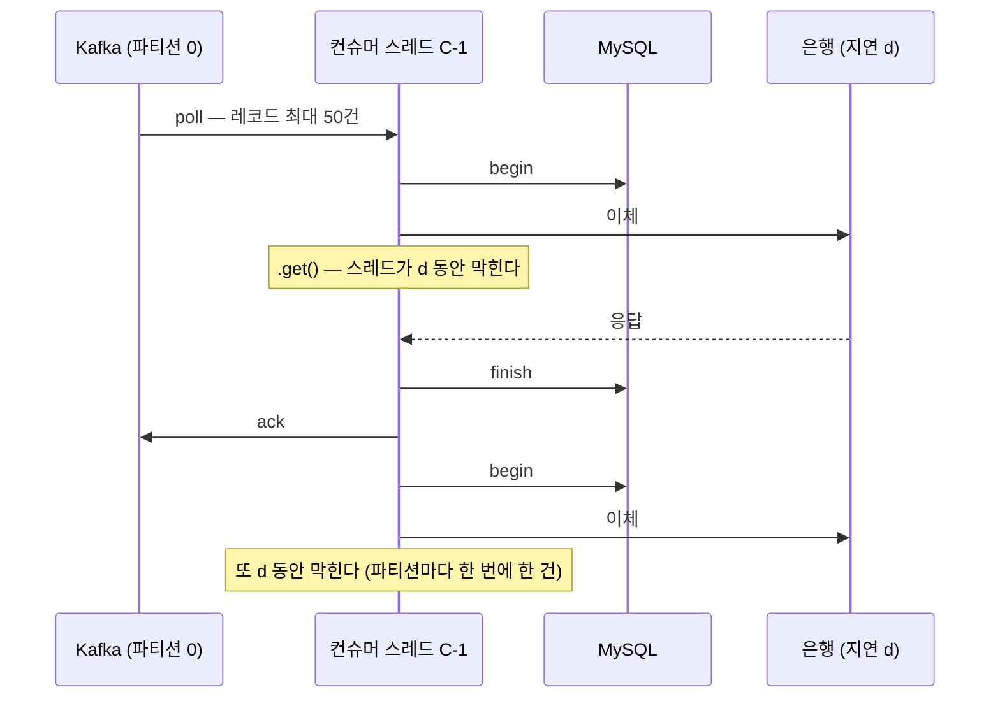
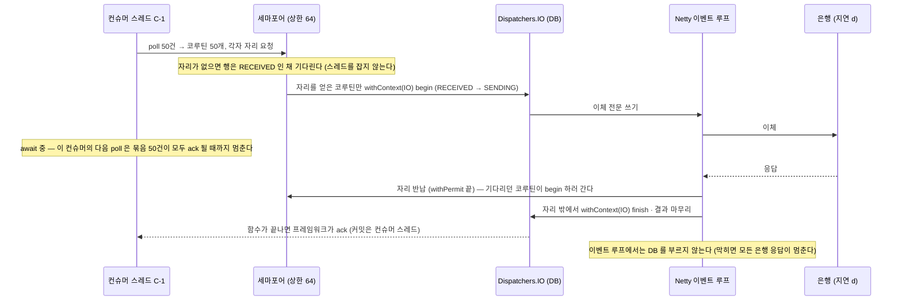
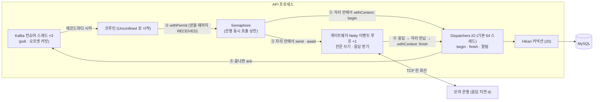
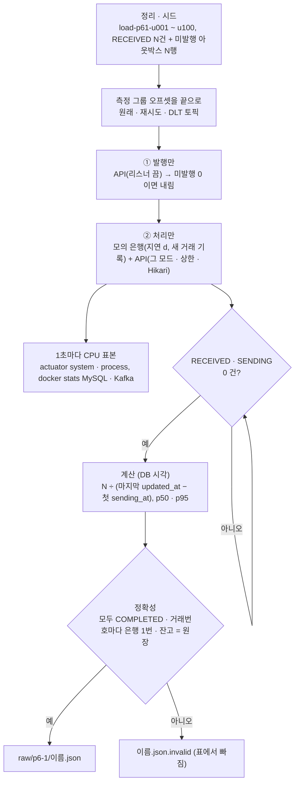
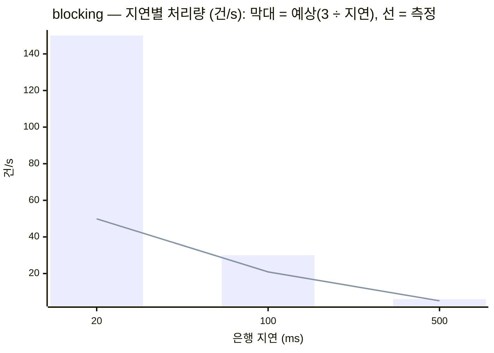
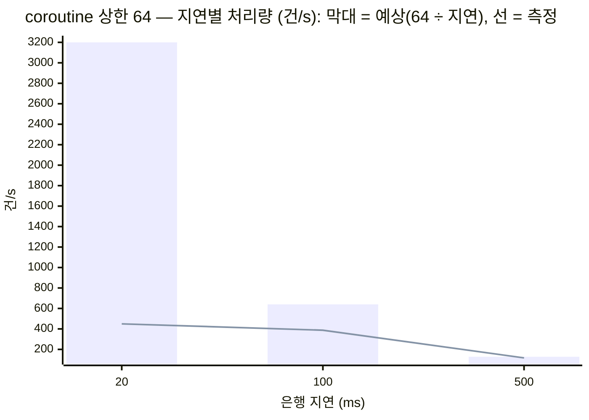
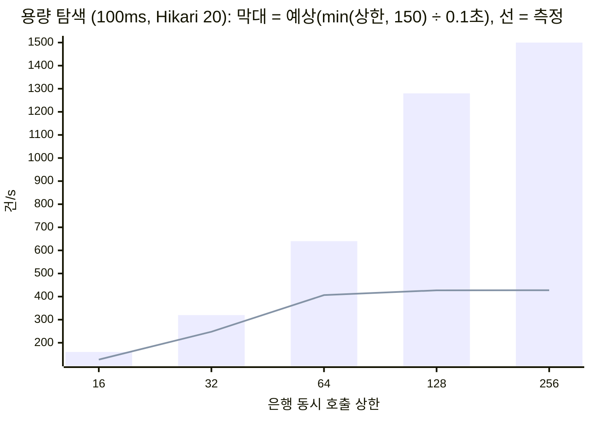

# P6-1 컨슈머 코루틴 — 측정 결과

> 측정: 2026-11-04 16:52 ~ 19:00 · 코드: `a7134e0` · 설계: [P6-1 설계](../superpowers/specs/2026-11-04-p6-1-consumer-coroutines-design.md) · 결정: [ADR-0012](../adr/0012-consumer-coroutines.md) · 절차: [OPERATION §11](../../OPERATION.md#11-컨슈머-모드--코루틴-측정-p6-1)
> 숫자는 **이 PC 기준 상대 비교이며 운영 수치가 아니다.** API · MySQL · Kafka · 모의 은행이 한 PC 의 CPU 를 나눠 쓰고, API 는 인스턴스 하나다.
> 표기: **확인** = JSON · 로그 · 코드로 직접 본 것, **추정** = 그 값들로 계산하거나 추론한 것 (따로 재지 않았다).

## 1. 한 줄 결론
- **은행이 느릴수록 차이가 커진다**: 은행 지연 100ms 에서 blocking 20.9건/s, coroutine(상한 64) 387.3건/s (18.5배). 500ms 에서 5.1 vs 116.8건/s (22.9배). blocking 은 거의 `3 ÷ (은행 지연 + 한 건의 DB · ack 시간 약 20ms)` 그대로다.
- **은행이 빨라도(0 · 20ms) 차이는 남는다**: blocking 87.6 · 49.9건/s, coroutine 448.9 · 449.3건/s. 은행이 바로 답해도 블로킹 스레드는 한 건마다 DB 커밋 · Kafka 커밋을 차례로 기다리기 때문이다 (추정, §8). coroutine 은 지연 0 과 20ms 가 같은 약 449건/s 에서 멈췄다 — 은행이 아니라 **DB 쪽이 천장**으로 본다 (추정, §7-1 — MySQL 컨테이너 CPU 평균 약 95 ~ 98% = 코어 1개 남짓이지만 포화는 아니다: 최대 표본이 100% 를 넘는다. 무엇이 막았는지는 가리지 못함).
- **대조 실험(coroutine · 상한 3 · 100ms)**: 24.4건/s — blocking 20.9 와 같은 자릿수다 (+17%). 차이를 만든 것은 "코루틴이라서" 가 아니라 **동시에 은행을 기다릴 수 있는 수**다. 남은 17% 는 코루틴 판이 `finish` · ack 를 퍼밋 밖에서 해서 다음 건의 은행 대기와 겹치기 때문으로 본다 (추정, §7-6).
- **용량 (지연 100ms)**: 상한 16 → 32 → 64 → 128 → 256 에서 127 → 248 → 406 → 427 → 428건/s. 128 이후 평평하다. 은행 최대 동시는 상한 256 에서도 **정확히 150 (= 컨슈머 3 × `max-poll-records` 50)** — 지금 컨슈머 설정에서 상한 150 초과는 쓸모가 없다. 같은 상한 256 에서 Hikari 10 / 20 / 40 은 282 / 428 / 465건/s — **이 PC 에서 다음 한계는 DB 커넥션 풀(Hikari 로 처리량이 움직임 — 확인)과 그 뒤의 MySQL(추정, §7-2)** 이다. 시스템 CPU 평균은 어느 단계에서도 80% 에 닿지 않았다 (최대 55%).

## 2. 무엇을 왜 재는가
- **막히는 지점**: 출금 컨슈머는 은행 응답을 최대 3초 기다린다. 블로킹 판은 컨슈머 스레드 3개(= 파티션 3)가 기다리는 동안 아무것도 하지 않으므로, 동시에 은행을 기다리는 출금이 3건을 넘지 못한다. 리틀의 법칙으로 처리량 ≈ 동시성 ÷ 지연 = 3 ÷ 은행 응답 시간이다.
- **왜 웹이 아니라 컨슈머인가**: 웹 접수는 DB 에 쓰고 202 로 끝난다 — 은행을 기다리지 않는다. 은행을 기다리는 곳은 컨슈머뿐이고, 그것이 ADR-0005 에 남겨 둔 실제 병목이다. 측정 대상이 하나라 결과가 선명하다. 웹 쪽 비교는 P6-2 · P7.
- **왜 "밀린 N건 비우기" 인가**: 은행 장애가 끝나면 쌓인 출금이 한꺼번에 처리된다 — 컨슈머 처리량이 가장 중요한 순간이다. 발행을 먼저 끝내 두고 처리만 따로 띄우면, 처리량을 DB 시각(첫 `sending_at` ~ 마지막 `updated_at`)으로 재서 API 기동 · 발행 속도가 섞이지 않는다. 평소처럼 "초당 몇 건씩 도착하는" 모양(열린 모델)은 재지 않는다 (§11).
- **왜 대조 실험인가**: coroutine 이 빠르게 나와도 그것이 "코루틴" 때문인지 "동시성" 때문인지는 비교 24회만으로 가를 수 없다. 코루틴 판의 상한을 블로킹과 같은 3 으로 묶어, 동시성만 같게 했을 때 차이가 사라지는지 본다.
- **왜 용량 탐색인가**: 상한을 키우면 언젠가 처리량이 멈춘다. 그때 무엇이 먼저 바닥나는지(은행 동시 수 · poll 묶음 · DB 커넥션 · MySQL · CPU)를 알아야 상한과 풀 크기를 정할 수 있다.

## 3. 그림으로 보기
### 3-1. 은행을 기다리는 모습
블로킹 — 스레드 하나가 한 건씩, 기다리는 동안 아무것도 하지 않는다:

코루틴 — 레코드마다 코루틴, **자리(퍼밋)를 먼저 얻고 그 안에서 begin · 이체**, 기다리는 동안 스레드를 놓는다:

순서가 이런 이유 (ADR-0012 결정 6): 자리를 기다리는 동안 행이 이미 `SENDING` 이면, 30초 넘게 기다릴 때 정리 작업이 먼저 환불하고 그 뒤에 송금될 수 있다. 그래서 `begin`(→ `SENDING`)은 자리 안에서 하고, 자리 하나가 짧은 DB 호출(`begin` 의 조회 + UPDATE)도 함께 덮는다. 이 값이 §7-2 · §8 에서 "상한보다 덜 나오는" 이유 중 하나다.

### 3-2. 시간축 (지연 100ms, 처음 300ms — 예시)

```mermaid
gantt
    title 은행 지연 100ms 일 때 처음 300ms (예시, DB 시간은 뺐다)
    dateFormat x
    axisFormat %L ms
    section blocking C-1
    #1 :0, 100
    #4 :100, 200
    #7 :200, 300
    section blocking C-2
    #2 :0, 100
    #5 :100, 200
    #8 :200, 300
    section blocking C-3
    #3 :0, 100
    #6 :100, 200
    #9 :200, 300
    section coroutine (상한 64)
    #1 ~ #64 :0, 100
    #65 ~ #128 :100, 200
    #129 ~ #150 :200, 300
```

같은 300ms 에 블로킹은 9건, 코루틴은 상한만큼씩 — 단, poll 묶음(컨슈머마다 50건)이 모두 끝나야 다음 묶음이 온다 (§7-3).
**이번 측정에서는** DB 시간이 빠지지 않아 그림보다 적었다: blocking 100ms 는 한 건이 약 144ms(= 3 ÷ 20.9건/s), coroutine 상한 64 는 자리 하나가 약 157 ~ 165ms(= 64 ÷ 406 ~ 387건/s) 동안 잡혔다 (계산, §8).

### 3-3. 스레드 · 디스패처 · 이벤트 루프

### 3-4. 측정 한 회

## 4. 조건
| 항목 | 값 |
|---|---|
| PC | AMD Ryzen 7 9700X (8코어 / 논리 16), 메모리 31.1 GB, Windows 11 Pro, 전원 구성 "균형 조정" |
| Docker Desktop | 29.8.2, WSL2, CPU 16 · 메모리 15.2 GiB (`.wslconfig` 없음 = 기본값) |
| JDK · 앱 | OpenJDK 21.0.12 · `bootJar`, `-Xms1g -Xmx1g`, 컨슈머 3 · 파티션 3 · `max-poll-records` 50 · ack `manual_immediate`(블로킹), 응답 시간 초과 3초, 앱 패키지 로그 WARN, 컨슈머 그룹 `transfer-processor-p61` |
| 끈 것 | 처리 단계의 발행기 · 정리 작업 · 일마감 대사 · 보존 배치 · 은행 점검 시간. 개발용 API · 모의 은행 · IntelliJ 실행 (8080 · 9090 · 9190 포트가 비어 있음을 확인), 측정 중 빌드 · IDE 작업 없음 |
| 인프라 | MySQL 8.4.11 (compose 기본 설정 — P4-2 와 같은 컨테이너), Kafka 4.1, 모의 은행 포트 9190 · 회차마다 새 거래 기록 디렉터리 (`build/load-p61/<이름>/bank-files`) |
| 데이터 | 사용자 100명에 출금 N건(1원, 모의 은행 계좌 → COMPLETED), 미발행 아웃박스 N행. 회차마다 정리 → 시드 → InnoDB 정리 대기 → 측정 그룹 오프셋을 끝으로. 끝난 뒤 `cleanup` (19:00) |
| N | 기본 5,000 · blocking 100ms 1,500 · blocking 500ms 400 · 대조 1,500 · 용량 탐색 20,000. **N 보정** (1회차가 20초 미만인 칸, `ceil(N × 25 ÷ 초 ÷ 1000) × 1000`): coroutine 0ms 12.8초 → **10,000**, coroutine 20ms 11.9초 → **11,000**, coroutine 100ms 13.5초 → **10,000**. 그 세 칸의 1회차는 지우고 새 N 으로 다시 쟀고, 2 · 3회차도 같은 N |
| 지표 | 처리량 = N ÷ (마지막 `updated_at` − 첫 `sending_at`), 건별 p50 · p95 (`updated_at − sending_at`, §7-7), CPU 평균 · 최대 (Actuator 약 1.3 ~ 2초 · `docker stats` 약 2초 간격, 처리 구간 안의 표본만), 은행 최대 동시 (모의 은행) |
| 회차 | 칸마다 3회, 회차를 칸 사이에 번갈아 (비교 · 대조 2 · 3회차 17:12 ~ 17:58). 지표마다 중앙값 (편차 = 처리량 · p95 중 중앙값에서 가장 먼 회차의 차이). 편차가 모두 20% 미만(최대 7%)이라 4 · 5회차는 돌지 않았다 |

## 5. 결과
> 이 PC 기준 상대 비교이며 운영 수치가 아니다.

### 5-1. 비교 — 모드 × 은행 지연
| 모드 | 지연 (ms) | 상한 | Hikari | N | 회차 | 처리량 (건/s) | 예상 (건/s) | p50 (ms) | p95 (ms) | 시스템 CPU 평균 / 최대 (%) | CPU 표본 | API CPU 평균 (%) | MySQL CPU 평균 (%) | 은행 최대 동시 | 편차 |
|---|---|---|---|---|---|---|---|---|---|---|---|---|---|---|---|
| blocking | 0 | - | 20 | 5000 | 3 | 87.6 | - | 12.5 | 17.7 | 26.2 / 38.1 | 42 | 3.0 | 25.1 | 1 | 7% |
| blocking | 20 | - | 20 | 5000 | 3 | 49.9 | 150 | 40.1 | 44.0 | 22.2 / 36.5 | 76 | 1.9 | 16.2 | 3 | 4% |
| blocking | 100 | - | 20 | 1500 | 3 | 20.9 | 30 | 117.5 | 127.3 | 19.8 / 100.0 | 53 | 1.6 | 9.9 | 3 | 3% |
| blocking | 500 | - | 20 | 400 | 3 | 5.1 | 6 | 523.2 | 528.0 | 16.2 / 31.4 | 60 | 1.0 | 4.1 | 3 | 6% |
| coroutine | 0 | 64 | 20 | 10000 | 3 | 448.9 | - | 55.1 | 139.1 | 59.9 / 88.3 | 13 | 12.8 | 94.6 | 1 | 3% |
| coroutine | 20 | 64 | 20 | 11000 | 3 | 449.3 | 3200 | 69.3 | 146.5 | 64.6 / 91.2 | 14 | 12.6 | 98.1 | 64 | 5% |
| coroutine | 100 | 3 | 20 | 1500 | 3 | 24.4 | 30 | 118.0 | 121.7 | 19.0 / 30.2 | 46 | 1.8 | 10.8 | 3 | 6% |
| coroutine | 100 | 64 | 20 | 10000 | 3 | 387.3 | 640 | 130.6 | 158.2 | 61.7 / 100.0 | 15 | 11.5 | 84.5 | 64 | 2% |
| coroutine | 500 | 64 | 20 | 5000 | 3 | 116.8 | 128 | 526.0 | 539.9 | 27.9 / 45.9 | 31 | 5.3 | 27.8 | 64 | 0% |

- 표는 `load/consumer/summarize.sh` 출력 그대로다. "예상" = min(상한 또는 3, 150) ÷ 지연 (리틀의 법칙, DB 시간을 뺀 값). CPU 는 시스템 · API 가 PC 전체(논리 16) 기준 %, MySQL 은 `docker stats` 기준 % (**100% = 코어 1개**).
- 은행 최대 동시: blocking **3** (100 · 20 · 500ms 모두, 3 이하여야 한다 — 확인), coroutine 상한 64 는 **64**, 대조 상한 3 은 **3**. 지연 0ms 칸의 **1** 은 측정 방식 때문이다 — 모의 은행은 지연이 0 이면 응답을 받은 그 자리에서 바로 쓰므로 "기다리는 요청" 이 1을 넘을 수 없다 (`MockBankServer` 코드 확인). 0ms 칸의 은행 동시 수는 읽지 않는다.
- 앱 로그 WARN · ERROR 줄 (`api_warn_error_lines` 중앙값): **5** — 모든 회차가 같은 5줄이고, 기동 때 Spring Batch 의 `AbstractListenerFactoryBean` 경고(ItemStreamReader/Writer 는 인터페이스라 …)다 (로그 확인). 처리 중 경고 · 오류는 없었다 (한 회차 예외 — 아래 이상 회차).
- 이상 회차: `.invalid` 없음 (49회 모두 정확성 확인 통과, 다시 돈 회차 없음 — 단, N 보정으로 지운 1회차 3개는 있다). 기록할 것 두 가지:
  - `coroutine-d100-c128-h20-sweep2` (용량 탐색) 은 WARN · ERROR 가 11줄이다. 늘어난 6줄은 18:32:56 의 Kafka 오프셋 커밋 실패 (`The server experienced an unexpected error` → `This is not the correct coordinator` → `The coordinator is loading`) — 브로커 쪽 그룹 코디네이터가 잠깐 바뀐 것으로 보인다 (추정). 그 회차도 정확성(거래번호마다 은행 한 번)을 통과했고 처리량 426.4건/s 는 다른 두 회차(427.8 · 427.1)와 같다 — 표에 그대로 둔다.
  - 시스템 CPU **최대 100.0** 은 JSON 16개 회차에서 나오는데, 모두 `cpu.txt` 의 **첫 표본**이 정확히 1.0 인 경우다 (앞뒤 표본은 20 ~ 80%, 확인). 첫 표본이 1.0 인 `cpu.txt` 는 17개지만 `coroutine-d20-c64-h20-1` 은 그 표본이 처리 구간 밖이라 평균 · 최대에 들어가지 않았다 (그 회차 최대 91.2%). API 를 막 띄운 직후 Actuator 의 첫 `system.cpu.usage` 값으로 보이며 (추정) 해석에 쓰지 않는다. 표본이 13 ~ 16개인 짧은 칸(coroutine 0 · 20 · 100ms 비교)은 이 한 표본이 평균을 최대 약 3%p 끌어올릴 수 있다.
- CPU 표본 수: coroutine 비교 칸(0 · 20 · 100ms)은 처리 구간이 22 ~ 26초라 Actuator 표본 12 ~ 16개, `docker stats` 표본 약 11 ~ 13개다 — CPU 평균은 다른 칸보다 거칠다.
- drift: 마지막(18:59)에 blocking 100ms 를 다시 돌린 값 **21.4건/s · p95 122.5ms** — 중앙값 20.9 와 +2%, 1회차(20.5)와 +4%. 2시간 동안 PC 상태가 한쪽으로 흐르지 않았다. 원본 `raw/p6-1/blocking-d100-h20-drift.json` (표에는 넣지 않았다).

(`xychart-beta` 는 Mermaid 의 베타 문법이라 보는 곳에 따라 그려지지 않을 수 있다. 같은 값이 §6 표에 있다.)

## 6. 예상과 비교 (리틀의 법칙: 처리량 = 동시성 ÷ 지연)
| 칸 | 동시성 | 예상 (건/s) | 측정 (건/s) | 비율 | 다르면 이유 |
|---|---|---|---|---|---|
| blocking 0ms | 3 | - | 87.6 | - | 은행 대기가 없어도 한 건에 약 34ms (= 3 ÷ 87.6). p50 12.5ms + 창 밖 약 22ms (§8-1) |
| blocking 20ms | 3 | 150 | 49.9 | 33% | 한 건 60ms = 은행 20 + DB · 왕복 약 20 (p50 40.1) + 창 밖 약 20ms. 은행이 빠를수록 DB 비중이 커서 예상과 멀다 |
| blocking 100ms | 3 | 30 | 20.9 | 70% | 한 건 144ms = p50 117.5 + 창 밖 약 26ms |
| blocking 500ms | 3 | 6 | 5.1 | 85% | 한 건 588ms = p50 523 + 창 밖 약 65ms. 창 밖이 다른 칸보다 큰 것은 N 400 이 파티션 3개에 고르지 않게 나뉘어 가장 많은 파티션이 끝을 정하기 때문으로 본다 (추정, §7-5) |
| coroutine 0ms | 64 | - | 448.9 | - | DB 쪽이 천장 (§7-1) |
| coroutine 20ms | 64 | 3,200 | 449.3 | 14% | 0ms 와 같은 값 — 은행이 아니라 DB 쪽이 천장. 예상은 DB 를 뺀 값이라 의미가 없다 |
| coroutine 100ms | 64 | 640 | 387.3 | 61% | 자리 하나가 약 165ms (= 64 ÷ 387.3) 잡혔다: 은행 100 + 자리 안의 `begin`(조회 + UPDATE, 커넥션 대기 포함). DB 가 바빠 그 시간이 길다 (§7-2, §8-2) |
| coroutine 500ms | 64 | 128 | 116.8 | 91% | 자리 하나가 약 548ms = 은행 500 + 약 48ms. 지연이 크면 DB 몫이 작아져 예상에 가깝다 |
| 대조 coroutine 상한 3 · 100ms | 3 | 30 | 24.4 | 81% | 자리 하나가 약 123ms. blocking 의 144ms 보다 짧다 — `finish` · ack 가 자리 밖이라서 (§7-6) |

## 7. 나타날 수 있는 현상과 읽는 법
### 7-1. 지연 0ms 에서 두 모드가 비슷하다
은행이 바로 답하면 기다림이 없어 동시성의 이점이 없다. 그때 한 건의 비용은 DB 왕복(`begin` 의 조회 + UPDATE, `finish` 의 UPDATE — 각각 커밋) · Kafka 커밋 · 전문 왕복이고, 병목은 DB 다. 코루틴은 디스패처 전환(`withContext` 두세 번)만큼 조금 느릴 수도 있다. **읽는 법**: 지연 0 의 처리량은 "이 PC 의 DB 한계" 로 보고 MySQL CPU · 시스템 CPU 를 같이 본다.

**이번 측정에서는 비슷하지 않았다**: blocking 87.6 vs coroutine 448.9건/s (5.1배).
- blocking 0ms 는 DB 한계가 아니다: MySQL 25%(코어 4분의 1), 시스템 CPU 26%, API 3% 로 아무것도 차지 않았다 (확인). 한 건이 약 34ms 걸리고 파티션마다 한 건씩이라 3 ÷ 34ms ≈ 88건/s — 막힌 곳은 자원이 아니라 **한 건 안의 기다림을 차례로 하는 것**이다. 그 34ms 의 대부분은 커밋 두 번(출금 UPDATE 두 번)과 Kafka 오프셋 커밋(`manual_immediate`)으로 본다 (추정 — 커밋 하나에 약 10ms 는 p50 12.5ms 와 P4-2 의 "한 건 약 9.5ms" 와 맞는다. 따로 재지는 않았다). 즉 "은행 대기" 가 0 이어도 **DB · Kafka 대기** 가 남아, 동시성의 이점이 그대로 산다.
- coroutine 0ms 와 20ms 는 448.9 · 449.3건/s 로 같다 (편차 3 · 5%) — 은행 지연과 무관한 천장이다. 그때 MySQL 컨테이너 CPU 평균 94.6 · 98.1% (0ms 1회차 `docker.txt` 의 처리 중 표본은 약 95 ~ 106% 로 평평, 확인), API 13%, 시스템 60 ~ 65%. 천장이 MySQL 인 것은 거의 확실하지만, **CPU 가 모자라서인지는 이 측정으로 가리지 못한다**: MySQL 은 코어를 더 쓸 수 있고(0 · 20ms 회차별 최대 표본 112 ~ 139%, Hikari 40 에서는 최대 174%), Docker 에는 CPU 16 이 있다. 커밋마다 redo 로그 · binlog 를 디스크에 쓰는 비용(P4-2 와 같은 기본 설정)과 커넥션 20개가 함께 막는 것으로 본다 (추정, §7-2 의 Hikari 결과가 근거).
- Hikari 대기 경고는 로그에 없다 (`Connection is not available` 0줄, 확인). 다만 Hikari 는 커넥션을 30초(기본 `connection-timeout`) 못 받을 때만 남기므로, **경고가 없다는 것이 대기가 없었다는 뜻은 아니다.**

### 7-2. 상한을 키우면 다음 한계가 DB 로 넘어간다 (커넥션 풀까지는 확인, 그 너머 MySQL 은 추정)
동시에 은행을 기다리는 수가 늘면 응답이 몰려 `finish` 가 한꺼번에 온다. DB 호출은 `Dispatchers.IO`(기본 64 스레드)에서 Hikari 커넥션(20)을 기다린다. 상한 128 · 256 에서 처리량이 늘지 않고 p95 가 커지면 커넥션 대기다 — 처리량 ≤ 커넥션 수 ÷ DB 한 건 시간. Hikari 10 / 20 / 40 단계가 이것을 확인한다: 커넥션이 병목이면 Hikari 에 따라 처리량이 움직이고, 아니면 그대로다.

**이번 측정에서는 그대로 나타났다**:
- 상한 64 → 128 → 256: 406.4 → 427.1 → 427.6건/s, p95 153 → 201 → 202ms, p50 129 → 137 → 137ms (확인). 처리량은 멈추고 한 건 지연만 늘었다.
- Hikari 10 / 20 / 40 (상한 256): 282.3 / 427.6 / 464.8건/s, MySQL CPU 60 / 87 / 101% (확인). 10 → 20 은 +51%, 20 → 40 은 +8.8% — **20 까지는 커넥션 풀이 한계, 그 위는 MySQL 쪽이 한계**로 본다 (추정, §7-1 — Hikari 에 따라 처리량이 움직인 것은 확인, 20 위에서 MySQL 이 막았다는 것은 정황).
- 계산으로 보면 (추정 — 풀이 늘 꽉 차 있었다고 가정, Hikari 지표는 수집하지 않았다): 한 건이 커넥션을 3번 쓴다 (`begin` 의 조회 · UPDATE, `finish` 의 UPDATE — 코드 확인). 커넥션 한 번을 쥐는 시간 = 풀 크기 ÷ (처리량 × 3) = Hikari 10: 11.8ms, 20: 15.6ms, 40: 28.7ms. 커넥션을 두 배로 늘리자 한 번 쥐는 시간도 거의 두 배가 됐다 — **늘린 커넥션은 MySQL 안에서 기다렸다.**

### 7-3. poll 묶음 50건 중 가장 늦은 건이 다음 묶음을 붙잡는다
비동기 ack 는 이전 poll 의 오프셋이 모두 커밋될 때까지 그 컨슈머를 멈춘다 (실험 ②). 묶음 단위로 "출발 → 모두 도착 → 다음 출발" 이라 처리량 상한은 대략 컨슈머 3 × 50 ÷ (지연 + 묶음 마무리 시간)이다. 모의 은행은 고정 지연이라 꼬리가 짧지만, 실제 은행처럼 응답이 들쭉날쭉하면 가장 늦은 한 건이 묶음 전체를 늦춘다 (측정 밖 — §11). **읽는 법**: "은행 최대 동시" 가 상한(64)보다 작거나 150 근처에서 멈추면 이 효과다.

**이번 측정에서는**: 상한 128 은 은행 최대 동시 128, 상한 256 은 Hikari 10 · 20 · 40 아홉 회차 **모두 정확히 150** 이었다 (확인 — JSON `bank_peak`, 예로 `coroutine-d100-c256-h20-sweep1` 의 모의 은행 로그 마지막 기록 `peak pending responses: 150`). 150 = 컨슈머 3 × `max-poll-records` 50 이고, Task 1 실험 ②(`SuspendListenerExperimentTest`)가 처리 중 레코드가 정확히 150 에서 멈추는 것을 보였다 — 같은 장치로 본다 (수치 150 은 확인, 실험 ② 가 뒷받침하지만 이 측정에서 장치를 직접 본 것은 아니라 메커니즘은 추정). 그래서 **지금 컨슈머 설정에서는 상한을 150 넘게 줘도 은행 동시 수가 늘지 않는다.** 다만 지연 100ms 에서는 상한 128(동시 128)과 256(동시 150)의 처리량이 같아(427.1 vs 427.6) 150 천장보다 DB 천장이 먼저였다. 150 천장이 처리량을 정하는 것은 은행이 느릴 때다 — 지연 500ms 면 아무리 키워도 150 ÷ 0.5초 = 300건/s 가 끝이다 (계산, 측정 안 함).

### 7-4. CPU 가 먼저 찰 수 있다
부하를 만드는 쪽(모의 은행 · Kafka)과 인프라(MySQL)가 API 와 같은 CPU 를 쓴다. 시스템 CPU 평균이 80% 에 닿은 단계는 "API 의 한계" 가 아니라 "이 PC 의 한계" 다 — 그래서 용량 탐색의 멈춤 조건이다. API CPU 와 MySQL CPU 를 나눠 본다.

**이번 측정에서는 CPU 가 먼저 차지 않았다**: 시스템 CPU 평균은 비교에서 최대 64.6%(coroutine 20ms, 한 회차 73.3%), 용량 탐색에서 최대 55.1% — 80% 멈춤에 한 번도 닿지 않았다 (확인). API 프로세스는 PC 전체의 15% 이하(칸별 중앙값 최대 12.8%, 코어 2개 남짓). 가장 바쁜 것은 늘 MySQL 이었다 (coroutine 에서 코어 1개 안팎). Kafka 는 부하와 무관하게 평균 30 ~ 65%, 순간 최대 180 ~ 260% 를 오갔다 — blocking 500ms(가장 한가한 칸)에서도 같아서 처리량과는 관계없는 주기적 작업으로 본다 (추정).

### 7-5. 지연이 크면 리틀의 법칙이 그대로 보인다
블로킹 500ms 는 거의 정확히 6건/s(3 ÷ 0.5)여야 한다 — DB 시간이 지연에 비해 작아서다. 크게 다르면 측정 조건(다른 인스턴스 · 오프셋 · 스케줄)을 먼저 의심한다.

**이번 측정에서는** 5.1건/s(85%)였다. 한 건의 창 밖 시간 약 20ms(DB · ack, 0 · 20ms 칸에서 본 값)를 더하면 3 ÷ 0.543초 = 5.5건/s 이고, 남은 약 8% 는 N 400 이 파티션 3개에 고르게 나뉘지 않은 탓으로 본다 (추정): key 가 출금 UUID 라 파티션마다 133건 안팎(표준편차 약 9건)이 되고, 블로킹은 파티션마다 한 줄로 처리하므로 **가장 많이 받은 파티션이 끝 시각을 정한다** (파티션별 건수는 기록하지 않았다). 측정 조건 문제는 아니다: 다른 인스턴스 없음 · 3회 편차 6% · p50 523ms(= 500 + 23)가 다른 칸과 같은 모양이다. coroutine 500ms 는 116.8건/s 로 예상 128 의 91% — 파티션과 무관하게 64자리를 나눠 쓰므로 이 쏠림이 거의 없다.

### 7-6. 대조 실험을 읽는 법
코루틴 · 상한 3 이 블로킹과 비슷하면 차이를 만든 것은 "코루틴이라서" 가 아니라 **동시에 은행을 기다릴 수 있는 수**다. 상한 3 이 블로킹보다 조금 빠를 수 있다: 블로킹은 한 컨슈머가 자기 파티션만 보지만 상한 3 은 파티션과 무관하게 3건을 함께 보내고, DB 시간이 다른 건의 은행 대기와 겹친다.

**이번 측정에서는**: 상한 3 = 24.4건/s, blocking = 20.9건/s (+17%), 은행 최대 동시는 둘 다 3, p50 은 118.0 vs 117.5ms 로 같다 (확인). 64 로 열면 387.3건/s 이니, 18배 차이 중 코루틴 자체가 만든 몫은 거의 없다. +17% 는 자리 하나를 쥐는 시간 차이로 본다 (추정 — 아래 144 · 123ms 는 3 ÷ 처리량을 고쳐 쓴 값이고, 자리 밖에서 하는 일은 코드로 확인): blocking 은 한 건마다 begin · 은행 · finish · ack 를 다 끝내야 다음 건이라 약 144ms, 상한 3 은 자리를 begin 부터 은행 응답까지만 쥐고 finish · ack 는 자리 밖에서 하므로 약 123ms (= 3 ÷ 24.4). 차이 약 21ms 가 §8-1 의 "창 밖 약 20ms" 와 맞는다 (추정 — 같은 시간이라는 것은 계산으로만 맞춰 봤다).

### 7-7. p50 · p95 는 `begin` 의 UPDATE 부터 `finish` 시작까지다
건별 지연은 `updated_at − sending_at` 이다. 두 시각 모두 앱이 DB 에 가기 **전에** 정한다 (`TransferProcessor` 가 `clock.instant()` 를 구한 뒤 저장소를 부른다 — 코드 확인):
- `sending_at` = `begin` 이 조회를 마치고 `RECEIVED → SENDING` UPDATE 를 하려는 순간 (그 UPDATE 의 커넥션 대기 · 커밋은 **들어간다**).
- `updated_at` = 은행 응답 뒤 `finish` 가 (IO 스레드에서) 시작하는 순간 (`finish` 의 커넥션 대기 · UPDATE · 커밋, ack 는 **빠진다**).
- 그래서 **빠지는 것**: Kafka 에서 기다린 시간, 코루틴의 **세마포어 대기**(퍼밋을 받은 뒤에 `begin` 하므로 기다리는 동안은 `sending_at` 이 아직 없다, 커밋 02e1b51), `begin` 의 조회, `finish` 의 DB 시간.
- **들어가는 것**: `begin` UPDATE (커넥션 대기 포함) + 은행 왕복(지연 d) + 응답 뒤 IO 스레드를 얻기까지.

블로킹의 p50 ≈ 지연 + 12 ~ 23ms(커밋 하나 + 전문 왕복), 코루틴은 DB 가 바쁘면 `begin` 의 커넥션 대기가 늘어 더 커진다. 처리량과 지연을 같이 본다 — "빨리 비우지만 한 건은 더 오래 걸린다" 가 정상일 수 있다.

**이번 측정에서는**: 지연을 뺀 p50 이 blocking 12.5 / 20.1 / 17.5 / 23.2ms (0 / 20 / 100 / 500), coroutine 상한 64 는 55.1 / 49.3 / 30.6 / 26.0ms — DB 가 가장 바쁜 0 · 20ms 칸에서 가장 컸다. 용량 탐색에서 Hikari 10 은 p50 180ms(지연 빼고 80ms)로, 커넥션이 모자랄 때 `begin` 이 기다린 것이 그대로 보인다 (확인 — 값, 원인은 추정). 반대로 Hikari 40 은 p50 145ms 로 20(137ms)보다 조금 길고 p95 는 182 vs 202ms 로 짧다 — 커넥션 대기가 줄고 MySQL 안의 대기가 는 것으로 본다 (추정).

### 7-8. 첫 회차가 느리면
JIT 워밍업 · 커넥션 풀 데우기다. 회차마다 API 를 새로 띄우므로 모든 회차에 같이 들어가고, 중앙값으로 본다.

**이번 측정에서는 1회차가 더 느린 경향이 없었다** (예: blocking 0ms 87.6 / 84.0 / 88.9, coroutine 20ms 449.3 / 427.0 / 450.7 — 가장 느린 것은 2회차). 대신 **같은 설정을 N 만 바꿔 잰 값이 달랐다**: coroutine 100ms 상한 64 가 N 10,000(비교) 387.3건/s, N 20,000(용량 탐색) 406.4건/s (+5%). 처리 구간이 26초 → 49초로 길어져 기동 직후의 느린 몇 초(워밍업)가 차지하는 몫이 줄었기 때문으로 본다 (추정). 그래서 §5 와 §9 의 값은 같은 표에 섞지 않는다.

### 7-9. 지연 0ms 의 "은행 최대 동시 1"
§5-1 의 주석 그대로 — 모의 은행이 지연 0 이면 기다리는 요청을 세지 못한다. 0ms 칸에서 은행 동시 수로 동시성을 판단하지 않는다.

## 8. 해석
### 8-1. 블로킹 = 3 ÷ (한 건 시간), 한 건 시간 = 은행 지연 + 약 20 ~ 25ms
| 지연 | 처리량 | 한 건 시간 (3 ÷ 처리량) | p50 | 차이 (창 밖) |
|---|---|---|---|---|
| 0ms | 87.6 | 34.2ms | 12.5ms | 21.7ms |
| 20ms | 49.9 | 60.1ms | 40.1ms | 20.0ms |
| 100ms | 20.9 | 143.5ms | 117.5ms | 26.0ms |
| 500ms | 5.1 | 588.2ms | 523.2ms | 65.0ms (§7-5) |

- (확인) 블로킹의 은행 최대 동시는 늘 3, 자원은 하나도 차지 않았다 (시스템 CPU 16 ~ 26%, MySQL 4 ~ 25%). 처리량은 동시성 3 과 한 건 시간만으로 정해졌다.
- (추정) "창 밖" 약 20ms 는 p50 창에 들어가지 않는 일 — `begin` 의 조회, `finish` UPDATE 커밋, Kafka 오프셋 커밋(`manual_immediate`), 다음 레코드로 넘어가기 — 이다. 은행이 빠를수록 이 고정 비용의 비중이 커서 예상(3 ÷ 지연)과 멀어진다 (20ms 에서 33%, 500ms 에서 85%).

### 8-2. 코루틴 = min(상한, 150) ÷ (자리 하나 쥐는 시간), 그리고 DB 천장

- (확인) 지연 100ms · Hikari 20 에서 상한 16 → 32 는 127.1 → 247.8 (×1.95, 거의 비례), 32 → 64 는 406.4 (×1.64), 64 → 128 은 427.1 (×1.05), 128 → 256 은 427.6. 자리 하나를 쥐는 시간(= 상한 ÷ 처리량, 자리가 늘 찼다고 보고 계산)은 126 → 129 → 157 → 300ms 로 늘었다. (추정) 64 부터 DB 대기가 끼어들기 시작한 것으로 본다.
- (확인) coroutine 0 · 20ms 가 449건/s, 지연 100ms 의 상한 128 · 256 이 427건/s 에서 멈췄다 — 은행 지연이 달라도 비슷한 천장이다. 이것이 Hikari 20 에서 이 PC 의 DB(출금 한 건 = 커밋 2번 + 조회 1번)가 낼 수 있는 처리량으로 본다 (추정: 천장의 위치는 확인, 무엇이 막았는지는 §7-1 · §7-2 의 정황).
- (추정) 상한 64 에서 자리 하나가 약 157 ~ 165ms 인 것은 은행 100ms + 자리 안의 `begin`(조회 · UPDATE 와 그 커넥션 대기)이다. 퍼밋을 `begin` 보다 먼저 받기로 한 값(ADR-0012 결정 6)이 여기서 보인다 — DB 가 한가하면 몇 ms, 바쁘면 수십 ms 다. 이 값은 "환불 뒤 송금" 을 막는 안전 비용이라 바꾸지 않는다.
- (확인) 지연 500ms 는 DB 가 한가해(MySQL 28%) 116.8건/s = 예상 128 의 91%.

### 8-3. 코루틴이 이긴 이유는 "동시성", 진 곳은 없다 (이 측정 범위에서)
- (확인) 대조 실험(상한 3)이 blocking 과 같은 자릿수(24.4 vs 20.9)라 차이의 거의 전부는 동시성이다. 코루틴은 그 동시성을 **스레드를 늘리지 않고** 얻는 방법이다 — API 프로세스 CPU 는 coroutine 이 가장 바쁜 칸에서도 PC 의 약 13% (중앙값).
- (확인) 이 측정의 모든 칸에서 coroutine 이 blocking 이상이었다. 은행이 빠른 칸에서 "코루틴 전환 비용으로 조금 느릴 수 있다" 는 예상(§7-1)은 나타나지 않았다 — 블로킹도 DB · Kafka 를 차례로 기다리므로 그 기다림을 겹치는 이득이 전환 비용보다 컸다 (추정).
- 대가는 측정 밖에 있다: 같은 파티션 순서를 지키지 않고(ADR-0012 결정 8), 스레드 경계를 손으로 지켜야 하며, 동시에 쏟는 양만큼 DB 와 은행에 몰린다.

## 9. 용량 탐색 — 어디가 먼저 바닥나나
### 9-1. 표
> 이 PC 기준 상대 비교이며 운영 수치가 아니다. coroutine · 지연 100ms · N 20,000.

| 모드 | 지연 (ms) | 상한 | Hikari | N | 회차 | 처리량 (건/s) | 예상 (건/s) | p50 (ms) | p95 (ms) | 시스템 CPU 평균 / 최대 (%) | CPU 표본 | API CPU 평균 (%) | MySQL CPU 평균 (%) | 은행 최대 동시 | 편차 |
|---|---|---|---|---|---|---|---|---|---|---|---|---|---|---|---|
| coroutine | 100 | 16 | 20 | 20000 | 3 | 127.1 | 160 | 118.9 | 132.8 | 29.1 / 55.8 | 114 | 2.6 | 30.9 | 16 | 1% |
| coroutine | 100 | 32 | 20 | 20000 | 3 | 247.8 | 320 | 120.5 | 133.7 | 38.8 / 62.4 | 56 | 4.7 | 53.3 | 32 | 1% |
| coroutine | 100 | 64 | 20 | 20000 | 3 | 406.4 | 640 | 128.7 | 153.0 | 51.2 / 88.5 | 32 | 8.2 | 84.7 | 64 | 1% |
| coroutine | 100 | 128 | 20 | 20000 | 3 | 427.1 | 1280 | 137.4 | 200.8 | 55.1 / 100.0 | 30 | 7.8 | 88.5 | 128 | 2% |
| coroutine | 100 | 256 | 10 | 20000 | 3 | 282.3 | 1500 | 180.4 | 282.3 | 39.0 / 62.2 | 49 | 4.8 | 60.1 | 150 | 2% |
| coroutine | 100 | 256 | 20 | 20000 | 3 | 427.6 | 1500 | 137.3 | 202.3 | 54.8 / 100.0 | 30 | 8.0 | 87.4 | 150 | 4% |
| coroutine | 100 | 256 | 40 | 20000 | 3 | 464.8 | 1500 | 145.0 | 182.1 | 53.4 / 100.0 | 27 | 8.7 | 101.0 | 150 | 3% |

- 멈춘 단계와 이유: **상한 256 에서 멈춤 — 처리량 증가 5% 미만** (128 → 256: 427.1 → 427.6, +0.1%). 64 → 128 은 +5.1% 로 기준을 겨우 넘어 한 단계 더 갔다. CPU 80% (최대 55.1%) · 오류(.invalid 0, 시간 초과 0, WARN · ERROR 는 위 Kafka 코디네이터 한 번뿐)로 멈춘 것은 아니다.
- 가장 좋았던 상한: 규칙("멈춘 단계까지에서 처리량 중앙값이 가장 큰 상한")으로 **256** (427.6). 다만 128 (427.1) 과 0.1% 차이라 **사실상 같다** — 256 이 128 보다 낫다는 뜻이 아니다. 은행 동시 수가 150 에서 막히므로 256 은 실제로는 "150" 과 같다.
- 그때 Hikari 10 / 20 / 40: **282.3 / 427.6 / 464.8건/s** (p95 282 / 202 / 182ms). Hikari 40 도 시스템 CPU 평균 53.4% 로 80% 멈춤에 걸리지 않았다.
- 먼저 바닥난 자원 (확인한 것과 추정을 나눈다):
  - (확인) 은행 동시 수: 상한 256 에서 150 에 막혔다.
  - (추정) 그 원인은 poll 묶음 정지다 (§7-3, 실험 ②).
  - (확인) DB 커넥션 풀이 처리량을 움직인다: Hikari 10 → 20 에서 +51%.
  - (확인) MySQL 컨테이너 CPU 가 가장 높다: Hikari 20 · 40 의 상한 64 이후 85 ~ 101% (코어 1개 안팎, Hikari 10 은 60%), API 는 약 8 ~ 9% (같은 칸의 중앙값 7.8 ~ 8.7, Hikari 10 은 4.8%).
  - (추정) Hikari 20 → 40 이 +8.8% 에 그친 것, 그리고 커넥션 한 번 쥐는 시간이 15.6 → 28.7ms 로 늘어난 것(§7-2)으로 보아, 풀 다음은 **MySQL 의 커밋 처리**가 막는다. CPU 부족인지 디스크 쓰기(redo · binlog) 직렬화인지는 이 측정으로 가리지 못한다.
  - (확인) Hikari 를 바꾸면 처리량이 움직였다 (10 / 20 / 40 → 282 / 428 / 465).
  - (추정) `Dispatchers.IO`(64) 는 이번 탐색의 한계가 아니었다 — 커넥션이 40 이하라 64 보다 작다. IO 스레드 수는 바꿔 보지 않았다.
- blocking 은 탐색하지 않았다 — 파티션 수(3)에서 막히는 것 자체가 결과다 (동시성 3 은 상한 · 풀과 무관하다).

## 10. 언제 무엇을 쓰나
- **은행(외부 I/O) 응답이 느리고 DB 에 여유가 있을 때**: coroutine. 지연 100ms 에서 18.5배, 500ms 에서 22.9배. 블로킹으로 같은 동시성을 얻으려면 파티션 · 컨슈머를 그만큼 늘려야 한다 (예: 지연 100ms 에 400건/s 면 파티션 약 60개 — 계산, 측정 안 함).
- **은행이 빠를 때 (0 ~ 20ms)**: 이 PC 에서는 그래도 coroutine 이 5 ~ 9배 — 블로킹이 DB · Kafka 커밋을 차례로 기다리기 때문이다. 다만 천장은 DB 라 상한을 키워도 늘지 않는다. 이때는 상한보다 **DB(풀 · 커밋 비용)** 를 본다.
- **상한 정하기**: 처리량이 아니라 **은행이 허용하는 기관별 동시 요청 수**로 정한다. 이 PC 에서는 64 → 128 이 +5% 뿐이었고, 150 을 넘기면 아무 효과가 없다 (poll 묶음). 기본 64 는 그대로 쓸 만하다.
- **Hikari**: 상한을 키우면 풀도 같이 본다. 상한 256 · Hikari 10 은 Hikari 20 보다 34% 느렸다. 20 → 40 은 +8.8% 에 MySQL CPU 87 → 101% — 풀을 키우면 대기가 MySQL 안으로 옮겨 갈 뿐이다. 웹 요청 · 정리 작업 · 배치도 같은 풀을 쓰므로 컨슈머만 보고 키우지 않는다.
- **150 천장을 올리려면** (모두 측정하지 않은 선택지): ① 파티션과 컨슈머(또는 인스턴스)를 함께 늘린다 — 천장 = 실제로 배정받은 컨슈머 수 × `max-poll-records` 이고, 파티션이 3 이면 인스턴스를 늘려도 컨슈머는 3개뿐이다. ② `max-poll-records` 를 늘린다 — 처리 중 메시지가 늘어 장애 때 다시 오는 양 · 리밸런스 시간도 커진다. ③ 둘 다 DB 천장(이 PC 약 450건/s)보다 은행이 느릴 때만 의미가 있다 — 지연 100ms 에서는 이미 DB 가 먼저 막았다. 150 천장이 먼저 오는 것은 대략 은행 지연이 150 ÷ 450건/s ≈ 330ms 를 넘을 때다 (계산).
- **운영 기본값**: 이 PR 에서는 `blocking` 그대로 둔다 (설계 §8). 판단은 ADR-0012 결과 절에 적었다.

## 11. 한계
- 한 PC · API 인스턴스 하나 (상대 비교만). 서버 여러 대의 효과(인스턴스 사이 경합 · 네트워크 · 로드밸런서)는 재지 않았다.
- 모의 은행은 고정 지연이다 — 실제 은행의 들쭉날쭉한 응답(꼬리 지연)은 §7-3 의 묶음 효과를 더 키울 수 있다.
- "밀린 N건 비우기" 만 쟀다. 평소처럼 초당 몇 건씩 도착하는 모양(열린 모델)은 웹 비교(P6-2 · P7)에서 다룬다.
- 은행 게이트웨이는 단일 연결 · 이벤트 루프 1개다. 상한을 크게 키우면 그 한 회선이 병목일 수 있다 (구조는 바꾸지 않았다). 이번에는 은행 동시 150 까지 그 징후(처리량 하락 · 오류)는 보지 못했다.
- 지표마다 따로 낸 중앙값이라 한 행의 값들이 같은 회차에서 나온 것은 아니다.
- Hikari 활성 · 대기 커넥션 수, MySQL 내부 지표(커밋 지연 · 디스크 쓰기)는 수집하지 않았다 — "DB 가 한계" 의 세부(풀 · CPU · 디스크)는 정황으로만 나눴다.
- coroutine 비교 칸(0 · 20 · 100ms)은 처리 구간이 22 ~ 26초라 CPU 표본이 12 ~ 16개로 적다. 같은 설정도 N 에 따라 약 5% 달랐다 (§7-8).
- 파티션별 레코드 수는 기록하지 않아 blocking 500ms 의 쏠림(§7-5)은 확인하지 못했다.

## 12. 원자료
- [raw/p6-1/](raw/p6-1/) — `<모드>-d<지연>[-c<상한>]-h<hikari>-<회차>.json` (회차가 숫자 = 비교 · 대조 27개, `sweep…` = 용량 탐색 21개, `drift` = 마지막 재측정 1개, 모두 49개). 표는 `bash load/consumer/summarize.sh` 로 다시 만든다.
- 회차별 로그 · CPU 표본(`api-process.log` · `mock-bank.log` · `cpu.txt` · `docker.txt`)은 `build/load-p61/<이름>/` 에 남겼고 저장소에는 넣지 않았다.
