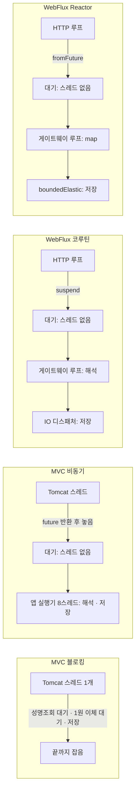
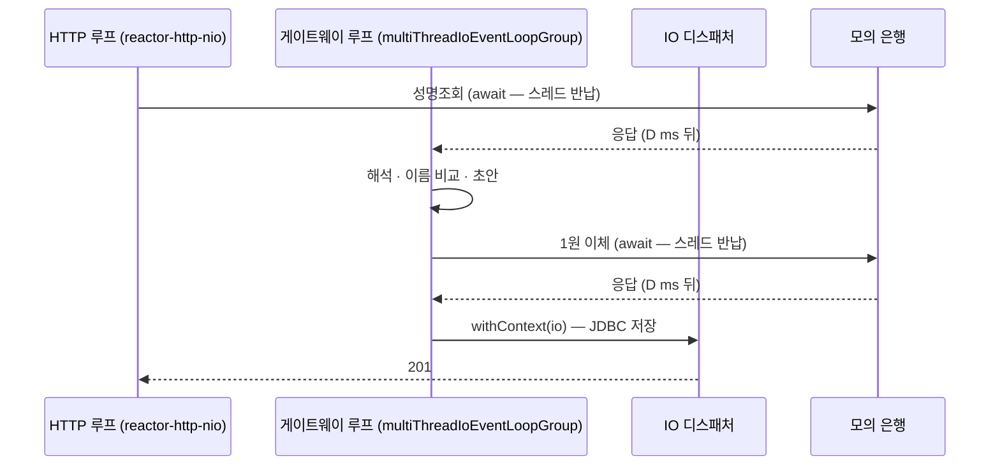
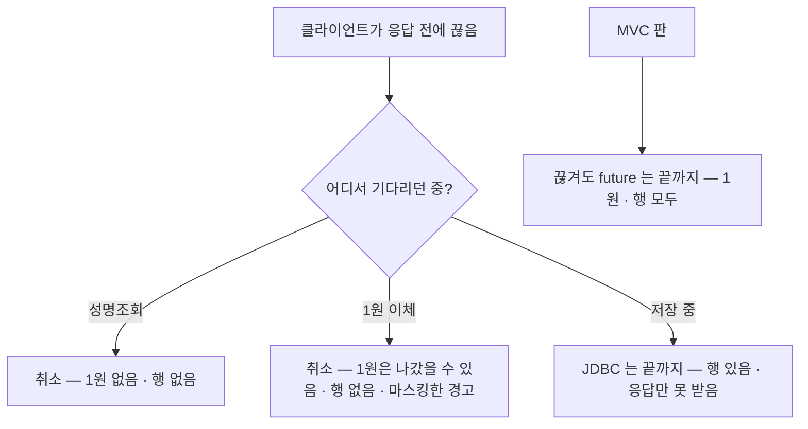
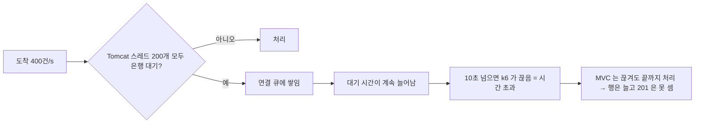

# P6-2 웹 1원인증 WebFlux 비교 — 측정 결과

> 측정: 2026-11-05 16:45 ~ 18:06 · 코드: `cccdb0a` · 설계: [P6-2 설계](../superpowers/specs/2026-11-05-p6-2-web-reactive-design.md) · 결정: [ADR-0013](../adr/0013-web-verification-webflux-comparison.md) · 절차: [OPERATION §12](../../OPERATION.md#12-웹-1원인증-판--webflux-측정-p6-2)
> 숫자는 **이 PC 기준 상대 비교이며 운영 수치가 아니다.** 앱 · MySQL · 모의 은행 · k6 가 한 PC 의 CPU 를 나눠 쓰고, 앱은 인스턴스 하나다.
> 표기: **확인** = 결과 JSON · 로그 · 코드로 직접 본 것, **추정** = 그 값들로 계산하거나 추론한 것 (따로 재지 않았다).

## 1. 한 줄 결론
- **은행을 기다리는 동안 스레드를 잡으면 무너지고, 놓아 주면 버틴다.** 은행 지연 500ms(요청 하나 ≈ 1초) · 초당 400건에서 MVC 블로킹은 **53.5건/s** (k6 시간 초과 4,999건), MVC 비동기 · WebFlux 코루틴 · WebFlux Reactor 는 셋 다 **400.0건/s** 였다 (확인).
- **블로킹의 천장은 Tomcat 스레드 수다.** 같은 칸에서 Tomcat 최대 스레드를 200 → 400 으로 늘리자 53.5 → **386.1건/s** (확인). 천장 ≈ 스레드 ÷ 요청 시간 = 200 ÷ 1초 = 200건/s 이고, 초당 200건 칸에서 블로킹은 197건/s · p50 1.5초로 이미 천장에 붙어 있었다 (확인 · 계산은 추정).
- **비동기 세 판은 본 측정 범위에서 같다** (판단 기준: 처리량 차이 5% 안 — 모든 칸에서 셋 다 도착률 그대로). 남는 차이는 **스레드 수**(코루틴 약 100개로 일정, Reactor 초당 200건 이상 칸에서 190개 안팎 — 500ms · 200건/s 는 159, MVC 비동기 63 ~ 163개)와 **꼬리 지연**(500ms · 400건/s 의 p99: 코루틴 1.04초 · Reactor 1.03초 · MVC 비동기 1.15초)이다 (확인).
- **예상 밖: MVC 비동기는 초당 800건에서 무너졌다** (491건/s, p99 4.3초). 은행 응답 뒤의 처리 · DB 저장이 도는 **앱 실행기(기본 8스레드)** 가 원인이었다 — 실행기를 64로 늘리자 800.0건/s · p99 1.7초 (확인, §9-2). "서블릿 비동기면 공짜" 가 아니다: 기다리는 스레드는 놓아 줘도, 콜백을 도는 풀이 새 천장이 된다.
- **한계 (500ms)**: 코루틴 · Reactor 는 초당 800건까지 그대로, 1,600건에서 960 · 973건/s 로 평평해졌다 — 그때 시스템 CPU 최대 89 ~ 91%(표본 17 · 9개), k6 VU 2,000개 소진 (확인 — 표본 적음). 이 PC 에서는 앱보다 **PC 자체(같은 PC 의 k6 · MySQL 포함)** 가 먼저 찼다 (추정).

## 2. 무엇을 왜 재는가
- **왜 1원인증인가**: 웹 요청 중 은행을 기다리는 곳은 1원인증 요청 하나다 (성명조회 → 1원 이체, 은행 두 번 — 코드 확인됨). 출금 접수는 DB 트랜잭션 하나로 202 를 돌려주고 은행을 기다리지 않는다.
- **왜 네 판인가**: 지금의 1원인증은 이미 서블릿 비동기(CompletableFuture)다. "WebFlux 가 빠른가" 를 바로 묻지 않고, **기다리는 동안 스레드를 잡는 판(블로킹)** · **놓는 판 셋** 으로 나눠 차이가 어디서 나는지 본다 (P6-1 의 대조 실험과 같은 생각).
- **왜 열린 모델인가**: 웹 요청은 앱이 느려져도 계속 도착한다. k6 `constant-arrival-rate` 로 초당 R건을 일정하게 보내, 앱이 못 따라가면 큐 · 지연 · 시간 초과로 드러나게 했다 (닫힌 모델이면 느린 앱이 요청을 덜 받아 무너짐이 가려진다).

## 3. 그림으로 보기
### 3-1. 은행을 기다리는 동안 누가 스레드를 잡나

### 3-2. 코루틴 판 한 요청의 스레드 이동 (진행 조건 실험 E1 로 확인)

> 응답이 `await` 보다 먼저 와 있으면(아주 빠른 은행) 아래의 "게이트웨이 루프" 단계가 "HTTP 루프" 그대로가 된다 — 2026-11-06 CI 에서 관찰. 어느 쪽이든 이벤트 루프라 저장을 IO 로 넘기는 이유는 같다.

### 3-3. 끊긴 시점별 결과 (WebFlux 두 판, 끊김 테스트로 고정)

**끊김의 틈**: 1원 이체 응답을 받은 뒤 저장이 시작되기 전(코루틴 IO 디스패처 대기 · Reactor `publishOn` 큐)에 취소되면 1원은 나갔는데 행도 경고도 없다 — 경고는 응답을 기다리는 중(`stage=transfer`)에만 남기 때문이다 (코드 확인됨). 부하가 높으면 이 틈이 넓어진다(추정). 이번 측정에서는 관측 없음(`one_won == rows`, 확인). 이런 1원은 경고 대신 일마감 대사로 보이는 것도 아니다: 대사는 1원인증 줄(V 거래번호 · 1원)을 대조하지 않고 건수만 센다 (코드 확인됨 — `ReconRepository.verificationLine`) — 행 없는 1원은 개별로 보이지 않고, 은행의 V 줄 건수와 우리 행 수의 차이로만 짐작할 수 있다 (추정). 사용자가 다시 요청하면 1원이 한 번 더 나가는 대가(설계 §4-3)와 같은 종류다.

### 3-4. 열린 모델에서 블로킹이 무너지는 모양

## 4. 조건
| 항목 | 값 |
|---|---|
| PC | AMD Ryzen 7 9700X (8코어 / 논리 16), 메모리 31.1 GB, Windows 11 Pro |
| JVM | OpenJDK 21.0.12, 앱마다 `-Xms1g -Xmx1g` |
| 앱 | apps/api (MVC, Tomcat 최대 스레드 200 — 원인 확인만 400) · apps/api-reactive (WebFlux, Reactor Netty). 두 앱 Hikari 최대 20 |
| 측정 격리 | 측정용 모의 은행 9190 (`--response-delay`, 회차마다 새 거래 기록), 측정용 포트 18080 · 18081. apps/api 측정 인스턴스는 Kafka 리스너 · 발행기 · 정리 작업 · 대사 · 보존 스케줄을 끔 |
| 부하 | k6 2.3.0 (Docker), `constant-arrival-rate`, 워밍업 10초 + 측정 30초, 요청 시간 초과 10초, VU 최대 2,000 |
| 요청 | 측정 사용자 `p62-u001` ~ `u100` 순환, 모의 은행 기본 계좌 3개 순환 (예금주 일치 → 모두 201 이 정상) |
| 회차 | 본 측정 72 (4판 × 지연 100 · 500ms × 도착률 100 · 200 · 400 × 3회) + 원인 확인 3 + 한계 탐색 6 + 실행기 확인 1 = 82회, 모두 정확성 확인 통과 (무효 0) |
| 표본 | 1초 쉬고 액추에이터 지표 3개를 차례로 읽는다 (확인 — `samples.txt`). 정상 칸은 간격 약 1.4 ~ 1.5초(측정 구간 30초에 17 ~ 21개, 블로킹 500ms · 200건/s 처럼 천장에 붙은 칸은 약 2.5초 · 11개)지만, 읽는 곳이 측정 대상 앱이라 **포화되면 표본이 크게 성겨진다**: 측정 구간 표본은 회차에 따라 1 ~ 21개 (블로킹 500ms · 400건/s 1 · 2 · 1개, Tomcat 400 칸 5 · 5 · 5개, Reactor 1,600 한계 탐색 9개 — 원자료 `samples`). 원인: 표본 curl 이 측정 대상 서버를 거치고 시간 제한이 없어 포화 때 큐에 갇혔다 (추정 — 표본이 줄어든 칸이 포화 칸과 겹침; 다음 측정부터 `run.sh` 가 curl 에 `--max-time 1` 을 둔다). **스레드 최대 · CPU 는 표본 사이의 순간 최댓값을 놓칠 수 있고, 표본이 10개 미만인 칸은 더 약하게 읽는다** (추정) |
| 측정 구간 | k6 시작 시각 + 10초부터 30초 — Docker 컨테이너 기동만큼(1 ~ 2초, 추정) 앞당겨 잡힌다 |

## 5. 결과
> 이 PC 기준 상대 비교이며 운영 수치가 아니다. 칸마다 3회, 지표마다 중앙값. `dropped` 는 워밍업을 포함한 전체 구간 (§7-2).

### 5-1. 은행 지연 100ms (요청 하나 ≈ 200ms + α)
| 판 · 도착률 | 201 처리량 (건/s) | p50 (ms) | p95 (ms) | p99 (ms) | 스레드 최대 | 시스템 CPU 평균 (%) | 시간 초과 | dropped |
|---|---|---|---|---|---|---|---|---|
| blocking · 100 | 100.0 | 214.1 | 223.5 | 230.4 | 99 | 23.9 | 0 | 0 |
| async · 100 | 100.0 | 214.0 | 223.2 | 229.0 | 63 | 21.9 | 0 | 0 |
| coroutine · 100 | 100.0 | 214.1 | 223.2 | 228.9 | 101 | 24.0 | 0 | 0 |
| reactor · 100 | 100.0 | 214.0 | 223.0 | 229.3 | 90 | 22.5 | 0 | 0 |
| blocking · 200 | 200.0 | 216.0 | 222.2 | 229.0 | 199 | 30.3 | 0 | 0 |
| async · 200 | 200.0 | 215.8 | 221.1 | 224.9 | 119 | 29.5 | 0 | 0 |
| coroutine · 200 | 200.0 | 215.8 | 221.1 | 225.5 | 101 | 28.9 | 0 | 1 |
| reactor · 200 | 200.0 | 215.9 | 222.0 | 226.3 | 190 | 28.1 | 0 | 9 |
| blocking · 400 | 400.0 | 219.2 | 228.1 | 251.2 | 226 | 37.5 | 0 | 50 |
| async · 400 | 400.0 | 219.2 | 232.9 | 253.5 | 163 | 37.7 | 0 | 121 |
| coroutine · 400 | 400.0 | 218.2 | 224.5 | 232.7 | 102 | 36.8 | 0 | 32 |
| reactor · 400 | 400.0 | 218.1 | 224.2 | 228.5 | 190 | 36.5 | 0 | 59 |

- 지연 100ms 에서는 블로킹 천장이 200 ÷ 0.2초 ≈ 1,000건/s 라 400건/s 까지 네 판 모두 도착률 그대로다 (계산은 추정). 그래도 400건/s 에서 블로킹 · MVC 비동기의 p99 가 250ms 대로 WebFlux 두 판(229 ~ 233ms)보다 20ms 남짓 길다 (확인).

### 5-2. 은행 지연 500ms (요청 하나 ≈ 1,000ms + α)
| 판 · 도착률 | 201 처리량 (건/s) | p50 (ms) | p95 (ms) | p99 (ms) | 스레드 최대 | 시스템 CPU 평균 (%) | 시간 초과 | dropped |
|---|---|---|---|---|---|---|---|---|
| blocking · 100 | 100.0 | 1015.2 | 1024.5 | 1032.8 | 152 | 22.4 | 0 | 27 |
| async · 100 | 100.0 | 1014.9 | 1024.2 | 1032.3 | 74 | 22.9 | 0 | 25 |
| coroutine · 100 | 100.0 | 1015.4 | 1025.3 | 1033.6 | 96 | 23.3 | 0 | 31 |
| reactor · 100 | 100.0 | 1015.4 | 1025.3 | 1034.5 | 88 | 21.6 | 0 | 30 |
| **blocking · 200** | **197.0** | **1545.1** | 1769.6 | 1835.9 | 226 | 26.0 | 0 | 166 |
| async · 200 | 200.0 | 1017.9 | 1024.5 | 1029.4 | 100 | 29.3 | 0 | 64 |
| coroutine · 200 | 200.0 | 1016.7 | 1025.2 | 1031.5 | 101 | 29.1 | 0 | 68 |
| reactor · 200 | 200.0 | 1015.9 | 1021.8 | 1030.2 | 159 | 29.2 | 0 | 67 |
| **blocking · 400** | **53.5** | **8399.2** | 9820.4 | 9903.0 | 226 (표본 1 ~ 2개) | 24.1 (표본 1 ~ 2개) | **4,999** | 6,401 |
| async · 400 | 400.0 | 1019.5 | 1064.3 | 1152.0 | 148 | 39.5 | 0 | 199 |
| coroutine · 400 | 400.0 | 1018.5 | 1026.1 | 1036.0 | 103 | 37.2 | 0 | 159 |
| reactor · 400 | 400.0 | 1018.5 | 1025.1 | 1030.9 | 190 | 38.0 | 0 | 157 |

- 표본이 10개 미만인 칸(블로킹 · 500ms · 400건/s: 회차별 1 · 2 · 1개)의 스레드 최대 · CPU 는 **확인 — 표본 적음**이다. 이 칸의 처리량 · 지연 · 시간 초과는 k6 요약이라 표본과 무관하다 (확인).

### 5-3. 원인 확인 — MVC 블로킹, Tomcat 최대 스레드 (지연 500ms · 도착률 400)
| Tomcat 최대 스레드 | 201 처리량 (건/s) | p50 (ms) | p99 (ms) | 스레드 최대 | 시간 초과 |
|---|---|---|---|---|---|
| 200 | 53.5 | 8399.2 | 9903.0 | 226 (표본 1 ~ 2개) | 4,999 |
| 400 | 386.1 | 2990.5 | 3349.6 | 426 (표본 5개) | 0 |

- Tomcat 400 칸의 스레드 최대는 회차마다 표본 5개라 **확인 — 표본 적음**이다 (426 = 400 + 기본 26 과 맞아 떨어지는 것은 §7-3 의 200 + 26 = 226 과 같은 모양).

## 6. 예상과 비교 (리틀의 법칙: 처리량 = 동시에 처리 중인 수 ÷ 한 건 시간)
| 칸 | 예상 (추정) | 실제 (확인) |
|---|---|---|
| 블로킹 천장, 지연 100ms | 200 ÷ 0.21초 ≈ 950건/s — 400건/s 는 여유 | 400.0, p50 219ms |
| 블로킹 천장, 지연 500ms | 200 ÷ 1.0초 ≈ 200건/s | 200건/s 칸: 197.0, p50 1.5초 (천장에 붙음) · 400건/s 칸: 무너짐 |
| 블로킹 · Tomcat 400, 지연 500ms | 400 ÷ 1.0초 ≈ 400건/s | 386.1 — 천장이 스레드를 따라 거의 두 배 |
| 비동기 판 동시 대기 수, 500ms · 400건/s | 400 × 1.0초 ≈ 400건 — 스레드와 상관없음 | 셋 다 400.0, 스레드 103 ~ 190 |

- 블로킹 400건/s 칸이 "200건/s 에서 멈춤" 이 아니라 53.5건/s 까지 떨어진 이유: 열린 모델이라 처리 못 한 요청이 Tomcat 연결 큐에 계속 쌓이고, 대기가 10초를 넘은 요청은 k6 가 끊어 **처리돼도 201 로 세지 않는다** (§3-4). 실제로 그 회차의 DB 행은 9,568건 = 201 4,603건 + 끊긴 뒤 저장된 4,965건이었다 (확인, 1회차). 처리 자체는 200건/s 근처였고, 손님이 받은 성공만 줄었다 (추정).

## 7. 나타날 수 있는 현상과 읽는 법
### 7-1. 끊김 비용 — 행 수와 1원 수가 201 수와 다르다
블로킹 500ms · 400건/s 1회차: 201 4,603 · 행 9,568 · 1원 9,600 · 시간 초과 4,997 (확인). `행 − 201 = 4,965` 는 k6 가 끊은 뒤에도 MVC 가 끝까지 저장한 건이다 (MVC 는 끊겨도 진행 — 실험 E2). `1원 − 행 = 32` 는 1원은 나갔는데 행이 없는 건으로, 측정이 끝나 앱을 내릴 때 처리 중이던 요청으로 본다 (추정). 두 값 모두 시간 초과 수 안이라 정확성 규칙으로 유효 (OPERATION §12-2). 운영이었다면 4,965명은 "실패" 를 보고 다시 요청해 **1원이 두 번** 나간다 (추정) — 블로킹 포화의 진짜 비용은 처리량보다 이쪽이다.

### 7-2. `dropped` 가 낮은 부하에서도 생긴다 — 부하 발생기 쪽이다
초당 100건 · 500ms 에도 dropped 25 ~ 31 (확인). 그때 VU 최대 125 로 상한 2,000 에 한참 못 미치고, 측정 구간 201 처리량은 정확히 100.0 이다. k6 는 VU 를 도착률만큼 미리 만들고(`preAllocatedVUs`), 요청이 1초씩 걸려 더 필요한 VU 를 늘리는 사이(워밍업 초반) 몇 건을 보내지 못한다 (추정). 그래서 dropped 는 "VU 최대 2,000 에 닿았거나 측정 구간 처리량이 모자랄 때" 만 앱 포화로 읽는다 — 한계 탐색의 멈춤 조건도 이렇게 적용했다 (ADR-0013).

### 7-3. 스레드 수 — 코루틴 일정, Reactor 190, MVC 비동기는 부하를 따라
- 코루틴 판은 어느 칸에서도 96 ~ 110 이다 (확인). 저장은 `Dispatchers.IO`(최대 64)로, 대기는 스레드 없이 — 부하가 늘어도 스레드가 늘지 않는다.
- Reactor 판은 초당 200건 이상에서 190 근처로 오른다 (확인 — 단 지연 500ms 의 200건/s 칸은 159). `boundedElastic` 이 저장 작업이 몰리면 스레드를 늘리는 구조(상한 = 코어 수 × 10)라서로 본다 (추정 — 이 PC 논리 16 → 160 + 앱 기본 스레드).
- MVC 비동기는 63 → 163 (확인). 짧게 쓰고 돌려주는 Tomcat 스레드가 동시 도착 수만큼 만들어진 뒤 남는 것으로 본다 (추정).
- 블로킹은 도착률 × 요청 시간만큼 Tomcat 스레드를 쓰다가 200(+기본 26)에서 막힌다 (확인: 226 — 100ms · 400건/s 칸의 표본 19 ~ 20개로). 500ms · 400건/s 칸의 226 은 표본 1 ~ 2개, Tomcat 400 칸의 426 은 표본 5개라 확인 — 표본 적음.

### 7-4. 꼬리 지연 — 비동기 세 판의 작은 차이
500ms · 400건/s 의 p99: MVC 비동기 1,152ms · 코루틴 1,036 · Reactor 1,031 (확인). 평균 · p50 은 같다. MVC 비동기의 꼬리는 §9-2 의 실행기 대기가 조금씩 보이기 시작한 것으로 본다 (추정 — 같은 칸 p95 1,064 로 다른 두 판보다 40ms 길다).

### 7-5. 첫 몇 초의 503
측정 앱이 막 떠서 게이트웨이가 측정 은행에 붙기 전 요청은 503 `BANK_UNAVAILABLE` 이 될 수 있다. run.sh 는 기동 뒤 3초 쉬고, 워밍업 10초는 집계하지 않는다. 이번 82회의 측정 구간 5xx 는 0 이다 (확인).

## 8. 해석
- **블로킹은 "스레드 ÷ 요청 시간" 그대로다.** 은행이 느려지면(요청 시간 ↑) 같은 스레드로 받을 수 있는 수가 줄고, 도착이 그보다 많으면 큐가 끝없이 길어진다 — 열린 모델에서 이건 "조금 느려짐" 이 아니라 **시간 초과 폭주**다 (확인: 200 → 400 스레드로 53.5 → 386.1).
- **스레드를 놓으면 천장이 다른 곳으로 옮겨 간다.** MVC 비동기 · 코루틴 · Reactor 모두 은행 대기 중 스레드를 놓아 500ms · 400건/s 를 버텼다. 그다음 천장은 판마다 다르다: MVC 비동기는 **콜백 실행기(8스레드)**, 코루틴 · Reactor 는 이 PC 의 CPU (§9).
- **WebFlux 가 이긴 것은 "빨라서" 가 아니다.** 같은 칸에서 처리량은 같다. 이긴 것은 (1) 스레드 수가 부하에 묶이지 않는다(코루틴), (2) 실행기 같은 숨은 풀을 하나 덜 거친다는 구조다 (추정). MVC 비동기도 실행기를 64로 키우면 800건/s 를 받았다 (§9-2).
- **P6-1 과 같은 결론**: 빠른 것은 프레임워크가 아니라 **동시에 기다릴 수 있는 수**이고, 그 수를 무엇이 막는지(스레드 · 풀 · CPU)를 찾는 것이 측정의 일이다.

## 9. 한계 탐색 — 지연 500ms, 도착률을 올리면
### 9-1. 표 (회차마다 한 번)
| 판 · 도착률 | 201 처리량 (건/s) | p99 (ms) | 스레드 최대 | 시스템 CPU 평균 / 최대 (%) | VU 최대 | 멈춤 |
|---|---|---|---|---|---|---|
| async · 800 | 490.9 | 4,312 | 226 | 43.5 / 59.4 | 2,000 | 처리량 < 99% · p99 > 3초 → 멈춤 |
| coroutine · 800 | 800.0 | 1,205 | 110 | 57.8 / 87.5 | 1,247 | — |
| reactor · 800 | 800.0 | 1,183 | 191 | 55.4 / 71.5 | 1,165 | — |
| async · 1,600 | 434.9 | 4,644 | 226 | 37.4 / 52.3 | 2,000 | 800 에서 멈춘 뒤 같은 스크립트가 함께 돌린 회차 (처리량 < 99% · p99 > 3초) |
| coroutine · 1,600 | 960.5 | 2,329 | 109 | 63.5 / 88.6 | 2,000 | 처리량 < 99% · VU 소진 → 멈춤 |
| reactor · 1,600 | 972.9 | 3,231 | 191 (표본 9개) | 64.4 / 90.6 (표본 9개) | 2,000 | 처리량 < 99% · p99 > 3초 → 멈춤 |

- 코루틴 · Reactor 는 1,600건/s 에서 약 960 ~ 973건/s 로 평평해졌다 (차이 1.3% — 같다). 이때 시스템 CPU 최대가 89 ~ 91% 이고 같은 PC 의 k6 · MySQL · 모의 은행이 CPU 를 나눠 쓴다 — **앱이 아니라 PC 가 먼저 찼다** (추정). 3,200건/s 는 VU 상한(2,000)과 CPU 로 부하 발생기만 재게 돼 돌리지 않았다.
- **멈춤 조건의 CPU 해석**: 시스템 CPU 80% 는 측정 구간 평균으로 판정했다 (코루틴 800 은 최대 87.5% · 평균 57.8% 라 1,600 으로 진행). 최대로 판정했다면 800 에서 멈췄을 것이다. 최대는 표본 사이를 놓칠 수 있고 표본이 적은 칸이 있어 평균을 골랐다 (판단). Reactor 1,600 의 CPU(평균 64.4 / 최대 90.6)는 표본 9개라 확인 — 표본 적음.
- **1,600 회차의 워밍업 시간 초과**: `timeouts_all` 이 코루틴 190 · Reactor 140 이다 (측정 구간 `timeouts` 는 둘 다 0). 모두 1원 이체 전에 끊긴 요청이라 `one_won == rows` (코루틴 37,437 · Reactor 37,818)로 맞았다 — 1원이 나갔는데 행이 없는 건은 이 회차에서 관측되지 않았다 (확인).
- async · 1,600 은 800 에서 멈춘 뒤 스크립트가 세 판을 같은 도착률로 함께 돌려 생긴 회차다. 멈춤 판정에는 쓰지 않았고, 평평해진 모양(434.9건/s · 스레드 226 · CPU 평균 37%)은 같은 실행기 천장으로 본다 (추정 — §9-2 는 800건/s 에서만 확인).

### 9-2. MVC 비동기는 왜 800건/s 에서 무너졌나 — 앱 실행기 (확인)
- MVC 비동기 판은 은행 응답 future 의 뒤처리(응답 해석 · 1원인증 저장)를 `thenApplyAsync(applicationTaskExecutor)` 로 넘긴다 (코드 확인됨 — 이벤트 루프에서 JDBC 를 기다리지 않게). Spring Boot 기본 실행기는 코어 8스레드에 큐 무제한이라 8개에서 늘지 않는다 (추정 — Boot 기본값).
- 확인 실험: 같은 칸(500ms · 800건/s)을 `--spring.task.execution.pool.core-size=64` 로 한 번 더 쟀다 (`async-d500-r800-exec64.json` — 본 측정 표에는 넣지 않는다). **490.9 → 800.0건/s, p99 4,312 → 1,708ms, 시간 초과 0** (확인).
- 읽는 법: 서블릿 비동기는 Tomcat 스레드를 놓아 주지만 **뒤처리를 도는 풀이 새 병목**이 된다. 운영에서 MVC 비동기를 쓰면 이 실행기 크기 · 큐 · 지표를 따로 정해야 한다 (ADR-0013 결과 절). 코루틴 판은 같은 일을 `Dispatchers.IO`(64)가, Reactor 판은 `boundedElastic` 이 맡아 이 칸을 넘겼다.

## 10. 언제 무엇을 쓰나 (이 측정 범위에서)
- **은행처럼 느린 외부를 기다리는 웹 요청에 블로킹(스레드 잡기)은 안 된다** — 열린 모델에서 시간 초과 폭주와 1원 중복(§7-1)으로 번진다.
- **지금 운영 기본인 MVC 비동기는 이 부하(초당 400건 · 은행 1초)까지 WebFlux 와 같다.** 그 위로 가려면 앱 실행기 크기를 정해야 한다 — 설정 하나로 800건/s 까지 확인했다.
- **WebFlux(코루틴)는 스레드 수가 부하와 상관없이 일정하다는 점이 운영상 장점**이다. 대신 별도 앱 · 끊기면 취소(1원 이체 대기 중 끊김의 비용) · Reactor 스택 디버깅을 감수한다 (ADR-0013).

## 11. 한계
- 한 PC · 인스턴스 하나의 상대 비교. 1,600건/s 이상은 PC(같은 PC 의 k6 포함)가 먼저 찼다.
- 모의 은행은 고정 지연이다. 꼬리 지연이 있는 은행 · 은행 동시 한도는 재지 않았다.
- WebFlux 판의 DB 는 블로킹 JDBC(IO · boundedElastic)다 — 완전한 논블로킹(R2DBC)은 범위 밖.
- 스레드 · CPU 최대는 약 1.4 ~ 1.5초 간격 표본(포화 칸은 훨씬 성김, 1 ~ 21개)이라 순간 최댓값을 놓칠 수 있다 (§4).
- 실행기 확인(§9-2)은 1회다. 실행기 크기를 정하는 일(몇이 적당한가)은 재지 않았다.

## 12. 원자료
- `docs/perf/raw/p6-2/<판>-d<지연>-r<도착률>[-t<톰캣>]-<회차>.json` — 회차가 숫자면 본 측정 · 원인 확인, `probe1` 은 한계 탐색, `exec64` 는 §9-2 확인 실험. 키 설명은 OPERATION §12-2.
- 표는 `bash load/verification/summarize.sh` 로 다시 만든다. 다시 재는 법은 OPERATION §12.
