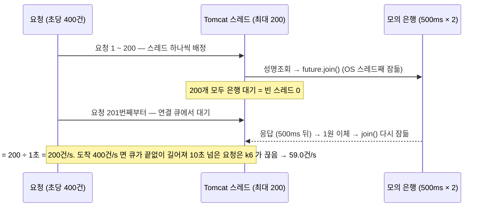
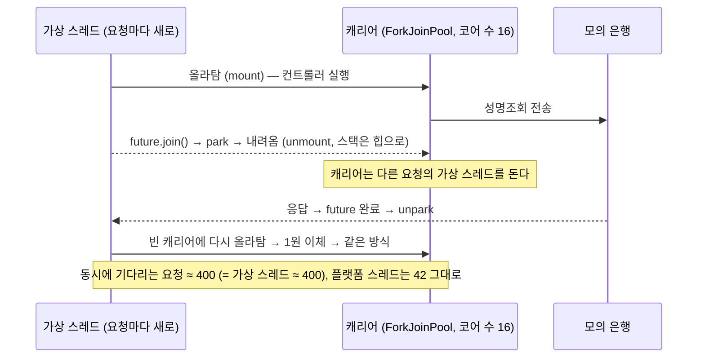
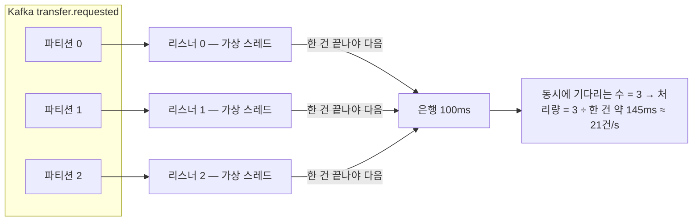
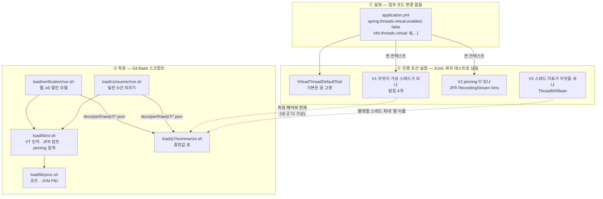
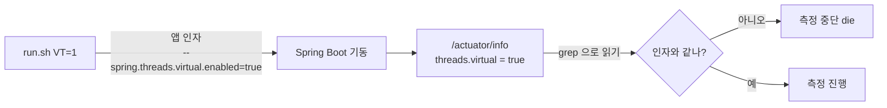
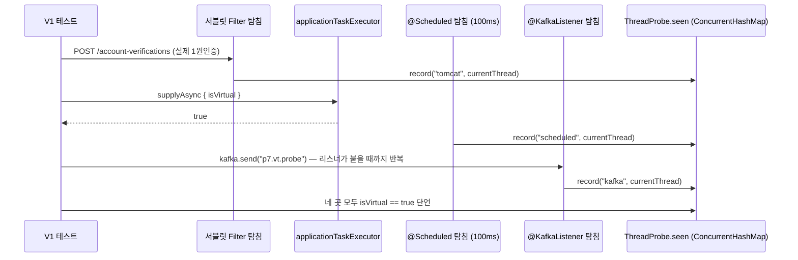
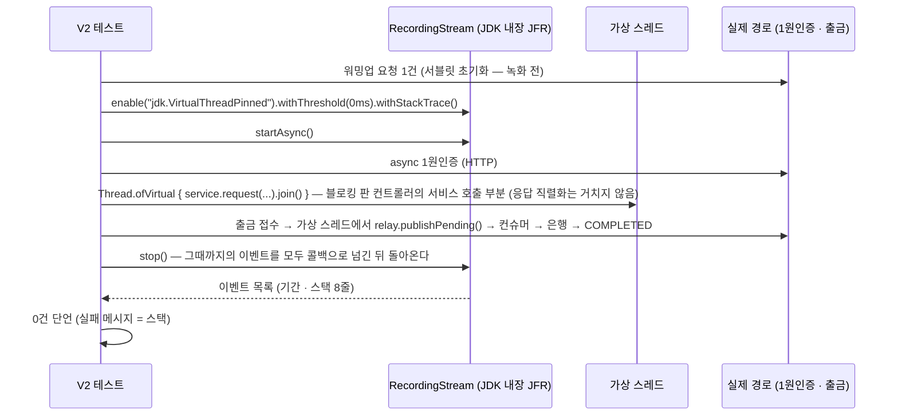
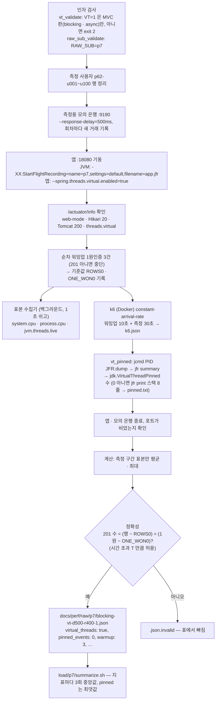
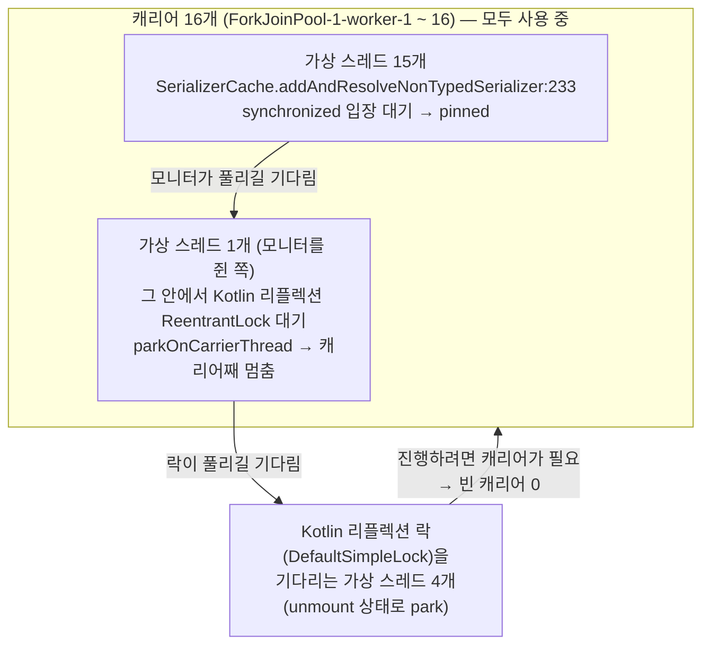

# P7 가상 스레드(Virtual Thread) 적용 비교 — 측정 결과

> 측정: 2026-11-09 웹 10:51 ~ 11:27 · 컨슈머 13:25 ~ 13:40 · 코드: `dcf35bf` · 설계: [P7 설계](../superpowers/specs/2026-11-09-p7-virtual-threads-design.md) · 결정: [ADR-0014](../adr/0014-virtual-threads.md) · 절차: [OPERATION §13](../../OPERATION.md#13-가상-스레드-측정-p7)
> 숫자는 **이 PC 기준 상대 비교이며 운영 수치가 아니다.** 앱 · MySQL · Kafka · 모의 은행 · k6 가 한 PC 의 CPU 를 나눠 쓰고, 앱은 인스턴스 하나다.
> 표기: **확인** = 결과 JSON · 로그 · 스레드 덤프 · 코드로 직접 본 것, **추정** = 그 값들로 계산하거나 추론한 것 (따로 재지 않았다).

## 1. 한 줄 결론
- **웹: 블로킹 코드를 그대로 두고 설정 한 줄(`spring.threads.virtual.enabled=true`)만 켜자 Tomcat 200 천장이 사라졌다.** 은행 지연 500ms(요청 하나 ≈ 1초) · 초당 400건에서 MVC 블로킹 **59.0 → 400.0건/s**, p99 9,967 → 1,033ms, k6 시간 초과 4,849 → 0 (확인).
- **MVC 비동기의 앱 실행기 8 천장도 사라졌다.** 초당 800건에서 **495.8 → 800.0건/s** (p99 4,228 → 1,467ms). 블로킹 + 가상 스레드도 800.0건/s 로, WebFlux 코루틴 판(800.0건/s)과 같다 (확인).
- **컨슈머는 그대로다.** 블로킹 컨슈머 20.7 → 20.6건/s (편차 −0.5%, 은행 최대 동시 3 → 3). 파티션 3개를 리스너 3개가 한 건씩 처리해 **동시에 기다리는 수가 3 그대로**이기 때문이다 (확인 · 원인은 추정). 가상 스레드는 동시에 *기다릴 수* 있게 할 뿐 동시에 *일을 만들지는* 않는다.
- **park 중 pinning(`jdk.VirtualThreadPinned`) 0건** — 실험 V2(기준 0ms) · 측정 VT 회차 16회(기준 20ms) 모두 (확인). 단 이 이벤트는 JDK 21 에서 **모니터를 쥔 채 park 할 때만** 남는다 (JDK 소스 확인). `synchronized` **입장 대기**로 캐리어를 붙잡는 것은 세지 않는다 — 같은 녹화의 `jdk.JavaMonitorEnter`(20ms 이상)로 따로 세면 가상 스레드 2건(컨슈머 1회차, Hibernate 첫 쿼리 번역)이 있었다 (§8).
- **그러나 냉시동 교착을 찾았다 (P7 의 핵심 발견).** 막 뜬 앱에 동시 요청이 곧바로 몰리면 Java 21 에서 앱 전체가 멈췄다 — 가상 스레드 켬 **4/4 멈춤**, 끔 2/2 정상 (확인). 원인은 Jackson 직렬화기 캐시의 `synchronized` 에서 가상 스레드들이 캐리어 16개를 모두 붙잡은 것이다 (스레드 덤프로 확인, §6). JFR `jdk.VirtualThreadPinned` 로는 이 교착이 **0건으로 보인다** (§6-2).
- **판정 (ADR-0014, 제안)**: 기준 1(pinning 0) 실패 → **Java 21 에서는 기본값을 끈 채로 둔다.** 다시 볼 조건은 Java 24+(JEP 491 — `synchronized` 안에서도 캐리어를 놓음) 또는 기동 워밍업 · 동시 호출 상한을 함께 넣을 때.

## 2. 무엇을 왜 재는가
- P6 에서는 "은행을 기다리는 동안 스레드를 놓게" 하려고 **코드를 다시 썼다** — 컨슈머는 suspend 리스너(P6-1), 웹은 서블릿 비동기 · WebFlux 코루틴 · Reactor(P6-2). P7 은 **코드를 다시 쓰지 않고** JVM 이 같은 일을 하게 하는 가상 스레드를 같은 PC · 같은 측정 도구로 비교한다.
- **가설 1 (웹)**: Tomcat 200 천장(블로킹)과 앱 실행기 8 천장(비동기)이 모두 사라져, 블로킹 코드 그대로 코루틴 판만큼 받는다.
- **가설 2 (컨슈머)**: 처리량은 그대로다. 동시에 기다리는 수를 정하는 것은 스레드가 아니라 파티션 · 리스너 수다 — 효과와 **한계**를 함께 보이려는 대조.
- **범위를 줄인 이유** (2026-11-09 사용자 결정): 결과가 대부분 예상 가능해, 끊김 실험 · 1,600건/s 한계 탐색 · 컨슈머 코루틴 재측정은 빼고 P6 값을 인용한다. 기준 칸(끈 판)은 날짜 · PC 상태 차이가 섞이지 않게 같은 날 다시 쟀다.

## 3. 그림으로 보기
### 3-1. 플랫폼 스레드: Tomcat 스레드 200개가 `join()` 에서 막힌다

### 3-2. 가상 스레드: `join()` 에서 캐리어를 내려놓는다

- 코드는 같다: 블로킹 판 컨트롤러는 여전히 `service.request(...).join()` 이다 (코드 확인됨). 달라진 것은 `join()` 아래의 `LockSupport.park` 를 JVM 이 "OS 스레드를 재우기" 대신 "가상 스레드를 캐리어에서 내리기" 로 처리한다는 것뿐이다 (JDK 동작 — V2 가 pinning 없음으로 확인).

### 3-3. 컨슈머: 스레드가 가상이 되어도 동시 3 그대로

- 스레드를 싸게 만들어도 **일을 나눠 주는 쪽(리스너 3개, 한 건씩 순서대로)** 이 그대로라 동시성이 늘지 않는다. P6-1 코루틴 판은 리스너 안에서 은행 호출을 상한 64까지 **동시에 띄워서** 387.3건/s 를 냈다 — 코드를 바꿔야 얻는 동시성이다.

## 4. 측정 코드는 어떻게 만들었나 (구현 설명)
면접에서 "어떻게 쟀나 · 왜 이렇게 만들었나" 를 설명할 수 있게 구현을 데이터 흐름 순서로 적는다. 코드 위치는 저장소 기준이다.

### 4-1. 전체 구조 — 세 층

- **왜 세 층인가**: 설정(①)은 실무에서 실제로 켜는 방법 그대로다 (실행기를 손으로 바꾸면 "무엇이 가상이 됐나" 가 코드마다 달라진다). 측정(③)은 숫자를 주지만 **"정말 가상 스레드에서 돌았나 · 숫자가 무엇을 세나"** 는 말해 주지 않는다. 그래서 측정 전에 실험(②)으로 전제를 고정했다 — P6-1 · P6-2 와 같은 방식.

### 4-2. 설정 한 줄과 "켜졌는지" 확인 고리

- `application.yml` 에 기본값 `false` 를 **명시**하고 `info.threads.virtual: ${spring.threads.virtual.enabled}` 로 그 값을 `/actuator/info` 에 노출했다. 측정 스크립트는 앱을 띄운 뒤 이 값이 회차 인자(VT=0/1)와 같은지 확인하고, 다르면 재지 않고 멈춘다 — "끈 줄 알았는데 켜져 있었다" 같은 실수를 막는다 (P6-2 의 `web-mode` 확인과 같은 방식).
- `VirtualThreadDefaultTest` 가 기본(끔)을 고정한다: 앱 실행기에 작업을 넣어 `Thread.currentThread().isVirtual` 이 `false`, Tomcat 가상 스레드 커스터마이저 빈이 없음, info 에 `"threads":{"virtual":"false"}`.

### 4-3. 실험 V1 — 네 곳에 탐침을 꽂아 실제 스레드를 기록

- **탐침을 쓴 이유**: "설정을 켜면 가상 스레드가 된다" 는 문서 설명이 아니라 **실제로 그 경로를 지나는 스레드**를 잡아야 한다. 서블릿 필터는 1원인증 URI 만 기록하고, 예약 작업 · 리스너는 앱 것과 **같은 Boot 스케줄러 · 컨테이너 팩토리**를 쓰는 테스트 전용 빈이다 (앱에 직접 만든 팩토리가 없어서 같다 — 코드 확인됨).
- `putIfAbsent` 로 곳마다 **처음 본 스레드 하나**만 남긴다. 이 클래스는 `@TestPropertySource(properties = ["spring.threads.virtual.enabled=true"])` 로 **별도 컨텍스트**를 띄워 다른 테스트와 섞이지 않는다.
- 결과 (확인): 네 곳 모두 `virtual=true`. Boot 4.1.1 에서 바뀌는 곳 = Tomcat 요청(`TomcatVirtualThreadsWebServerFactoryCustomizer`), 앱 실행기(`SimpleAsyncTaskExecutor`), `@Scheduled`(`SimpleAsyncTaskScheduler`), Kafka 리스너 컨테이너.

### 4-4. 실험 V2 — JFR 을 테스트 안에서 켜서 pinning 을 센다

- **왜 JFR 인가**: pinning 은 "가상 스레드가 캐리어를 놓아야 할 때 못 놓은 순간" 이라 로그 · 지표에 보이지 않는다. JDK 가 이 순간 중 **모니터를 쥔 채 park 한 경우**를 `jdk.VirtualThreadPinned` 이벤트로 남기고 (JDK 21 에서 이 이벤트를 만드는 곳은 `VirtualThread.parkOnCarrierThread` 하나 — `src.zip` 확인), `jdk.jfr.consumer.RecordingStream` 으로 **테스트 코드 안에서** 녹화 · 구독할 수 있다 — 새 의존성 없음.
- **왜 기준 0ms 인가**: 기본 설정(`default.jfc`)은 20ms 이상만 남긴다. 실험은 짧은 pinning 도 보려고 0ms 로 켰다. 측정 회차는 부담을 줄이려고 기본 20ms 를 쓴다 (§12 한계).
- **왜 `stop()` 인가**: 비동기 스트림이라 블록이 끝난 직후에는 이벤트가 아직 콜백에 안 왔을 수 있다. `stop()` 은 남은 이벤트를 모두 처리한 뒤 돌아온다 (JDK 20+) — `close()` 만 하면 놓칠 수 있다.
- **대조 테스트**: 같은 녹화 함수로 `synchronized(lock) { Thread.sleep(30) }` 를 가상 스레드에서 돌려 **1건 이상** 잡히는지 본다. "0건" 이 검출 실패가 아님을 늘 보장한다 (결과 1 ~ 3건, 확인). JDK 24+ 에서는 JEP 491 로 이 대조가 0건이 되어 실패한다 — 그때 Java 버전 변화가 테스트로 드러난다.
- **구현 중 만난 것 — 1회성 pinning**: 처음에는 실제 경로에서 간헐적으로 1 ~ 2건이 잡혔다. 스택을 보니 첫 요청의 `DispatcherServlet` 지연 초기화가 Tomcat `StandardWrapper.allocate` 의 `synchronized` 안에서 돌고, 그 안의 INFO 로그가 Gradle 테스트 출력 잠금을 기다리며 pinned 된 것이었다 (확인). 요청 경로가 아니라 1회성이라, 녹화 전에 요청 한 번으로 초기화를 끝내 두었다. 운영에서는 `spring.mvc.servlet.load-on-startup` 으로 기동 때 초기화하면 피할 수 있다 (추정 — 확인 안 함).
- 결과 (확인): 실제 경로 **0건**, 대조 1 ~ 3건.
- **이 실험이 보지 못하는 것**: ① 요청을 한 건씩 순서대로 보내 `synchronized` **경합 자체가 생기지 않는다** — 냉시동 교착 같은 동시 진입은 이 실험 밖이다. ② 블로킹 판은 서비스를 직접 `join` 해 HTTP 응답 직렬화를 거치지 않는다 (교착 지점이 바로 그 직렬화였다). ③ 모니터 입장 대기는 이 이벤트로 남지 않는다 (위). 그래서 V2 의 0건은 "정상 상태의 한 건 경로에 park 중 pinning 이 없다" 까지만 말한다.

### 4-5. 실험 V3 — `jvm.threads.live` 는 가상 스레드를 세지 않는다
- 측정 표의 스레드 열은 Micrometer `jvm.threads.live` 이고, 이 값은 `ThreadMXBean.threadCount` 다. 가상 스레드 200개를 `CountDownLatch` 에 묶어 둔 채 읽어 **141 → 141** (다른 실행 268 → 268) — 늘지 않았다 (확인).
- 그래서 측정 표의 열 이름을 **"플랫폼 스레드 최대"** 로 정했고, 가상 스레드 수는 재지 않고 리틀의 법칙(처리량 × 지연)으로 추정만 한다.

### 4-6. 측정 한 회의 데이터 흐름 (`load/verification/run.sh`, VT=1)

- **JFR 은 VT 회차에만** 붙인다 (끈 회차는 `pinned_events: null`). 그래서 VT 판이 JFR 부담(일반적으로 1% 안팎, 추정)만큼 약간 불리한 쪽이다.
- **덤프는 앱을 내리기 전에**: Git Bash 의 `kill` 은 Windows 프로세스를 바로 끝내 JVM 종료 훅이 돌지 않는다 → 녹화 파일이 남지 않는다. 그래서 `jcmd <PID> JFR.dump` 로 먼저 떠 둔다. 경로는 `pwd -W`(Windows 경로)로 넘긴다 — jcmd 는 Windows 프로세스라 `/c/...` 를 모른다.
- **pinning 수를 0 으로 속이지 않기**: `jfr summary` 가 실패했는데 출력이 비어 `awk` 가 아무것도 못 찾으면 "0건" 이 된다 — 리뷰에서 잡아 고쳤다. 지금은 덤프 파일이 비었거나 · `jfr summary` 가 실패하거나 · 출력에 `jdk.` 이벤트 줄이 없거나 · 수가 숫자가 아니면 **측정을 멈춘다**. 스택 출력(`jfr print`)만 실패하면 경고만 남긴다 (수는 이미 확인됨).
- **컨슈머** (`load/consumer/run.sh`): 발행 단계(리스너 끔)는 끈 채로, **처리 단계 앱에만** VT · JFR 을 붙인다 (`API_JVM_ARGS`) — 재려는 것은 리스너가 은행을 기다리는 부분이다. 결과 이름 `blocking-vt-d100-h20-<회차>`.

### 4-7. 정확성 확인을 워밍업 "차이" 로 바꾼 이유
- 워밍업 3건도 DB 행과 1원 이체를 만든다. 그대로 세면 `201 수 ≠ 행 수` 로 모든 회차가 무효가 된다. 그래서 워밍업 직후의 행 수 · 1원 수를 기준값(`ROWS0` · `ONE_WON0`)으로 잡고, 끝난 뒤 **차이**를 k6 의 201 수와 비교한다. 판 · VT 여부와 상관없이 **모든 웹 회차에 똑같이** 넣어 비교 조건을 맞췄다.

### 4-8. 이 PC(Windows · Git Bash)에서 만난 함정
| 증상 | 원인 (확인) | 대처 |
|---|---|---|
| 포트가 쓰이고 있는데 "비어 있음" | `netstat -ano` 가 0.0.0.0 에 묶인 대기 포트를 보여 주지 않음 (127.0.0.1 만) → 측정 격리 안전장치가 사실상 꺼져 있었음 | `load/lib/proc.sh`: `/dev/tcp/127.0.0.1/PORT` 접속 시험, PID 는 `jcmd -l` 명령행(`--server.port=…`)에서 |
| 앞 회차 앱이 안 죽음 | `MSYS_NO_PATHCONV=1` 에서 `taskkill //F` 가 옵션으로 안 읽힘 | `taskkill /F /PID` |
| 워밍업 400 | curl 명령행 인자로 넘긴 JSON 의 따옴표가 깨짐 | 본문을 파일로 (`--data-binary @warmup.json`), 한글은 `\uXXXX` |
| 워밍업 응답 코드 000 | `-o /dev/null` 을 Windows curl 이 못 엶 (exit 23) | 작업 폴더 파일로 받음 |
- `load/run.sh`(P4-2) 는 아직 netstat 을 쓴다 — HANDOVER 범위 밖 목록.

### 4-9. 설명할 때 순서 (요약)
1. "**설정 한 줄**로 켜고, 켜졌는지는 `/actuator/info` 로 스크립트가 확인한다."
2. "측정 전에 **실험 3개**로 전제를 고정했다 — 네 곳이 정말 가상 스레드인가(탐침), park 중 pinning 이 있나(JFR 0ms + 대조 테스트), 스레드 지표가 무엇을 세나(ThreadMXBean)."
3. "측정은 P6 와 **같은 도구 · 같은 날 기준 칸**으로, VT 회차에만 JFR 을 붙여 끝나기 전에 `jcmd` 로 덤프해 pinning 을 셌다. 집계가 실패하면 0 으로 쓰지 않고 멈춘다."
4. "첫 시험 회차에서 **앱이 통째로 멈췄고**, 스레드 덤프로 Jackson `synchronized` + Kotlin 리플렉션 락 + 캐리어 16개 소진임을 찾았다. JFR `VirtualThreadPinned` 로는 0건이었다 — JDK 21 은 이 이벤트를 '모니터를 쥔 채 park' 에만 남기고 `synchronized` 입장 대기는 세지 않는다. 그래서 pinning 은 `JavaMonitorEnter` 까지 같이 보고, 멈춘 앱은 덤프로 본다."
5. "그래서 결과는 '성능은 코루틴만큼, 그러나 Java 21 에서는 기본으로 켜지 않는다'."

## 5. 조건
| 항목 | 값 |
|---|---|
| PC | AMD Ryzen 7 9700X (8코어 / 논리 16), 메모리 31.1 GB, Windows 11 Pro |
| JVM | OpenJDK 21.0.12, 앱마다 `-Xms1g -Xmx1g`. 가상 스레드 캐리어 = ForkJoinPool, 병렬도 = 논리 코어 16 (JDK 기본) |
| 앱 | apps/api (MVC, Tomcat 최대 스레드 200) · apps/api-reactive (코루틴 판 기준선). Hikari 최대 20 |
| 가상 스레드 | VT 회차: `--spring.threads.virtual.enabled=true` + JFR `settings=default` (pinning 기준 20ms), 끝나기 전 `jcmd JFR.dump`. 끈 회차: JFR 없음 |
| 측정 격리 | 측정용 모의 은행 9190, 측정용 포트 18080 · 18081. apps/api 측정 인스턴스는 Kafka 리스너 · 발행기 · 정리 작업 · 대사 · 보존 스케줄을 끔. **웹 측정 중 사용자의 개발용 API(8080) · 리액티브 앱(8081) · 모의 은행(9090)이 켜진 채였다** (유휴, 기록). 컨슈머 측정은 개발용 API 를 끈 뒤 |
| 웹 부하 | k6 2.3.0 (Docker), `constant-arrival-rate`, 은행 지연 500ms, 워밍업 10초 + 측정 30초, 요청 시간 초과 10초, VU 최대 2,000. **k6 전에 순차 워밍업 1원인증 3건** (모든 회차, §4-7) |
| 웹 회차 | 본 측정 27 (§7 표) + drift 1 = 28회, 회차는 판 사이를 번갈아 (1회차 아홉 칸 → 2회차 → 3회차). 모두 정확성 통과, 무효 0 |
| 컨슈머 | `load/consumer`, 은행 지연 100ms, N=1,500, Hikari 20, 측정 그룹 `transfer-processor-p61`. 끔 · 켬 번갈아 3회씩 = 6회, 모두 정확성 통과 |
| 표본 | 1초 쉬고 액추에이터 지표 3개 (`--max-time 1`). 정상 칸 측정 구간 약 20개. 블로킹(끔) · 400 칸은 포화로 **0개** → 스레드 · CPU '-' |
| 원자료 | `docs/perf/raw/p7/` (§13) |

## 6. 냉시동 교착 — 무엇을 봤고 왜 생기나
### 6-1. 재현
첫 시험 회차(VT 켬 · blocking · 500ms · 초당 100건)에서 앱이 통째로 멈췄다: 201 0건, 1원 94건 · 행 28건 뒤 진행 없음. 같은 절차(새 앱 → 3초 → 곧바로 k6 초당 100건)로 다시 재현했다 (확인 — `build/p7-debug/repro-*`, 커밋하지 않음):

| 조건 | 결과 |
|---|---|
| VT 켬, 새 앱 (JFR 있음 2 · 없음 2) | **4/4 멈춤** |
| VT 끔, 새 앱 | 2/2 정상 (97.9 · 100.1건/s) |
| VT 켬, 미리 몇 건 보내 데운 앱 | 2/2 정상 (100.0 · 99.4건/s) |

- 관찰 (확인): JFR 이 있든 없든 멈췄고, VT 를 끄거나 데우면 멈추지 않았다. 해석 (추정 — 표본이 켬 4 · 끔 2 · 데움 2 로 작다): 녹화 부담이 아니라 **가상 스레드 + 첫 요청 초기화**의 조합이다. 재현 기록 중 3회는 내 재현 스크립트의 종료 명령(`taskkill //F`)이 듣지 않아 앞 앱이 남은 무효 회차라 위 표에서 뺐다.

### 6-2. 스레드 덤프로 본 원인 (확인 — `jcmd <PID> Thread.dump_to_file`, 가상 스레드 포함)

1. 첫 요청들이 응답을 직렬화하려 하면 Jackson 3 의 `SerializerCache` 가 새 직렬화기를 만들며 `synchronized` 에 들어간다.
2. 모니터를 쥔 가상 스레드는 직렬화기를 만들다 Kotlin 모듈(`KotlinNamesAnnotationIntrospector.findPreferredCreator`)의 Kotlin 리플렉션을 부르고, 그 안의 `ReentrantLock`(`DefaultSimpleLock`)을 기다린다. **Java 21 은 모니터를 쥔 채 park 하면 캐리어에서 내려오지 못한다** (`VirtualThread.parkOnCarrierThread` — 덤프에서 확인).
3. 나머지 15개는 같은 모니터 입장을 기다리며 **캐리어를 붙잡는다** (Java 21 에서 모니터 입장 대기도 pinning).
4. 같은 Kotlin 락을 기다리는 가상 스레드 4개(`tomcat-handler-8 · 9 · 10 · 16`)는 캐리어에서 내려와 park 중이다 (확인). 캐리어 16개가 모두 묶여 있어, 락이 넘어가도 AQS 큐의 다음 대기자가 락을 얻으려면 먼저 캐리어에 올라타야 하는데 **빈 캐리어가 없다** → 아무도 진행하지 못한다 (이 마지막 고리는 추정 — 덤프에서 락 소유자를 직접 보지는 못했다).

- **왜 데우면 괜찮나**: 직렬화기는 한 번 만들면 캐시된다. 순차 요청 몇 건으로 만들어 두면 이후에는 이 `synchronized` 블록에 오래 머무를 일이 없다 (확인 — 데운 앱 정상, 본 측정 VT 웹 회차 13회 정상).
- **왜 플랫폼 스레드에서는 괜찮나**: 같은 대기여도 OS 스레드가 각자 잠들 뿐, 락을 이어받을 스레드가 "올라탈 자리" 를 기다리지 않는다 (관찰은 확인 — 끔 2/2 정상, 이유는 추정).
- **왜 JFR 이 0 인가** (재현 회차 JFR 덤프 0건, 확인): JDK 21 에서 `jdk.VirtualThreadPinned` 를 만드는 곳은 `parkOnCarrierThread` 하나다 (JDK `src.zip` 확인). ① 모니터 입장을 기다리는 15개는 park 가 아니라 이 이벤트가 **아예 생기지 않는다**. ② 모니터를 쥐고 park 한 1개는 park 가 끝날 때 기간과 함께 기록되는데, 교착이라 끝나지 않는다. **"pinning 0건" 은 교착이 없다는 뜻이 아니다** — 입장 대기는 `jdk.JavaMonitorEnter` 로 따로 보고 (이것도 입장에 성공해야 기록된다 — 추정), 멈춘 앱은 스레드 덤프로 봐야 한다.
- **"냉시동" 만의 문제가 아닐 수 있다** (추정): 같은 모양은 정상 상태에서도 **어떤 타입을 처음 직렬화하는 순간**(예: 장애로 처음 보는 오류 응답이 한꺼번에 몰릴 때) 동시 요청이 캐리어 수(16)를 넘으면 생길 수 있다. 컨슈머 1회차에서도 Hibernate 의 첫 쿼리 번역(`synchronized`)에서 가상 스레드 2개가 22.6ms 씩 입장을 기다렸다 (§8, 확인) — 라이브러리의 "처음 한 번" 초기화는 대개 `synchronized` 다.
- **Java 24+**: JEP 491 로 `synchronized` 안에서 park · 모니터 입장 대기 때도 캐리어를 놓는다 → 이 교착 고리(2 · 3)가 끊긴다 (추정 — 이 PC 에서 JDK 24+ 로 재 보지 않았다).

## 7. 결과
> 이 PC 기준 상대 비교이며 운영 수치가 아니다. 칸마다 3회, 지표마다 중앙값. pinned 는 회차 중 최댓값 (VT 를 끈 판은 '-'). `bash load/p7/summarize.sh` 출력 그대로.

### 7-1. 웹 1원인증 — 은행 지연 500ms (요청 하나 ≈ 1,000ms + α)
| 판 · 도착률 | 회차 | 201 처리량 (건/s) | p50 (ms) | p95 (ms) | p99 (ms) | 플랫폼 스레드 최대 | 시스템 CPU 평균 (%) | 시간 초과 | dropped | pinned (최대) |
|---|---|---|---|---|---|---|---|---|---|---|
| blocking · 400 | 3 | 59.0 | 8233.4 | 9755.6 | 9967.0 | - | - | 4849 | 6277 | - |
| blocking-vt · 400 | 3 | 400.0 | 1018.8 | 1025.9 | 1032.5 | 42 | 39.9 | 0 | 30 | 0 |
| async · 400 | 3 | 399.8 | 1019.7 | 1033.8 | 1067.4 | 38 | 40.6 | 0 | 59 | - |
| async-vt · 400 | 3 | 399.1 | 1018.7 | 1026.1 | 1065.2 | 42 | 42.6 | 0 | 57 | 0 |
| coroutine · 400 | 3 | 399.7 | 1018.5 | 1025.1 | 1032.1 | 69 | 39.5 | 0 | 26 | - |
| blocking-vt · 800 | 3 | 800.0 | 1024.3 | 1098.7 | 1122.3 | 42 | 60.6 | 0 | 424 | 0 |
| async · 800 | 3 | 495.8 | 3997.3 | 4205.8 | 4228.1 | 44 | 43.5 | 0 | 11340 | - |
| async-vt · 800 | 3 | 800.0 | 1025.9 | 1298.8 | 1467.0 | 42 | 62.8 | 0 | 823 | 0 |
| coroutine · 800 | 3 | 800.0 | 1024.6 | 1139.2 | 1213.3 | 107 | 59.8 | 0 | 288 | - |

- drift (마지막에 blocking-vt · 400 한 번 더): 201 399.9건/s · p99 1037.0ms · pinned 0 — 1회차와 같다 (확인).
- blocking(끔) · 400 의 회차별: 201 58.1 · 59.6 · 59.0건/s, 시간 초과 4,849 · 4,837 · 4,857, VU 2,000 소진, `행 − 201` 4,804 · 4,823 · 4,835 (k6 가 끊은 뒤에도 MVC 가 끝까지 저장한 건) — P6-2 의 53.5건/s 와 같은 모양 (확인).
- async · 800 은 VU 2,000 소진 · dropped 11,340 — P6-2 의 490.9건/s 와 같은 실행기 천장 (확인). VT 판 · 코루틴의 VU 최대는 965 ~ 1,305 (1회차, 확인).

### 7-2. 출금 컨슈머 — 은행 지연 100ms · Hikari 20 · N=1,500
| 판 | 회차 | N | 처리량 (건/s) | p50 (ms) | p95 (ms) | 시스템 CPU 평균 (%) | 은행 최대 동시 | pinned (최대) | 편차 |
|---|---|---|---|---|---|---|---|---|---|
| blocking | 3 | 1500 | 20.7 | 117.3 | 122.6 | 19.7 | 3 | - | 3% |
| blocking-vt | 3 | 1500 | 20.6 | 117.3 | 126.2 | 20.1 | 3 | 0 | 2% |

- 회차별 처리량: 끔 20.6 · 20.7 · 21.4, 켬 20.7 · 20.6 · 20.6건/s (확인). 편차 = 회차 중 중앙값에서 가장 먼 값의 차이 (처리량 · p95 중 큰 쪽). P6-1 의 같은 칸(20.9건/s)과도 같다.
- 회차는 끔 · 켬을 번갈아 돌았다 (13:25 ~ 13:40). 측정 뒤 개발용 그룹 `transfer-processor` 에 측정 메시지 10,500건이 밀려 있다 (`cleanup` 안내 — 비우는 것은 사용자 확인 뒤, OPERATION §13-4).

## 8. 진행 조건 실험 결과 (`apps/api` 테스트, 확인)
| # | 질문 | 결과 |
|---|---|---|
| V1 | 설정을 켜면 무엇이 가상 스레드가 되나 | Tomcat 요청 · 앱 실행기 · `@Scheduled` · Kafka 리스너 **넷 다 `virtual=true`** |
| V2 | 실제 경로에 park 중 pinning 이 있나 (기준 0ms) | async 1원인증 · blocking 1원인증(서비스 호출) · 블로킹 출금(발행 → 컨슈머 → 은행 → `COMPLETED`) **0건**. 대조(`synchronized` 안 `sleep`) 1 ~ 3건. 첫 요청 서블릿 초기화의 1회성 pinning 은 워밍업으로 뺐다 (§4-4) |
| V3 | `jvm.threads.live` 가 가상 스레드를 세나 | 가상 스레드 200개가 기다리는 동안 141 → 141 — **세지 않는다** (플랫폼 스레드만) |

- 측정 회차 `jdk.VirtualThreadPinned`: VT 웹 13회 + 컨슈머 3회 모두 0건 (기준 20ms, 확인). 단 냉시동 교착 · 모니터 입장 대기는 이 수에 잡히지 않는다 (§6-2).
- **모니터 입장 대기 (사후 집계)**: 같은 녹화(`default.jfc` 는 `jdk.JavaMonitorEnter` 도 20ms 기준으로 남긴다)를 최종 리뷰 뒤 다시 셌다 (`build/` 의 JFR, 커밋하지 않음 — 확인):

| 회차 | `jdk.JavaMonitorEnter` (20ms 이상) | 스레드 | 위치 |
|---|---|---|---|
| VT 웹 13회 | 0 | — | — |
| 컨슈머 VT 1회차 | 2 (각 22.6ms) | **가상** (`kafka-13` · `kafka-15`, 리스너) | Hibernate `StandardSqmTranslatorFactory.createMutationTranslator` — 첫 UPDATE 쿼리 번역 |
| 컨슈머 VT 2회차 | 0 | — | — |
| 컨슈머 VT 3회차 | 6 (20.0 ~ 21.0ms) | 플랫폼 (Kafka 하트비트 스레드) | Kafka `ConsumerCoordinator` — 가상 스레드와 무관 |

  가상 스레드의 모니터 입장 대기 2건은 **처음 한 번 만드는 것을 `synchronized` 로 지키는 라이브러리 초기화**라는 점에서 냉시동 교착과 같은 모양이다 (추정). 이 회차는 리스너 3개뿐이라 캐리어 16개가 모자라지 않아 22.6ms 로 끝났다 (추정). 측정 도구는 이 이벤트를 세지 않는다 — HANDOVER 범위 밖 목록.

## 9. 예상과 비교 (설계 §6-6)
| 칸 | 예상 (추정) | 실제 (확인) |
|---|---|---|
| blocking + VT · 400 | 약 400건/s, p50 약 1,020ms (동시 대기 ≈ 400) | 400.0, p50 1,018.8 |
| blocking + VT · 800 | 약 800건/s. Hikari 20 은 남는다 (800 × 약 5ms ≈ 4) | 800.0, p99 1,122 — Hikari 대기로 무너지지 않음 |
| async + VT · 800 | 약 800건/s (P6-2 실행기 64 확인 실험 800.0 과 같은 모양) | 800.0, p99 1,467 (P6-2 실행기 64: 1,708) |
| 플랫폼 스레드 최대 | VT 판이 끈 판보다 작다 | 블로킹(끔)은 이번에 포화로 표본 0개라 **비교할 값이 없다**. **비동기(끔) 대비는 같다** (38 · 44 vs 42) — §10-3 |
| 컨슈머 blocking + VT | 약 21건/s (끈 판 ±5%) | 20.6 (끈 판 20.7) |
| pinning | 0건 | park 중 pinning 0건 · 가상 스레드 모니터 입장 대기 2건(컨슈머 1회차) · **냉시동 교착은 예상 못 함** (§6 · §8) |

## 10. 해석
### 10-1. 블로킹 + 가상 스레드가 코루틴만큼 받는 이유 — 리틀의 법칙
- 동시에 처리 중인 수 = 처리량 × 한 건 시간. 초당 400건 × 약 1.02초 ≈ **동시 대기 약 410건** (추정). 플랫폼 스레드 판은 이 수가 Tomcat 200 에 막혀 천장 = 200 ÷ 1.02초 ≈ 196건/s 이고, 열린 모델이라 나머지는 큐에서 시간 초과로 무너졌다 (59.0건/s).
- 가상 스레드는 요청마다 하나씩 만들고 기다리는 동안 캐리어를 놓아, 410개가 동시에 기다려도 **플랫폼 스레드는 42개 그대로**다. 천장이 "스레드 수" 에서 다음 자원(CPU · DB · 은행)으로 옮겨 갔다 — 800건/s 에서도 시스템 CPU 60% 남짓, Hikari 20 은 저장 몇 ms 만 쥐어 남는다 (추정).
- **async(끔) · 800 이 무너진 곳은 Tomcat 이 아니라 뒤처리 실행기(코어 8 · 큐 무제한)** 다 (P6-2 §9-2). VT 를 켜면 이 실행기가 `SimpleAsyncTaskExecutor`(작업마다 가상 스레드, 풀 없음)로 바뀌어(V1) 같은 천장이 사라진다 — 실행기를 64 로 키운 P6-2 확인 실험과 같은 결과를 설정 한 줄로 얻었다.
- 꼬리 지연: 800건/s 의 p99 — blocking-vt 1,122 · coroutine 1,213 · async-vt 1,467ms (확인). async-vt 가 가장 긴 것은 Tomcat 요청 · 뒤처리 · 응답 재디스패치로 가상 스레드를 한 요청에 여러 번 거치기 때문으로 본다 (추정 — 원인 실험 안 함).

### 10-2. 컨슈머가 그대로인 이유
- 블로킹 컨슈머는 파티션 3개 · 리스너 3개가 **한 건씩 끝나야 다음 건**을 읽는다. 은행 최대 동시 3 (끔 · 켬 모두, 확인). 처리량 20.6건/s 면 리스너 하나가 한 건에 약 146ms(= 3 ÷ 20.6) 쓴다 (계산) — p50 117ms(은행 100ms + DB) 에 p50 측정 창 밖의 Kafka 커밋 · 다음 poll 약 26ms 를 더한 값으로, P6-1 의 같은 칸(한 건 144ms = p50 117.5 + 창 밖 약 26ms)과 같은 구성이다 (추정, P6-1 결과 문서 §8).
- 리스너 스레드가 가상이 되어도 "몇 건을 동시에 꺼내 은행에 보내나" 는 코드(리스너 구조)가 정한다. 동시성을 늘리려면 P6-1 처럼 리스너 안에서 동시에 띄우거나(코루틴 상한 64 → 387.3건/s), 파티션 · 컨테이너 동시성을 늘려야 한다 — **가상 스레드는 동시성을 만들지 않고, 이미 있는 동시성을 싸게 기다리게 한다.**

### 10-3. 플랫폼 스레드 수 읽기
- VT 판은 모든 칸에서 **42** 로 일정하다 (확인). 앱 기본 스레드 약 26 + 캐리어 16(논리 코어 수) 으로 본다 (추정 — 캐리어 수는 JDK 기본 병렬도).
- 이번 비동기(끔) 판은 38 ~ 44 로 VT 판과 거의 같다. P6-2 의 같은 칸(148)보다 훨씬 작은데, 코드가 바뀌지 않은 리액티브 앱(코루틴)도 103 → 69 로 줄었다 (확인). 이번에 넣은 **순차 워밍업**(§4-7)이 첫 요청 초기화를 미리 끝내, k6 가 몰릴 때 요청이 잠깐 쌓이며 Tomcat · IO 디스패처 스레드가 늘어나는 일이 줄어든 것으로 본다 (추정 — 워밍업 없는 회차를 따로 재지 않았다). 그래서 **스레드 수는 P6-2 와 직접 비교하지 않고, 같은 날 같은 스크립트의 칸끼리만** 비교한다.
- 블로킹(끔)은 포화로 표본이 0개라 이번에는 '-' 다. P6-2 의 같은 칸은 226 (= 200 + 기본 26, 표본 1 ~ 2개).

### 10-4. 판단 기준 (설계 §6-5) 판정
| 기준 | 결과 | 판정 |
|---|---|---|
| 1. V2 와 측정 회차 모두 pinning 0건 | park 중 pinning(`VirtualThreadPinned`)은 V2 · 측정 회차 0건이지만, **냉시동 교착 4/4** — 그 이벤트에 안 잡히는 모니터 입장 대기가 앱을 멈춤. 측정 회차에도 가상 스레드 모니터 입장 대기 2건 | **불충족** |
| 2. 웹 모든 칸에서 VT 판 처리량 ≥ async(끔) (5% 안이면 같다) | 400: 400.0 · 399.1 vs 399.8 (같다), 800: 800.0 · 800.0 vs 495.8 | 충족 |
| 3. 컨슈머 VT 처리량이 끈 판의 ±5% 안 | 20.6 vs 20.7 (−0.5%) | 충족 |

→ 하나가 어긋나 **끈 채로 둔다** (ADR-0014). 성능 이득은 분명하지만, 운영에서 배포 · 재기동 직후 트래픽이 몰리면 앱이 통째로 멈출 수 있는 위험을 Java 21 에서 받아들일 이유가 없다.

## 11. 언제 무엇을 쓰나 (이 측정 범위에서)
- **블로킹 레거시 코드가 느린 외부를 기다린다** → 가상 스레드가 가장 싸게 천장을 없앤다 (설정 한 줄, 코드 그대로). 단 **Java 21 이면** `synchronized` 를 쓰는 라이브러리(이번엔 Jackson 3 + Kotlin 리플렉션, 컨슈머에서는 Hibernate 첫 쿼리 번역)와 냉시동을 반드시 시험한다 — 기동 직후 순차 워밍업 · 레디니스 지연, 또는 Java 24+. 워밍업은 "처음 한 번" 을 모두 덮지 못한다 (처음 보는 오류 응답 등, §6-2) — 그래서 Java 21 에서는 켜지 않는 쪽으로 판단했다.
- **이미 비동기인 코드(서블릿 비동기 · CompletableFuture 뒤처리)** → 숨은 풀(앱 실행기)의 천장을 없애는 데에도 효과가 있다. 실행기 크기를 정하는 대신 쓸 수 있다.
- **동시성을 코드로 만들어야 하는 곳(컨슈머의 한 건씩 처리)** → 가상 스레드로는 안 된다. 코루틴(구조적 동시성 · 상한 세마포어) 같은 코드 변경이 필요하다 (P6-1).
- **WebFlux · 코루틴** → 스레드를 이미 놓는 앱이라 가상 스레드가 할 일이 거의 없다 (설계 §2 결정 3). 대신 취소 전파 · 백프레셔 같은 기능은 이쪽에만 있다 (ADR-0013).
- **공통 주의 — 풀이 없어진다**: 켜면 Tomcat · 앱 실행기의 풀 크기가 막아 주던 과부하 보호가 사라진다. 은행 · DB 동시 호출은 Hikari(20) · 은행 응답 시간 초과(3초)만 막는다 — 운영이라면 세마포어 같은 상한을 함께 둔다 (범위 밖).

## 12. 한계
- 한 PC · 인스턴스 하나의 상대 비교. 절대 수치는 운영으로 옮기지 못한다.
- 가상 스레드 수는 재지 않았다 (V3). 동시 대기 수는 리틀의 법칙으로 추정만 했다.
- 측정 회차 pinning 은 JFR 기본 20ms 기준이다 — 더 짧은 pinning 은 세지 않는다 (V2 는 0ms). 그리고 풀리지 않는 pinning(교착)은 어느 기준으로도 0 이다 (§6-2).
- 냉시동 교착 재현은 6회(켬 4 · 끔 2)이고, Java 24+ 에서 사라지는지는 재지 않았다 (추정).
- 순차 워밍업 때문에 P6-2 와 스레드 수 · 첫 구간 조건이 조금 다르다 (처리량 · 지연은 P6-2 와 같은 모양, §7-1).
- 웹 측정 중 사용자의 개발용 앱 3개가 유휴로 켜져 있었다 (§5).
- 끊김 동작 · 1,600건/s 한계 · 동시 호출 상한 · ThreadLocal · MDC 점검은 범위 밖 (설계 §1).

## 13. 원자료
- `docs/perf/raw/p7/<판>[-vt]-d500-r<도착률>-<회차>.json` (웹), `blocking[-vt]-d100-h20-<회차>.json` (컨슈머). 회차가 숫자면 본 측정, `drift` 는 마지막 한 번 더. 키: P6-2 · P6-1 과 같고 `virtual_threads` · `pinned_events`(끈 회차는 `null`) · `warmup`(웹) 이 더해졌다 (OPERATION §13-2).
- 표는 `bash load/p7/summarize.sh` 로 다시 만든다. 회차별 로그 · JFR · 표본은 `build/load-p62/<이름>/` · `build/load-p61/<이름>/` (커밋하지 않음).
