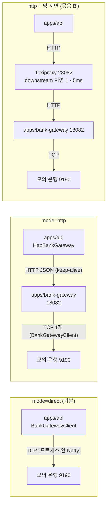
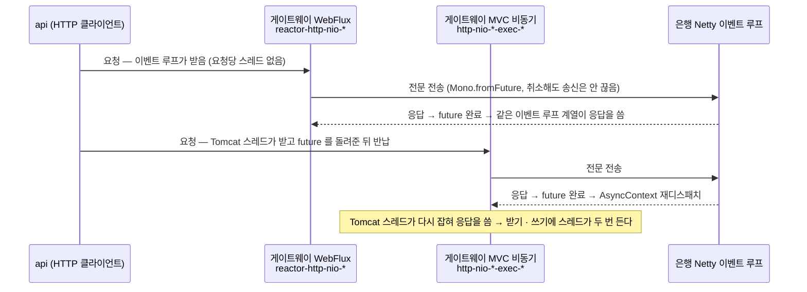
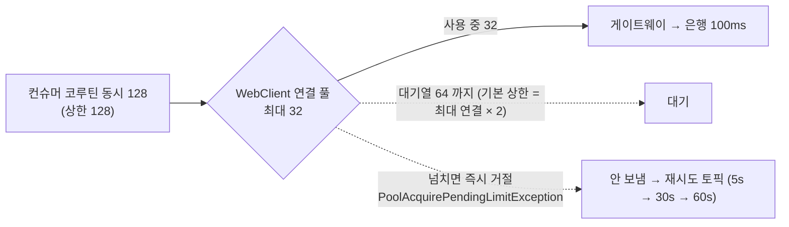
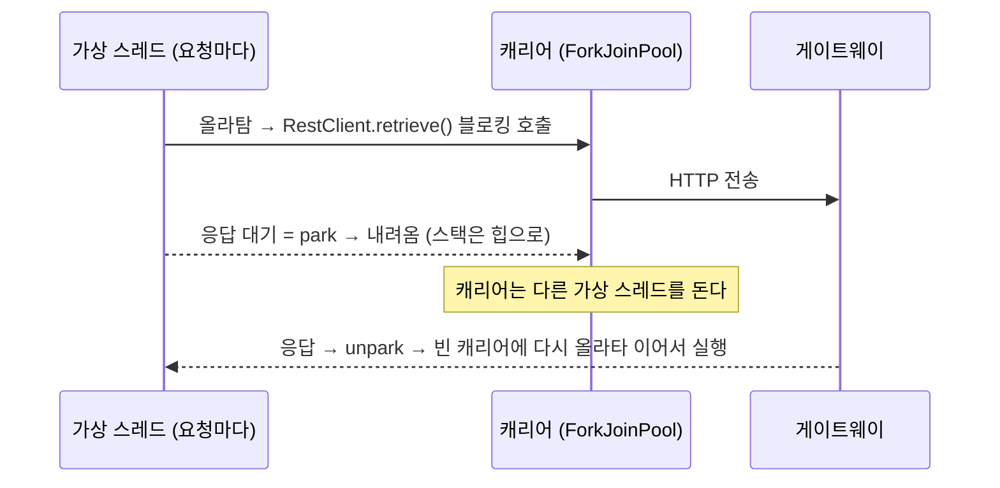

# P8-1 은행 게이트웨이 서비스 분리 — 측정 결과

> 측정: 2026-11-10 13:53 ~ 15:13 (42회 중 40회) + D 묶음 풀 32 재측정 2회 (약 15:17 · 15:19) · 코드: `79be982` (40회) · `7afaf5b` (재측정 2회, §5-7) · 설계: [P8-1 설계](../superpowers/specs/2026-11-10-p8-1-gateway-split-design.md) · 결정: [ADR-0015](../adr/0015-bank-gateway-service.md) · 형식 본보기: [P7 결과](p7-virtual-threads.md)
> 숫자는 **이 PC 기준 상대 비교이며 운영 수치가 아니다.** 앱 · 게이트웨이 · MySQL · Kafka · 모의 은행 · k6 가 한 PC 의 CPU 를 나눠 쓰고, 게이트웨이는 1대다.
> 표기: **확인** = 결과 JSON · 로그 · 스레드 덤프 · 코드로 직접 본 것, **추정** = 그 값들로 계산하거나 추론한 것 (따로 재지 않았다).

## 1. 한 줄 결론
- **분리의 목적은 성능이 아니라 확장 · 은행 연결 소유다. 이 절은 그 비용이 이 PC 에서 얼마였는지만 적는다.** 모든 회차가 정확성 확인을 통과했다 (은행 거래 기록 수 = 처리 행 수, 이중 송신 0 — 확인).
- **A (은행 지연 100ms, 분리 비용)**: 블로킹 컨슈머는 **21.4 → 20.7건/s (−3.3%)** 로 회차 흔들림 안이다. 코루틴(상한 64)은 **361.2 → 297.5건/s (−17.6%)** 로 회차 범위가 겹치지 않는다 — 예상(오차 안)과 **다르다** (확인, 원인은 CPU 포화로 추정).
- **B (지연 0, 순수 오버헤드)**: 코루틴 **408.7 → 314.7건/s (−23.0%)**, p50 65.4 → 70.6ms (+5.2ms), p95 156.2 → 216.2ms (+60.0ms). 시스템 CPU 평균 61.9 → 84.5% (확인).
- **B' (Toxiproxy 지연)**: 프록시를 거치면 p50 이 70.6 → 80.7ms 로 **약 +10ms** 늘지만, 지연 1ms → 5ms 의 차이는 80.7 → 81.1ms 로 회차 흔들림 안이라 보이지 않는다. 처리량은 302.5 · 299.7건/s 로 거의 같다 (확인). 프록시만 거친 대조(지연 0)는 재지 않았다.
- **C (판 비교, 지연 10ms · 상한 128)**: 네 조합 모두 292.4 ~ 337.6건/s. 기본(WebFlux + WebClient) 대비 +10% 이상이 두 회차 모두인 판은 **없다**. 모양은 다르다 — 게이트웨이 스레드 최대 WebFlux 30 vs MVC 비동기 144 (확인).
- **D (연결 풀 천장)**: 풀 32 에서 은행 최대 동시가 **32 에 고정**됐다 (풀 500 은 128). 처음 두 회차는 정확성 확인에 **실패**했고(미완료 324 · 283), 원인은 Reactor Netty 연결 풀 **대기열 상한** 거절을 "모름" 으로 분류한 버그였다 — 고친 뒤 재측정: **102.8 · 202.2건/s** (풀 500: 293.3 · 294.6), 미완료 0 · 이중 0. 두 회차 처리량이 2배 차이 나는 것은 재시도 꼬리 때문이다 (§5-7).
- **E (웹 1원인증, 은행 지연 500ms · 400건/s)**: 처리량은 **400.0 그대로**, 시간 초과 0 · 5xx 0. p95 는 1030.7 → 1135.7ms (+105.0ms) — 예상(수 ms)보다 크고 회차 흔들림도 크다(http 1039.5 ~ 1188.2). 표본 18개 (< 20) 경고 있음 (확인).
- **판단**: 기본 판(WebFlux 서버 + WebClient)을 **유지**한다. `bank.gateway.mode` 기본은 P8-1 에서 `direct` 유지, P8-2 에서 `http` (§8).

## 2. 무엇을 왜 재는가
- P8-1 은 은행 FEP 연결을 혼자 가진 게이트웨이 앱(`apps/bank-gateway`)을 떼어내고 api 가 HTTP 로 부른다. **분리의 목적은 api 를 여러 대로 늘려도 은행 연결이 대수만큼 늘지 않게 하고(연결 소유), 응답 매칭을 한 프로세스에 두는 것**이다 (설계 §1). 더 빠르게 하려는 것이 아니다 — 네트워크 구간이 하나 늘어난 **비용이 얼마인지** 같은 도구로 잰다.
- 같은 PC 루프백은 망 지연이 거의 0 이라 비용이 작게 나오므로, 지연 주입(Toxiproxy)으로 "다른 PC 를 부르는 상황" 에 가깝게 한 번 더 본다 (B').
- 비교 판(서버 WebFlux / MVC 비동기, 클라이언트 WebClient / JDK `HttpClient`)은 면접에서 차이를 설명하려고 구현한 것이다. 같은 계약 테스트 · 같은 측정으로 처리량 · 스레드 모양을 본다 (C).
- 판단 기준은 측정 전에 정했다 (설계 §8-4): 기본 판을 바꾸려면 C 에서 다른 판이 처리량 10% 이상 높고 **두 회차 모두 같은 방향**이어야 한다.

## 3. 그림으로 보기
### 3-1. 직결(`direct`) vs `http` 경로

- 처리 코드는 인터페이스 `BankGateway` 만 본다. 두 모드는 구현 하나만 갈아 끼운 것이다 (설계 §3).

### 3-2. 판별 스레드 흐름 (설계 §5 표를 그림으로)

- 클라이언트 쪽: WebClient 는 Reactor Netty 이벤트 루프가 응답을 처리하고, JDK `HttpClient` 는 셀렉터 스레드 + 기본 실행기(늘어나는 캐시 풀)를 쓴다 (설계 §5-2).

### 3-3. 연결 풀 천장 (묶음 D)

- 동시 128 중 32 는 연결을, 64 는 대기열을 쓰면 나머지(최대 32)는 쓰기 전에 거절된다 (대기열 상한 = 기본값, 코드 확인은 §5-7). 풀 500 이면 128 이 모두 연결을 얻어 이 경로는 열리지 않는다.

## 4. 조건
| 항목 | 값 |
|---|---|
| PC | P7 결과와 같은 PC: AMD Ryzen 7 9700X (8코어 / 논리 16), 메모리 31.1 GB, Windows 11 Pro (P7 문서에서 가져옴 — 이번 로그에는 CPU 모델이 남지 않았다) |
| 버전 | Spring Boot 4.1.1, Kotlin 2.3.21, Reactor Netty 1.3.7 (수정 커밋 메시지), Java toolchain 21 · 게이트웨이 JVM 21.0.12 (스레드 덤프 머리말) |
| 앱 | `apps/api` (측정 포트 **18080**) → 게이트웨이 `apps/bank-gateway` (**18082**, `-Xms512m -Xmx512m`, 점검 송신 보류 끔) → 모의 은행 (**9190**). 컨슈머 묶음은 Hikari 20, 측정 그룹 `transfer-processor-p61` |
| Toxiproxy | api → **Toxiproxy 28082** → 게이트웨이 18082. 프록시 `p81-gateway` (제어 API 8474, Docker), `latency` toxic 을 **응답 방향(downstream)** 에만 1 · 5ms. 회차가 끝나면 프록시를 지운다 |
| 도구 | `load/consumer/run.sh` (A ~ D), `load/verification/run.sh` (E, k6 열린 모델). 환경 변수 `GATEWAY` · `SERVER` · `CLIENT` · `GW_POOL` · `NET_DELAY` |
| 회차 | 42 (A 12 · B 6 · B' 6 · C 8 · D 4 · E 6). 40회는 `79be982` jar, D 풀 32 두 회차는 고친 `7afaf5b` jar 로 **다시** 잰 것 |
| 컨슈머 부하 | 은행 지연 0 / 10 / 100ms, N = 1,500 (블로킹) · 5,000 (코루틴 · D). 코루틴 상한 64 (A · B · B'), 128 (C · D) |
| 웹 부하 | `async` 판, 은행 지연 500ms, 도착률 400건/s, 워밍업 10초 + 측정 30초, 순차 워밍업 3건 |
| 표본 경고 | **코루틴 28회가 처리 시간 20초 미만** (12.1 ~ 17.7초) 이라 CPU 표본이 6 ~ 9개 (< 10) — 해당 칸의 CPU · 스레드 수는 거칠다. E 는 측정 구간 표본 18 ~ 19개 (< 20) (확인, `build/p81-measure.log`) |

## 5. 결과
> 표는 `summarize.sh` 출력 그대로다 (묶음별로 행을 나눠 놓았다). 지표마다 **중앙값**이고, 회차가 2개인 칸은 **작은 쪽 값**이 나온다 (스크립트의 `v[int((n+1)/2)]`) — C · D 칸은 회차별 값을 본문에 따로 적었다. gw = 게이트웨이 프로세스(Actuator 값). 소수 둘째 자리 이하는 스크립트가 버렸다.

### 5-1. A — 분리 비용 (은행 지연 100ms, 3회)
| 모드 | 게이트웨이 | 지연 (ms) | 상한 | Hikari | N | 회차 | 처리량 (건/s) | 예상 (건/s) | p50 (ms) | p95 (ms) | 시스템 CPU 평균 / 최대 (%) | CPU 표본 | API CPU 평균 (%) | MySQL CPU 평균 (%) | 은행 최대 동시 | 편차 | gw CPU 평균 / 최대 (%) | gw 스레드 최대 |
|---|---|---|---|---|---|---|---|---|---|---|---|---|---|---|---|---|---|---|
| blocking | direct | 100 | - | 20 | 1500 | 3 | 21.4 | 30 | 117.5 | 124.2 | 19.4 / 35.5 | 52 | 1.6 | 9.8 | 3 | 4% | - / - | - |
| blocking | http-gw-reactive-webclient | 100 | - | 20 | 1500 | 3 | 20.7 | 30 | 118.2 | 131.1 | 25.6 / 100.0 | 53 | 1.7 | 9.8 | 3 | 0% | 0.9 / 2.3 | 30 |
| coroutine | direct | 100 | 64 | 20 | 5000 | 3 | 361.2 | 640 | 133.7 | 172.2 | 72.1 / 100.0 | 7 (<10) | 17.3 | 86.8 | 64 | 1% | - / - | - |
| coroutine | http-gw-reactive-webclient | 100 | 64 | 20 | 5000 | 3 | 297.5 | 640 | 140.3 | 208.4 | 86.0 / 100.0 | 9 (<10) | 21.8 | 110.3 | 64 | 5% | 7.1 / 11.8 | 30 |

- 회차별 처리량: 블로킹 direct 20.5 · 21.5 · 21.4, http 20.6 · 20.8 · 20.7. 코루틴 direct 363.0 · 361.2 · 356.3, http 282.4 · 297.5 · 305.2 (확인). 블로킹은 http 범위가 direct 범위 안이고, 코루틴은 두 범위가 겹치지 않는다.

### 5-2. B — 순수 오버헤드 (코루틴 · 지연 0 · 상한 64, 3회)
| 모드 | 게이트웨이 | 지연 (ms) | 상한 | Hikari | N | 회차 | 처리량 (건/s) | 예상 (건/s) | p50 (ms) | p95 (ms) | 시스템 CPU 평균 / 최대 (%) | CPU 표본 | API CPU 평균 (%) | MySQL CPU 평균 (%) | 은행 최대 동시 | 편차 | gw CPU 평균 / 최대 (%) | gw 스레드 최대 |
|---|---|---|---|---|---|---|---|---|---|---|---|---|---|---|---|---|---|---|
| coroutine | direct | 0 | 64 | 20 | 5000 | 3 | 408.7 | - | 65.4 | 156.2 | 61.9 / 85.6 | 6 (<10) | 19.4 | 96.9 | 1 | 5% | - / - | - |
| coroutine | http-gw-reactive-webclient | 0 | 64 | 20 | 5000 | 3 | 314.7 | - | 70.6 | 216.2 | 84.5 / 100.0 | 7 (<10) | 19.5 | 108.1 | 1 | 4% | 7.1 / 12.0 | 30 |

- 회차별 처리량: direct 408.7 · 411.6 · 408.7, http 314.7 · 322.6 · 312.1 (확인).

### 5-3. B' — 망 지연 (http · 코루틴 · 지연 0 · 상한 64, 지연마다 3회)
| 모드 | 게이트웨이 | 지연 (ms) | 상한 | Hikari | N | 회차 | 처리량 (건/s) | 예상 (건/s) | p50 (ms) | p95 (ms) | 시스템 CPU 평균 / 최대 (%) | CPU 표본 | API CPU 평균 (%) | MySQL CPU 평균 (%) | 은행 최대 동시 | 편차 | gw CPU 평균 / 최대 (%) | gw 스레드 최대 |
|---|---|---|---|---|---|---|---|---|---|---|---|---|---|---|---|---|---|---|
| coroutine | http-gw-reactive-webclient-n1ms | 0 | 64 | 20 | 5000 | 3 | 302.5 | - | 80.7 | 220.7 | 90.7 / 100.0 | 7 (<10) | 20.7 | 107.5 | 1 | 3% | 7.1 / 9.8 | 30 |
| coroutine | http-gw-reactive-webclient-n5ms | 0 | 64 | 20 | 5000 | 3 | 299.7 | - | 81.1 | 226.2 | 90.0 / 100.0 | 8 (<10) | 19.9 | 106.5 | 1 | 6% | 7.0 / 10.9 | 30 |

- 표의 "지연 (ms)" 칸은 **모의 은행 지연**(0)이다. Toxiproxy 지연은 게이트웨이 칸 이름의 `n1ms` · `n5ms`.
- 회차별 p50: 1ms 80.7 · 81.7 · 76.2, 5ms 80.3 · 84.3 · 81.1 (확인).

### 5-4. C — 판 비교 (코루틴 · 지연 10ms · 상한 128, 조합마다 2회)
| 모드 | 게이트웨이 | 지연 (ms) | 상한 | Hikari | N | 회차 | 처리량 (건/s) | 예상 (건/s) | p50 (ms) | p95 (ms) | 시스템 CPU 평균 / 최대 (%) | CPU 표본 | API CPU 평균 (%) | MySQL CPU 평균 (%) | 은행 최대 동시 | 편차 | gw CPU 평균 / 최대 (%) | gw 스레드 최대 |
|---|---|---|---|---|---|---|---|---|---|---|---|---|---|---|---|---|---|---|
| coroutine | http-gw-reactive-jdk | 10 | 128 | 20 | 5000 | 2 | 319.2 | 12800 | 92.3 | 258.6 | 84.5 / 100.0 | 6 (<10) | 18.6 | 93.9 | 128 | 7% | 7.2 / 11.3 | 30 |
| coroutine | http-gw-reactive-webclient | 10 | 128 | 20 | 5000 | 2 | 307.9 | 12800 | 90.6 | 243.7 | 85.9 / 100.0 | 7 (<10) | 21.6 | 103.0 | 128 | 4% | 7.2 / 12.1 | 30 |
| coroutine | http-gw-servlet-jdk | 10 | 128 | 20 | 5000 | 2 | 325.9 | 12800 | 97.9 | 267.6 | 87.1 / 100.0 | 7 (<10) | 20.6 | 93.6 | 128 | 8% | 9.4 / 13.7 | 144 |
| coroutine | http-gw-servlet-webclient | 10 | 128 | 20 | 5000 | 2 | 292.4 | 12800 | 93.8 | 263.0 | 90.2 / 100.0 | 7 (<10) | 21.0 | 95.5 | 128 | 13% | 9.3 / 15.6 | 144 |

- 회차별 처리량 (1회차 · 2회차): reactive + webclient 307.9 · 320.1 / reactive + jdk 336.0 · 319.2 / servlet + webclient 310.1 · 292.4 / servlet + jdk 325.9 · 337.6 (확인).
- 기본(reactive + webclient) 대비 회차별 비율 (식 = 그 판 ÷ 기본 − 1): reactive + jdk **+9.1% · −0.3%** (336.0 ÷ 307.9, 319.2 ÷ 320.1), servlet + jdk **+5.8% · +5.5%** (325.9 ÷ 307.9, 337.6 ÷ 320.1), servlet + webclient **+0.7% · −8.7%** (310.1 ÷ 307.9, 292.4 ÷ 320.1) (계산).
- 이 묶음 전부 처리 시간이 14.8 ~ 17.1초(< 20초)이고 CPU 표본 6 ~ 8개다. 시스템 CPU 평균 85 ~ 92% 로 한 PC 가 포화 상태라 처리량 차이를 판 탓으로 단정하기 어렵다.

### 5-5. D — 연결 풀 천장 (http · 코루틴 · 지연 100ms · 상한 128, 풀마다 2회)
| 모드 | 게이트웨이 | 지연 (ms) | 상한 | Hikari | N | 회차 | 처리량 (건/s) | 예상 (건/s) | p50 (ms) | p95 (ms) | 시스템 CPU 평균 / 최대 (%) | CPU 표본 | API CPU 평균 (%) | MySQL CPU 평균 (%) | 은행 최대 동시 | 편차 | gw CPU 평균 / 최대 (%) | gw 스레드 최대 |
|---|---|---|---|---|---|---|---|---|---|---|---|---|---|---|---|---|---|---|
| coroutine | http-gw-reactive-webclient-p32 | 100 | 128 | 20 | 5000 | 2 | 102.8 | 1280 | 236.3 | 356.6 | 36.4 / 93.6 | 13 | 6.1 | 32.8 | 32 | 97% | 2.5 / 9.2 | 30 |
| coroutine | http-gw-reactive-webclient-p500 | 100 | 128 | 20 | 5000 | 2 | 293.3 | 1280 | 155.2 | 299.5 | 86.4 / 100.0 | 7 (<10) | 17.7 | 92.8 | 128 | 2% | 7.0 / 12.4 | 30 |

- 회차별 (1회차 · 2회차): 풀 32 — 처리량 **102.8 · 202.2**, 걸린 시간 48.658 · 24.724초, p50 236.3 · 240.4ms, p95 356.6 · 357.3ms, 시스템 CPU 평균 36.4 · 68.0%. 풀 500 — 293.3 · 294.6건/s, p50 155.2 · 158.8ms (확인).
- 풀 32 의 편차 97% 는 위 두 회차의 처리량 차이다. 이 칸의 해석은 §5-7.
- 풀 32 는 `7afaf5b`, 풀 500 은 `79be982` 로 쟀다. 수정은 "안 보냄" 분류에만 닿고, 풀 500 은 거절이 0건이라 (§5-7) 조건이 달라도 비교에 영향이 없다고 본다 (추정).

### 5-6. E — 웹 1원인증 (async 판 · 은행 지연 500ms · 400건/s, 3회)
| 게이트웨이 · 지연 · 도착률 | 회차 | 201 처리량 (건/s) | p50 (ms) | p95 (ms) | p99 (ms) | 스레드 최대 | 시스템 CPU 평균 (%) | 앱 CPU 평균 (%) | 시간 초과 | dropped | 5xx | gw CPU 평균 / 최대 (%) | gw 스레드 최대 |
|---|---|---|---|---|---|---|---|---|---|---|---|---|---|
| direct · 500ms · 400 | 3 | 400.0 | 1019.4 | 1030.7 | 1064.3 | 38.0 | 40.6 | 4.4 | 0 | 42 | 0 | - / - | - |
| http-gw-reactive-webclient · 500ms · 400 | 3 | 400.0 | 1022.3 | 1135.7 | 1238.8 | 65.0 | 52.0 | 5.9 | 0 | 323 | 0 | 3.1 / 9.7 | 30 |

- 회차별 p95: direct 1030.7 · 1054.2 · 1028.9, http 1135.7 · 1188.2 · 1039.5. p99: direct 1061.3 · 1124.8 · 1064.3, http 1238.8 · 1296.4 · 1063.1 (확인).
- k6 가 도착 시각에 못 맞춘 `dropped`: direct 42 · 63 · 33, http 341 · 323 · 169. 가상 사용자 최대: direct 441 · 463 · 433, http 695 · 702 · 563 (확인).
- 모든 회차 201 수 = 행 수 = 1원 이체 수 (예: http 1회차 15,660 · 15,660 · 15,660), 시간 초과 0.
- 측정 구간 표본이 18 ~ 19개 (< 20) — 스레드 · CPU 평균은 거칠다.

### 5-7. 측정 중 생긴 일 — D 묶음 풀 32 첫 2회 정확성 확인 실패
**증상 (확인).** `GATEWAY=http GW_POOL=32` · 코루틴 · 지연 100ms · 상한 128 의 1 · 2회차가 정확성 확인에서 실패해 `.json.invalid` 로 바뀌었다 (`build/p81-measure.log`). 1회차: 출금 5000 중 **미완료 324**, 은행 기록 4676, 이중 입금(두 번 간 거래번호) 0. 2회차: 은행 기록 4717 (5000 − 4717 = 283 미완료), 이중 0. 돈은 안전한 쪽으로 실패했다 — 이중 출금은 없다. (`.invalid` 파일 자체는 재측정이 같은 이름으로 대체해 폴더에 남아 있지 않고, 증거는 위 로그다.)

**원인 (코드 · 로그로 확인).** Reactor Netty 연결 풀의 **대기열 기본 상한 = 최대 연결 × 2** 다 (풀 32 → 64). 이 기본값은 재현 테스트(`WebClientBankGatewayTest` — 풀 1 · 동시 4건이면 대기열 2 를 넘은 건이 거절된다)로 고정했다. 동시 128 중 연결을 못 얻고 대기열도 넘친 요청은 `PoolAcquirePendingLimitException` 으로 **즉시 거절**된다. 그런데 실패 분류가 `PoolAcquireTimeoutException` 만 "안 보냄" 으로 알고 있어서 이 예외를 "모름" 으로 올렸고, "모름" 은 결과조회 경로로 가서 측정 창 안에 끝나지 못했다. 요청은 쓰기 전에 거절된 것이므로 대기 시간 초과와 같은 "안 보냄" 이 맞다.

**고침.** 커밋 `7afaf5b` — 풀 예외 단순 이름 집합에 `PoolAcquirePendingLimitException` 추가, 단위 테스트를 가짜 클래스 대신 Reactor Netty 1.3.7 의 **실제 셰이드 예외**로 고정, 풀 1 · 동시 4건으로 대기열 초과를 재현하는 테스트 추가. 고치기 전에 두 테스트가 실패하는 것을 확인했다 (컨트롤러 확인).

```kotlin
private val POOL_ACQUIRE_FAILURES = setOf("PoolAcquireTimeoutException", "PoolAcquirePendingLimitException")
```

**재측정 (`build/p81-rerun-p32-1.log` · `-2.log`).** 두 회차 모두 정확성 통과 (미완료 0 · 환불 0 · 원장 불일치 0 · 이중 0, 은행 기록 5000 = N). 그 결과가 §5-5 의 풀 32 행이다.

| 풀 32 재측정 | 처리량 (건/s) | 걸린 시간 (초) | p50 / p95 (ms) | 은행 최대 동시 | "안 보냄" 로그 (api) | 재시도 2단계(retry-1) 소비 흔적 |
|---|---|---|---|---|---|---|
| 1회차 | 102.8 | 48.658 | 236.3 / 356.6 | 32 | 218줄 | 있음 (끝 시각 15:18:01) |
| 2회차 | 202.2 | 24.724 | 240.4 / 357.3 | 32 | 227줄 | 없음 (끝 시각 15:19:57) |

**두 회차 처리량이 2배 차이 나는 이유 — 재시도 꼬리 (로그로 확인한 만큼).**
- p50 · p95 는 거의 같다 (236.3 vs 240.4, 356.6 vs 357.3). 거의 모든 건은 같은 속도로 끝났고, 달라진 것은 **마지막 건이 끝나는 시각**이다. 처리량은 N ÷ (첫 `sending_at` ~ 마지막 `updated_at`) 이라 (`load/consumer/run.sh` 285 ~ 286행) 꼬리 한 건이 전체 시간을 정한다 (확인).
- 재시도 간격은 5초 → 30초 → 60초(최대)다 (`application.yml` `transfer.retry`: delay 5000 · multiplier 6.0 · max 60000 — 확인). "안 보냄" 건은 재시도 토픽으로 가서 5초 뒤 다시 시도된다.
- 1회차 `api-process.log`: 재시도 2단계 토픽(`transfer.requested-retry-1-*`) 파티션 위치 조정(seek)이 15:17:51 · 15:18:01 에 남아 있고, 마지막 줄 15:18:01.482 가 실행 끝(시작 약 15:17:12 + 48.7초)과 맞는다. "안 보냄" 마지막 줄은 15:17:31 이고 + 30초 = 15:18:01 이다 (계산). 즉 **첫 재시도에서도 또 거절되어 30초 칸으로 넘어간 건이 꼬리를 약 24초 늘렸다** (48.658 − 24.724 = 23.9초).
- 2회차는 재시도 2단계 소비 흔적이 없고 마지막 줄이 15:19:57 로 실행 끝과 맞는다 — 모든 건이 첫 재시도(5초 칸) 안에서 끝났다.
- **확인 못 한 것**: 1회차에서 몇 건이 30초 칸으로 갔는지(건수), 왜 1회차에만 그런 건이 생겼는지. 재시도 시각이 풀이 가득 찬 순간과 겹친 우연이라고 보지만 (추정) 따로 확인하지 않았다. 두 회차 사이 시스템 CPU 평균 36.4 vs 68.0% 도 빈 꼬리 구간이 평균을 낮춘 것으로 본다 (표본 32 vs 13개, 추정).
- 결론: **D 의 결론은 "풀 천장에서는 거절이 재시도로 넘어가 꼬리가 길어진다"** 이다. 풀 32 의 처리량 (102.8 · 202.2)은 풀의 순수 한계가 아니라 재시도 꼬리가 섞인 값이어서, 설계 예상(≈ 260건/s)과 직접 비교하지 않는다.

**나머지 40회는 고치기 전 jar 로 쟀다 — 영향 없다.** 풀 500 · 동시 ≤ 128 에서는 대기열 상한(1000)에 닿지 않는다. 실제로 풀 32 두 회차를 뺀 컨슈머 http 25회의 `api-process.log` 에 "bank transfer not sent" 가 **0줄** 이다 (확인; E 6회는 앱 로그를 따로 남기지 않아 이 확인에서 빠진다 — 거기서는 1원인증 201 수 = 행 수 = 1원 이체 수로 확인했다).

**남긴 선택.** 대기열 상한은 **기본값(× 2) 그대로** 둔다 — 빨리 거절하고 재시도 토픽이 흡수한다. 대안은 `pendingAcquireMaxCount` 를 키우는 것인데, 그러면 거절은 줄지만 대기하는 요청이 늘어 연결 대기 시간 초과(`pendingAcquireTimeout` 1초 — 이것도 "안 보냄")에 걸리거나 지연이 길어지는 대가가 있다 (설계 판단, 측정하지 않음).

**면접 포인트.** "실패 분류 표는 라이브러리 기본값이 만드는 예외까지 포함해야 한다 — 천장을 일부러 쳐 보는 측정에서 드러났다."

## 6. 예상과 비교 (설계 §8-3)
| 칸 | 예상 (추정) | 실제 (확인) | 판정 |
|---|---|---|---|
| A | 차이가 회차 간 흔들림 안. 처리량 = 동시성 ÷ (은행 지연 + α) 에서 α 가 수 ms 늘 뿐 | 블로킹: 21.4 → 20.7건/s (−3.3%), p50 +0.7ms, http 범위가 direct 범위 안 → **맞음**. 코루틴 상한 64: 361.2 → 297.5 (−17.6%), 범위가 안 겹침 → **다름** | 부분 |
| (A 코루틴이 다른 이유) | — | 은행 지연 100ms · 상한 64 의 이론 천장 640건/s 에 direct 도 못 닿는다 (361.2). 시스템 CPU 평균 72.1 → 86.0%, 최대 100%, MySQL CPU 평균 86.8 → 110.3% 라 은행 대기가 아니라 **PC 의 CPU 가 천장**이다 (추정). http 는 게이트웨이 프로세스(gw CPU 평균 7.1%) · JSON 변환 · HTTP 처리가 같은 CPU 를 더 쓴다 (추정) — 운영처럼 다른 호스트면 이 몫은 달라진다 | 이유 |
| B | 한 건당 수 ms 증가 (루프백) | p50 65.4 → 70.6ms (**+5.2ms**) → **맞음**. 그러나 p95 는 +60.0ms (156.2 → 216.2), 처리량은 −23.0% (408.7 → 314.7, 식 = 314.7 ÷ 408.7 − 1) — p50 만 보면 안 보이는 꼬리 · CPU 비용이 있다 | 부분 (p50 맞음 · 꼬리 다름) |
| B' (p50) | 지연을 넣은 만큼 p50 이 늘고 | 프록시를 거치자 p50 70.6 → 80.7 (+10.1ms), 그러나 1ms → 5ms 는 80.7 → 81.1 (+0.4ms) — 기대한 +4ms 가 회차 흔들림(76.2 ~ 84.3) 안에 묻힌다. 프록시 경유 자체(Docker 경유 한 번 더 건너는 비용)가 지연 설정보다 크다 (추정) | **다름** |
| B' (처리량) | 동시성이 충분하면 처리량은 거의 그대로 (리틀의 법칙) | 314.7 → 302.5 (−3.9%) → 299.7 (−4.8%), 1ms ↔ 5ms 는 −0.9% | **맞음** |
| C | 처리량은 비슷하고 스레드 모양만 다르다 | 처리량: 기본 대비 +10% 이상이 두 회차 모두인 판 없음 (§5-4) → **맞음**. 게이트웨이 스레드 최대 WebFlux 30 / MVC 144 → 스레드 모양 **맞음** (게이트웨이 쪽). JDK 판의 api 쪽 실행기 스레드는 덤프를 안 떠서 **확인 못 함** (§7) | 맞음 (일부 미확인) |
| D | 풀 32 에서 ≈ 32 ÷ (0.1s + α) ≈ 260건/s 근처 천장, 500 이면 상한 128 이 한계 | **동시성 천장은 맞음**: 은행 최대 동시 32 (풀 32) · 128 (풀 500). **처리량은 다름**: 풀 32 102.8 · 202.2 (재시도 꼬리, §5-7), 풀 500 293.3 · 294.6 — 128 ÷ 0.1s = 1280 에는 못 닿는다 (PC CPU 포화, 시스템 CPU 평균 86%). 거기에 **예상하지 못한 정확성 실패**(대기열 상한 거절의 분류 누락)가 먼저 드러났다 | 다름 |
| E | p95 가 수 ms 늘고 처리량은 400 그대로 | 처리량 **400.0 그대로**, 시간 초과 0 · 5xx 0 → 맞음. p95 1030.7 → 1135.7 (**+105.0ms**, 중앙값 기준) — 예상보다 크고 회차 간 흔들림도 크다 (http p95 1039.5 ~ 1188.2). dropped 42 → 323, 가상 사용자 최대 441 → 695, api 스레드 38 → 65 | p95 **다름** |
| (E 가 다른 이유) | — | 요청 하나가 HTTP 한 구간(+ 게이트웨이 처리)을 더 지나 응답이 조금 늦어지면 열린 모델에서 가상 사용자가 늘고 api 스레드도 는다 (추정). 이 PC 에서 게이트웨이를 켠 만큼 시스템 CPU 평균이 40.6 → 52.0% 로 올랐다 (확인). 표본 18개 (< 20) 이고 3회뿐이라 +105ms 를 한 값으로 믿지 않는다. 원인을 가르는 별도 실험은 안 했다 | 이유 |

## 7. 판 비교 읽는 법 — 스레드 덤프 · CPU · 스레드 수
게이트웨이의 `jcmd Thread.dump_to_file` 덤프(`build/load-p61/<회차>/gw-threads.txt`)를 **회차가 끝난 직후**(`load/consumer/run.sh` 270행, 남은 건이 0 이 된 뒤 2초) 떴다. 그래서 스택은 모두 쉬는 모양이고, **쓰는 스레드의 이름 · 개수**가 증거다 (확인).

| 판 (C 1회차) | 게이트웨이 덤프의 스레드 (이름 패턴 : 개수) | 덤프 전체 | summarize `gw 스레드 최대` |
|---|---|---|---|
| WebFlux + WebClient | `reactor-http-nio-N` : 16, `boundedElastic-N` : 2, `multiThreadIoEventLoopGroup-N-N` : 1 (은행 Netty 클라이언트) | 30 | 30 |
| WebFlux + JDK | 위와 같다 (서버 쪽 스레드만 보이므로 클라이언트 판은 구분되지 않는다) | 30 | 30 |
| MVC 비동기 + WebClient | `http-nio-18082-exec-N` : **129**, `Catalina-utility-N` : 2, `http-nio-18082-Poller` · `Acceptor` : 각 1, `multiThreadIoEventLoopGroup-N-N` : 1 | 144 | 144 |
| MVC 비동기 + JDK | 위와 같다 | 144 | 144 |

```
"reactor-http-nio-1"        … WEPollSelectorImpl.doSelect → NioIoHandler.run     (이벤트 루프: 일이 없으면 select 에서 쉼)
"http-nio-18082-exec-1"     … LinkedBlockingQueue.poll → TaskQueue.poll → ThreadPoolExecutor.getTask   (Tomcat 풀 스레드: 큐에서 대기)
```
- **WebFlux**: 이벤트 루프 16개(논리 코어 수와 같다 — 추정)가 받기 · 쓰기를 모두 한다. 동시 128 요청에도 스레드는 30 그대로다.
- **MVC 비동기**: 받기 · 쓰기에 Tomcat 스레드가 두 번 들어 동시 128 근처까지 풀이 자라 **exec 스레드 129개**가 남았다 (확인; 최대 128 + 1 은 동시 상한 128 과 맞는다 — 추정). 쉬는 모양이어도 개수가 "동시에 요청이 이만큼 있었다" 는 흔적이다.
- **JDK `HttpClient`**: 이름이 `HttpClient-N-Worker-N` 인 스레드는 **api 프로세스** 안에 있어 게이트웨이 덤프에 나오지 않는다. 이번에는 api 덤프를 뜨지 않아 **이 이름은 직접 확인하지 못했다** (설계 §5-2 의 서술일 뿐).
- gw CPU (Actuator, 전체 CPU 대비 — 추정): WebFlux 7.2 ~ 7.5% (JDK 판 2회차만 10.9%), MVC 비동기 9.3 ~ 10.3% (확인). MVC 가 평균 2%p 안팎 높지만 시스템 CPU 가 85 ~ 92% 로 포화라 판 탓이라 단정하지 않는다.

## 8. 판단 (설계 §8-4 기준)
| 기준 | 결과 | 판정 |
|---|---|---|
| 기본 판(WebFlux + WebClient)을 바꾸는 조건: 다른 판이 C 에서 처리량 **10% 이상** 높고 **두 회차 모두** 같은 방향 | 가장 큰 후보 reactive + jdk 가 +9.1% · −0.3% (방향이 다르다), servlet + jdk +5.8% · +5.5% (10% 미만), servlet + webclient +0.7% · −8.7% | **불충족 → 유지** |
| `mode` 기본은 P8-1 에서 `direct` 유지, P8-2 에서 `http` 로 | 측정 결과와 상관없다. 분리의 목적이 성능이 아니라 확장 · 연결 소유이기 때문 | 그대로 |
| A · E 에서 차이가 예상보다 크면 원인을 찾아 문서에 남긴다 | A 코루틴 −17.6% · B −23.0% · E p95 +105ms 는 예상보다 크다. 원인은 §6 에 적었다 — 모두 **한 PC 의 CPU 포화로 보이지만(추정) 따로 가르는 실험은 안 했다** | 남김 |

→ 기본 판 **유지**. 두 번째 근거는 비교 판 사이에 의미 있는 차이가 없다는 것이다 — 그렇다면 스레드 수가 작고(30 vs 144) 취소 · 연결 풀 조절이 되는 쪽(WebFlux + WebClient)이 기본으로 맞다. 단 D 가 보여 준 대로 **풀 크기와 실패 분류는 함께 봐야 한다**: 풀 500 은 이 부하에서 천장이 아니고, 풀을 줄이면 거절이 재시도로 넘어간다.

## 9. 한계
- **한 PC · 게이트웨이 1대.** 앱 · 게이트웨이 · MySQL · Kafka · 모의 은행 · k6 가 CPU 를 나눠 쓴다. 코루틴 묶음의 시스템 CPU 평균이 85 ~ 92% 라 "HTTP 구간이 느리다" 와 "한 PC 가 포화다" 를 가르지 못한다.
- **루프백.** 같은 PC 라 실제 망의 패킷 손실 · 대역폭 · 다른 호스트로 가는 CPU 분리를 흉내 내지 못한다.
- **Toxiproxy 는 지연만, 응답 방향에만** 넣었다. 끊김 · 손실은 테스트(Testcontainers)에서 다뤘고 측정에는 없다. 프록시만 거친 대조(지연 0)가 없어 **프록시 경유 비용과 지연 설정을 가르지 못한다** (B' 에서 +10ms 의 정체는 추정).
- **표본이 작다.** 코루틴 28회가 처리 시간 20초 미만(CPU 표본 6 ~ 9개), E 는 측정 구간 표본 18 ~ 19개 (< 20). C · D 는 조합마다 2회뿐이다. 2회짜리 칸의 summarize 값은 작은 쪽 값이다.
- **D 의 코드가 다르다** (풀 32 `7afaf5b` / 풀 500 `79be982`, §5-5). 풀 32 의 처리량은 재시도 꼬리가 섞인 값이다 (§5-7).
- 게이트웨이 덤프는 부하 직후(쉬는 모양)다. 부하 한가운데의 스택 · api 쪽 JDK 클라이언트 스레드는 보지 못했다 (§7).
- 서버 설정 불일치 위험(점검 시간 설정이 두 곳), 서비스 간 인증 없음은 설계 §10 그대로다.

## 10. 원자료
- `docs/perf/raw/p8-1/<모드>-d<지연>-h20-<회차>.json`. 이름 규칙: 직결은 접미사 없음, http 는 `-gw-<서버>-<클라이언트>` + 풀 `-p<N>` + 망 지연 `-n<N>ms` (예: `coroutine-d100-c128-h20-gw-reactive-webclient-p32-1.json`). 웹은 `async-d500-r400[-gw-reactive-webclient]-<회차>.json`. 총 42개, `.json.invalid` 는 남아 있지 않다 (§5-7: 풀 32 실패 2회는 재측정이 같은 이름으로 대체, 증거는 `build/p81-measure.log`).
- 원자료 키: P6-1 · P6-2 · P7 과 같고 `gateway` · `gw_cpu_avg` · `gw_cpu_max` · `gw_threads_max` 가 더해졌다 (직결은 `gateway: "direct"` · `gw_*` 는 `null`). 코드 해시 `code` 가 회차마다 들어 있다.
- 회차별 로그 · 스레드 덤프 · 게이트웨이 CPU 표본: `build/load-p61/<회차>/` (`gw-threads.txt` · `gw.txt` · `cpu.txt` · `api-process.log` · `gateway.log`), `build/load-p62/<회차>/` (커밋하지 않음). 전체 실행 로그 `build/p81-measure.log`, 재측정 `build/p81-rerun-p32-1.log` · `-2.log`.
- **표를 만든 방법.** `RAW_SUB=p8-1 bash load/consumer/summarize.sh` · `RAW_SUB=p8-1 bash load/verification/summarize.sh` 출력 그대로다. 이 폴더에는 컨슈머 · 웹 JSON 이 섞여 있어 처음에는 두 스크립트가 서로의 JSON 에서 멈췄다 (컨슈머: 웹 JSON 에 없는 키, 웹: `set -e` 아래 `&&` 사슬이 마지막 파일에서 거짓이면 치환 전체가 실패). 결과 문서 커밋에서 각 스크립트가 자기 종류만 읽게(컨슈머 `"tps"` · 웹 `"rate"` 키) 고쳤고, 고친 출력이 위 표와 같음을 확인했다. P6-1 · P6-2 원자료에서도 그대로 돈다.
- 측정 뒤 안내: 개발용 그룹 `transfer-processor` 의 `transfer.requested` 에 측정 메시지가 171,600건 밀려 있다 (재측정 뒤 로그 기준, `reset-dev-group` 은 사용자 확인 뒤).

## 11. 말로만 비교: `RestClient` + 가상 스레드
**구현하지도 재지도 않았다.** 설계 §2 결정 5 대로 흐름과 코드 발췌만 두고, 숫자는 **P7 결과**로 설명한다.

```kotlin
// 설명용 (저장소에 없음)
val client = RestClient.create("http://gateway:8082")
Thread.ofVirtual().start {
    client.post().uri("/internal/v1/bank/transfers").body(req).retrieve().body<TransferHttpResponse>()   // 블로킹 호출 — 가상 스레드는 park 로 캐리어를 놓는다
}
```

- **무엇이 같나**: WebClient 와 목적이 같다 — "응답을 기다리는 동안 OS 스레드를 놓는다". 코드는 블로킹 스타일 그대로이고 `Mono` · 콜백이 없다.
- **P7 의 숫자로 본 효과**: 블로킹 코드에 설정 한 줄로 가상 스레드를 켜자 은행 지연 500ms · 400건/s 에서 **59.0 → 400.0건/s** (Tomcat 200 천장 소멸), 코루틴 판과 같은 800.0건/s 까지 갔다 (P7 §1 · §7-1).
- **P7 의 한계도 그대로 온다**: Java 21 에서는 `synchronized` 를 쥔 채 park 하거나 모니터 입장을 기다리면 캐리어를 붙잡는다 — 막 뜬 앱에 동시 요청이 몰리면 앱 전체가 멈춘 냉시동 교착 4/4 (P7 §6). 그래서 ADR-0014 는 Java 21 에서 기본값을 **끈 채로** 두었다. 이 클라이언트를 쓴다면 같은 시험(냉시동 · 모니터 입장 대기)이 먼저다.
- **WebClient 와 다른 점**: 연결 풀(최대 연결 · 대기 시간) 조절 · 취소 전달 · Micrometer 연결 지표는 WebClient(Reactor Netty) 쪽이 낫고, `RestClient` 는 선택한 HTTP 클라이언트 구현에 따라 다르다. 동시 호출 상한은 코드로 따로 둬야 한다 (가상 스레드는 풀이 없어 과부하 보호가 사라진다 — P7 §11).
