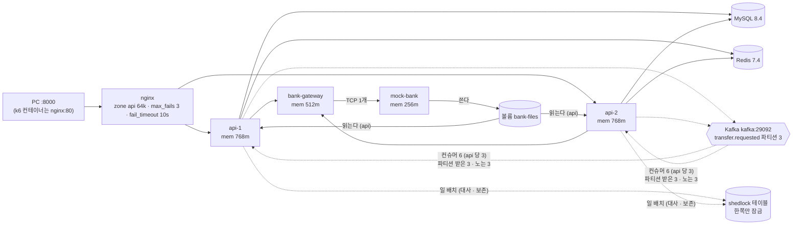
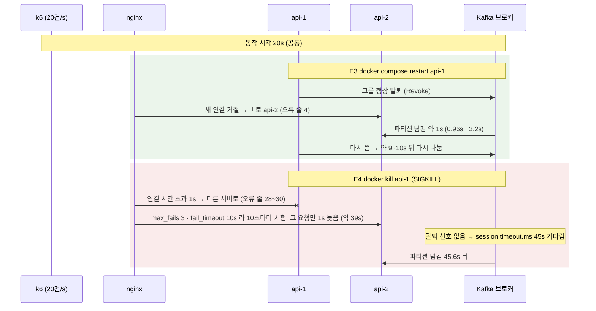

# P8-2 Compose 로 api 2대 — 측정 결과

> 측정: 2026-11-11 12:10 ~ 13:56 (E1 · E2 · E3 · E4 · E5) · 설계: [P8-2 설계](../superpowers/specs/2026-11-11-p8-2-compose-design.md) · 형식 본보기: [P8-1 결과](p8-1-gateway-split.md)
> 숫자는 **이 PC 기준이며 운영 수치가 아니다.** api 2대 · 게이트웨이 · 모의 은행 · nginx · MySQL · Kafka · Redis · k6 가 한 PC 의 CPU 를 나눠 쓴다. 숫자의 출처는 `docs/perf/raw/p8-2/` 의 원자료다.
> 이 문서는 **처리량을 재지 않았다.** 목적은 "2대로 띄웠을 때 가용성 · 정합성이 지켜지는가, 이미지는 얼마인가" 이다.

## 1. 한 줄 결론
- **처리량은 재지 않았다 — 한 PC 의 2대는 같은 CPU 를 나눠 쓴다.** 늘었다고 주장하지 않는다.
- **E1 (이미지)**: api 512MB · bank-gateway 381MB · mock-bank 297MB (추정 ~300MB 보다 큼). 코드 한 줄 수정 빌드 26.5s, 새로 만든 층은 application 1.67MB 뿐 (dependencies 116MB 층 그대로). 기동 → healthy 30.3s. 측정 중 `.dockerignore` 누락을 찾아 고쳤다 (아무것도 안 바꾼 빌드 27.3s → 3.9s).
- **E2 (분배)**: `/actuator/info` 100번 → api-1 50 · api-2 50. Kafka 컨슈머 6 중 파티션을 받은 것 3, **노는 컨슈머 3**, lag 0.
- **E3 (롤링 재시작, 2회)**: 첫 시도 5xx **0**, 접수 키 = 출금 행 (1201 = 1201 · 1200 = 1200), 은행 누락 · 중복 0. 파티션은 **0.96s · 3.2s** 만에 api-2 로 넘어갔다 (api-1 이 정상 탈퇴).
- **E4 (강제 종료, 3회)**: 은행 누락 · 중복 0, 환불 0, 접수 키 = 출금 행. 그러나 **처리 지연 45s** — SIGKILL 은 탈퇴 신호가 없어 브로커가 `session.timeout.ms` 기본 45s 를 기다린 뒤에야 api-2 가 **45.6s · 45.6s** 만에 파티션을 이어받았다. 1회(kill-3)에서 1201건 중 5s 넘음 268건(22%), 30s 넘음 119건, 최대 45.04s. 잃은 것은 없다 — 늦을 뿐이다.
- **kill-3 의 502 1건**: SIGKILL 순간 api-1 이 처리 중이던 POST. nginx 는 보낸 POST 를 다시 보내지 않았고, 클라이언트가 1초 뒤 **같은 멱등키**로 다시 보내 한 번만 접수됐다.
- **E5 (ShedLock)**: 2분마다 cron 으로 약 10분, 6회차 모두 **한 컨테이너만** 시도 (api-2 5회 · api-1 1회), 같은 분에 두 줄 없음. `shedlock` 행 확인.
- **면접 한 줄**: "정상 종료는 Kafka 가 1초쯤에 넘기고, 강제 종료는 세션 시간 45초만큼 처리가 늦는다. 대신 아무것도 안 잃는다 — 이미 보낸 POST 는 nginx 가 아니라 클라이언트가 같은 키로 다시 보낸다."

## 2. 무엇을 왜 재는가
P8-1 이 은행 연결을 게이트웨이 1대로 모았으니, P8-2 는 api 를 실제로 2대 띄워 본다. 2대가 되면 한 대가 죽거나 재시작될 때 **무엇이 깨지는지**가 질문이다 (가용성 · 정합성), 그리고 Dockerfile 이 만드는 **이미지가 얼마나 크고 얼마나 빨리 다시 만들어지는지** (이미지 비용). 설계 §1 의 성공 기준 네 줄을 이 문서가 확인한다.

| 설계 §1 성공 기준 | 이 문서의 확인 |
|---|---|
| `docker compose --profile app up -d --build` 한 번으로 인프라 + 모의 은행 + 게이트웨이 1대 + api 2대 + nginx, PC 에 JDK 불필요 | E1 · E2 (기동 → healthy 30.3s, 분배 50 : 50) |
| 2대가 되면 드러나는 인스턴스 안 상태를 하나씩 처리하고 근거를 남김 | E5 (ShedLock), E2 (파티션 3 ↔ 컨슈머 6) |
| CI 가 같은 구성을 띄워 nginx 로 1원인증 · 출금 `COMPLETED` 확인 | CI `app-smoke` 통과 (#27 두 번째 실행, 잡 1m48s) — §5 처음 빌드 |
| 롤링 재시작 · 강제 종료에서 이중 0, 접수된 출금 전부 완료 | E3 · E4 |
| (아님) 처리량 증가 | 재지 않았다 |

## 3. 그림으로 보기
### 3-1. 컨테이너 구성

- 같은 Compose 안의 api 2대가 `bank-files` 를 읽기 전용으로 공유한다 (mock-bank 가 대사 파일을 쓴다).
- 파티션 3개 · 컨슈머 6개라 3개는 항상 논다. 일부러 그대로 뒀다 — 놀던 컨슈머가 이어받는 것이 E3 · E4 에서 보이는 현상이다.

### 3-2. E3 (정상 재시작) vs E4 (강제 종료) 타임라인


| 구간 | E3 롤링 재시작 | E4 강제 종료 |
|---|---|---|
| 동작 | `docker compose restart api-1` | `docker kill api-1` |
| nginx 가 api-1 로 보내기를 그침 | 내려가는 순간 (connect refused 2~3 + `temporarily disabled`, 오류 줄 4) | 컨테이너 IP 가 사라져 connect 가 시간 초과 1s, 오류 줄 30 · 28, 약 39s 동안 10초마다 다시 시험 |
| 파티션을 api-2 가 받기까지 | **0.96s (restart-1) · 3.2s (restart-2)** | **45.6s (kill-1) · 45.6s (kill-2)** |
| api-1 이 다시 뜬 뒤 | 약 10s · 9s 뒤 다시 나눔 | run.sh 가 `up -d` 로 올림 (Docker 가 자동 재시작하지 않음) |

## 4. 조건
| 항목 | 값 |
|---|---|
| PC | Windows 11 PC 한 대, Docker Desktop Engine 29.8.2 · Compose v5.6.0 |
| 이미지 태그 | `bank-transfer/{api,bank-gateway,mock-bank}:dev` |
| 메모리 상한 | api 768m · bank-gateway 512m · mock-bank 256m |
| 인프라 | MySQL 8.4 · Kafka 4.1 (KRaft 단일 노드, `transfer.requested` 파티션 3) · Redis 7.4, 모두 같은 Compose |
| 부하 | k6 2.3.0 컨테이너 (Compose `load` 프로필) → nginx:80, constant-arrival-rate **20건/s × 60s**, 동작 시각 **20s**, 사용자 `load-p82-u001` ~ `u020`, 출금 1원 |
| 회차 | steady 1 · restart 2 · kill 3 (kill-3 은 처리 지연을 DB 로 재려고 더 돌림) |
| 시간대 | 컨테이너 `date` · 로그 +09:00 (Task 5 확인) |

## 5. E1 — 이미지
| 항목 | 값 |
|---|---|
| 이미지 크기 | api **512MB** · bank-gateway **381MB** · mock-bank **297MB** |
| api 층 크기 | dependencies 116MB · spring-boot-loader 696kB · snapshot-dependencies 4.1kB · application 1.67MB |
| 빌드 · 아무것도 안 바꾼 줄 알았던 때 (`.dockerignore` 고치기 전) | 27.3s (Gradle 단계 20.2s 가 다시 돎) |
| 빌드 · 고친 뒤, 바뀐 것 없음 | 3.9s |
| 빌드 · 고친 뒤, `infra/` 파일만 바뀜 | 3.7s (Gradle 단계 CACHED) |
| 빌드 · `.dockerignore` 바꾼 직후 1회 | 27.4s |
| 빌드 · `--no-cache` | 1m20s (Gradle 의존성 캐시 마운트는 남아 있음) |
| 빌드 · 처음 api 빌드 (Task 4, 베이스 이미지 받기 포함) | 1m36s |
| 빌드 · 코드 한 줄 수정 (`BankTransferApplication.kt` 주석) | 26.5s — 새로 만든 층 application 1.67MB, dependencies 116MB 층 그대로 |
| 기동 → healthy (api 한 대, readiness) | 30.3s |

메모리 (`docker stats`):

| | api-1 | api-2 | gateway | mock-bank | nginx |
|---|---|---|---|---|---|
| 쉬는 동안 | 448MiB / 768MiB | 398MiB / 768MiB | 166MiB / 512MiB | 42MiB / 256MiB | 13MiB |
| 부하 뒤 | 430MiB | 504MiB | 197MiB | 54MiB | — |

- **판단**: api 768m 은 부하 뒤 최대 504MiB 로 여유 약 35% — 적당하다. gateway 512m · mock-bank 256m 은 넉넉하다 (줄일 수 있으나 이번에는 바꾸지 않았다).
- **크기**: 추정(~300MB)보다 api · gateway 가 크다. JRE Alpine 베이스 위에 의존성이 얹히기 때문이다. 층 분리 덕에 **코드만 바뀌면 새 층은 1.67MB** 이고 116MB 는 그대로라는 점이 핵심이다.
- **찾은 것**: `.dockerignore` 에 `infra/` · `.github/` 가 없어 스모크 · CI 파일만 바꿔도 `COPY . .` 층이 무효화돼 Gradle 단계가 다시 돌았다 (27.3s). `infra/` · `.github/` · `**/*.md` · `gradlew.bat` 를 추가해 3.7s 로 줄였다 (커밋 3800e4b).
- **처음 빌드 (CI, 캐시 없음 — #27 첫 실행)**: 이미지 단계 api 3m20s · bank-gateway 12s · mock-bank 6s (api 가 Gradle 빌드 단계를 돌리고 나머지는 그 층을 다시 씀), Compose 기동 → 모두 healthy 55s. **캐시 있음 (두 번째 실행, `infra/` 만 바뀜)**: api 18s · bank-gateway 10s · mock-bank 6s, 기동 50s. GitHub Actions 캐시(`type=gha,mode=max`)를 내보내는 뒤처리는 이미지마다 약 2s 라 세 이미지 모두 `mode=max` 를 유지한다.

## 6. E2 — 분배
- nginx 로 `/actuator/info` 100번: `"instance":"api-1"` **50** · `"instance":"api-2"` **50**. upstream `zone api 64k;` 가 워커 사이에 라운드 로빈 카운터를 공유한다. (zone 이 없을 때는 워커 18개가 각자 세어 처음 14건이 api-1 로 쏠렸다 — Task 5 에서 발견.)
- `kafka-consumer-groups --describe --members` 발췌 (그룹 `transfer-processor`):

```
CONSUMER-ID                         HOST          #PARTITIONS
consumer-transfer-processor-14-…    /172.18.0.7   0
consumer-transfer-processor-15-…    /172.18.0.7   0
consumer-transfer-processor-15-…    /172.18.0.8   0
consumer-transfer-processor-14-…    /172.18.0.8   1
consumer-transfer-processor-13-…    /172.18.0.7   1
consumer-transfer-processor-13-…    /172.18.0.8   1
```
- 멤버 **6** (api 당 `concurrency` 3), 파티션을 받은 멤버 **3**, 나머지 **3 은 `#PARTITIONS 0` — 노는 컨슈머**. 파티션 0 · 1 · 2 모두 lag 0.

## 7. E3 · E4 — 롤링 재시작 · 강제 종료
`load/compose/run.sh` 가 만든 JSON 에서 옮겼다 (`<회차>.json`, 원자료 §12).

| 회차 | 동작 | 첫 시도 202 | 첫 시도 5xx | 502 | 연결 실패 | 재시도 | 접수 키 = 출금 행 | 은행 누락 / 중복 | max 응답 | p95 |
|---|---|---|---|---|---|---|---|---|---|---|
| steady-1 | 없음 (기준) | 1200 | 0 | 0 | 0 | 0 | 1200 = 1200 | 0 / 0 | 77ms | 19.9ms |
| restart-1 | `restart api-1` | 1201 | 0 | 0 | 0 | 0 | 1201 = 1201 | 0 / 0 | 281ms | 22.1ms |
| restart-2 | `restart api-1` | 1200 | 0 | 0 | 0 | 0 | 1200 = 1200 | 0 / 0 | 223ms | 20.2ms |
| kill-1 | `kill api-1` | 1201 | 0 | 0 | 0 | 0 | 1201 = 1201 | 0 / 0 | 1027ms | 19.6ms |
| kill-2 | `kill api-1` | 1201 | 0 | 0 | 0 | 0 | 1201 = 1201 | 0 / 0 | 1029ms | 22.7ms |
| kill-3 | `kill api-1` | 1200 | **1** | **1** | 0 | **1** | 1201 = 1201 | 0 / 0 | 1028ms | 23.0ms |

- 모든 회차 공통: `COMPLETED` 아님 0 · 환불 0 · 음수 잔고 0 · 잔고 ≠ 원장 0 · 출금 ≠ 원장 0 · 미발행 아웃박스 0. 부하가 끝난 뒤 `COMPLETED` 를 기다린 시간 1s.
- 접수 키 수가 1200 이 아닌 회차(1201)는 부하 끝 쪽의 도착 한 건 차이다. 접수 키 = 출금 행 = 은행 기록이라 0 은 지켜졌다.

### 7-1. 재시작 (graceful) — Kafka 가 1초쯤에 넘긴다
- nginx 오류 줄 4: 내려가는 순간 새 연결이 거절되고(connect refused 2~3, `temporarily disabled`) 바로 api-2 로 갔다. 5xx 0.
- api-1 이 그룹을 **정상 탈퇴(Revoke)** 하므로 api-2 가 api-1 의 파티션을 **0.96s (restart-1) · 3.2s (restart-2)** 뒤 받았다. api-1 이 다시 뜨면 약 10s · 9s 뒤 다시 나눈다.

### 7-2. 강제 종료 (SIGKILL) — 처리 지연 45s, 잃는 것은 없다
- nginx 오류 줄 30 · 28: 컨테이너 IP 가 사라져 `connect()` 가 거절이 아니라 **1s 시간 초과** → 다른 서버로. `max_fails=3` · `fail_timeout=10s` 라 10초마다 api-1 을 다시 시험하고 그 요청만 1s 늦는다 (max 응답 약 1027 ~ 1029ms). 이 상태가 약 39s 이어진다 (그 뒤 `run.sh` 가 api-1 을 다시 올림).
- **파티션 넘김 45.6s (kill-1) · 45.6s (kill-2)**. 탈퇴 신호가 없어 브로커가 `session.timeout.ms` (기본 45s) 를 기다리다가 api-2 에 파티션을 줬다. 그 동안 죽은 api-1 이 갖고 있던 파티션(3개 중 1개)의 메시지는 처리되지 않는다.
- **처리 지연 측정 (kill-3, DB: 접수 `created_at` → 마지막 상태 `updated_at`)**:

| 1201건 중 | 값 |
|---|---|
| 5s 넘음 | 268건 (22%) |
| 30s 넘음 | 119건 |
| 최대 | 45.04s |
| 평균 | 6.5s |
| 지연된 건의 접수 시각 | kill 직후 ~ 40s 사이 (13:55:18 ~ 13:55:58) |

  접수(202)는 지연이 없다 — **처리만 늦다.** 잃은 메시지 0 · 두 번 보낸 은행 송신 0.

### 7-3. kill-3 의 502 1건 — nginx 는 다시 보내지 않고, 클라이언트가 같은 키로
- kill-1 · kill-2 는 5xx 0 이었는데 kill-3 에서 **502 가 1건** 나왔다. SIGKILL 이 떨어진 순간 api-1 이 **처리 중이던 POST** 가 있었다 (nginx 오류 줄: `upstream prematurely closed connection while reading response header` — POST `/api/v1/transfers`).
- nginx 는 **이미 보낸 POST 를 다시 보내지 않는다** (`proxy_next_upstream` 에 `non_idempotent` 없음). 같은 요청이 api-2 에서 한 번 더 처리되어 출금이 두 번 되는 위험을 막는 기본 동작이다.
- 클라이언트(k6)가 **1초 뒤 같은 멱등키로 다시 보냈고**, 한 번만 접수됐다 → 접수 키 1201 = 출금 행 1201. "보낸 요청은 nginx 가 재시도하지 않고, 클라이언트가 같은 키로" 규칙이 실제로 동작한 사례다. 이 한 건이 나올지는 SIGKILL 시각에 달려 있어 3회 중 1회였다.
- 요청이 접수되기 전에 죽은 연결(connect 시간 초과)은 보내지 않은 것이라 nginx 가 다른 서버로 다시 보내므로 5xx 로 안 보인다. kill-1 · kill-2 는 SIGKILL 순간 api-1 이 처리 중인 POST 가 없었던 것으로 본다 (**추정** — p95 가 20ms 대라 순간에 걸린 요청이 없을 확률이 크다. nginx 오류 줄에 `prematurely closed` 가 없다).

### 7-4. Docker 는 `docker kill` 한 컨테이너를 다시 띄우지 않았다
`restart: unless-stopped` 인데도 3회 모두 `auto_restart_after_kill=false` 였다. Docker 는 `kill` 을 "사람이 멈춤" 으로 본다. 실제 장애(OOM · 프로세스 크래시)는 다시 띄운다. 그래서 `run.sh` 가 `up -d` 로 올렸다 — "자동 복구를 확인했다" 는 주장은 하지 않는다.

## 8. E5 — ShedLock, 배치 실행 시간
### 8-1. 2분마다 cron 으로 6회차
두 api 의 대사 cron 을 2분마다로 바꿔 약 10분 돌렸다 (04:44 ~ 04:54 UTC = 13:44 ~ 13:54 KST). **회차마다 정확히 한 컨테이너만** 대사를 시도했다: **api-2 5회 · api-1 1회 (04:52)**. 같은 분에 두 줄이 있는 회차는 없다.

- 결과는 매번 `FILE_NOT_READY` (어제 2026-11-10 대사 파일 없음). **사용자 승인 아래** 개발 DB `BATCH_*` 에 `FAILED` 실행 행이 생기는 것을 허용했다 — 사용자에게는 5개로 안내했지만 실제로는 6회차라 **6개 (execution 15 ~ 20)** 가 생겼다. 이 숫자는 안내와 다르다.
- `shedlock` 행 (04:54:20 UTC 조회):

| name | locked_by | locked_at (UTC) | lock_until (UTC) |
|---|---|---|---|
| daily-recon | api-2 | 2026-11-11 04:53:59.996 | 2026-11-11 04:54:59.996 |

  `lock_until = locked_at + lockAtLeastFor 1분`. 작업이 끝났으므로 `lockAtMostFor` 50분이 아니라 최소 1분으로 줄어 있다. 값은 UTC 로 저장된다.
- 실제 앱의 `@Bean` 스케줄러가 ShedLock 프록시로 감싸졌다는 것을 **컨테이너 2대에서 확인**했다 (단위 테스트는 작은 컨텍스트에서만 확인했다).

### 8-2. 배치 실행 시간 → lockAtMostFor 의 근거 (`batch-durations.txt`, 개발 DB 의 지금까지 실행)
| 잡 | 상태 | 횟수 | 평균 | 최대 |
|---|---|---|---|---|
| dailyReconciliationJob | COMPLETED | 8 | 1.62s | 2.2s |
| dailyReconciliationJob | FAILED (FILE_NOT_READY) | 8 | 0.09s | — |
| dataRetentionJob | COMPLETED | 4 | 0.2s | 0.23s |

→ `lockAtMostFor` 대사 **50분** · 보존 **30분**은 실행 시간보다 수백 배 넉넉하고, 대사 회차 간격(60분)보다 짧다. 개발 데이터 규모라 운영 규모에서는 다시 재야 한다.

## 9. 예상과 비교 (설계 §1 · §7-3)
| 설계 항목 | 예상 | 실제 | 판정 |
|---|---|---|---|
| §1 한 번에 기동 | `up -d --build` 한 번 · JDK 불필요 | api 한 대 기동 → healthy 30.3s. Compose 로 인프라 + 앱 모두 뜸 | 맞음 |
| §1 CI app-smoke | nginx 로 1원인증 · 출금 `COMPLETED` | 첫 실행은 [5/7] 포트 판정이 CI 의 `invalid IP:0` 출력에 헛실패 (앱 문제 아님, adfb6ba 로 고침) → 두 번째 실행 7단계 통과, 잡 1m48s (처음 빌드 5m6s) | 맞음 |
| §1 이중 0 · 접수 전부 완료 | 재시작 · 강제 종료에서 | 6회차 모두 은행 누락 · 중복 0, 접수 키 = 출금 행, `COMPLETED` 아님 0 | 맞음 |
| §1 처리량 증가는 목표 아님 | 재지 않음 | 재지 않았다 | 맞음 |
| E1 이미지 크기 | 계획 추정 ~300MB | api 512MB · gateway 381MB · mock-bank 297MB | **다름** (mock-bank 만 맞음) — JRE Alpine 베이스 위에 의존성이 얹혀 api · gateway 가 더 큼 |
| E1 코드 한 줄 수정 | 새 층만 만들어짐 | 26.5s, 새 층 application 1.67MB, dependencies 116MB 그대로 | 맞음 (단 `.dockerignore` 누락이 먼저 드러남 — 고침) |
| E1 메모리 | mem_limit 이 맞는지 | api 최대 504MiB / 768m, gateway 197 / 512, mock-bank 54 / 256 | 맞음 (gateway · mock-bank 는 넉넉) |
| E2 분배 · 노는 컨슈머 | 50 : 50, 6 중 3 파티션 없음 | 50 : 50, 멤버 6 · 파티션 받은 3 · lag 0 (단 `zone` 없이는 쏠림) | 맞음 (nginx 설정은 고침) |
| E3 롤링 재시작 | 5xx 0, 접수 전부 `COMPLETED`, 이중 0, 리밸런스 시각 | 2회 모두 5xx 0 · 이중 0, 파티션 0.96s · 3.2s | 맞음 |
| E4 강제 종료 · 502 수 | 502 가 몇 건 | 2회는 502 0, 1회(kill-3)는 502 1건 | **다름** — 2회는 요청이 접수되기 전에 죽은 연결만 시간 초과로 다른 서버로 돌아가서 보이지 않았고, 1회는 SIGKILL 순간 처리 중인 POST 가 있어 502. 이 한 건은 같은 키 재시도로 한 번만 접수 |
| E4 nginx 가 빼는 시간 | 수 초 ~ | 약 39s 동안 10초마다 다시 시험 (그 요청만 1s 늦음) | 부분 — 완전히 "빼지" 않고 `fail_timeout` 마다 다시 시험 |
| E4 파티션 넘김 · 처리 지연 | 세션 시간 초과 | 45.6s · 45.6s, kill-3 처리 지연 최대 45.04s (5s 넘음 22%) | 맞음 (예상한 대로 45s. 처리 지연의 규모 — 22% 가 5s 넘음 — 는 이번에 처음 쟀다) |
| E4 자동 재시작 | (예상 안 함 / 불확실) | Docker 는 `docker kill` 한 컨테이너를 `restart: unless-stopped` 로도 안 띄움 (3회) | 다름 — kill 은 "사람이 멈춤". `run.sh` 가 `up -d` |
| E5 회차 수 · 주기 | 1분마다 5분 | **2분마다 약 10분, 6회차** (api-2 5 · api-1 1). 회차마다 한쪽만 | 맞음 (주기는 계획 단계에서 2분으로 바꿈 — 1분이면 lockAtLeastFor 1분과 겹쳐 두 대 모두 건너뛰는 회차가 생긴다) |
| E5 FAILED 행 수 | 5개 안내 | 실행 행 **6개** | 다름 — 6회차라 6개 |

## 10. 파티션을 늘리는 판단 기준 (설계 §5-4)
- **늘릴 조건**: `transfer.requested` 의 **lag 가 계속 늘고**, 컨슈머 **CPU 에 여유**가 있을 때. 컨슈머가 파티션보다 많아 놀고 있다면(지금: 6 중 3) 파티션을 늘려야 더 쓸 수 있다.
- **지금은 늘리지 않는다**: lag 은 0 이다 (§6). 20건/s 에서 파티션 3개가 충분하고, 한 PC 에서는 CPU 를 같이 쓰므로 늘려도 처리량이 늘지 않는다.
- **줄일 수 없다**: Kafka 는 파티션 수를 줄이지 못한다 (토픽을 다시 만들어야 한다). 늘리면 키 → 파티션 매핑이 바뀌어 같은 키의 순서 보장이 잠시 흔들릴 수 있다. 그래서 필요할 때 한 번에 정확히 정한다.

## 11. 한계
- **한 PC · 같은 CPU.** api 2대는 같은 CPU 를 나눠 쓰므로 처리량 비교가 되지 않는다. 재지 않았고 늘었다고 주장하지 않는다.
- **bank-gateway 1대 = 단일 장애점.** api 를 늘려도 은행 연결은 한 곳이다 (P8-1 의 의도). 게이트웨이가 죽는 경우는 실험하지 않았다.
- **nginx 는 기동 때 upstream 이름을 한 번 푼다.** 컨테이너 IP 가 바뀌면 (재생성) nginx 가 모른다. `run.sh` 는 재시작 · 강제 종료 회차 뒤마다 nginx 를 재시작해 이름을 다시 풀게 했다 — 운영 절차도 같다 (OPERATION §14). 컨테이너를 다시 만들고 nginx 를 그대로 두면 옛 IP 로 보낸다.
- **`kill` 은 컨테이너 단위다 — 노드 장애가 아니다.** 커널 · 네트워크 · 호스트가 죽는 경우, 디스크 장애는 보지 못했다. SIGKILL 은 프로세스만 즉시 끊는다.
- **45s 의 손잡이는 `session.timeout.ms` · heartbeat 튜닝이다.** 줄이면 강제 종료 때 지연이 짧아지지만 일시 정지(GC · 느린 처리)에도 불필요한 리밸런스가 늘어난다. **이번 단계에서는 바꾸지 않았다** (기본값 그대로 측정).
- 표본이 작다: 재시작 2회, 강제 종료 3회, E5 6회. 502 가 3회 중 1회 나온 것은 타이밍이라 반복 빈도를 말할 수 없다.
- 배치 실행 시간은 개발 DB 규모다 (§8-2). 운영 규모에서는 다시 잰다.
- 처음 빌드 시간은 GitHub 호스트 러너 1회 값이다 (러너 성능에 따라 흔들린다).

## 12. 측정 중 생긴 일 · 원자료
### 12-1. 측정 중 생긴 일
- **Task 5 — nginx 워커별 카운터.** `zone api 64k;` 없이는 워커 18개가 각자 라운드 로빈을 세어 처음 14건이 api-1 로 쏠렸다. zone 을 추가했다 (§6).
- **Task 6 — 스모크의 전역 `MSYS_NO_PATHCONV=1` 이 Git Bash `curl -o /dev/null` 을 깨뜨렸다 (rc=23).** `docker` 명령에만 걸게 고쳤다 (9123601).
- **E1 — `.dockerignore` 누락.** `infra/` · `.github/` 가 없어 스크립트만 바꿔도 Gradle 단계가 다시 돌았다 → 추가 (3800e4b). §5.
- **도구 리뷰 — `run.sh` 가 접수 0건 · 동작 미발생에도 통과할 수 있었다.** 접수 키 > 0, 접수 + 포기 = 반복 수, 출금 행 = 거래번호 수, 동작 시각 < 부하 시간 검사를 추가했다 (92f5cec).
- **kill-3 — 처리 지연을 재려고 한 회차 더.** cleanup 전에 DB 질의를 넣었다. 502 가 이 회차에만 나왔다 (§7-3).
- **E5 승인 — 개발 DB 에 `FAILED` 대사 실행 행.** 사용자 승인 아래 생겼고, 5개로 안내했으나 실제로는 6개 (§8-1).

### 12-2. 원자료 `docs/perf/raw/p8-2/`
| 파일 | 뜻 |
|---|---|
| `e1-images.txt` | 이미지 크기 · api 층별 크기 |
| `e1-build-after-dockerignore.txt` · `e1-build-cached.txt` · `e1-build-infra-only.txt` · `e1-build-nocache.txt` · `e1-build-oneline.txt` | 빌드 시간 (`.dockerignore` 뒤 · 캐시 · infra 만 변경 · `--no-cache` · 코드 한 줄 수정) |
| `e1-startup.txt` | 기동 → healthy 시간 |
| `e1-stats-idle.txt` · `e1-stats-after-load.txt` | 쉬는 동안 · 부하 뒤 `docker stats` 메모리 |
| `e2-distribution.txt` | 100번 요청 비율, `kafka-consumer-groups --describe` (멤버 · lag) |
| `steady-1.*` | 기준 회차 (동작 없음) |
| `restart-1.*` · `restart-2.*` | E3 롤링 재시작 |
| `kill-1.*` · `kill-2.*` · `kill-3.*` | E4 강제 종료 |
| `<회차>.json` | `run.sh` 결과 (§7 표의 출처) |
| `<회차>.k6.json` | k6 요약 (도착 · 응답 · 재시도) |
| `<회차>.nginx-errors.txt` | 그 회차 동안의 nginx 오류 줄 (재시작 4줄 · 강제 종료 약 30줄 · steady 0줄) |
| `<회차>.rebalance.txt` | 그 회차 동안의 Kafka 컨슈머 그룹 로그 (리밸런스 시각 · 파티션 넘김) |
| `kill-3.processing-delay.txt` | 처리 지연 (접수 → 마지막 상태): 1201건 · 최대 45.04s · 5s 넘음 268 · 30s 넘음 119 |
| `e5-recon-log.txt` | 대사 cron 6회차의 api-1 · api-2 로그 (어느 컨테이너가 돌았나) |
| `e5-shedlock.txt` | `shedlock` 행 (`locked_by` · `locked_at` · `lock_until`) · 최근 `BATCH_*` 실행 행 |
| `batch-durations.txt` | 개발 DB 배치 실행 시간 통계 (§8-2) |
