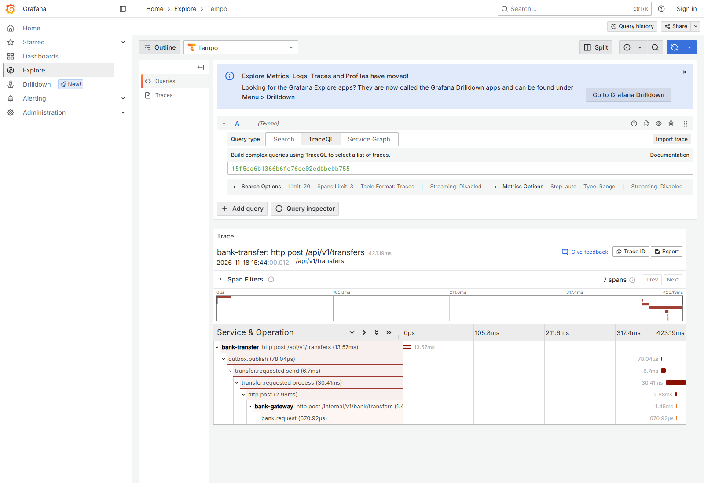
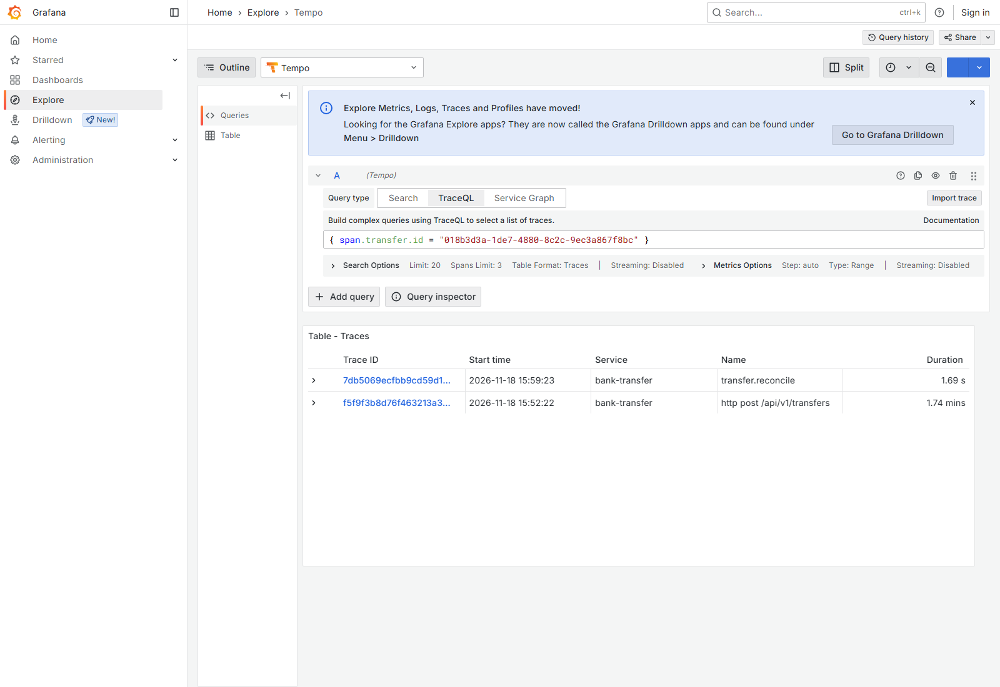

# P9b 분산 추적 실험 결과

> 설계 [스펙](../superpowers/specs/2026-11-18-p9b-tracing-design.md) (§14 계획 단계에서 고친 점 포함) · 결정 [ADR-0021](../adr/0021-distributed-tracing.md) · 도구 `load/k8s/run.sh` (`PHASE=p9b`, 수집 `load/k8s/p9b.sh`, 모양 분석 `load/k8s/traceshape.py`) · 원자료 `raw/p9b/` (`<동작>-<회차>.json` 판정 · `.p9b.json` 추적 요약 · `.traces.txt` 표본 trace 원문 20개 · `.tempo-search-*.json` Tempo 검색 결과)
> 환경: kind 3노드(제어 1 · 워커 2), 앱 이미지 `dev-f16cb94`, Tempo 2.10.10 (단일 바이너리 · emptyDir · 보관 2일), 샘플링 1.0, 보내기 OTLP HTTP 묶음(5초 · 대기열 2048). Collector 없음.
> 부하 · 판정: 이전 단계와 같다 — k6 출금 20건/s(T1c 만 40건/s), 판정은 돈 정확성(접수된 키 = 출금 행 = 거래번호, 전부 `COMPLETED`, 은행 빠짐 0 · 이중 0, 환불 0, 잔고 = 원장 합). **11회 중 10회 통과, 1회(T3 첫 회차 `bank-1`)는 판정 규칙상 실패지만 돈은 정확** — 아래 "T3".

## 요약 — 성공 기준 (스펙 §1)
| # | 기준 | 결과 | 근거 |
|---|---|---|---|
| 1 | 돈 정확성 — 모든 실험 판정 | **통과** (재실행 포함) | 10회 `통과`. `bank-1` 은 은행을 끄는 순간 보낸 3건이 "모름 → 결과조회 → 원거래 없음 → 환불" 로 끝나 "전부 COMPLETED" 규칙에 걸림 — 돈은 정확(은행 기록 없음 · 환불). 같은 조건 `bank-2` 통과 |
| 2 | 출금 1건 = trace 1개 (프로세스 2종 · 스레드 전환 3번 이상) | **통과** | T2: steady 3 · gwkill · gwroll 5회차 표본 100 trace 는 모두 정확히 7구간 · 출금 1건 (`spans_min` = `spans_max` = 7), 두 서비스. bank 2회차 표본 40개도 모두 두 서비스를 지나는 완전한 trace 지만 구간 수는 다르다 — 6개(`bank-1` 2 · `bank-2` 4)는 root 가 `transfer.reconcile` 인 정리 작업 trace (최대 701구간 · `transfer.id` 최대 100개, 설계대로 E7), 정확히 7구간은 9개, 나머지는 재시도 · 정리 작업 구간이 붙은 더 큰 trace. 아래 "한계" 의 m5 메모 참고. 통합 테스트(두 프로세스 · 코루틴 · JDK 판) · 스모크 [11] |
| 3 | 재발행 · 결과조회를 `transfer.id` 한 번 검색으로 찾는다 | **통과** | T3 `bank-2`: 재발행 출금 286건 검색 → 286건 모두 처음 trace + 정리 작업 trace 2개 이상, 정리 작업 root 있음 (5분 검색 상한으로 771건 중 286건 검색) |
| 4 | 추적 비용: 접수 p95 ≤ +10%, 처리량 ≥ −5% | **통과** | T1 (20건/s): 접수 p95 켬 25.25ms / 끔 25.39ms (**−0.6%**, 잡음 안), 처리량 같음. 40건/s 한 쌍: +5.8% |
| 5 | CI `k8s-smoke` 20분 안 · 스모크 [11] | **통과** — CI `k8s-smoke` 4분 13초 · 4분 49초 (20분 제한), 스모크 [11] Tempo 검색 | 이 문서 끝 "CI" |

## T1 — 추적 비용 (켬 vs 끔)
숫자는 `raw/p9b/steady-*.p9b.json` 그대로. "끔" = 샘플링 0 (구간 · 전파는 그대로, 내보내지 않음 — 계획에서 정한 것 2).

| 회차 | 추적 | 속도 | 접수 p95 (ms) | 완료 /s | 접수 → 확정 p95 (s) | api CPU | 게이트웨이 CPU | 보내기 실패 | 판정 |
|---|---|---|---|---|---|---|---|---|---|
| `steady-1` | 켬 | 20/s | 24.88 | 19.69 | 0.46 | 0.0470 | 0.00852 | 0 | 통과 |
| `steady-2` | 켬 | 20/s | 25.62 | 19.67 | 0.50 | 0.0465 | 0.00859 | 0 | 통과 |
| `steady-3` | 끔 | 20/s | 26.68 | 19.67 | 0.48 | 0.0462 | 0.00810 | 0 | 통과 |
| `steady-4` | 끔 | 20/s | 24.10 | 19.67 | 0.47 | 0.0458 | 0.00817 | 0 | 통과 |
| `steady-5` | 켬 | 40/s | 30.29 | 38.71 | 0.83 | 0.0843 | 0.01630 | 0 | 통과 |
| `steady-6` | 끔 | 40/s | 28.64 | 38.71 | 0.49 | 0.0856 | 0.01440 | 0 | 통과 |
| `tempozero-1` | 켬 · **Tempo 0대 60초** | 20/s | 24.59 | 19.69 | 0.49 | 0.0470 | 0.00891 | **12** | 통과 |

- 20건/s 평균: 접수 p95 켬 25.25 / 끔 25.39 → **−0.6%** (회차 사이 흔들림 ±1.3ms 보다 작다 — 차이 없음), 완료 /s 같음, api CPU **+1.7%**, 게이트웨이 CPU +5.2% (측정).
- 40건/s 한 쌍: 접수 p95 **+5.8%**, 접수 → 확정 p95 0.49 → 0.83초. 한 쌍뿐이라 "관찰" — 같은 쌍을 더 돌려야 비용인지 흔들림인지 가른다 (추정: 확정 p95 는 히스토그램 버킷 경계 0.5 ~ 1초 사이의 보간이라 크게 흔들린다).
- **처리량은 "고정 도착률" 이라 완료 /s 가 거의 도착률과 같다** — 비용은 CPU 와 지연으로 본다 (계획에서 정한 것 15).
- **Tempo 0대(T1d)**: 돈 · 접수 p95 · 처리량이 켬 회차와 같다. 보내기 실패는 앱 로그 12줄(묶음 단위 "Failed to export")로만 남았고 요청은 기다리지 않았다 — E10 · 위험 C7 확인. 그 회차에 Tempo 가 새 Pod(emptyDir)로 떠서 **그 전의 trace 는 Tempo 에서 사라졌다** (원자료 `traces.txt` 에는 남음).

## T2 — 정상 출금의 trace 모양
표본 = 회차마다 출금 20건의 trace 를 Tempo 에서 ID 로 가져와 분석 (`traceshape.py`). 7구간 = `http post /api/v1/transfers` → `outbox.publish` → `transfer.requested send` → `transfer.requested process` → `http post` → (게이트웨이) `http post /internal/v1/bank/transfers` → `bank.request`.

| 회차 | 완전 / 표본 | 구간 수 | 접수 → 발행 p50 · p95 (ms) | 컨슈머 → 은행 p50 · p95 (ms) | 은행 호출 p50 (ms) | 끝까지 p50 · p95 (ms) |
|---|---|---|---|---|---|---|
| `steady-1` | 20 / 20 | 7 | 125.7 · 288.3 | 16.5 · 22.1 | 1.6 | 228.8 · 350.1 |
| `steady-2` | 20 / 20 | 7 | 135.4 · 422.1 | 15.3 · 25.4 | 1.1 | 277.7 · 462.9 |
| `steady-5` (40/s) | 20 / 20 | 7 | 176.0 · 452.1 | 16.8 · 23.6 | 0.9 | 360.8 · 486.1 |
| `gwkill-1` | 20 / 20 | 7 | 190.2 · 437.8 | 13.9 · 21.4 | 1.2 | 272.3 · 529.1 |
| `gwroll-1` | 20 / 20 | 7 | 212.6 · 429.9 | 15.3 · 19.9 | 0.9 | 299.8 · 506.4 |

- **끝까지 걸리는 시간의 대부분은 "접수 → 발행" 틈이다** (끝까지 p50 230 ~ 360ms 중 130 ~ 210ms). 발행기가 0.5초마다 아웃박스를 읽으므로 p95 가 500ms 아래에 붙는다 — 아웃박스 패턴의 값 (측정). 컨슈머 → 은행은 15ms 안팎, 모의 은행 호출 자체는 1ms 대.
- 이 숫자는 P9a 지표("접수 → 확정 시간")로는 나눠 볼 수 없던 것 — 추적이 처음으로 "어느 구간이 시간을 먹나" 를 보여 준다.

Grafana → Explore → Tempo 에서 출금 하나(`gwroll-1` 표본)의 trace — 7구간, 두 서비스(`bank-transfer` · `bank-gateway`), 아래로 갈수록 자식. 접수(13.6ms) 뒤 약 400ms 의 빈 칸이 아웃박스 발행 대기, 그 뒤 컨슈머 → 게이트웨이 → `bank.request`(0.67ms):

## T3 — 은행 2분 끊기 (재시도 · 재발행)
| 회차 | 판정 | 재시도 trace (검색) | 그중 접수 trace 에 붙음 | 재발행 출금 | 검색한 것 · 찾음 · 정리 작업 root | 표본 구간 수 최대 |
|---|---|---|---|---|---|---|
| `bank-1` | **실패** (미완료 3 · 환불 3 · 은행 기록 없음 3) | 1000 | 914 (검색) + 86 (ID 로 다시 확인) = **1000** | 742 | 304 · 304 · 304 | 701 |
| `bank-2` | 통과 | 1000 | **1000** | 771 | 286 · 286 · 286 | 377 |

- **재시도 체인은 끊기지 않는다**: 은행이 끊긴 동안 `retry-0 · 1 · 2` 로 돈 메시지 1000개가 모두 처음 접수 trace 에 이어 붙었다 (Kafka 헤더 `traceparent` — 위험 C2 확인). `bank-1` 에서 86개는 Tempo 검색 결과에 `<root span not yet received>` 로 나왔지만 ID 로 다시 가져오니 86/86 접수 구간이 있었다 — 검색이 블록 단위라 생기는 표시 문제 (`raw/p9b/bank-1.retry-rootless-byid.txt`).
- **재발행은 `transfer.id` 한 번으로 찾는다**: 검색한 재발행 출금 모두 trace 가 2개 이상(처음 접수 · 정리 작업)이고 정리 작업(`transfer.reconcile`) root 가 있었다. 검색은 건마다 1초 남짓이라 5분 상한에서 멈췄다 — 전수가 아니라 표본 (286 · 304건).
재발행된 출금 하나를 `{ span.transfer.id = "…" }` 로 검색한 결과 — trace 2개: 처음 접수(`http post /api/v1/transfers`, 1.74분 — 은행이 끊긴 동안의 재시도까지 포함) · 정리 작업(`transfer.reconcile`, 재발행 뒤 은행까지):

- **정리 작업 trace 는 크다**: 정리 작업 1회가 재발행을 최대 100건 하고, 그 뒤 Kafka → 은행이 모두 그 trace 의 자식이라 한 trace 에 구간이 수백 개(최대 701) — "실행 1회 = 새 trace" (E7) 의 대가. 보기 · 샘플링에는 불리하지만 "이번 정리 작업이 무엇을 다시 보냈나" 를 한 번에 본다 (추정 — 운영이면 건별 trace + 링크가 낫다, ADR-0021 "다음").
- **`bank-1` 판정 실패의 원인 (추적과 무관 — 설계대로)**: 은행 Pod 를 끄는 순간(15:09:09 KST) 이미 은행으로 보낸 출금 3건이 응답 없이 연결이 끊겨 `UNKNOWN` (보냈는지 모름) → 30초 뒤 결과조회는 은행이 꺼져 있어 2분 동안 미뤄짐 → 은행이 돌아온 뒤 결과조회에 "원거래 없음(2001)" → `FAILED` + 환불. 은행에 기록이 없고 환불됐으니 돈은 정확하다 (P3-3a 의 "모르면 묻는다" 경로). 실험 판정은 "전부 COMPLETED" 만 통과로 쳐서 실패로 남겼다. P9a 의 같은 실험에서는 끄는 순간 날아가던 건이 없었을 뿐 (추정 — 타이밍).

## T4 — 게이트웨이 리더 교대 중의 `bank.request`
| 회차 | 동작 | 판정 | `not_sent` trace | 사유 (구간 수) |
|---|---|---|---|---|
| `gwkill-1` | 리더 Pod 강제 삭제 | 통과 | 3 | `stepping_down` 6 |
| `gwroll-1` | 게이트웨이 롤링 (정상 교대) | 통과 | 14 | `stepping_down` 28 |

- 교대 중 "안 보냄" 은 모두 **`stepping_down`(내려오는 중)** 이었다 — 강제 삭제도 Pod 가 SIGTERM 을 받아 정상 교대 경로를 탄다(P8-3b). `not_leader` 는 0 — 트래픽이 리더 라벨 Pod 로만 가서 대기 Pod 가 받은 적이 없다 (측정).
- 사유가 trace 에 있으니 "이 출금이 왜 재시도로 갔나" 를 로그 없이 답한다. 같은 trace 안에서 그 다음 재시도가 새 리더로 간 것도 보인다.

## T5 — (덤) exemplar
- 켬 회차마다 Prometheus 가 `banktransfer_transfer_completed_seconds_bucket` 의 exemplar(`trace_id`)를 26 ~ 119개 저장했고, 그 `trace_id` 를 Tempo 에서 찾았다 (`exemplar_trace_found` true). Tempo 0대 회차는 false (Tempo 가 비어 있음 — 정상).
- Grafana "① 출금 흐름" 의 "접수 → 확정 시간" 패널에 점이 찍히고 점 → Tempo 로 간다 (설정 · API 로 확인, 화면 클릭은 머지 전 사람 확인).

## 위험 확인 (스펙 §10)
| # | 위험 | 결과 |
|---|---|---|
| C1 | 아웃박스 행 사이 문맥이 샘 | 통합 테스트(행마다 부모 단언) · 리뷰(행마다 범위 열고 닫음, 예외에도). T2 steady · gwkill · gwroll 100 trace 는 모두 정확히 7구간 · 출금 1건 — 다른 출금의 구간이 섞인 trace 없음. bank 표본의 여러 출금이 든 trace 는 정리 작업 root(설계, E7)이지 누수가 아니다 |
| C2 | 재시도 · DLT 로 traceparent 가 덮임 | T3 재시도 trace 1000/1000 이 접수 trace 에 붙음 (두 회차) |
| C3 | 추적 비용 | T1: p95 −0.6% (20/s), +5.8% (40/s 한 쌍), CPU +1.7% |
| C4 | Netty 에서 구간을 닫을 때 문맥 누수 | 단위 테스트(모든 완료 경로에서 정확히 한 번) · 리뷰. T4 의 `stepping_down` 구간이 제대로 닫혀 보임 |
| C5 | 코루틴 · 리액터 문맥 유실 | 통합 테스트 (코루틴 판 두 프로세스 trace). **계획의 `spring.reactor.context-propagation=auto` 만으로는 코루틴에서 끊겼다** — Micrometer `ObservationRegistry.asContextElement()` 로 리스너 본문 전체를 감싸 해결 (Task 7) |
| C6 | 민감정보가 속성 · 로그로 샘 | 지우개(예외 메시지 · 스택 · 상태 설명 제거) + 통합 테스트(지우개를 빼면 실패함을 확인). 실제 422 · 400 요청은 예외 처리기가 처리해 구간에 예외가 실리지 않음 |
| C7 | Tempo 장애가 앱을 느리게 함 | T1d: 돈 · p95 · 처리량 그대로, 실패는 로그 12줄 |
| C8 | 로그 패턴 변경이 실험 도구 grep 을 깸 | 도구 점검 결과 영향 없음. 대신 `kubectl logs | grep -q` 가 pipefail 아래 SIGPIPE 로 거짓 실패하는 것을 찾아 `grep -c` 로 바꿈 (스모크 [11]) |

## 해석 · 예상과 다른 점
- **추적 비용은 이 부하에서 잡음 수준** (측정). 구간은 출금당 7개, 내보내기는 5초 묶음이라 요청 스레드가 기다리지 않는다.
- **"아웃박스 틈" 이 끝까지 시간의 절반 이상** — 지연을 줄이려면 발행 주기(0.5초)나 커밋 뒤 즉시 발행(트랜잭션 이벤트 리스너)이 첫 후보 (추정, 다음 단계 아님).
- **예상보다 trace 가 늦게 검색된다**: 출금 직후 약 8초 동안은 검색에 안 나온다 (보내기 묶음 5초 + Tempo 수집). 스모크 · 도구는 재시도로 기다린다.
- **traceparent 끝 플래그가 `-01` 이 아니라 `-03`** (샘플링 0 이면 `-02`): OpenTelemetry 1.62 가 W3C 2단계의 "random trace id" 비트를 켠다. 문자열로 비교하는 코드는 깨진다 (측정).
- **Grafana 익명 보기 사용자는 Explore 를 못 열었다** → `GF_USERS_VIEWERS_CAN_EDIT=true` 로 고침 (실험 중 발견, 저장은 여전히 못 함).
- **Tempo emptyDir**: Tempo Pod 가 바뀌면(T1d) trace 가 다 사라진다 — 운영이면 객체 저장소.

## 한계
- kind 한 호스트 — 비용은 상대 비교, 망 지연 없음. 40건/s 비교는 한 쌍뿐.
- bank 회차 표본은 재발행 출금에서 검색이 정리 작업(`transfer.reconcile` root) trace 를 먼저 집었다 — 그래서 여러 출금이 든 trace · 큰 구간 수(최대 701)가 보이고, 그 표본의 e2e · bank_ms 는 다른 출금 구간에서 계산됐다. 이 수정(`p9b.sh` 가 root 가 `http post /api/v1/transfers` 인 trace 를 고른다) 전에 받은 bank 회차가 그렇다. 또 빈 정리 작업 root 는 이제 내보내지 않는다 (`EmptyReconcileSpans` — 건수와 건별 구간 수 `reconcile.items` 가 모두 0 인 root 만. 처음 판정은 OTel 의 root parentId `0000000000000000` 을 root 로 못 봐 아무것도 거르지 않았다 — PR 전 마지막 점검에서 고침, 실제 브리지 구간으로 테스트).
- 모의 은행은 계측하지 않는다 — trace 는 게이트웨이의 `bank.request` 에서 끝난다 (은행 안 시간은 모름).
- 재발행 검색은 5분 상한의 표본 (286 · 304건). 재시도 검색은 Tempo 검색 한도 1000 에서 잘렸다 (재시도 trace 가 1000 보다 많을 수 있음).
- Tempo emptyDir · 보관 2일 · 샘플링 1.0 — 운영이면 비율 · 꼬리 샘플링과 영구 저장.
- 코루틴 판의 비동기 실패 경로(재시도 발행이 소비 구간 밖에서 일어나는 경우)는 새 trace 일 수 있다 — 실험하지 않음.

## CI
`k8s-smoke` 시간 (스모크 [11] 포함, 20분 제한) — [#37](https://github.com/hyeokjinON/bank-transfer/pull/37) 의 PR CI:

| 커밋 | `build` | `infra-smoke` | `app-smoke` | `k8s-smoke` |
|---|---|---|---|---|
| `48b130f` (첫 실행) | 9분 56초 | 48초 | 3분 50초 | 6분 37초 **실패** — 스모크 [10] 출금 카운터 |
| `b1247a5` | 8분 13초 실패 — 가상 스레드 pinning 2ms | 52초 | 2분 8초 | **4분 13초** |
| `3a9ed42` (머지 직전) | 9분 27초 실패 → 다시 돌려 **9분 53초** | 55초 | 2분 9초 | **4분 49초** |

- `k8s-smoke` 첫 실패는 P9a 의 스모크 [10] 이 새 Pod 에서 흔들린 것이다: Prometheus `increase()` 는 첫 수집 전에 생긴 증가를 못 센다 → 0 이면 원래 합계로 한 번 더 본다 (`b1247a5`).
- `build` 의 두 실패는 시간에 민감한 기존 테스트 — 가상 스레드 실험(Kafka 컨슈머 내부 잠금에서 2ms pinning)과 게이트웨이 리더 반납(CI 의 API 서버에서 반납이 2초를 넘김). 둘 다 P9b 가 손대지 않은 코드이고 로컬에서 통과 (5/5 · 3/3) — 기준을 느슨하게 하면 검사가 약해져서 고치지 않고 다시 돌렸다. 또 나오면 그때 원인을 판다 (HANDOVER §4).
- P9a(#35) 의 `k8s-smoke` 8분 7초 · 5분 59초보다 오히려 짧다 — Tempo 이미지와 스모크 [11] 이 늘었지만 CI 러너마다 1 ~ 3분씩 흔들리는 폭이 더 크다 (추정 — 단계별 시간은 나누어 재지 않았다). 20분 제한까지 여유가 크다.

Postman 직접 확인 (2026-11-19, `9. 추적 (P9b, kind)` 폴더 9-1 ~ 9-4 + Grafana · 로그 · 은행 끊기): 출금 202 → Tempo 에서 trace 1개 · 구간 7개 이름 · 두 서비스 · 계좌번호 없음 → Explore 로 같은 trace → api 로그 traceId 로 같은 출금 → 은행 끊김 중 재시도 구간이 처음 trace 에 붙음 → 빈 정리 작업 root 0 — 통과.
