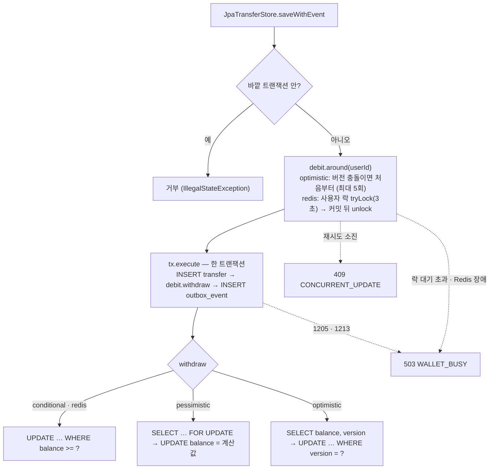

# P4-2 잔고 차감 락 전략 비교 — 구현 계획

> **For agentic workers:** REQUIRED SUB-SKILL: Use superpowers:subagent-driven-development (recommended) or superpowers:executing-plans to implement this plan task-by-task. Steps use checkbox (`- [ ]`) syntax for tracking.

**Goal:** P4-1 의 잔고 차감(조건부 UPDATE 한 문장)을 차감 전략 인터페이스 `WalletDebit` 뒤로 옮기고 비관적 락 · 낙관적 락 · Redis 분산락 구현을 더해 기동 설정(`wallet.debit-strategy`)으로 하나를 고르게 한다. 네 전략 모두 같은 동시 출금 정확성 테스트를 통과한 뒤, 같은 접수 API 를 k6 핫스팟 · 분산 시나리오로 24회 측정해 처리량 · 지연 · 실패율을 비교하고 "언제 무엇을 쓰나"를 숫자로 남긴다.

**Architecture:** 도메인(`modules/transfer`)은 락을 모르고 `StoreConflict.WalletBusy` · `ConcurrentUpdate` → `TransferException` → 웹의 503 `WALLET_BUSY` · 409 `CONCURRENT_UPDATE`(+ `Retry-After: 1`)만 안다. `apps/api/persistence` 의 `WalletDebit` 는 트랜잭션 **바깥**(`around` — 낙관적 재시도, Redis 락)과 **안**(`withdraw` — 차감 SQL + 원장 WITHDRAW) 두 지점을 가지며, `JpaTransferStore.saveWithEvent` 는 `debit.around(userId) { tx.execute { 출금 INSERT → debit.withdraw → 아웃박스 } }` 모양이 되고 바깥 트랜잭션 안에서 부르면 `check` 로 거부한다. MySQL 1205 · 1213(Spring `PessimisticLockingFailureException` 계열)은 전략과 무관하게 저장소 한 곳에서 `WalletBusy` 로 바꾼다. `WalletLedger` 에는 충전 · 환불 · 조회와 원장 기록만 남는다. 전략 빈은 `WalletDebitConfiguration` 이 설정값으로 하나만 만들고, `RedissonClient` 는 `redis` 일 때만 만든다. 부하 측정은 `load/`(k6 스크립트 · 시드 · 정리 · 검증 SQL · 실행 보조)와 compose 의 `k6` 서비스(`load` 프로필)로 한다.

**Tech Stack:** Kotlin 2.3.21 · Spring Boot 4.1.1 (Spring 7.0.9 · `NamedParameterJdbcTemplate` · `TransactionTemplate` · `@ConditionalOnProperty` · `ApplicationContextRunner`) · HikariCP · MySQL 8.4 (InnoDB 행 락, `innodb_lock_wait_timeout`) · Redisson 4.8.0 (`RLock`, watchdog) · Redis 7.4 · Testcontainers 2.0.5 (`GenericContainer`) · JUnit 5 (`@ParameterizedTest`) · k6 2.3.0 (`grafana/k6:2.3.0`)

**Spec:** [docs/superpowers/specs/2026-10-27-p4-2-lock-comparison-design.md](../specs/2026-10-27-p4-2-lock-comparison-design.md) (상위: README 로드맵 P4, 이전 단계 [P4-1 계획](2026-10-26-p4-1-wallet-balance.md) · [ADR-0008](../../adr/0008-wallet-debit-on-intake-refund-on-failure.md))
2026-10-27 사용자 결정: 핫스팟 + 분산 두 시나리오, 접수 API 그대로 측정, Redis 는 Redisson RLock, A안 = 차감 전략 인터페이스 + 기동 시 설정으로 하나만 선택, 전략별 규칙, k6 측정 조건.

## Global Constraints

스펙에서 그대로 옮긴 프로젝트 전체 요구 (모든 Task 의 요구사항에 암묵적으로 포함된다):

- 정확성이 먼저다: 네 전략 모두 동시 출금 테스트를 통과해야 측정을 시작한다. 잔고는 어느 전략에서도 음수가 되지 않고, 잔고 = 원장 합이다.
- **범위 밖**: 환불 · 충전의 락 전략(지금의 조건부 그대로), 다중 인스턴스 실측(Redis 락의 진짜 이점은 서버가 여러 대일 때지만 이번엔 한 대), 운영 기본 전략 변경(측정 결과로 ADR 에 판단만 남긴다), k6 의 CI 실행.
- 전략 선택: `wallet.debit-strategy = conditional | pessimistic | optimistic | redis` (기본 `conditional`). 기동 때 하나만. 잘못된 전략 이름은 기동 실패 (enum 바인딩).
- 이음새 (시그니처 그대로):
  ```kotlin
  interface WalletDebit {
      fun <T> around(userId: String, transaction: () -> T): T = transaction()
      fun withdraw(userId: String, transferId: UUID, amount: Long, at: Instant): Boolean
  }
  ```
  `JpaTransferStore.saveWithEvent` 는 `debit.around(userId) { tx.execute { 출금 INSERT → debit.withdraw(…) → 아웃박스 } }` 모양이 된다. `saveWithEvent` 를 바깥 트랜잭션 안에서 부르면 안 된다는 P4-1 의 문서상 전제를 **`check` 로 강제**한다. `WalletLedger` 에는 충전 · 환불 · 조회와 원장 쓰기가 남고, 차감 SQL 은 전략 구현으로 옮긴다.
- 전략별 규칙 (스펙 §3-2 표):
  - `conditional` (기준선): `UPDATE wallet SET balance = balance - :amt, version = version + 1 … WHERE user_id = :u AND balance >= :amt` → 0건이면 false
  - `pessimistic`: `SELECT balance FROM wallet WHERE user_id = :u FOR UPDATE` → 없거나 모자라면 false → `UPDATE … SET balance = :newBalance, version = version + 1`
  - `optimistic`: 바깥 = 버전 충돌이면 트랜잭션 전체를 **처음부터** 다시. 최대 5회, 사이에 10~50ms 무작위 대기. 5회 모두 충돌 → 409. 안 = `SELECT balance, version` (락 없음) → 모자라면 false → `UPDATE … SET balance = :newBalance, version = :v + 1 WHERE user_id = :u AND version = :v` → 0건이면 충돌
  - `redis`: 바깥 = Redisson `getLock("lock:wallet:{userId}").tryLock(3초)` — 임대 시간은 watchdog 자동 연장. 못 잡으면 503. 트랜잭션 **커밋 뒤** `unlock`. 안 = **기준선과 같은 조건부 UPDATE**
  - 낙관적 재시도는 출금 INSERT 까지 롤백된 뒤 같은 출금(같은 id · 거래번호)으로 다시 시작한다. 재시도 중 같은 키 UNIQUE 충돌이 나면 기존 멱등 응답 경로를 그대로 탄다 (재시도 대상은 버전 충돌뿐).
  - 원장 `balance_after` 는 모든 전략에서 이 트랜잭션이 X 락을 쥔 행의 값이다.
- 오류 (스펙 §4): 낙관적 재시도 5회 소진 → `ConcurrentUpdate` → 409 `CONCURRENT_UPDATE` + `Retry-After: 1` / MySQL 락 대기 초과(1205) · 데드락(1213) — Spring 의 `PessimisticLockingFailureException` 계열, Redis 락 3초 안에 못 잡음, Redis 에 닿지 않음(로그는 ERROR 로 따로) → `WalletBusy` → 503 `WALLET_BUSY` + `Retry-After: 1`. 1205 · 1213 매핑은 **전략과 무관**하게 `JpaTransferStore` 한 곳에서 한다. 도메인 모듈은 여전히 락을 모른다: "저장소가 지금 잔고를 잡지 못했다 / 동시에 바뀌어 포기했다"만 안다.
- 환불 · 충전: 전략과 무관하게 지금의 원자적 UPDATE (`balance = balance + :amt`). 안전망 `CHECK (balance >= 0)` 유지. 스키마는 **바꾸지 않는다** — `wallet.version` 은 V3 부터 있고 모든 UPDATE 가 이미 올린다.
- 설정 (스펙 §5 그대로):
  ```yaml
  spring.datasource.hikari:
    maximum-pool-size: 20                                       # 명시. minimum-idle 기본값 = 최대 → 측정 중 커넥션을 새로 만들지 않는다
    connection-init-sql: SET SESSION innodb_lock_wait_timeout = 5
  wallet:
    debit-strategy: conditional
    optimistic: { max-attempts: 5, backoff-min: 10ms, backoff-max: 50ms }
    lock: { wait-time: 3s, redis-address: "redis://${REDIS_HOST:localhost}:${REDIS_PORT:6379}" }
  ```
  `RedissonClient` 빈은 `redis` 전략일 때만 만든다. 다른 전략으로 띄우면 Redis 가 없어도 기동된다. Redis 명령 응답 대기는 1초, 재시도 1번. 의존성: `org.redisson:redisson` (Spring Boot 스타터는 쓰지 않는다).
- 테스트: 전략별 테스트는 **캐시된 컨텍스트 하나** 안에서 전략 객체를 직접 만들어 돌린다. Redis 는 Testcontainers 로 `redis:7.4-alpine` 을 함께 띄운다. 100건 동시 기준: `성공 + 잔고 부족 + 409 + 503 = 100`, **1 ≤ 성공 ≤ 10**, 잔고 = 10만 − 1만 × 성공 수 ≥ 0, 원장 합 = 잔고, 출금 행 수 = 원장 WITHDRAW 수 = 성공 수. `conditional` · `pessimistic` 은 정확히 10건 성공. 기존 `WalletConcurrencyTest` 는 기본 전략으로 그대로 통과.
- 부하 측정 (스펙 §7): 50 VU 닫힌 모델, 앞 10초 워밍업 시나리오 + 60초 측정 시나리오, **측정 시나리오 태그로만 집계**, 요청마다 새 멱등키, 금액 1원, 잔고 10억 원, 조합마다 3회 중앙값 (4 × 2 × 3 = 24회). 앱은 `bootJar` 를 `-Xms1g -Xmx1g` 로, 인자 `--wallet.debit-strategy=<전략> --transfer.outbox.relay.enabled=false --transfer.reconcile.enabled=false --spring.kafka.listener.auto-startup=false --server.tomcat.threads.max=200 --logging.level.io.github.hyeokjinon.banktransfer=WARN`. 매 회차 전에 `load/cleanup.sql` → `load/seed.sql`, 뒤에 `load/verify.sql`. 측정 뒤 `load/cleanup.sql` 은 반드시 돌린다.
- 저장소 규칙 (CLAUDE.md): 주석 · 문서 · 커밋 한국어, 주석은 "왜". 도메인 모듈(`modules/*`)은 Spring · JPA · Kafka · Redis 의존 없음. 버전은 정확히 고정(`latest` 금지). TDD. 설정 파일은 먼저 읽고 합친다(덮어쓰기 금지). 커밋 `type(scope): 한국어 요약`, 마지막 줄 `Co-Authored-By: Claude Opus 5.5 <noreply@anthropic.com>`. push 하지 않는다.
- 테스트 실행: Docker Desktop 필요, Git Bash 에서 `export PATH="/c/Users/user/AppData/Local/Programs/DockerDesktop/resources/bin:$PATH"`. 통합 테스트는 `ApiIntegrationTest` 상속(컨텍스트 공유). **공유 DB 규칙** (P4-1): 테스트마다 새 사용자(`newUserId()` / `fundedUser()`), `RECEIVED` 를 남기는 테스트는 모의 은행에 없는 계좌(`unregisteredAccount()`).

**버전 · 라이브러리 확인 결과 (계획 작성 때 Maven Central · Docker Hub · GitHub · 로컬 jar 로 확인함 — 구현자는 다시 찾지 않아도 된다)**
1. **`org.redisson:redisson:4.8.0`** — Maven Central 메타데이터의 마지막 버전, POM `Last-Modified: 2026-10-02` (계획일 기준 25일 전), 변경 이력 `02-October-2026 - 4.8.0 released`. 4.x 는 Spring Boot 4 지원 라인(4.0.0 = 2025-12-16). 부모 POM 의 `netty-bom` 은 **4.2.18.Final**, 이 프로젝트는 Spring Boot BOM 이 **4.2.17.Final** 을 고정한다(`~/.gradle` 캐시의 `io.netty/netty-common/4.2.17.Final`). `io.spring.dependency-management` 가 전이 의존성 버전도 BOM 값으로 맞추므로 Redisson 의 Netty 는 4.2.17 로 내려간다 — 같은 4.2 라인의 패치 하나 차이라 **exclusion 불필요**. native transport(epoll · kqueue · io_uring)는 `provided` 라 따라오지 않는다. Jackson 은 4.0 부터 optional. 확인 명령은 Task 5 Step 4.
   - API (소스 `redisson-4.8.0` 태그로 확인): `Config.setLazyInitialization(boolean)` (true = 첫 명령 때 연결), `useSingleServer().setAddress / setConnectTimeout(int) / setTimeout(int) / setRetryAttempts(int) / setRetryDelay(DelayStrategy)` (`setRetryInterval` 은 deprecated), `org.redisson.config.ConstantDelay(Duration)`, `RLock.tryLock(long, TimeUnit)` (임대 시간 없음 = watchdog, 기본 30초 연장), `lock(long, TimeUnit)`, `forceUnlock()`, `isLocked()`, 예외 `org.redisson.client.RedisException` ⊃ `RedisConnectionException` · `RedisTimeoutException` (모두 `RuntimeException`). `unlockAsync` 는 결과와 무관하게 watchdog 연장을 취소한다(`cancelExpirationRenewal`) → 해제가 실패해도 락은 임대 만료로 풀린다.
2. **`grafana/k6:2.3.0`** — GitHub 릴리스 `v2.3.0` 2026-09-21 (36일 전), Docker Hub 태그 존재. v2.0.0 의 호환 깨짐(외부 제어 실행기 · `k6 login` · `--no-summary` · legacy summary · `k6/experimental/redis` 제거 등)은 이 계획이 쓰는 `constant-vus` · `scenarios` · `thresholds` · `handleSummary` · `k6/execution` 과 무관하다. v2.1 · v2.2 는 호환 깨짐 없음.
3. **Testcontainers 2.0.5** (Boot 4.1.1 이 관리, `~/.gradle` 캐시로 확인): Redis 전용 모듈은 없다(`org.testcontainers:testcontainers-redis` = Maven Central 404). 코어 `org.testcontainers:testcontainers` 의 `org.testcontainers.containers.GenericContainer<SELF>` + `withExposedPorts` · `getMappedPort` · `host` 를 쓴다 (`javap` 로 확인). Kotlin 에서는 `class RedisContainer : GenericContainer<RedisContainer>(…)` 로 자기 타입을 고정한다. `@TestConfiguration` 의 컨테이너 빈은 Boot 가 시작시킨다(기존 MySQL · Kafka 와 같은 방식, `@ServiceConnection` 은 Spring Data Redis 가 없어 쓰지 않는다).
4. **MySQL 락 오류 매핑** (`spring-jdbc-7.0.9.jar` 의 `sql-error-codes.xml`): MySQL `cannotAcquireLockCodes = 1205,3572` → `CannotAcquireLockException`, `deadlockLoserCodes = 149,1213` → `PessimisticLockingFailureException` (Spring 7 에서 `DeadlockLoserDataAccessException` 은 없어졌다). `CannotAcquireLockException extends PessimisticLockingFailureException extends ConcurrencyFailureException`. 그래서 `catch (e: PessimisticLockingFailureException)` 하나로 둘 다 잡는다. `DataIntegrityViolationException` 과는 갈래가 다르다(겹치지 않는다).
5. **Spring Boot 4.1.1 설정 메타데이터** (`spring-boot-kafka-4.1.1.jar`, `spring-boot-jdbc-4.1.1.jar`): `spring.kafka.listener.auto-startup`, `spring.datasource.hikari.connection-init-sql` · `maximum-pool-size` 존재. `@ConditionalOnProperty(havingValue = "redis")` 의 비교는 대소문자 무시(`equalsIgnoreCase`), enum 바인딩도 대소문자 무시.
6. **코드 사실**:
   - `WalletLedger.withdraw` (`WalletLedger.kt:55-66`)가 지금의 차감 SQL. 호출자는 `JpaTransferStore.saveWithEvent` (`TransferPersistence.kt:204`)와 테스트 `WalletLedgerTest` 7곳(`:48 :49 :50 :63 :74 :88 :115 :116`). `lockedBalance` · `appendLedger` · `requireCallerTransaction` 은 지금 `private`.
   - `JpaTransferStore(transfers, outbox, tx, wallets, payloadOf = …)` 를 직접 만드는 곳: `AppConfiguration.kt:109`, `JpaTransferStoreTest.kt:92 · :234 · :328`. `saveWithEvent` 를 바깥 트랜잭션 안에서 부르는 테스트는 없다(grep 확인) → `check` 를 넣어도 기존 테스트는 깨지지 않는다.
   - `ApiExceptionHandler.handle` 은 `ProblemDetail` 을 돌려줘 헤더를 붙일 수 없다 → `ResponseEntity<ProblemDetail>` 로 바꾼다(본문 · 상태 · `instance` 처리는 Spring 이 같게 한다). `handle(` 를 직접 부르는 테스트는 없다.
   - `BankTransferApplication` 에 `@ConfigurationPropertiesScan` 이 있다. `@ConditionalOnProperty` 는 `org.springframework.boot.autoconfigure.condition` 패키지(`MessagingConfiguration.kt:8` 과 같다).
   - 시드에 쓰는 컬럼(V1 · V3): `wallet(user_id, balance, version, created_at, updated_at)`, `wallet_ledger(user_id, type, amount, balance_after, transfer_id, created_at)`, `account_verification(id, user_id, bank_code, account_no, holder_name, code_hash, status, failed_attempts, expires_at, verified_at, created_at)`. `outbox_event.aggregate_id` 에는 인덱스가 없다(정리 SQL 은 `transfer` 와 조인해 지운다).
   - `bootJar` 산출물: `apps/api/build/libs/api-0.1.0-SNAPSHOT.jar` (프로젝트 `version = "0.1.0-SNAPSHOT"`, 모듈 이름 `api`).

## 파일 구조

| 파일 | 책임 |
|---|---|
| `modules/transfer/.../Transfer.kt` (수정) | `StoreConflict.WalletBusy` · `ConcurrentUpdate`, `TransferException.WalletBusy` · `ConcurrentUpdate`, `saveWithEvent` KDoc |
| `modules/transfer/.../TransferService.kt` (수정) | 저장소의 두 충돌을 도메인 예외로 |
| `apps/api/.../web/ApiExceptionHandler.kt` (수정) | 409 `CONCURRENT_UPDATE` · 503 `WALLET_BUSY` + `Retry-After: 1`, 반환형 `ResponseEntity<ProblemDetail>` |
| `apps/api/.../persistence/WalletDebit.kt` (신규) | 이음새 `WalletDebit`, `ConditionalWalletDebit`, `PessimisticWalletDebit` |
| `apps/api/.../persistence/OptimisticWalletDebit.kt` (신규) | 버전 비교 차감 + 트랜잭션 전체 재시도 |
| `apps/api/.../persistence/RedisWalletDebit.kt` (신규) | Redisson 사용자 락(바깥) + 조건부 UPDATE(안), `redissonConfig()` |
| `apps/api/.../persistence/WalletLedger.kt` (수정) | 차감 SQL 제거, `recordWithdraw` · `lockedBalance` 를 전략에 공개, `requireCallerTransaction()` 파일 수준 |
| `apps/api/.../persistence/TransferPersistence.kt` (수정) | `JpaTransferStore(…, debit)`, `around` 로 감싸기, 바깥 트랜잭션 거부, 1205 · 1213 → `WalletBusy` |
| `apps/api/.../config/WalletDebitConfiguration.kt` (신규) | `DebitStrategy`, `WalletProperties`, 전략 빈 하나, `redis` 일 때만 `RedissonClient` |
| `apps/api/.../config/AppConfiguration.kt` (수정) | `transferStore` 에 `WalletDebit` 주입 |
| `apps/api/src/main/resources/application.yml` (수정) | Hikari 20 · 락 대기 5초, `wallet.*`, `info.wallet.debit-strategy` |
| `apps/api/build.gradle.kts` (수정) | `org.redisson:redisson:4.8.0`, `testImplementation("org.testcontainers:testcontainers")` |
| `apps/api/src/test/.../support/RedisTestContainer.kt` (신규) · `ApiIntegrationTest.kt` (수정) | 공유 컨텍스트에 Redis 컨테이너 + 테스트용 `RedissonClient` |
| `apps/api/src/test/.../persistence/{WalletDebitConcurrencyTest, PessimisticWalletDebitTest, OptimisticWalletDebitTest, RedisWalletDebitTest}.kt` (신규) | 전략별 정확성 · 실패 경로 |
| `apps/api/src/test/.../persistence/{JpaTransferStoreTest, WalletLedgerTest}.kt` (수정) | 이음새 · 1205 매핑 · 바깥 트랜잭션 거부, 차감 호출을 전략으로 |
| `apps/api/src/test/.../config/{WalletDebitConfigurationTest, WalletDebitWiringTest}.kt` (신규) | 설정별 빈 선택(`ApplicationContextRunner`), 기본 전략 · `/actuator/info` |
| `modules/transfer/src/test/.../TransferServiceTest.kt`, `apps/api/src/test/.../web/ApiExceptionHandlerTest.kt` (수정) | 새 오류 두 개 |
| `load/{common.js, hotspot.js, spread.js, seed.sql, cleanup.sql, verify.sql, run.sh, summarize.sh}` (신규) | k6 시나리오 · 데이터 준비 · 정확성 확인 · 실행 보조 · 중앙값 표 |
| `infra/docker-compose.yml` (수정), `.run/5. API (부하 측정).run.xml` (신규) | `k6` 서비스(`load` 프로필), 측정용 jar 실행 구성 |
| 문서 (ADR-0009, database.md, OPERATION, SETUP, ARCHITECTURE, README, HANDOVER, CHANGELOG, `http/transfer.http`, Postman `5-wallet/08-…` · 컬렉션 설명) | 결정 기록 · 운영 · 손 확인 |
| `docs/perf/p4-2-lock-comparison.md`, `docs/perf/raw/*.json` (신규, Task 9) | 측정 결과 |

---

### Task 1: 도메인 · HTTP — "잔고를 지금 못 잡음(503)" 과 "동시 변경으로 포기(409)", `Retry-After: 1`

**Files:**
- Modify: `modules/transfer/src/main/kotlin/io/github/hyeokjinon/banktransfer/transfer/Transfer.kt`
- Modify: `modules/transfer/src/main/kotlin/io/github/hyeokjinon/banktransfer/transfer/TransferService.kt`
- Modify: `apps/api/src/main/kotlin/io/github/hyeokjinon/banktransfer/api/web/ApiExceptionHandler.kt`
- Test: `modules/transfer/src/test/kotlin/io/github/hyeokjinon/banktransfer/transfer/TransferServiceTest.kt` (가짜 저장소 필드 1개 · 테스트 2개)
- Test: `apps/api/src/test/kotlin/io/github/hyeokjinon/banktransfer/api/web/ApiExceptionHandlerTest.kt` (테스트 4개)

**Interfaces:**
- Produces:
  - `StoreConflict.WalletBusy(userId: String)`, `StoreConflict.ConcurrentUpdate(userId: String)`
  - `TransferException.WalletBusy()`, `TransferException.ConcurrentUpdate()` (인자 없음)
  - `ApiExceptionHandler.handle(e: Exception): ResponseEntity<ProblemDetail>` — `WalletBusy` → 503 `WALLET_BUSY`, `ConcurrentUpdate` → 409 `CONCURRENT_UPDATE`, 두 경우만 `Retry-After: 1`

- [ ] **Step 1: 실패하는 테스트**

`TransferServiceTest.kt`:
1) `FakeStore` 의 `var balance: Long = Long.MAX_VALUE` 줄 아래에 추가:
```kotlin

        /** 지정하면 다음 저장 한 번에서 이 예외를 던진다 (잔고를 잡지 못함 · 동시 변경으로 포기 — P4-2). 실제 저장소처럼 아무것도 남기지 않는다. */
        var failure: RuntimeException? = null
```
2) `override fun saveWithEvent(…)` 본문 첫 줄(`raceWinner?.let { … }` 앞)에 추가:
```kotlin
            failure?.let { failure = null; throw it }
```
3) `private companion object` 바로 위에 테스트 2개 추가:
```kotlin
    @Test
    fun `저장소가 잔고를 지금 잡지 못하면 WalletBusy 이고 출금 기록 · 이벤트를 남기지 않는다`() {
        store.failure = StoreConflict.WalletBusy(USER)

        assertFailsWith<TransferException.WalletBusy> { service.request(command()) }

        assertTrue(store.transfers.isEmpty())
        assertTrue(store.events.isEmpty())
    }

    @Test
    fun `동시 변경으로 저장소가 포기하면 ConcurrentUpdate - 같은 요청을 다시 보내면 새로 접수된다`() {
        store.failure = StoreConflict.ConcurrentUpdate(USER)

        assertFailsWith<TransferException.ConcurrentUpdate> { service.request(command(key = "k-retry")) }
        val retried = service.request(command(key = "k-retry"))   // Retry-After 뒤 같은 요청 — 앞 시도는 아무것도 남기지 않았다

        assertTrue(retried.created)
        assertEquals(1, store.transfers.size)
    }
```

`ApiExceptionHandlerTest.kt`:
1) import 추가:
```kotlin
import io.github.hyeokjinon.banktransfer.transfer.TransferException
import org.springframework.http.HttpHeaders
import java.util.concurrent.CompletionException
import kotlin.test.assertNull
```
2) 클래스 끝(마지막 `}` 앞)에 테스트 4개 추가:
```kotlin

    @Test
    fun `잔고를 지금 잡지 못하면 503 WALLET_BUSY + Retry-After 1`() {
        val response = handler.handle(TransferException.WalletBusy())

        assertEquals(503, response.statusCode.value())
        assertEquals("WALLET_BUSY", response.body!!.properties?.get("code"))
        assertEquals("1", response.headers.getFirst(HttpHeaders.RETRY_AFTER))
    }

    @Test
    fun `낙관적 재시도를 다 쓰면 409 CONCURRENT_UPDATE + Retry-After 1`() {
        val response = handler.handle(TransferException.ConcurrentUpdate())

        assertEquals(409, response.statusCode.value())
        assertEquals("CONCURRENT_UPDATE", response.body!!.properties?.get("code"))
        assertEquals("1", response.headers.getFirst(HttpHeaders.RETRY_AFTER))
    }

    @Test
    fun `다시 보내도 같은 결과인 오류에는 Retry-After 를 붙이지 않는다`() {
        val response = handler.handle(TransferException.InsufficientBalance())

        assertEquals(422, response.statusCode.value())
        assertNull(response.headers.getFirst(HttpHeaders.RETRY_AFTER))
    }

    @Test
    fun `비동기 경로(CompletionException)로 감싸져 와도 같은 응답`() {
        val response = handler.handle(CompletionException(TransferException.WalletBusy()))

        assertEquals(503, response.statusCode.value())
        assertEquals("1", response.headers.getFirst(HttpHeaders.RETRY_AFTER))
    }
```

- [ ] **Step 2: 실패 확인**

Run: `./gradlew :modules:transfer:test :apps:api:test --tests '*ApiExceptionHandlerTest*'` → FAIL (컴파일: `Unresolved reference 'WalletBusy'`, `Unresolved reference 'ConcurrentUpdate'`, `Unresolved reference 'statusCode'` — `handle` 이 아직 `ProblemDetail` 을 돌려준다)

- [ ] **Step 3: 구현**

`Transfer.kt`:
1) `interface TransferStore` 의 `saveWithEvent` KDoc 을 바꾼다:
```kotlin
    /**
     * 이체 저장 · 잔고 차감 · 이벤트 기록은 함께 성공하거나 함께 실패한다 (P4-1: 차감 추가).
     * [transfer] 의 userId 지갑에서 amount 를 뺀다 — 잔고가 모자라면(지갑이 없어도 잔고 0) [StoreConflict.InsufficientBalance] 이고 아무것도 남지 않는다.
     * 잔고를 지금 잡지 못하면 [StoreConflict.WalletBusy], 동시 변경이 이어져 포기하면 [StoreConflict.ConcurrentUpdate] (P4-2) — 둘 다 아무것도 남지 않는다.
     * UNIQUE 위반이면 [StoreConflict] 를 던진다.
     */
```
2) `sealed class StoreConflict` 의 `InsufficientBalance` 아래에 추가:
```kotlin

    /**
     * 지금 잔고를 잡지 못했다 — 락 대기 한도 초과 · 데드락 · 분산락 대기 초과 · 분산락 저장소 장애 (P4-2).
     * 어떤 락인지는 저장소만 안다. 아무것도 남기지 않았고, 잠시 뒤 다시 하면 될 수 있다.
     */
    class WalletBusy(userId: String) : StoreConflict("wallet of '$userId' is busy, try again later")

    /** 다른 변경과 계속 부딪혀 저장소가 정한 횟수만큼 다시 하고도 포기했다 (P4-2, 낙관적 락). 아무것도 남기지 않았다. */
    class ConcurrentUpdate(userId: String) : StoreConflict("wallet of '$userId' kept changing concurrently, try again later")
```
3) `sealed class TransferException` 의 `InsufficientBalance` 아래에 추가:
```kotlin
    /** 잔고를 지금 잡지 못했다. 요청은 옳다 — 잠시 뒤 다시 보내면 된다 (P4-2). */
    class WalletBusy : TransferException("wallet is busy, retry after a moment")

    /** 동시 변경이 이어져 포기했다. 요청은 옳다 — 잠시 뒤 다시 보내면 된다 (P4-2). */
    class ConcurrentUpdate : TransferException("wallet was updated concurrently, retry after a moment")
```

`TransferService.kt`:
1) 클래스 KDoc 의 4번 줄을 바꾼다:
```kotlin
 * 4. 이체(RECEIVED) · 잔고 차감 · TransferRequested 이벤트를 함께 저장 → 잔고가 모자라면 422 (출금 자체를 받지 않는다).
 *    잔고를 지금 잡지 못하면 WalletBusy, 동시 변경으로 포기하면 ConcurrentUpdate — 둘 다 다시 보내면 될 수 있다 (P4-2). 은행 처리는 컨슈머가 한다
```
2) `catch (e: StoreConflict.InsufficientBalance) { … }` 블록 안의 `throw TransferException.InsufficientBalance()` 줄 바로 아래에 추가 (다음 줄의 기존 `} catch (conflict: StoreConflict.DuplicateReference) {` 가 마지막 블록을 닫는다):
```kotlin
            } catch (e: StoreConflict.WalletBusy) {
                // 락을 못 잡았다 (어떤 락인지는 저장소만 안다). 아무것도 남지 않았고, 같은 요청을 다시 보내면 될 수 있다 → 503 + Retry-After
                throw TransferException.WalletBusy()
            } catch (e: StoreConflict.ConcurrentUpdate) {
                // 낙관적 재시도를 다 썼다. 거래번호 재시도와 달리 여기서 또 돌리지 않는다 — 저장소가 이미 정한 횟수만큼 했다 → 409 + Retry-After
                throw TransferException.ConcurrentUpdate()
```

`ApiExceptionHandler.kt`:
1) import 에 `org.springframework.http.ResponseEntity` 는 이미 있다. 추가 import 없음.
2) `fun handle(e: Exception): ProblemDetail {` 부터 함수 끝까지를 다음으로 바꾼다:
```kotlin
    fun handle(e: Exception): ResponseEntity<ProblemDetail> {
        val cause = if (e is CompletionException && e.cause != null) e.cause!! else e
        val (status, code) = when (cause) {
            is AccountVerificationException.AccountNotFound -> HttpStatus.NOT_FOUND to "ACCOUNT_NOT_FOUND"
            is AccountVerificationException.HolderNameMismatch -> HttpStatus.UNPROCESSABLE_CONTENT to "HOLDER_NAME_MISMATCH"
            is AccountVerificationException.VerificationNotFound -> HttpStatus.NOT_FOUND to "VERIFICATION_NOT_FOUND"
            is AccountVerificationException.Expired -> HttpStatus.GONE to "VERIFICATION_EXPIRED"
            is AccountVerificationException.Locked -> HttpStatus.LOCKED to "VERIFICATION_LOCKED"
            is AccountVerificationException.WrongCode -> HttpStatus.BAD_REQUEST to "WRONG_CODE"
            is BankTimeoutException -> HttpStatus.GATEWAY_TIMEOUT to "BANK_TIMEOUT"
            is BankUnavailableException -> HttpStatus.SERVICE_UNAVAILABLE to "BANK_UNAVAILABLE"
            is BankRejectedException -> HttpStatus.BAD_GATEWAY to "BANK_REJECTED"
            is UserIdRequiredException -> HttpStatus.BAD_REQUEST to "USER_ID_REQUIRED"
            is TransferException.IdempotencyKeyRequired -> HttpStatus.BAD_REQUEST to "IDEMPOTENCY_KEY_REQUIRED"
            is TransferException.InvalidAmount -> HttpStatus.BAD_REQUEST to "INVALID_AMOUNT"
            is TransferException.InvalidMemo -> HttpStatus.BAD_REQUEST to "INVALID_MEMO"
            // 컨트롤러의 @Pattern 이 먼저 거르지만, 도메인을 직접 거치는 경로를 위해 같은 400 으로 매핑한다.
            is TransferException.InvalidAccount -> HttpStatus.BAD_REQUEST to "INVALID_ACCOUNT"
            is TransferException.AccountNotVerified -> HttpStatus.UNPROCESSABLE_CONTENT to "ACCOUNT_NOT_VERIFIED"
            is TransferException.InsufficientBalance -> HttpStatus.UNPROCESSABLE_CONTENT to "INSUFFICIENT_BALANCE"
            // P4-2: 요청은 옳은데 지금 잔고를 잡지 못했다. 잔고 부족(422 — 다시 보내도 같다)과 구분한다
            is TransferException.ConcurrentUpdate -> HttpStatus.CONFLICT to "CONCURRENT_UPDATE"
            is TransferException.WalletBusy -> HttpStatus.SERVICE_UNAVAILABLE to "WALLET_BUSY"
            is TransferException.IdempotencyKeyReused -> HttpStatus.UNPROCESSABLE_CONTENT to "IDEMPOTENCY_KEY_REUSED"
            is TransferException.TransferNotFound -> HttpStatus.NOT_FOUND to "TRANSFER_NOT_FOUND"
            is TransferException.IllegalTransition -> HttpStatus.CONFLICT to "ILLEGAL_TRANSITION"
            else -> {
                log.error("unexpected error", cause)
                HttpStatus.INTERNAL_SERVER_ERROR to "INTERNAL_ERROR"
            }
        }
        // 500 은 내부 메시지(SQL · 경로 등)를 응답에 싣지 않는다. 원인은 위 log.error 로 남아 있다.
        val detail = if (status == HttpStatus.INTERNAL_SERVER_ERROR) "internal error" else cause.message ?: code
        val problem = ProblemDetail.forStatusAndDetail(status, detail).apply {
            setProperty("code", code)
            if (cause is AccountVerificationException.WrongCode) setProperty("remainingAttempts", cause.remainingAttempts)
        }
        // 헤더를 붙이려고 ResponseEntity 로 감싼다. 본문 · 상태 · problem+json 처리는 ProblemDetail 을 바로 돌려줄 때와 같다
        return ResponseEntity.status(status)
            .headers { headers -> if (cause.isRetryable()) headers.set(HttpHeaders.RETRY_AFTER, RETRY_AFTER_SECONDS) }
            .body(problem)
    }

    /**
     * 같은 요청을 잠시 뒤 다시 보내면 될 수 있는 오류 (P4-2). 클라이언트에게 언제 다시 해도 되는지 알린다.
     * Redis 장애와 락 경합을 구분하지 않는다 — 클라이언트가 할 일(잠시 뒤 다시)이 같다. 운영자는 로그 수준으로 구분한다.
     */
    private fun Throwable.isRetryable() = this is TransferException.WalletBusy || this is TransferException.ConcurrentUpdate

    private companion object {
        /** 초 단위. 바로 다시 부딪히지 않을 만큼만 — 락 대기(5초) · 분산락 대기(3초)보다 짧다. */
        const val RETRY_AFTER_SECONDS = "1"
    }
}
```
(클래스의 마지막 `}` 까지 바꾼 것이다 — 원래 `handle` 이 클래스의 마지막 함수다.)

- [ ] **Step 4: 통과 확인**

Run: `./gradlew :modules:transfer:test :apps:api:test --tests '*ApiExceptionHandlerTest*' --tests '*TransferApiTest*'` → PASS (`TransferApiTest` 는 반환형을 바꿔도 기존 오류 응답 본문 · 상태가 같다는 확인)

- [ ] **Step 5: 커밋**

```bash
git add modules/transfer apps/api/src/main/kotlin/io/github/hyeokjinon/banktransfer/api/web/ApiExceptionHandler.kt apps/api/src/test/kotlin/io/github/hyeokjinon/banktransfer/api/web/ApiExceptionHandlerTest.kt
git commit -m "feat(transfer): 잔고를 지금 못 잡음(503 WALLET_BUSY) · 동시 변경으로 포기(409 CONCURRENT_UPDATE), 둘 다 Retry-After 1

P4-2 의 락 전략들이 실패할 때 도메인은 어떤 락인지 모른 채 \"지금 못 잡았다 / 계속 바뀌어 포기했다\"만 안다.
잔고 부족(422 — 다시 보내도 같다)과 달리 요청 자체는 옳으므로 Retry-After 로 잠시 뒤 다시 하라고 알린다.

Co-Authored-By: Claude Opus 5.5 <noreply@anthropic.com>"
```

---

### Task 2: 이음새 `WalletDebit` · 기준선 전략 · 저장소의 바깥 트랜잭션 거부 · 1205/1213 → `WalletBusy`

**Files:**
- Create: `apps/api/src/main/kotlin/io/github/hyeokjinon/banktransfer/api/persistence/WalletDebit.kt`
- Modify: `apps/api/src/main/kotlin/io/github/hyeokjinon/banktransfer/api/persistence/WalletLedger.kt` (전체 교체)
- Modify: `apps/api/src/main/kotlin/io/github/hyeokjinon/banktransfer/api/persistence/TransferPersistence.kt:1-27 (import), :173-221 (JpaTransferStore 머리 · saveWithEvent)`
- Modify: `apps/api/src/main/kotlin/io/github/hyeokjinon/banktransfer/api/config/AppConfiguration.kt:99-109`
- Create (test): `apps/api/src/test/kotlin/io/github/hyeokjinon/banktransfer/api/persistence/WalletDebitConcurrencyTest.kt`
- Modify (test): `apps/api/src/test/kotlin/io/github/hyeokjinon/banktransfer/api/persistence/JpaTransferStoreTest.kt` (생성자 3곳 · 테스트 3개)
- Modify (test): `apps/api/src/test/kotlin/io/github/hyeokjinon/banktransfer/api/persistence/WalletLedgerTest.kt` (차감 호출 7곳)

**Interfaces:**
- Consumes: Task 1 의 `StoreConflict.WalletBusy(userId)`
- Produces:
  - `interface WalletDebit { fun <T> around(userId: String, transaction: () -> T): T = transaction(); fun withdraw(userId: String, transferId: UUID, amount: Long, at: Instant): Boolean }` (패키지 `io.github.hyeokjinon.banktransfer.api.persistence`)
  - `class ConditionalWalletDebit(jdbc: NamedParameterJdbcTemplate, ledger: WalletLedger) : WalletDebit`
  - `WalletLedger.recordWithdraw(userId: String, transferId: UUID, amount: Long, balanceAfter: Long, at: Instant)` (internal), `WalletLedger.lockedBalance(userId: String): Long` (internal), 파일 수준 `internal fun requireCallerTransaction()`
  - `JpaTransferStore(transfers, outbox, tx, wallets: WalletLedger, debit: WalletDebit, payloadOf = ::outboxPayload)` — `debit` 은 기본값 없음
  - `AppConfiguration.walletDebit(jdbc, wallets): WalletDebit` 빈 (Task 6 에서 `WalletDebitConfiguration` 으로 옮긴다)
  - 테스트 `WalletDebitConcurrencyTest` 의 `debitFor(strategy: String): WalletDebit` 와 `@ValueSource(strings = [...])` — Task 3 · 4 · 5 가 한 줄씩 더한다

- [ ] **Step 1: 실패하는 테스트**

`WalletDebitConcurrencyTest.kt` (신규, `apps/api/src/test/kotlin/io/github/hyeokjinon/banktransfer/api/persistence/`):
```kotlin
package io.github.hyeokjinon.banktransfer.api.persistence

import io.github.hyeokjinon.banktransfer.api.support.ApiIntegrationTest
import io.github.hyeokjinon.banktransfer.api.support.concurrently
import io.github.hyeokjinon.banktransfer.transfer.RandomReferenceGenerator
import io.github.hyeokjinon.banktransfer.transfer.StoreConflict
import io.github.hyeokjinon.banktransfer.transfer.Transfer
import io.github.hyeokjinon.banktransfer.transfer.TransferEvent
import io.github.hyeokjinon.banktransfer.transfer.TransferStatus
import org.junit.jupiter.params.ParameterizedTest
import org.junit.jupiter.params.provider.ValueSource
import org.springframework.beans.factory.annotation.Autowired
import org.springframework.jdbc.core.JdbcTemplate
import org.springframework.jdbc.core.namedparam.NamedParameterJdbcTemplate
import org.springframework.transaction.support.TransactionTemplate
import java.time.Instant
import java.util.UUID
import kotlin.test.assertEquals
import kotlin.test.assertTrue

/**
 * 차감 전략마다 같은 정확성 기준 (P4-2 스펙 §6): 잔고 10만 원에 1만 원 출금 100건이 동시에 와도
 * 잔고는 음수가 되지 않고, 잔고 = 원장 합, 출금 행 수 = 원장 WITHDRAW 수 = 성공 수. 측정은 이 테스트가 통과한 전략만 한다.
 * 전략마다 컨텍스트를 띄우면 MySQL · Kafka 컨테이너가 전략 수만큼 뜬다 → 캐시된 컨텍스트 하나에서 저장소를 전략별로 직접 만든다.
 * 조건부 · 비관적은 진 쪽이 기다렸다가 바뀐 잔고를 보므로 정확히 10건, 낙관적 · Redis 는 409 · 503 으로 포기하는 건이 있어 1~10건이다.
 * 동시성 테스트는 확률적이다 — 실제로 경합이 났는지는 Task 3 의 변이 검사(FOR UPDATE 빼기)로 한 번 확인한다.
 * 계좌는 모의 은행에 없는 번호다: 남은 RECEIVED 를 나중에 다른 테스트가 처리해도 1001 거절 → 이 사용자에게 환불될 뿐이다.
 */
class WalletDebitConcurrencyTest : ApiIntegrationTest() {

    @Autowired private lateinit var transfers: TransferJpaRepository
    @Autowired private lateinit var outbox: OutboxEventJpaRepository
    @Autowired private lateinit var tx: TransactionTemplate
    @Autowired private lateinit var namedJdbc: NamedParameterJdbcTemplate
    @Autowired private lateinit var jdbc: JdbcTemplate

    private val references = RandomReferenceGenerator()

    private fun debitFor(strategy: String): WalletDebit = when (strategy) {
        "conditional" -> ConditionalWalletDebit(namedJdbc, wallets)
        else -> error("unknown strategy $strategy")
    }

    private fun newTransfer(userId: String, accountNo: String): Transfer {
        val now = Instant.now()
        return Transfer(
            id = UUID.randomUUID(), userId = userId, idempotencyKey = UUID.randomUUID().toString(), reference = references.next(),
            requestHash = "h".repeat(64), bankCode = "090", accountNo = accountNo, amount = 10_000, memo = "동시",
            status = TransferStatus.RECEIVED, createdAt = now, updatedAt = now,
        )
    }

    private fun count(sql: String, userId: String): Int = jdbc.queryForObject(sql, Int::class.java, userId)!!

    @ParameterizedTest(name = "{0}")
    @ValueSource(strings = ["conditional"])
    fun `잔고 10만 원에 1만 원 출금 100건 동시 - 음수 없음, 잔고 = 원장 합, 출금 = WITHDRAW = 성공 수`(strategy: String) {
        val store = JpaTransferStore(transfers, outbox, tx, wallets, debitFor(strategy))
        val user = fundedUser(100_000)
        val account = unregisteredAccount()

        val outcomes = concurrently(100) {
            val t = newTransfer(user, account)
            try {
                store.saveWithEvent(t, TransferEvent.TransferRequested(t.id, t.createdAt))
                "OK"
            } catch (e: StoreConflict.InsufficientBalance) {
                "INSUFFICIENT_BALANCE"
            } catch (e: StoreConflict.ConcurrentUpdate) {
                "CONCURRENT_UPDATE"
            } catch (e: StoreConflict.WalletBusy) {
                "WALLET_BUSY"
            }
        }

        // 그 밖의 예외(= API 라면 500)는 concurrently 가 그대로 던져 여기까지 오지 않는다 → 성공 + 422 + 409 + 503 = 100
        val counts = outcomes.groupingBy { it }.eachCount()
        val succeeded = counts["OK"] ?: 0
        assertEquals(100, outcomes.size)
        assertTrue(succeeded in 1..10, "$strategy: $counts")
        if (strategy in EXACTLY_TEN) assertEquals(10, succeeded, "$strategy: $counts")
        val balance = wallets.balanceOf(user)
        assertEquals(100_000L - 10_000L * succeeded, balance, "$strategy: $counts")
        assertTrue(balance >= 0)
        assertEquals(balance, ledgerSum(user))
        assertEquals(succeeded, count("SELECT COUNT(*) FROM transfer WHERE user_id = ?", user))
        assertEquals(succeeded, count("SELECT COUNT(*) FROM wallet_ledger WHERE user_id = ? AND type = 'WITHDRAW'", user))
    }

    private companion object {
        /** 진 쪽이 기다렸다가 바뀐 잔고를 보는 전략 — 포기가 없으니 정확히 잔고 몫(10건)만 성공한다. */
        val EXACTLY_TEN = setOf("conditional", "pessimistic")
    }
}
```

`JpaTransferStoreTest.kt`:
1) import 추가:
```kotlin
import org.springframework.dao.CannotAcquireLockException
import org.springframework.dao.PessimisticLockingFailureException
import org.springframework.jdbc.core.namedparam.NamedParameterJdbcTemplate
import org.springframework.transaction.support.TransactionSynchronizationManager
import java.util.concurrent.CompletableFuture
import java.util.concurrent.TimeUnit
```
2) `@Autowired private lateinit var jdbc: JdbcTemplate` 아래에 추가:
```kotlin
    @Autowired private lateinit var namedJdbc: NamedParameterJdbcTemplate

    /** 기준선 차감 전략 (P4-2). 테스트가 직접 만드는 저장소(아웃박스를 깨뜨린 것 등)에 넣는다. */
    private val conditional by lazy { ConditionalWalletDebit(namedJdbc, wallets) }
```
3) `JpaTransferStore(transfers, outbox, tx, wallets, payloadOf = { "not-json" })` 세 곳(`:92`, `:234`, `:328`)을 모두 `JpaTransferStore(transfers, outbox, tx, wallets, conditional, payloadOf = { "not-json" })` 로 바꾼다.
4) 클래스 끝(마지막 `}` 앞)에 테스트 3개 추가:
```kotlin

    @Test
    fun `접수 - 바깥 트랜잭션 안에서 부르면 거부한다 (낙관적 재시도 · Redis 락은 트랜잭션 바깥이어야 한다)`() {
        val t = newTransfer()

        assertFailsWith<IllegalStateException> { tx.execute { store.saveWithEvent(t, requested(t)) } }

        assertNull(store.findById(t.id))
    }

    @Test
    fun `접수 - 차감 전략의 바깥(around)이 접수 트랜잭션 전체를 감싼다`() {
        val seen = mutableListOf<String>()
        var activeBefore: Boolean? = null
        var committedAfter: Int? = null
        val t = newTransfer()
        val wrapping = object : WalletDebit by conditional {
            override fun <T> around(userId: String, transaction: () -> T): T {
                seen += userId
                activeBefore = TransactionSynchronizationManager.isActualTransactionActive()
                return transaction().also {
                    // 다른 스레드(다른 커넥션)에서 보인다 = transaction() 이 돌아왔을 때 이미 커밋됐다
                    committedAfter = CompletableFuture.supplyAsync {
                        jdbc.queryForObject("SELECT COUNT(*) FROM transfer WHERE id = ?", Int::class.java, t.id.toString())
                    }.get(10, TimeUnit.SECONDS)
                }
            }
        }

        JpaTransferStore(transfers, outbox, tx, wallets, wrapping).saveWithEvent(t, requested(t))

        assertEquals(listOf(user), seen)
        assertEquals(false, activeBefore)
        assertEquals(1, committedAfter)
    }

    @Test
    fun `접수 - 락을 못 잡으면(MySQL 1205 · 1213 = PessimisticLockingFailureException 계열) 전략과 무관하게 WalletBusy, 아무것도 남지 않는다`() {
        for (failure in listOf(CannotAcquireLockException("Lock wait timeout exceeded (test)"), PessimisticLockingFailureException("Deadlock found (test)"))) {
            val busy = object : WalletDebit {
                override fun withdraw(userId: String, transferId: UUID, amount: Long, at: Instant): Boolean = throw failure
            }
            val before = wallets.balanceOf(user)
            val t = newTransfer()

            assertFailsWith<StoreConflict.WalletBusy> { JpaTransferStore(transfers, outbox, tx, wallets, busy).saveWithEvent(t, requested(t)) }

            assertNull(store.findById(t.id))
            assertEquals(before, wallets.balanceOf(user))
            assertEquals(0, outbox.countByAggregateId(t.id.toString()))
        }
    }
```

`WalletLedgerTest.kt`:
1) import 추가: `import org.springframework.jdbc.core.namedparam.NamedParameterJdbcTemplate`
2) 클래스 KDoc 을 `/** 지갑 · 원장 SQL (P4-1). 차감 SQL 은 P4-2 부터 전략이 갖는다 — 여기서는 기준선 [ConditionalWalletDebit] 으로 뺀다. 차감 · 환불은 호출자 트랜잭션 안에서만 부르므로 tx.execute 로 감싼다. */` 로 바꾼다.
3) `@Autowired private lateinit var jdbc: JdbcTemplate` 아래에 추가:
```kotlin
    @Autowired private lateinit var namedJdbc: NamedParameterJdbcTemplate

    private val conditional by lazy { ConditionalWalletDebit(namedJdbc, wallets) }
```
4) `wallets.withdraw(` 를 모두(`:48 :49 :50 :63 :74 :88 :115 :116`) `conditional.withdraw(` 로 바꾼다. 테스트 이름 `차감 - 잔고가 충분하면 빼고 WITHDRAW, …` 를 `조건부 차감 - 잔고가 충분하면 빼고 WITHDRAW, 모자라거나 지갑이 없으면 0건이고 아무것도 쓰지 않는다` 로 바꾼다.

- [ ] **Step 2: 실패 확인**

Run: `./gradlew :apps:api:compileTestKotlin` → FAIL (`Unresolved reference 'ConditionalWalletDebit'`, `Unresolved reference 'WalletDebit'`, `Too many arguments for … JpaTransferStore`)

- [ ] **Step 3: 구현**

`WalletDebit.kt` (신규, `apps/api/src/main/kotlin/io/github/hyeokjinon/banktransfer/api/persistence/`):
```kotlin
package io.github.hyeokjinon.banktransfer.api.persistence

import org.springframework.jdbc.core.namedparam.MapSqlParameterSource
import org.springframework.jdbc.core.namedparam.NamedParameterJdbcTemplate
import java.sql.Timestamp
import java.time.Instant
import java.util.UUID

/**
 * 잔고 차감 전략 (P4-2, ADR-0009). 접수 트랜잭션의 바깥과 안, 두 지점에 끼운다 — 네 전략은 락이 걸리는 위치가 다르다.
 * 낙관적 재시도와 Redis 락은 트랜잭션 **바깥**이어야 한다: 재시도는 매번 새 트랜잭션으로, 락은 커밋이 끝난 뒤 푼다.
 * 조건부 · 비관적은 안에서 끝난다. 환불 · 충전은 전략과 무관하게 [WalletLedger] 의 원자적 UPDATE(balance = balance + ?)다 — 더하기라 음수 위험이 없다.
 * 어느 전략이 틀려도 CHECK (balance >= 0) 이 DB 에서 음수를 막는다.
 */
interface WalletDebit {
    /** 접수 트랜잭션 바깥. 기본은 그대로 실행. 낙관적 = 충돌하면 처음부터 다시, Redis = 사용자 락 안에서 실행하고 커밋 뒤 해제. */
    fun <T> around(userId: String, transaction: () -> T): T = transaction()

    /** 접수 트랜잭션 안. 잔고가 모자라거나 지갑이 없으면 false (아무것도 쓰지 않는다). 성공하면 원장 WITHDRAW 까지 쓴다. */
    fun withdraw(userId: String, transferId: UUID, amount: Long, at: Instant): Boolean
}

/**
 * 기준선 (P4-1 과 같은 SQL): 조건부 UPDATE 한 문장. 행 락 한 번으로 원자적이고 왕복이 가장 적다.
 * 진 쪽은 앞 트랜잭션이 커밋할 때까지 행 락을 기다렸다가 바뀐 잔고로 조건(balance >= :amount)을 다시 본다 → 모자라면 0건.
 */
class ConditionalWalletDebit(
    private val jdbc: NamedParameterJdbcTemplate,
    private val ledger: WalletLedger,
) : WalletDebit {

    override fun withdraw(userId: String, transferId: UUID, amount: Long, at: Instant): Boolean {
        // 트랜잭션 밖이면 UPDATE 가 혼자 커밋돼 버린다 → 쓰기 전에 거부한다
        requireCallerTransaction()
        val updated = jdbc.update(
            "UPDATE wallet SET balance = balance - :amount, version = version + 1, updated_at = :at " +
                "WHERE user_id = :userId AND balance >= :amount",
            MapSqlParameterSource()
                .addValue("userId", userId)
                .addValue("amount", amount)
                .addValue("at", Timestamp.from(at.toDbPrecision())),
        )
        if (updated == 0) return false
        ledger.recordWithdraw(userId, transferId, amount, ledger.lockedBalance(userId), at)
        return true
    }
}
```

`WalletLedger.kt` (전체 교체):
```kotlin
package io.github.hyeokjinon.banktransfer.api.persistence

import org.springframework.jdbc.core.RowMapper
import org.springframework.jdbc.core.namedparam.MapSqlParameterSource
import org.springframework.jdbc.core.namedparam.NamedParameterJdbcTemplate
import org.springframework.transaction.support.TransactionSynchronizationManager
import org.springframework.transaction.support.TransactionTemplate
import java.sql.Timestamp
import java.sql.Types
import java.time.Clock
import java.time.Instant
import java.util.UUID

/** 원장 한 줄의 종류. amount 는 항상 양수이고 방향은 종류가 정한다 (잔고 = DEPOSIT - WITHDRAW + REFUND). */
enum class LedgerType { DEPOSIT, WITHDRAW, REFUND }

/**
 * 사용자 원화 잔고(wallet)와 append-only 원장(wallet_ledger)의 SQL 을 모은다 (P4-1, ADR-0008).
 * 차감 SQL 은 P4-2 부터 차감 전략([WalletDebit] — 조건부 · 비관적 · 낙관적 · Redis)이 갖고, 원장 기록만 [recordWithdraw] 로 여기를 거친다 (ADR-0009).
 * 충전 · 환불은 전략과 무관하게 원자적 UPDATE(balance = balance + ?)다 — 더하기라 음수 위험이 없고, P4-2 의 비교 대상은 차감이다.
 *
 * - [refund] · [recordWithdraw] 는 호출자(JpaTransferStore · 차감 전략)의 트랜잭션 안에서만 부른다: 출금 행 · 상태 전이 · 아웃박스와 함께 커밋되거나 함께 롤백돼야 한다.
 * - 원장의 balance_after 는 이 트랜잭션이 X 락을 쥔 행의 값이라 다른 트랜잭션과 섞이지 않는다.
 * - 시각은 Timestamp 로 넘기고 KST 변환은 JDBC 설정(connectionTimeZone)이 한다 (database.md §2).
 */
class WalletLedger(
    private val jdbc: NamedParameterJdbcTemplate,
    private val tx: TransactionTemplate,
    private val clock: Clock = Clock.systemUTC(),
) {

    /**
     * 충전 (관리 · 테스트용 — 실제로는 은행 입금 통지가 채우고 멱등 처리가 필요하다). 지갑이 없으면 만든다.
     * 자기 트랜잭션을 쓴다. 돌려주는 값 = 충전 뒤 잔고.
     */
    fun deposit(userId: String, amount: Long): Long {
        require(amount > 0) { "deposit amount must be positive, was $amount" }
        return tx.execute {
            val at = Timestamp.from(clock.instant().toDbPrecision())
            jdbc.update(
                "INSERT INTO wallet (user_id, balance, version, created_at, updated_at) VALUES (:userId, :amount, 0, :at, :at) AS new " +
                    "ON DUPLICATE KEY UPDATE balance = wallet.balance + new.balance, version = wallet.version + 1, updated_at = new.updated_at",
                MapSqlParameterSource().addValue("userId", userId).addValue("amount", amount).addValue("at", at),
            )
            val balance = lockedBalance(userId)
            appendLedger(userId, LedgerType.DEPOSIT, amount, balance, null, at)
            balance
        }!!
    }

    /**
     * 차감 전략이 잔고를 뺀 뒤 원장에 WITHDRAW 를 남긴다 (P4-2). [balanceAfter] = 이 트랜잭션이 X 락을 쥔 지갑 행의 값 —
     * 조건부 · Redis 는 UPDATE 뒤 다시 읽은 값, 비관적 · 낙관적은 계산해 쓴 값이다.
     */
    internal fun recordWithdraw(userId: String, transferId: UUID, amount: Long, balanceAfter: Long, at: Instant) {
        requireCallerTransaction()
        appendLedger(userId, LedgerType.WITHDRAW, amount, balanceAfter, transferId, Timestamp.from(at.toDbPrecision()))
    }

    /**
     * 환불 (실패 확정). 이 출금의 WITHDRAW 원장이 있으면 그 금액을 돌려주고 REFUND 를 남긴다. 없으면(차감한 적 없는 P3 시절 출금) false.
     * 금액은 출금 행이 아니라 원장에서 읽는다 — 실제로 뺀 돈만 돌려준다.
     * 같은 출금에 REFUND 가 이미 있으면 uk_ledger_transfer_type 위반 → 예외 → 호출자 트랜잭션(상태 전이 포함)이 롤백된다 (이중 환불 2차 방어).
     */
    fun refund(transferId: UUID, at: Instant): Boolean {
        requireCallerTransaction()
        val (userId, amount) = jdbc.query(
            "SELECT user_id, amount FROM wallet_ledger WHERE transfer_id = :transferId AND type = 'WITHDRAW'",
            MapSqlParameterSource().addValue("transferId", transferId.toString()),
            RowMapper { rs, _ -> rs.getString("user_id") to rs.getLong("amount") },
        ).singleOrNull() ?: return false
        val ts = Timestamp.from(at.toDbPrecision())
        val updated = jdbc.update(
            "UPDATE wallet SET balance = balance + :amount, version = version + 1, updated_at = :at WHERE user_id = :userId",
            MapSqlParameterSource().addValue("userId", userId).addValue("amount", amount).addValue("at", ts),
        )
        check(updated == 1) { "wallet of $userId is missing although transfer $transferId was debited" }
        appendLedger(userId, LedgerType.REFUND, amount, lockedBalance(userId), transferId, ts)
        return true
    }

    /** 지금 잔고. 지갑이 없으면 0. */
    fun balanceOf(userId: String): Long =
        jdbc.query(
            "SELECT balance FROM wallet WHERE user_id = :userId",
            MapSqlParameterSource().addValue("userId", userId),
            RowMapper { rs, _ -> rs.getLong("balance") },
        ).singleOrNull() ?: 0L

    /** 결과가 정해지지 않아 잔고에서 빠진 채 묶인 금액 = 내 출금 중 RECEIVED · SENDING · UNKNOWN 의 합 (idx_transfer_user 로 사용자 범위를 좁힌다). */
    fun pendingOf(userId: String): Long =
        jdbc.queryForObject(
            "SELECT COALESCE(SUM(amount), 0) FROM transfer WHERE user_id = :userId AND status IN ('RECEIVED', 'SENDING', 'UNKNOWN')",
            MapSqlParameterSource().addValue("userId", userId),
            Long::class.java,
        )!!

    /** 방금 이 트랜잭션이 바꾼 지갑 행의 잔고. X 락을 쥐고 있어 다른 트랜잭션의 값과 섞이지 않는다. */
    internal fun lockedBalance(userId: String): Long =
        jdbc.queryForObject(
            "SELECT balance FROM wallet WHERE user_id = :userId",
            MapSqlParameterSource().addValue("userId", userId),
            Long::class.java,
        )!!

    private fun appendLedger(userId: String, type: LedgerType, amount: Long, balanceAfter: Long, transferId: UUID?, at: Timestamp) {
        jdbc.update(
            "INSERT INTO wallet_ledger (user_id, type, amount, balance_after, transfer_id, created_at) " +
                "VALUES (:userId, :type, :amount, :balanceAfter, :transferId, :at)",
            MapSqlParameterSource()
                .addValue("userId", userId)
                .addValue("type", type.name)
                .addValue("amount", amount)
                .addValue("balanceAfter", balanceAfter)
                .addValue("transferId", transferId?.toString(), Types.CHAR)   // DEPOSIT 은 NULL — 타입을 줘서 드라이버가 추측하지 않게
                .addValue("at", at),
        )
    }
}

/** 잔고를 바꾸는 SQL(차감 전략 · 환불 · 원장 기록)은 호출자 트랜잭션 안에서만 — 출금 행 · 상태 전이 · 아웃박스와 함께 커밋되거나 함께 롤백돼야 한다. */
internal fun requireCallerTransaction() =
    check(TransactionSynchronizationManager.isActualTransactionActive()) {
        "must run inside the caller's transaction, together with the transfer row"
    }
```

`TransferPersistence.kt`:
1) import 추가 (알파벳 순 자리에):
```kotlin
import org.slf4j.LoggerFactory
import org.springframework.dao.PessimisticLockingFailureException
import org.springframework.transaction.support.TransactionSynchronizationManager
```
2) `/** 이체 저장소 (MySQL). …` KDoc 부터 `saveWithEvent` 함수 끝(`:173-221`)까지를 다음으로 바꾼다:
```kotlin
/**
 * 이체 저장소 (MySQL). saveWithEvent 는 transfer · 잔고 차감(wallet · wallet_ledger) · outbox_event 를 한 트랜잭션에 쓴다:
 * 모두 커밋되거나 모두 롤백되므로 "돈은 빠졌는데 출금이 없는" 상태나 "이체는 있는데 처리 신호가 없는" 상태가 생기지 않는다 (P4-1).
 * 차감 방식은 [debit] 전략이 정한다 (P4-2, ADR-0009): 트랜잭션 바깥([WalletDebit.around] — 낙관적 재시도 · Redis 락)과 안([WalletDebit.withdraw]).
 * 실패 확정(fail)은 상태 전이와 환불을 한 트랜잭션에 쓴다 — 환불은 전략과 무관하게 [wallets] 의 원자적 UPDATE 다.
 * UNIQUE 위반은 제약 이름을 보고, 락 실패(1205 · 1213)는 예외 계열을 보고 도메인 예외([StoreConflict])로 바꿔 던진다.
 *
 * 바깥 트랜잭션 안에서 [saveWithEvent] 를 부르면 거부한다 (IllegalStateException, P4-2 에서 문서상 전제를 check 로 바꿨다).
 * 이 클래스가 자기 트랜잭션을 열고 닫는 것에 기대는 것이 셋이다: UNIQUE 위반이면 이 트랜잭션이 롤백된 뒤에야 호출자(TransferService)가
 * 이긴 쪽 건을 다시 읽을 수 있고, 낙관적 재시도는 매번 새 트랜잭션이어야 하며, Redis 락은 커밋이 끝난 뒤 풀어야 한다.
 * 바깥 트랜잭션에 합류(REQUIRED)하면 셋 다 깨진다.
 */
class JpaTransferStore(
    private val transfers: TransferJpaRepository,
    private val outbox: OutboxEventJpaRepository,
    private val tx: TransactionTemplate,
    private val wallets: WalletLedger,
    private val debit: WalletDebit,
    private val payloadOf: (TransferEvent) -> String = ::outboxPayload,
) : TransferStore {
    private val log = LoggerFactory.getLogger(javaClass)

    /**
     * 순서: 출금 INSERT(flush) → 잔고 차감 + 원장 WITHDRAW → 아웃박스 INSERT. 하나라도 실패하면 전부 롤백된다.
     * 출금 INSERT 를 먼저 하는 이유: 같은 (사용자, 키)가 동시에 오면 진 쪽이 UNIQUE 에서 멈춰(이긴 쪽 커밋까지 대기) 지갑을 건드리지 않고
     * 기존 건을 돌려받는다. 차감을 먼저 하면 잔고가 한 건 몫뿐일 때 진 쪽이 멱등 응답(200) 대신 잔고 부족(422)을 받는다.
     * 아웃박스를 차감 뒤에 두는 이유: 마지막 INSERT 가 실패해도 차감까지 되돌아간다는 것을 테스트로 보일 수 있다.
     * 락을 못 잡으면(MySQL 1205 락 대기 초과 · 1213 데드락 — Spring 의 PessimisticLockingFailureException 계열) 전략과 무관하게
     * [StoreConflict.WalletBusy] 다: 아무것도 남지 않았고, 다시 보내면 된다(같은 키면 멱등 응답). P4-1 의 "같은 키 3건 이상 동시 + 잔고 부족 → 1213 → 500" 도 이 길로 503 이 된다.
     */
    override fun saveWithEvent(transfer: Transfer, event: TransferEvent): Transfer {
        // 새 출금은 반드시 지갑에서 뺀다. 사용자 없는 출금을 받으면 차감 없이 돈이 나가는 길이 생긴다
        val userId = requireNotNull(transfer.userId) { "a new transfer must have userId (it is debited from the user's wallet)" }
        check(!TransactionSynchronizationManager.isActualTransactionActive()) {
            "saveWithEvent must not join an outer transaction: retries and locks wrap its own transaction"
        }
        return try {
            debit.around(userId) {
                tx.execute {
                    // flush 로 UNIQUE 위반을 여기서 터뜨려야 아래 catch 에서 StoreConflict 로 바꿀 수 있다 (커밋 시점까지 미루지 않는다)
                    val saved = transfers.saveAndFlush(TransferEntity.from(transfer))
                    if (!debit.withdraw(userId, transfer.id, transfer.amount, transfer.createdAt)) {
                        // false = 잔고 부족 또는 지갑 없음. 예외로 트랜잭션 전체(방금 INSERT 한 출금 포함)를 롤백한다
                        throw StoreConflict.InsufficientBalance(userId, transfer.amount)
                    }
                    outbox.saveAndFlush(outboxRow(event))
                    saved.toDomain()
                }!!
            }
        } catch (e: DataIntegrityViolationException) {
            // MySQL 메시지 예: Duplicate entry 'user-1-k1' for key 'transfer.uk_transfer_user_idempotency'
            // V3 에서 이름이 바뀌었다. 옛 이름(uk_transfer_idempotency)은 새 이름의 부분 문자열이 아니라 함께 고쳐야 했다
            val message = e.mostSpecificCause.message.orEmpty()
            when {
                "uk_transfer_user_idempotency" in message -> throw StoreConflict.DuplicateIdempotencyKey(transfer.idempotencyKey)
                "uk_transfer_reference" in message -> throw StoreConflict.DuplicateReference(transfer.reference)
                else -> throw e
            }
        } catch (e: PessimisticLockingFailureException) {
            // 드물고 운영자가 알아야 하는 일이라 WARN (부하 측정은 WARN 으로 돌리므로 요청마다 찍히는 로그는 두지 않는다)
            log.warn("wallet of {} is busy (lock wait timeout or deadlock), answering WALLET_BUSY: {}", userId, e.mostSpecificCause.message)
            throw StoreConflict.WalletBusy(userId)
        }
    }
```

`AppConfiguration.kt`:
1) import 추가: `import io.github.hyeokjinon.banktransfer.api.persistence.ConditionalWalletDebit`, `import io.github.hyeokjinon.banktransfer.api.persistence.WalletDebit`
2) `walletLedger` 빈 아래 `transferStore` 빈까지(`:99-109`)를 다음으로 바꾼다:
```kotlin
    /** 잔고 SQL 한 곳 (P4-1). 실패 확정 트랜잭션 안에서 JpaTransferStore 가 환불을 부르고, 충전 · 조회는 WalletController 가 부른다. */
    @Bean
    fun walletLedger(jdbc: NamedParameterJdbcTemplate, tx: TransactionTemplate) = WalletLedger(jdbc, tx, Clock.systemUTC())

    /** 잔고 차감 전략 (P4-2). 기준선 = P4-1 과 같은 조건부 UPDATE 한 문장. */
    @Bean
    fun walletDebit(jdbc: NamedParameterJdbcTemplate, wallets: WalletLedger): WalletDebit = ConditionalWalletDebit(jdbc, wallets)

    @Bean
    fun transferStore(
        transfers: TransferJpaRepository,
        outbox: OutboxEventJpaRepository,
        tx: TransactionTemplate,
        wallets: WalletLedger,
        debit: WalletDebit,
    ): TransferStore = JpaTransferStore(transfers, outbox, tx, wallets, debit)
```

- [ ] **Step 4: 통과 확인**

Run: `./gradlew :apps:api:test --tests '*JpaTransferStoreTest*' --tests '*WalletLedgerTest*' --tests '*WalletDebitConcurrencyTest*' --tests '*WalletConcurrencyTest*'` → PASS. 이어서 `./gradlew build` 전체 PASS.

- [ ] **Step 5: 커밋**

```bash
git add apps/api
git commit -m "feat(api): 잔고 차감 이음새 WalletDebit — 트랜잭션 바깥(around) · 안(withdraw), 기준선 = 조건부 UPDATE

차감 SQL 을 WalletLedger 에서 전략으로 옮겨 비관적 · 낙관적 · Redis 락을 같은 자리에 끼울 수 있게 한다.
낙관적 재시도와 Redis 락은 트랜잭션 바깥이어야 하므로 saveWithEvent 를 바깥 트랜잭션 안에서 부르면 check 로 거부한다.
MySQL 1205 · 1213 은 전략과 무관하게 저장소 한 곳에서 WalletBusy(503)로 바꾼다 — P4-1 의 같은 키 경합 데드락 500 도 여기로.

Co-Authored-By: Claude Opus 5.5 <noreply@anthropic.com>"
```

---

### Task 3: 비관적 락 전략 · Hikari 20 · 락 대기 5초 (+ 변이 검사)

**Files:**
- Modify: `apps/api/src/main/kotlin/io/github/hyeokjinon/banktransfer/api/persistence/WalletDebit.kt` (끝에 클래스 추가)
- Modify: `apps/api/src/main/resources/application.yml` (`spring.datasource` 아래 `hikari`)
- Create (test): `apps/api/src/test/kotlin/io/github/hyeokjinon/banktransfer/api/persistence/PessimisticWalletDebitTest.kt`
- Modify (test): `apps/api/src/test/kotlin/io/github/hyeokjinon/banktransfer/api/persistence/WalletDebitConcurrencyTest.kt` (전략 한 줄)

**Interfaces:**
- Consumes: Task 2 의 `WalletDebit`, `WalletLedger.recordWithdraw`, `requireCallerTransaction()`, `JpaTransferStore(…, debit)`
- Produces: `class PessimisticWalletDebit(jdbc: NamedParameterJdbcTemplate, ledger: WalletLedger) : WalletDebit`. 모든 풀 커넥션의 `innodb_lock_wait_timeout = 5`, Hikari `maximum-pool-size = 20`

- [ ] **Step 1: 실패하는 테스트**

`PessimisticWalletDebitTest.kt` (신규):
```kotlin
package io.github.hyeokjinon.banktransfer.api.persistence

import com.zaxxer.hikari.HikariDataSource
import io.github.hyeokjinon.banktransfer.api.support.ApiIntegrationTest
import io.github.hyeokjinon.banktransfer.transfer.RandomReferenceGenerator
import io.github.hyeokjinon.banktransfer.transfer.StoreConflict
import io.github.hyeokjinon.banktransfer.transfer.Transfer
import io.github.hyeokjinon.banktransfer.transfer.TransferEvent
import io.github.hyeokjinon.banktransfer.transfer.TransferStatus
import org.springframework.beans.factory.annotation.Autowired
import org.springframework.jdbc.core.JdbcTemplate
import org.springframework.jdbc.core.namedparam.NamedParameterJdbcTemplate
import org.springframework.transaction.support.TransactionTemplate
import java.time.Duration
import java.time.Instant
import java.util.UUID
import java.util.concurrent.CompletableFuture
import java.util.concurrent.CountDownLatch
import java.util.concurrent.TimeUnit
import javax.sql.DataSource
import kotlin.test.Test
import kotlin.test.assertEquals
import kotlin.test.assertFailsWith
import kotlin.test.assertNull
import kotlin.test.assertTrue

/** 비관적 락 전략 (P4-2): SELECT … FOR UPDATE 로 지갑 행을 잡고, 읽은 값에서 빼 쓴다. 락 대기 한도를 넘으면 WalletBusy(503). */
class PessimisticWalletDebitTest : ApiIntegrationTest() {

    @Autowired private lateinit var transfers: TransferJpaRepository
    @Autowired private lateinit var outbox: OutboxEventJpaRepository
    @Autowired private lateinit var tx: TransactionTemplate
    @Autowired private lateinit var namedJdbc: NamedParameterJdbcTemplate
    @Autowired private lateinit var jdbc: JdbcTemplate
    @Autowired private lateinit var dataSource: DataSource

    private val references = RandomReferenceGenerator()
    private val pessimistic by lazy { PessimisticWalletDebit(namedJdbc, wallets) }
    private val store by lazy { JpaTransferStore(transfers, outbox, tx, wallets, pessimistic) }

    private fun newTransfer(userId: String, amount: Long = 10_000): Transfer {
        val now = Instant.now()
        return Transfer(
            id = UUID.randomUUID(), userId = userId, idempotencyKey = UUID.randomUUID().toString(), reference = references.next(),
            requestHash = "h".repeat(64), bankCode = "090", accountNo = unregisteredAccount(), amount = amount, memo = "비관",
            status = TransferStatus.RECEIVED, createdAt = now, updatedAt = now,
        )
    }

    private fun requested(t: Transfer) = TransferEvent.TransferRequested(t.id, t.createdAt)

    @Test
    fun `모든 커넥션의 락 대기 한도는 5초, 풀은 20개 - 네 전략에 같은 조건`() {
        assertEquals(5L, jdbc.queryForObject("SELECT @@SESSION.innodb_lock_wait_timeout", Long::class.java))
        assertEquals(20, (dataSource as HikariDataSource).maximumPoolSize)
    }

    @Test
    fun `FOR UPDATE 로 읽은 잔고에서 빼고 version 을 올리며, 원장 balance_after 는 그 값`() {
        val user = fundedUser(30_000)
        val t = newTransfer(user)

        store.saveWithEvent(t, requested(t))

        assertEquals(20_000L, wallets.balanceOf(user))
        assertEquals(1L, jdbc.queryForObject("SELECT version FROM wallet WHERE user_id = ?", Long::class.java, user))   // 첫 충전으로 만들 때 0
        assertEquals(
            20_000L,
            jdbc.queryForObject("SELECT balance_after FROM wallet_ledger WHERE transfer_id = ? AND type = 'WITHDRAW'", Long::class.java, t.id.toString()),
        )
        assertEquals(1, outbox.countByAggregateId(t.id.toString()))
    }

    @Test
    fun `잔고가 모자라거나 지갑이 없으면 InsufficientBalance 이고 아무것도 남지 않는다`() {
        val poor = fundedUser(9_999)
        val short = newTransfer(poor)
        val noWallet = newTransfer(newUserId())

        assertFailsWith<StoreConflict.InsufficientBalance> { store.saveWithEvent(short, requested(short)) }
        assertFailsWith<StoreConflict.InsufficientBalance> { store.saveWithEvent(noWallet, requested(noWallet)) }

        assertEquals(9_999L, wallets.balanceOf(poor))
        assertNull(store.findById(short.id))
        assertNull(store.findById(noWallet.id))
        assertEquals(emptyList(), ledgerTypes(short.id))
    }

    @Test
    fun `다른 트랜잭션이 지갑 행을 잡고 놓지 않으면 락 대기 한도 뒤 WalletBusy, 출금 · 원장 · 아웃박스 없음`() {
        val user = fundedUser(30_000)
        val locked = CountDownLatch(1)
        val release = CountDownLatch(1)
        val holder = CompletableFuture.runAsync {
            tx.execute {
                jdbc.queryForObject("SELECT balance FROM wallet WHERE user_id = ? FOR UPDATE", Long::class.java, user)
                locked.countDown()
                release.await(30, TimeUnit.SECONDS)
            }
        }
        // 락 대기 한도를 이 트랜잭션의 커넥션만 1초로 줄인다 (테스트를 5초 기다리지 않게). 1205 → CannotAcquireLockException → WalletBusy
        // 경로는 5초일 때와 같고, 5초 설정 자체는 `모든 커넥션의 …` 테스트가 본다. 커넥션은 풀로 돌아가므로 끝나면 5초로 되돌린다
        val shortWait = object : WalletDebit {
            override fun withdraw(userId: String, transferId: UUID, amount: Long, at: Instant): Boolean {
                namedJdbc.jdbcOperations.execute("SET SESSION innodb_lock_wait_timeout = 1")
                try {
                    return pessimistic.withdraw(userId, transferId, amount, at)
                } finally {
                    namedJdbc.jdbcOperations.execute("SET SESSION innodb_lock_wait_timeout = 5")
                }
            }
        }
        val t = newTransfer(user)
        try {
            assertTrue(locked.await(10, TimeUnit.SECONDS))
            val started = System.nanoTime()

            assertFailsWith<StoreConflict.WalletBusy> { JpaTransferStore(transfers, outbox, tx, wallets, shortWait).saveWithEvent(t, requested(t)) }

            val waited = Duration.ofNanos(System.nanoTime() - started)
            assertTrue(waited >= Duration.ofMillis(900) && waited < Duration.ofSeconds(4), "waited $waited")
        } finally {
            release.countDown()
            holder.get(30, TimeUnit.SECONDS)
        }
        assertNull(store.findById(t.id))
        assertEquals(emptyList(), ledgerTypes(t.id))
        assertEquals(0, outbox.countByAggregateId(t.id.toString()))
        assertEquals(30_000L, wallets.balanceOf(user))
    }
}
```

`WalletDebitConcurrencyTest.kt`: `debitFor` 의 `"conditional" -> …` 줄 아래에 `"pessimistic" -> PessimisticWalletDebit(namedJdbc, wallets)` 를 넣고, `@ValueSource(strings = ["conditional"])` 를 `@ValueSource(strings = ["conditional", "pessimistic"])` 로 바꾼다.

- [ ] **Step 2: 실패 확인**

Run: `./gradlew :apps:api:compileTestKotlin` → FAIL (`Unresolved reference 'PessimisticWalletDebit'`)

- [ ] **Step 3: 구현**

`WalletDebit.kt` 끝에 추가 (import 에 `org.springframework.jdbc.core.RowMapper` 추가):
```kotlin

/**
 * 비관적 락: SELECT … FOR UPDATE 로 지갑 행의 X 락을 먼저 잡고, 읽은 잔고로 판단해 계산한 값을 쓴다.
 * "읽고 → 비교 → 값 쓰기"여도 안전하다: 락을 쥔 동안 다른 차감 · 환불 · 충전의 UPDATE 가 커밋까지 기다리므로 덮어쓸 값이 생기지 않는다.
 * 진 쪽은 FOR UPDATE 에서 기다렸다가 바뀐 잔고를 읽는다. 5초(innodb_lock_wait_timeout) 넘게 기다리면 MySQL 1205 → 저장소가 WalletBusy(503).
 * 조건부 UPDATE 와 결과가 같고 왕복이 하나(SELECT … FOR UPDATE) 더 있다 — 그 비용이 P4-2 측정에서 보려는 것이다.
 */
class PessimisticWalletDebit(
    private val jdbc: NamedParameterJdbcTemplate,
    private val ledger: WalletLedger,
) : WalletDebit {

    override fun withdraw(userId: String, transferId: UUID, amount: Long, at: Instant): Boolean {
        // 트랜잭션 밖이면 FOR UPDATE 가 문장 하나 끝에 풀려 락의 의미가 없다
        requireCallerTransaction()
        val balance = jdbc.query(
            "SELECT balance FROM wallet WHERE user_id = :userId FOR UPDATE",
            MapSqlParameterSource().addValue("userId", userId),
            RowMapper { rs, _ -> rs.getLong("balance") },
        ).singleOrNull()
        if (balance == null || balance < amount) return false
        val newBalance = balance - amount
        jdbc.update(
            "UPDATE wallet SET balance = :newBalance, version = version + 1, updated_at = :at WHERE user_id = :userId",
            MapSqlParameterSource()
                .addValue("userId", userId)
                .addValue("newBalance", newBalance)
                .addValue("at", Timestamp.from(at.toDbPrecision())),
        )
        ledger.recordWithdraw(userId, transferId, amount, newBalance, at)
        return true
    }
}
```

`application.yml` — `spring.datasource` 의 `password: …` 줄 아래(같은 들여쓰기)에 추가:
```yaml
    hikari:
      # 풀 크기를 명시한다 (P4-2). 기본 10 이면 락 비교가 "풀이 작다"를 재게 된다(ADR-0008 의 10-way 경합 한계).
      # minimum-idle 기본값 = 최대 → 측정 중 커넥션을 새로 만들지 않는다
      maximum-pool-size: 20
      # 락 대기 한도를 커넥션마다 5초로 (MySQL 기본 50초). 50초 동안 커넥션 · 톰캣 스레드를 붙잡으면 장애가 번진다.
      # 넘으면 1205 → 503 WALLET_BUSY. 발행기 · 정리 작업 트랜잭션에도 적용된다 (지금은 짧아 영향 없음 — HANDOVER)
      connection-init-sql: SET SESSION innodb_lock_wait_timeout = 5
```

- [ ] **Step 4: 통과 확인**

Run: `./gradlew :apps:api:test --tests '*PessimisticWalletDebitTest*' --tests '*WalletDebitConcurrencyTest*' --tests '*WalletConcurrencyTest*'` → PASS (`pessimistic` 도 정확히 10건).

- [ ] **Step 5: 변이 검사 (일회성, 커밋하지 않음)** — 동시성 테스트가 실제로 경합을 잡는지 확인한다 (스펙 §6).
  1. `PessimisticWalletDebit` 의 SQL 에서 ` FOR UPDATE` 를 지운다.
  2. Run: `./gradlew :apps:api:test --tests '*WalletDebitConcurrencyTest*'` → `[2] pessimistic` 이 FAIL 해야 한다. 예상: 락 없이 같은 잔고(10만)를 여러 트랜잭션이 읽고 `balance = :newBalance` 로 덮어써(lost update) 성공이 10건을 넘는다 → `succeeded in 1..10` 단언 실패. 실제 메시지(`pessimistic: {OK=…, …}`)를 그대로 적어 둔다.
  3. ` FOR UPDATE` 를 되돌리고 같은 명령이 다시 PASS 하는지 확인한다. `git diff apps/api/src/main` 이 비어 있어야 한다.
  4. 2번의 결과 문장(예: "FOR UPDATE 를 빼자 `{OK=100}` · 잔고 90,000 — lost update")을 아래 커밋 메시지 본문에 넣는다 (Task 8 에서 ADR-0009 결과 절로 옮긴다).

- [ ] **Step 6: 커밋**

```bash
git add apps/api
git commit -m "feat(api): 비관적 락 차감 전략 — SELECT … FOR UPDATE 후 계산, Hikari 풀 20 · 락 대기 5초

같은 행 락을 기다리는 건 조건부 UPDATE 와 같고 왕복이 하나 더 있다. 락을 쥔 동안 환불 · 충전도 기다리므로
읽고-계산하고-쓰기여도 덮어쓰지 않는다. 락 대기 기본 50초는 장애를 번지게 하므로 5초로 줄이고, 넘으면 503 이다.
변이 검사: <Step 5 의 실제 결과 문장>

Co-Authored-By: Claude Opus 5.5 <noreply@anthropic.com>"
```
(`<Step 5 의 실제 결과 문장>` 은 Step 5-2 에서 적어 둔 실제 출력으로 바꿔 쓴다 — 계획 작성 시점에는 알 수 없는 측정값이다.)

---

### Task 4: 낙관적 락 전략 — 버전 비교, 충돌이면 트랜잭션 전체를 처음부터 (최대 5회)

**Files:**
- Create: `apps/api/src/main/kotlin/io/github/hyeokjinon/banktransfer/api/persistence/OptimisticWalletDebit.kt`
- Create (test): `apps/api/src/test/kotlin/io/github/hyeokjinon/banktransfer/api/persistence/OptimisticWalletDebitTest.kt`
- Modify (test): `apps/api/src/test/kotlin/io/github/hyeokjinon/banktransfer/api/persistence/WalletDebitConcurrencyTest.kt` (전략 한 줄)

**Interfaces:**
- Consumes: Task 2 의 `WalletDebit`, `WalletLedger.recordWithdraw`, `requireCallerTransaction()`, Task 1 의 `StoreConflict.ConcurrentUpdate(userId)`
- Produces:
  ```kotlin
  class OptimisticWalletDebit(
      jdbc: NamedParameterJdbcTemplate,
      ledger: WalletLedger,
      maxAttempts: Int = 5,
      backoffMin: Duration = Duration.ofMillis(10),
      backoffMax: Duration = Duration.ofMillis(50),
      sleeper: (Duration) -> Unit = { Thread.sleep(it) },
      beforeWrite: (userId: String) -> Unit = {},
  ) : WalletDebit
  ```
  Task 6 은 앞의 다섯 인자만 넘긴다.

- [ ] **Step 1: 실패하는 테스트**

`OptimisticWalletDebitTest.kt` (신규):
```kotlin
package io.github.hyeokjinon.banktransfer.api.persistence

import io.github.hyeokjinon.banktransfer.api.support.ApiIntegrationTest
import io.github.hyeokjinon.banktransfer.transfer.RandomReferenceGenerator
import io.github.hyeokjinon.banktransfer.transfer.StoreConflict
import io.github.hyeokjinon.banktransfer.transfer.Transfer
import io.github.hyeokjinon.banktransfer.transfer.TransferEvent
import io.github.hyeokjinon.banktransfer.transfer.TransferStatus
import org.springframework.beans.factory.annotation.Autowired
import org.springframework.jdbc.core.JdbcTemplate
import org.springframework.jdbc.core.namedparam.NamedParameterJdbcTemplate
import org.springframework.transaction.support.TransactionTemplate
import java.time.Duration
import java.time.Instant
import java.util.UUID
import java.util.concurrent.CompletableFuture
import java.util.concurrent.CopyOnWriteArrayList
import java.util.concurrent.TimeUnit
import kotlin.test.Test
import kotlin.test.assertEquals
import kotlin.test.assertFailsWith
import kotlin.test.assertNull
import kotlin.test.assertTrue

/**
 * 낙관적 락 전략 (P4-2): 락 없이 잔고 · version 을 읽고, version 이 그대로일 때만 쓴다. 바뀌었으면 트랜잭션 전체를 처음부터 다시.
 * 충돌은 훅(beforeWrite)에서 다른 트랜잭션이 version 을 올려 결정적으로 만든다. 재시도 대기는 주입한 sleeper 로 기록만 한다 (테스트가 실제로 자지 않게).
 */
class OptimisticWalletDebitTest : ApiIntegrationTest() {

    @Autowired private lateinit var transfers: TransferJpaRepository
    @Autowired private lateinit var outbox: OutboxEventJpaRepository
    @Autowired private lateinit var tx: TransactionTemplate
    @Autowired private lateinit var namedJdbc: NamedParameterJdbcTemplate
    @Autowired private lateinit var jdbc: JdbcTemplate

    private val references = RandomReferenceGenerator()
    private val sleeps = CopyOnWriteArrayList<Duration>()

    private fun storeWith(beforeWrite: (String) -> Unit) = JpaTransferStore(
        transfers, outbox, tx, wallets,
        OptimisticWalletDebit(
            namedJdbc, wallets, maxAttempts = 5, backoffMin = Duration.ofMillis(10), backoffMax = Duration.ofMillis(50),
            sleeper = { sleeps += it }, beforeWrite = beforeWrite,
        ),
    )

    /** 다른 트랜잭션(다른 스레드 · 다른 커넥션)이 지갑 version 을 올린다 — 환불 · 충전 · 다른 차감이 사이에 끼어든 것과 같다. */
    private fun bumpVersionElsewhere(userId: String) {
        CompletableFuture.runAsync { jdbc.update("UPDATE wallet SET version = version + 1 WHERE user_id = ?", userId) }
            .get(10, TimeUnit.SECONDS)
    }

    private fun newTransfer(userId: String, amount: Long = 10_000): Transfer {
        val now = Instant.now()
        return Transfer(
            id = UUID.randomUUID(), userId = userId, idempotencyKey = UUID.randomUUID().toString(), reference = references.next(),
            requestHash = "h".repeat(64), bankCode = "090", accountNo = unregisteredAccount(), amount = amount, memo = "낙관",
            status = TransferStatus.RECEIVED, createdAt = now, updatedAt = now,
        )
    }

    private fun requested(t: Transfer) = TransferEvent.TransferRequested(t.id, t.createdAt)

    private fun transferCount(userId: String) = jdbc.queryForObject("SELECT COUNT(*) FROM transfer WHERE user_id = ?", Int::class.java, userId)!!

    @Test
    fun `첫 시도 사이에 다른 트랜잭션이 version 을 올리면 처음부터 다시 해 성공한다 (대기 1번)`() {
        val user = fundedUser(30_000)
        var calls = 0
        val t = newTransfer(user)

        storeWith { if (++calls == 1) bumpVersionElsewhere(it) }.saveWithEvent(t, requested(t))

        assertEquals(2, calls)
        assertEquals(1, sleeps.size)
        assertTrue(sleeps.all { it in Duration.ofMillis(10)..Duration.ofMillis(50) }, sleeps.toString())
        assertEquals(20_000L, wallets.balanceOf(user))
        assertEquals(listOf("WITHDRAW"), ledgerTypes(t.id))                   // 첫 시도의 출금 · 원장은 롤백됐다 — 한 번만 남는다
        assertEquals(1, transferCount(user))
        assertEquals(1, outbox.countByAggregateId(t.id.toString()))
        assertEquals(wallets.balanceOf(user), ledgerSum(user))
    }

    @Test
    fun `5번 모두 충돌하면 ConcurrentUpdate 이고 출금 · 원장 · 아웃박스 모두 남지 않는다 (대기 4번)`() {
        val user = fundedUser(30_000)
        var calls = 0
        val t = newTransfer(user)

        assertFailsWith<StoreConflict.ConcurrentUpdate> {
            storeWith { calls++; bumpVersionElsewhere(it) }.saveWithEvent(t, requested(t))
        }

        assertEquals(5, calls)
        assertEquals(4, sleeps.size)
        assertEquals(30_000L, wallets.balanceOf(user))
        assertNull(transfers.findById(t.id.toString()).orElse(null))
        assertEquals(emptyList(), ledgerTypes(t.id))
        assertEquals(0, outbox.countByAggregateId(t.id.toString()))
    }

    @Test
    fun `잔고가 모자라면 다시 하지 않고 InsufficientBalance (쓰기 전에 판단)`() {
        val user = fundedUser(9_999)
        var calls = 0
        val t = newTransfer(user)

        assertFailsWith<StoreConflict.InsufficientBalance> { storeWith { calls++ }.saveWithEvent(t, requested(t)) }

        assertEquals(0, calls)
        assertEquals(0, sleeps.size)
        assertEquals(9_999L, wallets.balanceOf(user))
    }
}
```

`WalletDebitConcurrencyTest.kt`: `debitFor` 에 `"optimistic" -> OptimisticWalletDebit(namedJdbc, wallets)` 를 넣고(기본값 = 5회 · 10~50ms · 실제 sleep), `@ValueSource(strings = ["conditional", "pessimistic", "optimistic"])` 로 바꾼다.

- [ ] **Step 2: 실패 확인**

Run: `./gradlew :apps:api:compileTestKotlin` → FAIL (`Unresolved reference 'OptimisticWalletDebit'`)

- [ ] **Step 3: 구현**

`OptimisticWalletDebit.kt` (신규, `apps/api/src/main/kotlin/io/github/hyeokjinon/banktransfer/api/persistence/`):
```kotlin
package io.github.hyeokjinon.banktransfer.api.persistence

import io.github.hyeokjinon.banktransfer.transfer.StoreConflict
import org.slf4j.LoggerFactory
import org.springframework.jdbc.core.RowMapper
import org.springframework.jdbc.core.namedparam.MapSqlParameterSource
import org.springframework.jdbc.core.namedparam.NamedParameterJdbcTemplate
import java.sql.Timestamp
import java.time.Duration
import java.time.Instant
import java.util.UUID
import java.util.concurrent.ThreadLocalRandom

/**
 * 낙관적 락 (P4-2): 락 없이 잔고 · version 을 읽고, version 이 그대로일 때만 계산한 잔고를 쓴다.
 * 안전한 이유: 환불 · 충전 · 다른 차감이 모두 version 을 올리므로, 그 사이 바뀌었으면 UPDATE 가 0건이 되어 충돌로 잡힌다.
 * 충돌이면 [around] 가 트랜잭션 **전체**(출금 INSERT 포함)를 롤백시킨 뒤 같은 출금(같은 id · 거래번호)으로 처음부터 다시 한다 —
 * 같은 트랜잭션 안에서 다시 읽으면 REPEATABLE READ 스냅샷이라 같은 옛 값이 보인다. 재시도 대상은 버전 충돌뿐이다
 * (같은 키 UNIQUE 충돌은 그대로 나가 기존 멱등 응답 경로를 탄다). [maxAttempts] 를 다 쓰면 ConcurrentUpdate → 409.
 * 시도 사이 무작위 대기는 같은 순간 다시 부딪히지 않게 하려는 것이고, 톰캣 스레드에서 잔다(최대 약 200ms — 측정 결과의 일부).
 */
class OptimisticWalletDebit(
    private val jdbc: NamedParameterJdbcTemplate,
    private val ledger: WalletLedger,
    private val maxAttempts: Int = 5,
    private val backoffMin: Duration = Duration.ofMillis(10),
    private val backoffMax: Duration = Duration.ofMillis(50),
    private val sleeper: (Duration) -> Unit = { Thread.sleep(it) },
    /** 테스트 훅: 읽은 뒤 · 쓰기 전. 다른 트랜잭션이 끼어드는 순간을 결정적으로 만든다. */
    private val beforeWrite: (userId: String) -> Unit = {},
) : WalletDebit {
    private val log = LoggerFactory.getLogger(javaClass)

    init {
        require(maxAttempts >= 1) { "maxAttempts must be >= 1, was $maxAttempts" }
        require(!backoffMin.isNegative && backoffMin <= backoffMax) { "backoff must be 0 <= min <= max, was $backoffMin..$backoffMax" }
    }

    override fun <T> around(userId: String, transaction: () -> T): T {
        var attempt = 1
        while (true) {
            try {
                return transaction()
            } catch (e: VersionConflict) {
                if (attempt >= maxAttempts) {
                    // 핫스팟에서는 흔한 결과라 INFO (부하 측정은 WARN 으로 돌린다 — 요청마다 로그를 쓰면 측정이 흐려진다)
                    log.info("wallet of {} kept changing for {} attempts, answering CONCURRENT_UPDATE", userId, maxAttempts)
                    throw StoreConflict.ConcurrentUpdate(userId)
                }
                sleeper(nextBackoff())
                attempt++
            }
        }
    }

    override fun withdraw(userId: String, transferId: UUID, amount: Long, at: Instant): Boolean {
        // 트랜잭션 밖이면 충돌 때 출금 INSERT 를 되돌릴 수 없다
        requireCallerTransaction()
        val current = jdbc.query(
            "SELECT balance, version FROM wallet WHERE user_id = :userId",
            MapSqlParameterSource().addValue("userId", userId),
            RowMapper { rs, _ -> rs.getLong("balance") to rs.getLong("version") },
        ).singleOrNull()
        // 모자라면 다시 해도 소용없다 → 재시도 없이 false (InsufficientBalance)
        if (current == null || current.first < amount) return false
        val (balance, version) = current
        beforeWrite(userId)
        val newBalance = balance - amount
        val updated = jdbc.update(
            "UPDATE wallet SET balance = :newBalance, version = :version + 1, updated_at = :at " +
                "WHERE user_id = :userId AND version = :version",
            MapSqlParameterSource()
                .addValue("userId", userId)
                .addValue("newBalance", newBalance)
                .addValue("version", version)
                .addValue("at", Timestamp.from(at.toDbPrecision())),
        )
        if (updated == 0) throw VersionConflict(userId)
        ledger.recordWithdraw(userId, transferId, amount, newBalance, at)
        return true
    }

    private fun nextBackoff(): Duration =
        Duration.ofMillis(ThreadLocalRandom.current().nextLong(backoffMin.toMillis(), backoffMax.toMillis() + 1))

    /**
     * 읽은 뒤 다른 트랜잭션이 version 을 올렸다. 트랜잭션 전체를 롤백시키고 [around] 가 처음부터 다시 한다. 이 클래스 밖으로 나가지 않는다.
     * 스택 트레이스를 만들지 않는다 — 핫스팟에서는 요청마다 여러 번 생기는 흐름 제어용 예외다.
     */
    internal class VersionConflict(userId: String) : RuntimeException("wallet version of '$userId' changed", null, false, false)
}
```

- [ ] **Step 4: 통과 확인**

Run: `./gradlew :apps:api:test --tests '*OptimisticWalletDebitTest*' --tests '*WalletDebitConcurrencyTest*'` → PASS (`optimistic` 은 1~10건 성공, 나머지는 422 · 409).

- [ ] **Step 5: 커밋**

```bash
git add apps/api
git commit -m "feat(api): 낙관적 락 차감 전략 — version 비교, 충돌이면 트랜잭션 전체를 처음부터 (최대 5회, 10~50ms)

환불 · 충전도 version 을 올리므로 그 사이 바뀌면 충돌로 잡힌다. 같은 트랜잭션에서 다시 읽으면 같은 스냅샷이라
트랜잭션 바깥(around)에서 출금 INSERT 까지 롤백한 뒤 다시 한다. 5번 다 부딪히면 409 CONCURRENT_UPDATE.

Co-Authored-By: Claude Opus 5.5 <noreply@anthropic.com>"
```

---

### Task 5: Redis 분산락 전략 — Redisson 사용자 락(바깥) + 조건부 UPDATE(안), fail-closed

**Files:**
- Modify: `apps/api/build.gradle.kts`
- Create: `apps/api/src/main/kotlin/io/github/hyeokjinon/banktransfer/api/persistence/RedisWalletDebit.kt`
- Create (test): `apps/api/src/test/kotlin/io/github/hyeokjinon/banktransfer/api/support/RedisTestContainer.kt`
- Modify (test): `apps/api/src/test/kotlin/io/github/hyeokjinon/banktransfer/api/support/ApiIntegrationTest.kt` (`@Import` · KDoc)
- Create (test): `apps/api/src/test/kotlin/io/github/hyeokjinon/banktransfer/api/persistence/RedisWalletDebitTest.kt`
- Modify (test): `apps/api/src/test/kotlin/io/github/hyeokjinon/banktransfer/api/persistence/WalletDebitConcurrencyTest.kt` (전략 한 줄 · `RedissonClient` 주입)

**Interfaces:**
- Consumes: Task 2 의 `WalletDebit` · `ConditionalWalletDebit`, Task 1 의 `StoreConflict.WalletBusy`
- Produces:
  - `class RedisWalletDebit(redisson: RedissonClient, inner: WalletDebit, waitTime: Duration = Duration.ofSeconds(3)) : WalletDebit`, `RedisWalletDebit.lockKey(userId: String): String` (= `"lock:wallet:$userId"`, companion)
  - `internal fun redissonConfig(address: String): org.redisson.config.Config` (패키지 `…api.persistence`) — lazy 연결, 연결 · 명령 대기 1초, 재시도 1번
  - 테스트: `RedisContainer` (`address: String`), 공유 컨텍스트의 `RedissonClient` 빈 `testRedisson`

- [ ] **Step 1: 의존성 · 테스트 컨테이너**

`apps/api/build.gradle.kts` 의 `dependencies { }` 에서 `runtimeOnly("com.mysql:mysql-connector-j")` 위에 추가:
```kotlin
    // Redis 분산락 (P4-2, redis 전략일 때만 클라이언트를 만든다). 스타터 없이 빈 하나만 필요하다. Netty 는 Boot BOM 버전(4.2.x)으로 맞춰진다
    implementation("org.redisson:redisson:4.8.0")
```
`testImplementation("org.testcontainers:testcontainers-junit-jupiter")` 아래에 추가:
```kotlin
    testImplementation("org.testcontainers:testcontainers")   // GenericContainer (Redis 전용 모듈이 없다)
```

`RedisTestContainer.kt` (신규, `apps/api/src/test/kotlin/io/github/hyeokjinon/banktransfer/api/support/`):
```kotlin
package io.github.hyeokjinon.banktransfer.api.support

import io.github.hyeokjinon.banktransfer.api.persistence.redissonConfig
import org.redisson.Redisson
import org.redisson.api.RedissonClient
import org.springframework.boot.test.context.TestConfiguration
import org.springframework.context.annotation.Bean
import org.testcontainers.containers.GenericContainer
import org.testcontainers.utility.DockerImageName

/** infra/docker-compose.yml 과 같은 redis:7.4-alpine. Testcontainers 2.0 에는 Redis 전용 모듈이 없어 GenericContainer 로 띄운다. */
class RedisContainer : GenericContainer<RedisContainer>(DockerImageName.parse("redis:7.4-alpine")) {
    init {
        withExposedPorts(PORT)
    }

    /** Redisson 주소 (redis://호스트:매핑된포트). 컨테이너가 뜬 뒤에만 부른다. */
    val address: String get() = "redis://$host:${getMappedPort(PORT)}"

    private companion object {
        const val PORT = 6379
    }
}

/**
 * 통합 테스트용 Redis (P4-2). 앱의 기본 전략은 conditional 이라 앱 자체는 Redis 를 쓰지 않는다 —
 * Redis 전략 테스트가 이 클라이언트로 RedisWalletDebit 을 직접 만든다 (전략마다 컨텍스트를 띄우지 않게).
 * Spring Data Redis 를 쓰지 않아 @ServiceConnection 대신 클라이언트를 직접 만든다. 설정은 앱과 같은 redissonConfig().
 */
@TestConfiguration(proxyBeanMethods = false)
class RedisTestContainer {

    @Bean
    fun redis(): RedisContainer = RedisContainer()

    @Bean(destroyMethod = "shutdown")
    fun testRedisson(redis: RedisContainer): RedissonClient = Redisson.create(redissonConfig(redis.address))
}
```

`ApiIntegrationTest.kt`:
1) `@Import(MySqlTestContainer::class, KafkaTestContainer::class)` 를 `@Import(MySqlTestContainer::class, KafkaTestContainer::class, RedisTestContainer::class)` 로 바꾼다.
2) 클래스 KDoc 끝(`잔고 단언이 …` 줄 아래)에 한 줄 추가: ` * Redis 컨테이너는 차감 전략 테스트(RedisWalletDebitTest)용이다 (P4-2). 앱은 기본 전략(conditional)이라 Redis 를 쓰지 않는다.`

- [ ] **Step 2: 실패하는 테스트**

`RedisWalletDebitTest.kt` (신규):
```kotlin
package io.github.hyeokjinon.banktransfer.api.persistence

import io.github.hyeokjinon.banktransfer.api.support.ApiIntegrationTest
import io.github.hyeokjinon.banktransfer.transfer.RandomReferenceGenerator
import io.github.hyeokjinon.banktransfer.transfer.StoreConflict
import io.github.hyeokjinon.banktransfer.transfer.Transfer
import io.github.hyeokjinon.banktransfer.transfer.TransferEvent
import io.github.hyeokjinon.banktransfer.transfer.TransferStatus
import org.redisson.Redisson
import org.redisson.api.RLock
import org.redisson.api.RedissonClient
import org.springframework.beans.factory.annotation.Autowired
import org.springframework.jdbc.core.JdbcTemplate
import org.springframework.jdbc.core.namedparam.NamedParameterJdbcTemplate
import org.springframework.transaction.support.TransactionSynchronizationManager
import org.springframework.transaction.support.TransactionTemplate
import java.lang.reflect.InvocationTargetException
import java.lang.reflect.Method
import java.lang.reflect.Proxy
import java.time.Duration
import java.time.Instant
import java.util.UUID
import java.util.concurrent.CompletableFuture
import java.util.concurrent.TimeUnit
import kotlin.test.Test
import kotlin.test.assertEquals
import kotlin.test.assertFailsWith
import kotlin.test.assertFalse
import kotlin.test.assertNull
import kotlin.test.assertTrue

/**
 * Redis 분산락 전략 (P4-2): 락은 DB 앞에서 같은 사용자 요청을 줄 세우는 문으로만 쓰고, 정확성은 안쪽의 조건부 UPDATE + CHECK 가 지킨다.
 * 락은 접수 트랜잭션 바깥에서 잡고 커밋이 끝난 뒤 푼다 — 먼저 풀면 다음 요청이 커밋 전 잔고를 보고 줄 세우기가 무너진다.
 */
class RedisWalletDebitTest : ApiIntegrationTest() {

    @Autowired private lateinit var transfers: TransferJpaRepository
    @Autowired private lateinit var outbox: OutboxEventJpaRepository
    @Autowired private lateinit var tx: TransactionTemplate
    @Autowired private lateinit var namedJdbc: NamedParameterJdbcTemplate
    @Autowired private lateinit var jdbc: JdbcTemplate
    @Autowired private lateinit var redisson: RedissonClient

    private val references = RandomReferenceGenerator()
    private val conditional by lazy { ConditionalWalletDebit(namedJdbc, wallets) }

    private fun storeWith(client: RedissonClient, waitTime: Duration = Duration.ofSeconds(3)) =
        JpaTransferStore(transfers, outbox, tx, wallets, RedisWalletDebit(client, conditional, waitTime))

    private fun newTransfer(userId: String, amount: Long = 10_000): Transfer {
        val now = Instant.now()
        return Transfer(
            id = UUID.randomUUID(), userId = userId, idempotencyKey = UUID.randomUUID().toString(), reference = references.next(),
            requestHash = "h".repeat(64), bankCode = "090", accountNo = unregisteredAccount(), amount = amount, memo = "분산락",
            status = TransferStatus.RECEIVED, createdAt = now, updatedAt = now,
        )
    }

    private fun requested(t: Transfer) = TransferEvent.TransferRequested(t.id, t.createdAt)

    /** RLock.unlock() 이 불릴 때 [onUnlock] 을 먼저 부르는 클라이언트 (나머지는 진짜 클라이언트에 그대로 넘긴다). */
    private fun unlockSpy(real: RedissonClient, onUnlock: () -> Unit): RedissonClient =
        Proxy.newProxyInstance(RedissonClient::class.java.classLoader, arrayOf(RedissonClient::class.java)) { _, method, args ->
            val result = forward(method, real, args)
            if (method.name == "getLock") {
                val lock = result as RLock
                Proxy.newProxyInstance(RLock::class.java.classLoader, arrayOf(RLock::class.java)) { _, m, a ->
                    if (m.name == "unlock" && m.parameterCount == 0) onUnlock()
                    forward(m, lock, a)
                }
            } else {
                result
            }
        } as RedissonClient

    private fun forward(method: Method, target: Any, args: Array<out Any?>?): Any? =
        try {
            method.invoke(target, *(args ?: emptyArray()))
        } catch (e: InvocationTargetException) {
            throw e.targetException
        }

    @Test
    fun `락 안에서 조건부 UPDATE 로 차감하고, 끝나면 락이 풀려 있다`() {
        val user = fundedUser(30_000)
        val t = newTransfer(user)

        storeWith(redisson).saveWithEvent(t, requested(t))

        assertEquals(20_000L, wallets.balanceOf(user))
        assertEquals(listOf("WITHDRAW"), ledgerTypes(t.id))
        assertFalse(redisson.getLock(RedisWalletDebit.lockKey(user)).isLocked)
    }

    @Test
    fun `잔고가 모자라면 InsufficientBalance 이고 락은 풀린다`() {
        val user = fundedUser(9_999)
        val t = newTransfer(user)

        assertFailsWith<StoreConflict.InsufficientBalance> { storeWith(redisson).saveWithEvent(t, requested(t)) }

        assertFalse(redisson.getLock(RedisWalletDebit.lockKey(user)).isLocked)
        assertEquals(9_999L, wallets.balanceOf(user))
    }

    @Test
    fun `다른 쪽이 락을 쥐고 있으면 대기 시간 뒤 WalletBusy, 아무것도 남지 않는다`() {
        val user = fundedUser(30_000)
        val key = RedisWalletDebit.lockKey(user)
        // 다른 스레드가 쥔다 — 같은 스레드면 Redisson 락은 재진입이라 바로 잡혀 버린다
        CompletableFuture.runAsync { redisson.getLock(key).lock(10, TimeUnit.SECONDS) }.get(10, TimeUnit.SECONDS)
        val t = newTransfer(user)
        try {
            val started = System.nanoTime()

            // 기다림을 0.3초로 줄인다 (운영 3초 — 대기 길이만 다르고 경로는 같다)
            assertFailsWith<StoreConflict.WalletBusy> { storeWith(redisson, Duration.ofMillis(300)).saveWithEvent(t, requested(t)) }

            val waited = Duration.ofNanos(System.nanoTime() - started)
            assertTrue(waited >= Duration.ofMillis(300) && waited < Duration.ofSeconds(3), "waited $waited")
        } finally {
            redisson.getLock(key).forceUnlock()
        }
        assertNull(transfers.findById(t.id.toString()).orElse(null))
        assertEquals(30_000L, wallets.balanceOf(user))
        assertEquals(emptyList(), ledgerTypes(t.id))
    }

    @Test
    fun `unlock 할 때는 접수 트랜잭션이 이미 끝나 커밋돼 있다`() {
        val user = fundedUser(30_000)
        val t = newTransfer(user)
        var txActiveAtUnlock: Boolean? = null
        var committedAtUnlock: Int? = null
        val spying = unlockSpy(redisson) {
            txActiveAtUnlock = TransactionSynchronizationManager.isActualTransactionActive()
            // 다른 스레드(다른 커넥션)에서 보이면 커밋된 것이다
            committedAtUnlock = CompletableFuture.supplyAsync {
                jdbc.queryForObject("SELECT COUNT(*) FROM transfer WHERE id = ?", Int::class.java, t.id.toString())
            }.get(10, TimeUnit.SECONDS)
        }

        storeWith(spying).saveWithEvent(t, requested(t))

        assertEquals(false, txActiveAtUnlock)
        assertEquals(1, committedAtUnlock)
    }

    @Test
    fun `Redis 에 닿지 않으면 WalletBusy (fail-closed) 이고 아무것도 남지 않는다`() {
        // 아무것도 듣지 않는 포트. lazyInitialization 이라 만들 때는 붙지 않고 첫 명령(tryLock)에서 실패한다
        val unreachable = Redisson.create(redissonConfig("redis://127.0.0.1:1"))
        val user = fundedUser(30_000)
        val t = newTransfer(user)
        try {
            val started = System.nanoTime()

            assertFailsWith<StoreConflict.WalletBusy> { storeWith(unreachable).saveWithEvent(t, requested(t)) }

            val took = Duration.ofNanos(System.nanoTime() - started)
            assertTrue(took < Duration.ofSeconds(15), "took $took")   // 연결 · 명령 대기 1초, 재시도 1번 → 수 초 안에 503
        } finally {
            unreachable.shutdown()
        }
        assertNull(transfers.findById(t.id.toString()).orElse(null))
        assertEquals(30_000L, wallets.balanceOf(user))
    }
}
```

`WalletDebitConcurrencyTest.kt`:
1) import 추가: `import org.redisson.api.RedissonClient`, `import java.time.Duration`
2) `@Autowired private lateinit var jdbc: JdbcTemplate` 아래에 `@Autowired private lateinit var redisson: RedissonClient`
3) `debitFor` 에 `"redis" -> RedisWalletDebit(redisson, ConditionalWalletDebit(namedJdbc, wallets), Duration.ofSeconds(3))` 를 넣고 `@ValueSource(strings = ["conditional", "pessimistic", "optimistic", "redis"])` 로 바꾼다.

- [ ] **Step 3: 실패 확인**

Run: `./gradlew :apps:api:compileTestKotlin` → FAIL (`Unresolved reference 'redissonConfig'`, `Unresolved reference 'RedisWalletDebit'`)

- [ ] **Step 4: 구현**

`RedisWalletDebit.kt` (신규, `apps/api/src/main/kotlin/io/github/hyeokjinon/banktransfer/api/persistence/`):
```kotlin
package io.github.hyeokjinon.banktransfer.api.persistence

import io.github.hyeokjinon.banktransfer.transfer.StoreConflict
import org.redisson.api.RLock
import org.redisson.api.RedissonClient
import org.redisson.client.RedisException
import org.redisson.config.Config
import org.redisson.config.ConstantDelay
import org.slf4j.LoggerFactory
import java.time.Duration
import java.time.Instant
import java.util.UUID
import java.util.concurrent.TimeUnit

/**
 * Redis 분산락 (P4-2): 접수 트랜잭션 **바깥**에서 사용자별 Redisson 락을 잡고, 그 안에서 트랜잭션을 실행하고, 커밋이 끝난 뒤 푼다.
 *
 * 락은 DB 앞에서 같은 사용자 요청을 줄 세우는 문으로만 쓴다. 안쪽([inner])은 기준선과 같은 조건부 UPDATE 다 —
 * 안쪽에서 "읽고 → 비교 → 값 쓰기"를 하면, 락을 잡지 않는 환불 · 충전이 그 사이 더한 금액을 덮어써 사라진다(lost update).
 * 그래서 정확성은 DB(조건부 UPDATE + CHECK)가 지키고, 락이 만료된 뒤 작업이 끝나는 경우(GC 멈춤 등)에도 잔고는 틀리지 않는다.
 *
 * - 임대 시간을 주지 않는다 → Redisson watchdog 이 30초씩 연장하고, 앱이 죽으면 연장이 멈춰 만료된다.
 * - [waitTime] 안에 못 잡으면 WalletBusy(503). Redis 에 닿지 않아도 WalletBusy — 돈이 걸린 판단을 락 없이 진행하지 않는다 (fail-closed).
 * - 해제 실패는 결과를 바꾸지 않는다: 커밋은 이미 끝났다. 로그만 남기고, 락은 연장이 멈춰 임대 만료(30초)로 풀린다.
 */
class RedisWalletDebit(
    private val redisson: RedissonClient,
    private val inner: WalletDebit,
    private val waitTime: Duration = Duration.ofSeconds(3),
) : WalletDebit {
    private val log = LoggerFactory.getLogger(javaClass)

    override fun <T> around(userId: String, transaction: () -> T): T {
        val lock = redisson.getLock(lockKey(userId))
        val acquired = try {
            lock.tryLock(waitTime.toMillis(), TimeUnit.MILLISECONDS)
        } catch (e: RedisException) {
            // 클라이언트에게는 락 경합과 같은 503 이지만 운영자는 구분해야 한다 → ERROR
            log.error("redis unavailable for wallet lock of {}, rejecting (fail-closed)", userId, e)
            throw StoreConflict.WalletBusy(userId)
        } catch (e: InterruptedException) {
            Thread.currentThread().interrupt()
            throw StoreConflict.WalletBusy(userId)
        }
        if (!acquired) {
            // 핫스팟에서는 흔한 결과라 INFO (부하 측정은 WARN 으로 돌린다)
            log.info("wallet lock of {} not acquired within {}, answering WALLET_BUSY", userId, waitTime)
            throw StoreConflict.WalletBusy(userId)
        }
        try {
            // 접수 트랜잭션은 이 안에서 시작 · 커밋된다 → 아래 unlock 은 커밋 뒤다 (JpaTransferStore 가 바깥 트랜잭션을 거부해 보장한다)
            return transaction()
        } finally {
            unlockQuietly(lock, userId)
        }
    }

    override fun withdraw(userId: String, transferId: UUID, amount: Long, at: Instant): Boolean =
        inner.withdraw(userId, transferId, amount, at)

    private fun unlockQuietly(lock: RLock, userId: String) {
        try {
            lock.unlock()
        } catch (e: RedisException) {
            log.error("failed to unlock wallet lock of {} after commit; it expires by lease", userId, e)
        } catch (e: IllegalMonitorStateException) {
            // 연장이 끊겨(긴 GC 멈춤 등) 이미 만료됐다. 안쪽이 조건부 UPDATE 라 잔고는 틀리지 않았다 (ADR-0009)
            log.error("wallet lock of {} expired before unlock", userId, e)
        }
    }

    companion object {
        /** 사용자별 락 이름. 운영자가 redis-cli 로 볼 때도 이 이름이다. */
        fun lockKey(userId: String): String = "lock:wallet:$userId"
    }
}

/**
 * Redisson 단일 서버 설정 (P4-2). 앱(WalletDebitConfiguration)과 테스트가 같은 값을 쓴다.
 * - lazyInitialization: 기동 때 Redis 에 붙지 않는다 → Redis 가 내려가 있어도 앱은 뜨고, 차감 요청만 503 이 된다 (fail-closed).
 * - 연결 · 명령 응답 대기 1초, 재시도 1번 (기본 10초 · 3초 · 4번) → 장애 때 수 초 안에 503 이 난다.
 */
internal fun redissonConfig(address: String): Config = Config().apply {
    setLazyInitialization(true)
    useSingleServer()
        .setAddress(address)
        .setConnectTimeout(1_000)
        .setTimeout(1_000)
        .setRetryAttempts(1)
        .setRetryDelay(ConstantDelay(Duration.ofMillis(200)))
}
```

- [ ] **Step 5: 통과 확인**

1. Run: `./gradlew :apps:api:dependencyInsight --dependency netty-common --configuration runtimeClasspath` → `io.netty:netty-common:4.2.17.Final` 이 선택되고 Redisson 의 요청(`4.2.18.Final`)이 BOM 으로 맞춰졌다는 줄이 보여야 한다. 4.1.x 가 섞여 있으면 멈추고 보고한다.
2. Run: `./gradlew :apps:api:test --tests '*RedisWalletDebitTest*' --tests '*WalletDebitConcurrencyTest*'` → PASS (`redis` 는 1~10건 성공).
   - `Redis 에 닿지 않으면` 테스트가 `WalletBusy` 가 아닌 다른 예외로 깨지면, 출력의 예외 타입을 확인한다. Redisson 의 연결 실패가 `RedisException` 하위가 아닌 타입(예: `java.util.concurrent.CompletionException` 으로 감싼 `RedisConnectionException`)으로 오면 `around` 의 catch 에 그 타입을 더하고(원인이 Redisson 예외일 때만 `WalletBusy`), 커밋 메시지에 실제 타입을 적는다.
3. 이어서 `./gradlew build` 전체 PASS.

- [ ] **Step 6: 커밋**

```bash
git add apps/api
git commit -m "feat(api): Redis 분산락 차감 전략 — Redisson 사용자 락은 트랜잭션 바깥, 안쪽은 조건부 UPDATE, Redis 장애는 503

락은 DB 앞의 줄 세우기로만 쓴다. 안쪽에서 읽고-계산하고-쓰면 락을 잡지 않는 환불 · 충전이 덮어써 사라지므로
기준선과 같은 조건부 UPDATE 를 그대로 쓰고, 정확성은 DB 가 지킨다. 해제는 커밋 뒤, Redis 에 닿지 않으면 fail-closed.
테스트용 Redis(redis:7.4-alpine)는 공유 컨텍스트에 한 번 띄운다.

Co-Authored-By: Claude Opus 5.5 <noreply@anthropic.com>"
```

---

### Task 6: 설정으로 전략 하나 선택 — `wallet.*`, `redis` 일 때만 `RedissonClient`, `/actuator/info`

**Files:**
- Create: `apps/api/src/main/kotlin/io/github/hyeokjinon/banktransfer/api/config/WalletDebitConfiguration.kt`
- Modify: `apps/api/src/main/kotlin/io/github/hyeokjinon/banktransfer/api/config/AppConfiguration.kt` (Task 2 의 `walletDebit` 빈 제거)
- Modify: `apps/api/src/main/resources/application.yml` (`wallet`, `info`, `management.info.env.enabled`)
- Create (test): `apps/api/src/test/kotlin/io/github/hyeokjinon/banktransfer/api/config/WalletDebitConfigurationTest.kt`
- Create (test): `apps/api/src/test/kotlin/io/github/hyeokjinon/banktransfer/api/config/WalletDebitWiringTest.kt`

**Interfaces:**
- Consumes: Task 2 · 3 · 4 · 5 의 전략 생성자, `redissonConfig(address)`
- Produces:
  - `enum class DebitStrategy { CONDITIONAL, PESSIMISTIC, OPTIMISTIC, REDIS }`
  - `@ConfigurationProperties("wallet") data class WalletProperties(debitStrategy: DebitStrategy = CONDITIONAL, optimistic: Optimistic = Optimistic(), lock: Lock = Lock())`, `Optimistic(maxAttempts: Int = 5, backoffMin: Duration = 10ms, backoffMax: Duration = 50ms)`, `Lock(waitTime: Duration = 3s, redisAddress: String = "redis://localhost:6379")`
  - 빈 `walletDebit: WalletDebit`, 조건부 빈 `redissonClient: RedissonClient` (`wallet.debit-strategy=redis` 일 때만)
  - `GET /actuator/info` → `{"wallet":{"debit-strategy":"<전략>"}}` (Task 7 의 `load/run.sh` 가 확인한다)

- [ ] **Step 1: 실패하는 테스트**

`WalletDebitConfigurationTest.kt` (신규, `apps/api/src/test/kotlin/io/github/hyeokjinon/banktransfer/api/config/`):
```kotlin
package io.github.hyeokjinon.banktransfer.api.config

import io.github.hyeokjinon.banktransfer.api.persistence.ConditionalWalletDebit
import io.github.hyeokjinon.banktransfer.api.persistence.RedisWalletDebit
import io.github.hyeokjinon.banktransfer.api.persistence.WalletDebit
import io.github.hyeokjinon.banktransfer.api.persistence.WalletLedger
import org.junit.jupiter.params.ParameterizedTest
import org.junit.jupiter.params.provider.CsvSource
import org.redisson.api.RedissonClient
import org.springframework.boot.test.context.runner.ApplicationContextRunner
import org.springframework.jdbc.core.namedparam.NamedParameterJdbcTemplate
import org.springframework.jdbc.datasource.DataSourceTransactionManager
import org.springframework.jdbc.datasource.DriverManagerDataSource
import org.springframework.transaction.support.TransactionTemplate
import java.util.function.Supplier
import kotlin.test.Test
import kotlin.test.assertEquals
import kotlin.test.assertIs
import kotlin.test.assertNotNull
import kotlin.test.assertNull

/**
 * 설정값별 전략 빈 선택 (P4-2). 전략 선택만 보므로 DB 에 닿지 않는 JDBC 객체를 넣는다 (빈을 만들 때 쿼리를 하지 않는다).
 * 운영처럼 한 번에 한 전략: 요청마다 고르면 운영 API 에 실험 손잡이가 생기고 네 빈이 자원을 나눠 쓴다.
 */
class WalletDebitConfigurationTest {

    private val runner = ApplicationContextRunner()
        .withUserConfiguration(WalletDebitConfiguration::class.java)
        .withBean(NamedParameterJdbcTemplate::class.java, Supplier { NamedParameterJdbcTemplate(DriverManagerDataSource()) })
        .withBean(WalletLedger::class.java, Supplier {
            val dataSource = DriverManagerDataSource()
            WalletLedger(NamedParameterJdbcTemplate(dataSource), TransactionTemplate(DataSourceTransactionManager(dataSource)))
        })

    @Test
    fun `설정이 없으면 conditional 이고 RedissonClient 빈이 없다 (Redis 없이 뜬다)`() {
        runner.run { ctx ->
            assertNull(ctx.startupFailure)
            assertIs<ConditionalWalletDebit>(ctx.getBean(WalletDebit::class.java))
            assertEquals(0, ctx.getBeanNamesForType(RedissonClient::class.java).size)
        }
    }

    @ParameterizedTest(name = "{0} → {1}")
    @CsvSource(
        "conditional, ConditionalWalletDebit",
        "pessimistic, PessimisticWalletDebit",
        "optimistic, OptimisticWalletDebit",
        "PESSIMISTIC, PessimisticWalletDebit",
    )
    fun `설정값으로 전략을 고른다 (대소문자 무관), redis 가 아니면 RedissonClient 가 없다`(value: String, expected: String) {
        runner.withPropertyValues("wallet.debit-strategy=$value").run { ctx ->
            assertNull(ctx.startupFailure)
            assertEquals(expected, ctx.getBean(WalletDebit::class.java)::class.simpleName)
            assertEquals(0, ctx.getBeanNamesForType(RedissonClient::class.java).size)
        }
    }

    @Test
    fun `redis 면 RedisWalletDebit 과 RedissonClient - 기동 때 Redis 에 붙지 않는다 (닿지 않는 주소로도 뜬다)`() {
        runner.withPropertyValues("wallet.debit-strategy=redis", "wallet.lock.redis-address=redis://127.0.0.1:1").run { ctx ->
            assertNull(ctx.startupFailure)
            assertIs<RedisWalletDebit>(ctx.getBean(WalletDebit::class.java))
            assertEquals(1, ctx.getBeanNamesForType(RedissonClient::class.java).size)
        }
    }

    @Test
    fun `모르는 전략 이름이면 기동 실패`() {
        runner.withPropertyValues("wallet.debit-strategy=mutex").run { ctx ->
            assertNotNull(ctx.startupFailure)
        }
    }
}
```

`WalletDebitWiringTest.kt` (신규):
```kotlin
package io.github.hyeokjinon.banktransfer.api.config

import io.github.hyeokjinon.banktransfer.api.persistence.ConditionalWalletDebit
import io.github.hyeokjinon.banktransfer.api.persistence.WalletDebit
import io.github.hyeokjinon.banktransfer.api.support.ApiIntegrationTest
import org.springframework.beans.factory.annotation.Autowired
import kotlin.test.Test
import kotlin.test.assertIs
import kotlin.test.assertTrue

/** 실제 application.yml 로 뜬 앱의 전략 (P4-2). 측정 스크립트(load/run.sh)는 /actuator/info 로 띄운 전략을 확인한 뒤에만 잰다. */
class WalletDebitWiringTest : ApiIntegrationTest() {

    @Autowired private lateinit var debit: WalletDebit

    @Test
    fun `기본 설정이면 conditional 로 뜨고 actuator info 에 전략이 보인다`() {
        assertIs<ConditionalWalletDebit>(debit)

        val info = client.get().uri("/actuator/info").retrieve().body(String::class.java)!!

        assertTrue("\"debit-strategy\":\"conditional\"" in info, info)
    }
}
```

- [ ] **Step 2: 실패 확인**

Run: `./gradlew :apps:api:compileTestKotlin` → FAIL (`Unresolved reference 'WalletDebitConfiguration'`)

- [ ] **Step 3: 구현**

`WalletDebitConfiguration.kt` (신규, `apps/api/src/main/kotlin/io/github/hyeokjinon/banktransfer/api/config/`):
```kotlin
package io.github.hyeokjinon.banktransfer.api.config

import io.github.hyeokjinon.banktransfer.api.persistence.ConditionalWalletDebit
import io.github.hyeokjinon.banktransfer.api.persistence.OptimisticWalletDebit
import io.github.hyeokjinon.banktransfer.api.persistence.PessimisticWalletDebit
import io.github.hyeokjinon.banktransfer.api.persistence.RedisWalletDebit
import io.github.hyeokjinon.banktransfer.api.persistence.WalletDebit
import io.github.hyeokjinon.banktransfer.api.persistence.WalletLedger
import io.github.hyeokjinon.banktransfer.api.persistence.redissonConfig
import org.redisson.Redisson
import org.redisson.api.RedissonClient
import org.springframework.beans.factory.ObjectProvider
import org.springframework.boot.autoconfigure.condition.ConditionalOnProperty
import org.springframework.boot.context.properties.ConfigurationProperties
import org.springframework.boot.context.properties.EnableConfigurationProperties
import org.springframework.context.annotation.Bean
import org.springframework.context.annotation.Configuration
import org.springframework.jdbc.core.namedparam.NamedParameterJdbcTemplate
import java.time.Duration

/** 잔고 차감 전략 (P4-2, ADR-0009). 설정값은 소문자(conditional …)로 쓴다 — enum 바인딩은 대소문자를 가리지 않고, 모르는 이름이면 기동 실패. */
enum class DebitStrategy { CONDITIONAL, PESSIMISTIC, OPTIMISTIC, REDIS }

@ConfigurationProperties("wallet")
data class WalletProperties(
    val debitStrategy: DebitStrategy = DebitStrategy.CONDITIONAL,
    val optimistic: Optimistic = Optimistic(),
    val lock: Lock = Lock(),
) {
    data class Optimistic(
        val maxAttempts: Int = 5,
        val backoffMin: Duration = Duration.ofMillis(10),
        val backoffMax: Duration = Duration.ofMillis(50),
    )

    data class Lock(
        val waitTime: Duration = Duration.ofSeconds(3),
        val redisAddress: String = "redis://localhost:6379",
    )
}

/**
 * 차감 전략 조립 (P4-2). 기동 때 [WalletProperties.debitStrategy] 하나만 만든다 — 운영처럼 한 번에 한 전략.
 * RedissonClient 는 redis 전략일 때만 만든다: 다른 전략으로 띄우면 Redis 가 없어도 기동된다.
 * (WalletProperties 는 @ConfigurationPropertiesScan 도 등록하지만, 이 클래스만 떼어 쓰는 테스트를 위해 여기서도 켠다 — 같은 이름이라 한 번만 등록된다.)
 */
@Configuration(proxyBeanMethods = false)
@EnableConfigurationProperties(WalletProperties::class)
class WalletDebitConfiguration {

    @Bean(destroyMethod = "shutdown")
    @ConditionalOnProperty(prefix = "wallet", name = ["debit-strategy"], havingValue = "redis")
    fun redissonClient(props: WalletProperties): RedissonClient = Redisson.create(redissonConfig(props.lock.redisAddress))

    @Bean
    fun walletDebit(
        props: WalletProperties,
        jdbc: NamedParameterJdbcTemplate,
        ledger: WalletLedger,
        redisson: ObjectProvider<RedissonClient>,
    ): WalletDebit {
        val conditional = ConditionalWalletDebit(jdbc, ledger)
        return when (props.debitStrategy) {
            DebitStrategy.CONDITIONAL -> conditional
            DebitStrategy.PESSIMISTIC -> PessimisticWalletDebit(jdbc, ledger)
            DebitStrategy.OPTIMISTIC -> OptimisticWalletDebit(
                jdbc, ledger, props.optimistic.maxAttempts, props.optimistic.backoffMin, props.optimistic.backoffMax,
            )
            // 안쪽은 기준선과 같은 조건부 UPDATE — Redis 락은 줄 세우기일 뿐, 정확성은 DB 가 지킨다
            DebitStrategy.REDIS -> RedisWalletDebit(redisson.getObject(), conditional, props.lock.waitTime)
        }
    }
}
```

`AppConfiguration.kt`: Task 2 에서 넣은 `walletDebit` 빈(KDoc 포함 4줄)과 import `ConditionalWalletDebit` 를 지운다 (`WalletDebit` import 는 `transferStore` 인자에 쓰므로 둔다).

`application.yml`:
1) 파일 끝(`transfer:` 블록 뒤)에 추가:
```yaml

wallet:
  # 잔고 차감 전략 (P4-2, ADR-0009): conditional | pessimistic | optimistic | redis. 기동 때 하나만 — 모르는 이름이면 기동 실패
  debit-strategy: conditional
  optimistic:
    max-attempts: 5        # 버전 충돌이면 트랜잭션 전체를 처음부터. 다 쓰면 409 CONCURRENT_UPDATE
    backoff-min: 10ms      # 시도 사이 무작위 대기 — 같은 순간 다시 부딪히지 않게
    backoff-max: 50ms
  lock:
    wait-time: 3s          # redis 전략: 사용자 락을 기다리는 최대 시간. 넘으면 503 WALLET_BUSY
    redis-address: "redis://${REDIS_HOST:localhost}:${REDIS_PORT:6379}"   # redis 전략일 때만 클라이언트를 만든다

info:
  wallet:
    debit-strategy: ${wallet.debit-strategy}   # /actuator/info 로 지금 전략을 본다 (load/run.sh 가 측정 전에 확인)
```
2) `management:` 블록에 `endpoints:` 와 같은 들여쓰기로 추가:
```yaml
  info:
    env:
      enabled: true   # info.* 설정을 /actuator/info 에 보인다 (P4-2: 차감 전략)
```

- [ ] **Step 4: 통과 확인**

Run: `./gradlew :apps:api:test --tests '*WalletDebitConfigurationTest*' --tests '*WalletDebitWiringTest*' --tests '*WalletConcurrencyTest*'` → PASS. 이어서 `./gradlew build` 전체 PASS (기존 `WalletConcurrencyTest` 는 기본 전략으로 그대로).

- [ ] **Step 5: 커밋**

```bash
git add apps/api
git commit -m "feat(api): wallet.debit-strategy 로 차감 전략 하나 선택, redis 일 때만 RedissonClient, actuator info 에 전략

운영처럼 기동 때 한 전략만 만든다 (요청마다 고르면 운영 API 에 실험 손잡이가 생긴다).
다른 전략이면 Redis 없이 뜨고, redis 전략도 기동 때 Redis 에 붙지 않아 장애 중 기동 → 요청만 503.
측정 스크립트가 띄운 전략을 /actuator/info 로 확인할 수 있게 한다.

Co-Authored-By: Claude Opus 5.5 <noreply@anthropic.com>"
```

---

### Task 7: 부하 측정 도구 — k6 시나리오 · 시드 · 정리 · 검증 · 실행 보조 · compose `k6` · 실행 구성

**Files:**
- Create: `load/common.js`, `load/hotspot.js`, `load/spread.js`, `load/seed.sql`, `load/cleanup.sql`, `load/verify.sql`, `load/run.sh`, `load/summarize.sh`
- Modify: `infra/docker-compose.yml` (`kafka-ui` 서비스 뒤에 `k6`)
- Create: `.run/5. API (부하 측정).run.xml`

**Interfaces:**
- Consumes: Task 6 의 `/actuator/info` `"debit-strategy":"<전략>"`, Task 1 의 409 · 503 응답
- Produces:
  - `bash load/run.sh <conditional|pessimistic|optimistic|redis> <hotspot|spread> <회차>` → `docs/perf/raw/<전략>-<시나리오>-<회차>.json` (요약) · `.full.json` (k6 원본 요약), 정확성 실패면 `.json.invalid` 로 바꾸고 exit 1
  - `bash load/run.sh cleanup`
  - `bash load/summarize.sh` → 시나리오별 마크다운 표(전략 · 회차 수 · 처리량 · p50 · p95 · p99 · 202 · 409 · 503 · 그 외 · 편차)
  - 요약 JSON 키: `run, strategy, scenario, vus, warmup, measure, rps, p50, p95, p99, avg, max, total, status_202, status_409, status_422, status_503, other, accepted_all`
  - 환경변수 `WARMUP`(10s) · `MEASURE`(60s, 초 단위만) · `VUS`(50) · `API_URL`(http://localhost:8080)

이 Task 의 "테스트"는 짧은 연기 측정(smoke)이다: 스크립트 · SQL 이 실제 MySQL · 앱 · k6 컨테이너에서 끝까지 도는지, 정확성 확인이 0 을 내는지 본다.

- [ ] **Step 1: k6 스크립트**

`load/common.js`:
```javascript
// P4-2 부하 측정 공통: 시나리오(워밍업 → 측정), 출금 요청, 측정 구간만 모은 요약.
// 환경변수는 load/run.sh 가 넘긴다: RUN, STRATEGY, SCENARIO, WARMUP(10s), MEASURE(60s — 초 단위만), VUS(50), BASE_URL
import http from 'k6/http';
import exec from 'k6/execution';

const BASE_URL = __ENV.BASE_URL || 'http://host.docker.internal:8080';
const RUN = __ENV.RUN || 'local';
const WARMUP = __ENV.WARMUP || '10s';
const MEASURE = __ENV.MEASURE || '60s';
const VUS = Number(__ENV.VUS || 50);
const STATUSES = ['202', '409', '422', '503'];
// 모의 은행에 없는 계좌 — load/seed.sql 이 부하용 사용자마다 VERIFIED 로 넣어 둔다. 금액 1원 · 잔고 10억이라 측정 중 422 가 나지 않는다
const BODY = JSON.stringify({ bankCode: '090', accountNo: '5599000000001', amount: 1, memo: 'load' });

function thresholds() {
  // 판정용이 아니다: 측정 시나리오(scenario:measure)의 하위 지표를 요약에 남기게 하는 장치라 항상 통과하는 조건을 건다
  const t = {
    'http_req_duration{scenario:measure}': ['max>=0'],
    'http_reqs{scenario:measure}': ['count>=0'],
    // 워밍업 포함 202 수 = DB 의 출금 행 수 (run.sh 가 맞춰 본다)
    'http_reqs{status:202}': ['count>=0'],
  };
  for (const s of STATUSES) t[`http_reqs{scenario:measure,status:${s}}`] = ['count>=0'];
  return t;
}

export const options = {
  discardResponseBodies: true, // 상태 코드만 본다 — 본문을 읽는 비용을 k6 쪽에서 뺀다
  summaryTrendStats: ['avg', 'min', 'med', 'max', 'p(95)', 'p(99)'],
  scenarios: {
    // JIT · 커넥션 풀 데우기. 집계하지 않는다. 진행 중인 요청은 끝까지 기다린다(5초) — 202 수와 DB 출금 행 수를 맞춰 보기 때문
    warmup: { executor: 'constant-vus', vus: VUS, duration: WARMUP, gracefulStop: '5s' },
    measure: { executor: 'constant-vus', vus: VUS, duration: MEASURE, startTime: WARMUP },
  },
  thresholds: thresholds(),
};

/** 닫힌 모델: VU 하나가 요청 → 응답 대기 → 바로 다음 요청. 멱등키는 요청마다 새로 (64자 이내) — 같은 키가 겹치면 멱등 응답(200)이 섞인다. */
export function transfer(userId) {
  const key = `${RUN}-${exec.scenario.name.charAt(0)}-${exec.vu.idInTest}-${exec.vu.iterationInScenario}`;
  return http.post(`${BASE_URL}/api/v1/transfers`, BODY, {
    headers: { 'Content-Type': 'application/json', 'X-User-Id': userId, 'Idempotency-Key': key },
  });
}

function values(data, metric, tags) {
  // 하위 지표 이름의 태그 순서에 기대지 않는다: {scenario:measure,status:202} 와 {status:202,scenario:measure} 를 같게 본다
  const want = tags.slice().sort().join(',');
  for (const name of Object.keys(data.metrics)) {
    if (!name.startsWith(`${metric}{`)) continue;
    const got = name.slice(metric.length + 1, -1).split(',').map((s) => s.trim()).sort().join(',');
    if (got === want) return data.metrics[name].values;
  }
  return null;
}

function count(data, tags) {
  const v = values(data, 'http_reqs', tags);
  return v ? v.count : 0;
}

function fmt(ms) {
  return ms === undefined ? '-' : ms.toFixed(1);
}

export function handleSummary(data) {
  const seconds = parseInt(MEASURE, 10);
  const total = count(data, ['scenario:measure']);
  const d = values(data, 'http_req_duration', ['scenario:measure']) || {};
  const by = {};
  for (const s of STATUSES) by[s] = count(data, ['scenario:measure', `status:${s}`]);
  const result = {
    run: RUN,
    strategy: __ENV.STRATEGY || '',
    scenario: __ENV.SCENARIO || '',
    vus: VUS,
    warmup: WARMUP,
    measure: MEASURE,
    rps: total / seconds,
    p50: d.med,
    p95: d['p(95)'],
    p99: d['p(99)'],
    avg: d.avg,
    max: d.max,
    total,
    status_202: by['202'],
    status_409: by['409'],
    status_422: by['422'],
    status_503: by['503'],
    other: total - STATUSES.reduce((sum, s) => sum + by[s], 0),
    accepted_all: count(data, ['status:202']),
  };
  const line = `[${RUN}] ${result.rps.toFixed(1)} req/s · p50 ${fmt(result.p50)} · p95 ${fmt(result.p95)} · p99 ${fmt(result.p99)} ms · ` +
    `202=${result.status_202} 409=${result.status_409} 422=${result.status_422} 503=${result.status_503} 그 외=${result.other}\n`;
  return {
    stdout: line,
    [`/out/${RUN}.json`]: JSON.stringify(result, null, 2),
    [`/out/${RUN}.full.json`]: JSON.stringify(data, null, 2),
  };
}
```

`load/hotspot.js`:
```javascript
// P4-2 시나리오 ① 핫스팟: 한 사용자(load-hot)에게 50 VU 가 쉬지 않고 1원 출금 — 한 행을 50명이 다툰다.
// 비관적 = 대기열, 낙관적 = 재시도 폭주, Redis = 왕복 + 대기가 드러난다. 실행: bash load/run.sh <전략> hotspot <회차>
import { options as common, handleSummary as summarize, transfer } from './common.js';

export const options = common;

export function handleSummary(data) {
  return summarize(data);
}

export default function () {
  transfer('load-hot');
}
```

`load/spread.js`:
```javascript
// P4-2 시나리오 ② 분산: 500명(load-u001 ~ load-u500) 중 요청마다 무작위 — 경합이 거의 없어 방식 자체의 고정 비용이 드러난다.
// 실행: bash load/run.sh <전략> spread <회차>
import { options as common, handleSummary as summarize, transfer } from './common.js';

export const options = common;

export function handleSummary(data) {
  return summarize(data);
}

export default function () {
  const n = Math.floor(Math.random() * 500) + 1;
  transfer(`load-u${String(n).padStart(3, '0')}`);
}
```

- [ ] **Step 2: SQL**

`load/seed.sql`:
```sql
-- P4-2 부하 측정 시드: 부하용 사용자 501명 (load-hot 1명 + load-u001 ~ load-u500) 각각
--   지갑 10억 원 (1원 출금이라 측정 중 422 가 나지 않는다) · 충전 원장 1줄 (잔고 = 원장 합) · VERIFIED 1원인증 1건 (받는 계좌).
-- 받는 계좌 5599000000001 은 모의 은행에 없는 번호다 (혹시 처리돼도 1001 거절 → 환불). 시각은 세션 시간대(KST, 서버 기본) NOW(6).
-- cleanup.sql 뒤에 부른다 (같은 사용자가 남아 있으면 PK 충돌로 멈춘다). load/run.sh 가 부른다.
INSERT INTO wallet (user_id, balance, version, created_at, updated_at)
WITH RECURSIVE n (i) AS (SELECT 0 UNION ALL SELECT i + 1 FROM n WHERE i < 500)
SELECT IF(i = 0, 'load-hot', CONCAT('load-u', LPAD(i, 3, '0'))), 1000000000, 0, NOW(6), NOW(6) FROM n;

INSERT INTO wallet_ledger (user_id, type, amount, balance_after, transfer_id, created_at)
SELECT user_id, 'DEPOSIT', balance, balance, NULL, NOW(6) FROM wallet WHERE user_id LIKE 'load-%';

INSERT INTO account_verification
  (id, user_id, bank_code, account_no, holder_name, code_hash, status, failed_attempts, expires_at, verified_at, created_at)
SELECT UUID(), user_id, '090', '5599000000001', 'LOAD', REPEAT('0', 64), 'VERIFIED', 0, NOW(6), NOW(6), NOW(6)
  FROM wallet WHERE user_id LIKE 'load-%';

SELECT 'seeded_users', COUNT(*) FROM wallet WHERE user_id LIKE 'load-%';
```

`load/cleanup.sql`:
```sql
-- P4-2 부하 측정 데이터 지우기 (사용자 id 가 load- 로 시작하는 것만). load/run.sh 가 매 회차 앞에 부르고, 측정이 끝나면 한 번 더 부른다.
-- 경고: 측정 데이터는 RECEIVED 출금 + 미발행 아웃박스 수만 건이다 (발행기 · 컨슈머를 끄고 측정한다).
--       지우지 않고 평소 설정으로 앱을 띄우면 쌓인 아웃박스가 모두 Kafka → 은행으로 나간다.
-- outbox_event.aggregate_id 에는 인덱스가 없어 transfer 와 조인해 지운다 (transfer 는 idx_transfer_user 로 load- 범위를 찾는다).
DELETE o FROM outbox_event o JOIN transfer t ON t.id = o.aggregate_id WHERE t.user_id LIKE 'load-%';
DELETE FROM wallet_ledger WHERE user_id LIKE 'load-%';
DELETE FROM transfer WHERE user_id LIKE 'load-%';
DELETE FROM account_verification WHERE user_id LIKE 'load-%';
DELETE FROM wallet WHERE user_id LIKE 'load-%';
```

`load/verify.sql`:
```sql
-- P4-2 부하 측정 뒤 정확성 확인 (부하용 사용자만). 앞 세 줄은 0 이어야 한다 — 하나라도 아니면 그 회차 숫자는 버리고 원인을 찾는다.
-- 마지막 줄(transfers)은 접수된 출금 수: load/run.sh 가 k6 의 202 수(워밍업 포함)와 같은지 본다 (409 · 503 이면 아무것도 남지 않아야 한다).
SELECT 'negative_balance', COUNT(*) FROM wallet WHERE user_id LIKE 'load-%' AND balance < 0;
SELECT 'balance_ne_ledger', COUNT(*)
  FROM wallet w
  LEFT JOIN (SELECT user_id, SUM(CASE type WHEN 'WITHDRAW' THEN -amount ELSE amount END) AS total
               FROM wallet_ledger WHERE user_id LIKE 'load-%' GROUP BY user_id) l ON l.user_id = w.user_id
 WHERE w.user_id LIKE 'load-%' AND w.balance <> COALESCE(l.total, 0);
SELECT 'transfer_ne_withdraw',
       ABS((SELECT COUNT(*) FROM transfer WHERE user_id LIKE 'load-%')
         - (SELECT COUNT(*) FROM wallet_ledger WHERE user_id LIKE 'load-%' AND type = 'WITHDRAW'));
SELECT 'transfers', COUNT(*) FROM transfer WHERE user_id LIKE 'load-%';
```

- [ ] **Step 3: 실행 보조 스크립트**

`load/run.sh`:
```bash
#!/usr/bin/env bash
# P4-2 부하 측정 1회: cleanup → seed → (InnoDB 정리 대기) → k6 → verify.
# 결과: docs/perf/raw/<전략>-<시나리오>-<회차>.json (요약) · .full.json (k6 요약 원본). 정확성이 어긋나면 .json.invalid 로 바꾸고 실패한다.
#
# 사용 (Git Bash):
#   bash load/run.sh <conditional|pessimistic|optimistic|redis> <hotspot|spread> <회차>
#   bash load/run.sh cleanup          # 측정이 끝나면 반드시 (아래 경고)
# 먼저: infra up · 모의 은행 · 같은 전략으로 띄운 API (OPERATION.md "부하 측정"). 앱 재기동은 전략이 바뀔 때만.
# 경고: 측정용 출금 수만 건이 RECEIVED + 미발행 아웃박스로 남는다. cleanup 없이 평소 설정으로 앱을 띄우면 모두 은행으로 나간다.
# 환경변수 (짧게 시험할 때만 바꾼다): WARMUP=10s MEASURE=60s(초 단위만) VUS=50 API_URL=http://localhost:8080
set -euo pipefail
export MSYS_NO_PATHCONV=1   # Git Bash 가 /scripts/... 를 Windows 경로로 바꾸지 않게
cd "$(dirname "$0")/.."

ENV_FILE=infra/.env
[ -f "$ENV_FILE" ] || ENV_FILE=infra/.env.example
set -a; . "./$ENV_FILE"; set +a
dc() { docker compose -f infra/docker-compose.yml --env-file "$ENV_FILE" "$@"; }
# 비밀번호는 명령행 대신 MYSQL_PWD 로 넘긴다 (프로세스 목록 · 경고 메시지에 남지 않게). 값은 infra/.env 에서만 읽는다
sql() { dc exec -T -e MYSQL_PWD="$MYSQL_PASSWORD" mysql mysql -u"$MYSQL_USER" "$MYSQL_DATABASE" --default-character-set=utf8mb4 -N; }
rootsql() { dc exec -T -e MYSQL_PWD="$MYSQL_ROOT_PASSWORD" mysql mysql -uroot -N; }

if [ "${1:-}" = cleanup ]; then
  sql < load/cleanup.sql
  echo "cleanup 완료 (부하용 사용자 load-* 의 지갑 · 원장 · 출금 · 아웃박스 · 인증)"
  exit 0
fi

STRATEGY=${1:?전략: conditional | pessimistic | optimistic | redis}
SCENARIO=${2:?시나리오: hotspot | spread}
RUN_NO=${3:?회차: 1, 2, 3 …}
case "$STRATEGY" in conditional|pessimistic|optimistic|redis) ;; *) echo "모르는 전략: $STRATEGY" >&2; exit 2 ;; esac
case "$SCENARIO" in hotspot|spread) ;; *) echo "모르는 시나리오: $SCENARIO" >&2; exit 2 ;; esac
API_URL=${API_URL:-http://localhost:8080}
WARMUP=${WARMUP:-10s}
MEASURE=${MEASURE:-60s}
VUS=${VUS:-50}
RUN="$STRATEGY-$SCENARIO-$RUN_NO"
OUT="docs/perf/raw/$RUN.json"

# 떠 있는 앱의 전략이 인자와 같은지 먼저 본다 — 다른 전략의 숫자를 잘못 적지 않게
INFO=$(curl -sf "$API_URL/actuator/info") || { echo "API($API_URL)가 떠 있지 않다" >&2; exit 1; }
grep -q "\"debit-strategy\":\"$STRATEGY\"" <<<"$INFO" || { echo "앱의 전략이 $STRATEGY 가 아니다: $INFO" >&2; exit 1; }

mkdir -p docs/perf/raw
echo "[$RUN] 1/5 cleanup"
sql < load/cleanup.sql
echo "[$RUN] 2/5 seed"
sql < load/seed.sql
echo "[$RUN] 3/5 InnoDB 정리(purge) 대기 — 지운 행의 정리가 측정과 겹치지 않게 (최대 60초)"
for _ in $(seq 60); do
  # INNODB_METRICS 는 PROCESS 권한이 필요해 root 로 읽는다
  H=$(echo "SELECT COUNT FROM information_schema.INNODB_METRICS WHERE NAME = 'trx_rseg_history_len'" | rootsql)
  [ "${H:-0}" -lt 1000 ] && break
  sleep 1
done
echo "[$RUN] 4/5 k6 (워밍업 $WARMUP + 측정 $MEASURE, $VUS VU)"
dc --profile load run --rm \
  -e RUN="$RUN" -e STRATEGY="$STRATEGY" -e SCENARIO="$SCENARIO" \
  -e WARMUP="$WARMUP" -e MEASURE="$MEASURE" -e VUS="$VUS" \
  k6 run --quiet "/scripts/$SCENARIO.js"
echo "[$RUN] 5/5 verify"
RESULT=$(sql < load/verify.sql)
echo "$RESULT"
BAD=$(awk '$1 != "transfers" && $2 != 0' <<<"$RESULT")
TRANSFERS=$(awk '$1 == "transfers" { print $2 }' <<<"$RESULT")
ACCEPTED=$(grep -o '"accepted_all": *[0-9]*' "$OUT" | grep -o '[0-9]*$')
if [ -n "$BAD" ] || [ "$ACCEPTED" != "$TRANSFERS" ]; then
  echo "[$RUN] 정확성 확인 실패 — 이 회차 숫자는 버리고 원인을 찾는다 (k6 202=$ACCEPTED, 출금 행=$TRANSFERS)" >&2
  mv "$OUT" "$OUT.invalid"
  exit 1
fi
echo "[$RUN] 끝 — $OUT"
```

`load/summarize.sh`:
```bash
#!/usr/bin/env bash
# P4-2 측정 결과를 시나리오별 · 전략별 중앙값 표(마크다운)로 만든다 → docs/perf/p4-2-lock-comparison.md 에 붙인다.
# 사용: bash load/summarize.sh     (docs/perf/raw/<전략>-<시나리오>-<회차>.json 을 모두 읽는다. .full.json · .invalid 는 제외)
# 지표마다 따로 중앙값을 낸다 (한 회차의 값 묶음이 아니다). 편차 = 처리량 · p95 중 중앙값에서 가장 먼 회차의 차이(%) —
# 20% 이상이면 조건을 다시 확인한다 (스펙 §9).
set -euo pipefail
cd "$(dirname "$0")/.."
RAW=docs/perf/raw

val() { grep -o "\"$2\": *[-0-9.eE+]*" "$1" | head -1 | sed 's/.*: *//'; }
median() { sort -g | awk '{ v[NR] = $1 } END { if (NR == 0) print "nan"; else print v[int((NR + 1) / 2)] }'; }
maxdev() { awk -v m="$1" '{ d = (m == 0) ? 0 : ($1 - m) / m * 100; if (d < 0) d = -d; if (d > x) x = d } END { printf "%.0f", x }'; }

for scenario in hotspot spread; do
  echo
  echo "### $scenario"
  echo
  echo "| 전략 | 회차 | 처리량 (req/s) | p50 (ms) | p95 (ms) | p99 (ms) | 202 | 409 | 503 | 그 외 | 편차 |"
  echo "|---|---|---|---|---|---|---|---|---|---|---|"
  for strategy in conditional pessimistic optimistic redis; do
    files=$(ls "$RAW/$strategy-$scenario-"*.json 2>/dev/null | grep -v '\.full\.json$' || true)
    [ -n "$files" ] || continue
    n=$(wc -l <<<"$files" | tr -d ' ')
    row="| $strategy | $n"
    for key in rps p50 p95 p99; do
      row="$row | $(printf '%.1f' "$(for f in $files; do val "$f" "$key"; done | median)")"
    done
    for key in status_202 status_409 status_503 other; do
      row="$row | $(printf '%.0f' "$(for f in $files; do val "$f" "$key"; done | median)")"
    done
    rps_m=$(for f in $files; do val "$f" rps; done | median)
    p95_m=$(for f in $files; do val "$f" p95; done | median)
    d1=$(for f in $files; do val "$f" rps; done | maxdev "$rps_m")
    d2=$(for f in $files; do val "$f" p95; done | maxdev "$p95_m")
    echo "$row | $(( d1 > d2 ? d1 : d2 ))% |"
  done
done
```

- [ ] **Step 4: compose `k6` 서비스 · 실행 구성**

`infra/docker-compose.yml` 의 `kafka-ui` 서비스 블록 뒤(`volumes:` 최상위 키 앞)에 추가:
```yaml

  # 부하 측정 (P4-2). 기본 실행에는 포함 안 됨 — load/run.sh 가 부른다:
  #   docker compose -f infra/docker-compose.yml --env-file infra/.env --profile load run --rm k6 run /scripts/hotspot.js
  # 스크립트는 load/, 요약 JSON 은 docs/perf/raw/ 로 나온다. 대상은 PC 에서 띄운 앱(host.docker.internal:8080)
  k6:
    image: grafana/k6:2.3.0
    profiles: ["load"]
    volumes:
      - ../load:/scripts:ro
      - ../docs/perf/raw:/out
    extra_hosts:
      - "host.docker.internal:host-gateway"   # 리눅스에서도 PC(호스트)에 닿게. Docker Desktop 은 원래 된다
```
(파일 머리말 주석의 `# 로컬 개발 인프라 (P3-0) — MySQL 8.4 · Kafka 4.1 (KRaft, 단일 노드) · Redis 7.4` 줄 끝에 ` · (선택) k6 2.3 부하 측정` 을 붙인다.)

`.run/5. API (부하 측정).run.xml` (신규):
```xml
<component name="ProjectRunConfigurationManager">
  <configuration default="false" name="5. API (부하 측정)" type="JarApplication">
    <option name="JAR_PATH" value="$PROJECT_DIR$/apps/api/build/libs/api-0.1.0-SNAPSHOT.jar" />
    <option name="VM_PARAMETERS" value="-Xms1g -Xmx1g -Dstdout.encoding=UTF-8 -Dstderr.encoding=UTF-8" />
    <option name="PROGRAM_PARAMETERS" value="--wallet.debit-strategy=conditional --transfer.outbox.relay.enabled=false --transfer.reconcile.enabled=false --spring.kafka.listener.auto-startup=false --server.tomcat.threads.max=200 --logging.level.io.github.hyeokjinon.banktransfer=WARN" />
    <option name="WORKING_DIRECTORY" value="$PROJECT_DIR$" />
    <option name="ALTERNATIVE_JRE_PATH" />
    <method v="2">
      <option name="Gradle.BeforeRunTask" enabled="true" tasks=":apps:api:bootJar" externalProjectPath="$PROJECT_DIR$" vmOptions="" scriptParameters="" />
    </method>
  </configuration>
</component>
```
(전략을 바꿀 때는 `PROGRAM_PARAMETERS` 의 `--wallet.debit-strategy=` 만 고친다. 측정은 Task 9 처럼 터미널에서 같은 인자로 띄워도 된다.)

- [ ] **Step 5: 연기 측정 (smoke)** — Git Bash, 저장소 루트에서:
```bash
export PATH="/c/Users/user/AppData/Local/Programs/DockerDesktop/resources/bin:$PATH"
docker compose -f infra/docker-compose.yml --env-file infra/.env up -d --wait
docker compose -f infra/docker-compose.yml --env-file infra/.env --profile load config --services   # → mysql kafka redis kafka-ui k6
docker compose -f infra/docker-compose.yml --env-file infra/.env --profile load run --rm k6 version  # → k6 v2.3.0
MSYS_NO_PATHCONV=1 docker compose -f infra/docker-compose.yml --env-file infra/.env --profile load run --rm k6 inspect /scripts/hotspot.js   # → scenarios warmup · measure, thresholds 7개
./gradlew :apps:api:bootJar
java -Xms1g -Xmx1g -jar apps/api/build/libs/api-0.1.0-SNAPSHOT.jar --wallet.debit-strategy=conditional \
  --transfer.outbox.relay.enabled=false --transfer.reconcile.enabled=false --spring.kafka.listener.auto-startup=false \
  --server.tomcat.threads.max=200 --logging.level.io.github.hyeokjinon.banktransfer=WARN > build/load-api-smoke.log 2>&1 &
API_PID=$!
curl -sf --retry 60 --retry-connrefused --retry-delay 1 http://localhost:8080/actuator/health
WARMUP=2s MEASURE=5s VUS=5 bash load/run.sh conditional hotspot smoke
WARMUP=2s MEASURE=5s VUS=5 bash load/run.sh conditional spread smoke
bash load/run.sh pessimistic hotspot smoke; echo "exit=$?"   # 전략이 다르면 측정 전에 멈춰야 한다
bash load/summarize.sh
kill "$API_PID"
bash load/run.sh cleanup
rm -f docs/perf/raw/*-smoke.*
```
Expected:
- `run.sh conditional …` 두 번 모두 `[k6 한 줄 요약] … 202=<0 보다 큼> 409=0 422=0 503=0 그 외=0`, verify 의 `negative_balance 0` · `balance_ne_ledger 0` · `transfer_ne_withdraw 0` · `transfers <202 수와 같은 수>`, 마지막 줄 `끝 — docs/perf/raw/conditional-…-smoke.json`.
- `run.sh pessimistic …` 는 `앱의 전략이 pessimistic 가 아니다: {"wallet":{"debit-strategy":"conditional"}}` 와 `exit=1`.
- `summarize.sh` 는 `### hotspot` · `### spread` 표에 `| conditional | 1 | …` 줄을 낸다.
- 에이전트로 돌릴 때는 `java …` 를 `run_in_background` 로 띄우고 `API_PID` 대신 그 작업을 멈춘다. `kill` 이 듣지 않으면 `taskkill //F //IM java.exe` 대신 `netstat -ano | grep :8080` 의 PID 로 `taskkill //F //PID <pid>`.
- k6 가 `/out/…json` 을 쓰지 못한다(권한)는 오류가 나면 compose 의 `k6` 서비스에 `user: "0:0"` 을 더하고(컨테이너 안 쓰기 권한만의 문제) 이유를 주석으로 남긴다.

- [ ] **Step 6: 커밋**

```bash
git add load infra/docker-compose.yml ".run/5. API (부하 측정).run.xml"
git commit -m "infra(load): k6 2.3.0 부하 측정 — 핫스팟 · 분산 시나리오, 시드 · 정리 · 정확성 확인, 실행 보조 · 중앙값 표

워밍업 10초는 따로 돌리고 측정 시나리오 태그로만 집계한다. 매 회차 같은 출발점(정리 → 시드 → InnoDB 정리 대기)에서
재고, 끝나면 음수 잔고 · 잔고 ≠ 원장 합 · k6 202 수 ≠ 출금 행 수를 확인해 하나라도 어긋나면 그 회차를 버린다.
띄운 앱의 전략은 /actuator/info 로 확인한 뒤에만 잰다. 비밀번호는 infra/.env 에서만 읽는다.

Co-Authored-By: Claude Opus 5.5 <noreply@anthropic.com>"
```

---

### Task 8: 결정 기록 · 문서 · 손 확인 자료

**Files:**
- Create: `docs/adr/0009-wallet-debit-strategies-and-lock-comparison.md`
- Create: `postman/collections/bank-transfer/5-wallet/08-wallet-busy.request.yaml`
- Modify: `docs/database.md`, `OPERATION.md`, `SETUP.md`, `ARCHITECTURE.md`, `README.md`, `HANDOVER.md`, `CHANGELOG.md`, `http/transfer.http`, `postman/collections/bank-transfer/.resources/definition.yaml`

**Interfaces:**
- Consumes: Task 1~7 의 이름 · 설정 · 명령, Task 3 커밋 메시지의 변이 검사 결과, Step 8 의 전체 테스트 수
- Produces: ADR-0009 (상태: 제안) — Task 9 가 `## 결과` 의 측정 절을 채운다

- [ ] **Step 1: ADR-0009** — 기존 ADR 형식(제목 · 상태 · 단계 · 맥락 · 결정 · 결과 · 검토한 다른 선택지):
  - 제목: `# ADR-0009 잔고 차감은 전략 인터페이스로 바꿔 끼운다 (조건부 · 비관적 · 낙관적 · Redis) — Redis 락은 DB 앞의 줄 세우기로만 쓰고 정확성은 DB 가 지킨다`
  - 상태: 제안 (2026-10-27). 단계: P4-2 · 설계: [P4-2 설계](../superpowers/specs/2026-10-27-p4-2-lock-comparison-design.md) · [ADR-0008](0008-wallet-debit-on-intake-refund-on-failure.md) (차감 위치 · 원장은 그대로) · [database.md](../database.md) §6 · [측정 결과](../perf/p4-2-lock-comparison.md)
  - 맥락: P4-1 의 차감은 조건부 UPDATE 한 문장이다. 같은 차감을 비관적 · 낙관적 · Redis 분산락으로 바꾸면 비용이 어디서 생기는지(행 락 대기 · 재시도 · 네트워크 왕복)를 같은 API · 같은 조건에서 숫자로 설명하고 싶다. 네 방식은 락이 걸리는 위치가 다르다 (안: 조건부 · 비관적 / 바깥: 낙관적 재시도 · Redis 락). P4-1 의 한계: Hikari 기본 10 (10-way 경합), 락 대기 기본 50초, 같은 키 경합 데드락(1213) → 500.
  - 결정: (1) `WalletDebit { around · withdraw }` 이음새, `saveWithEvent = debit.around(userId) { tx.execute { INSERT → withdraw → outbox } }`, 바깥 트랜잭션 안 호출은 `check` 로 거부 (2) 기동 설정 `wallet.debit-strategy` 로 하나만 (기본 `conditional`), `RedissonClient` 는 `redis` 일 때만 · lazy 연결 (3) 전략별 규칙 표 (스펙 §3-2 를 그대로 옮긴다) (4) Redis 안쪽은 조건부 UPDATE — 환불 · 충전이 락을 잡지 않으므로 안쪽 "읽고-쓰기" 는 lost update. 락 만료 뒤 끝나는 작업도 안전 (5) 오류: 409 `CONCURRENT_UPDATE` · 503 `WALLET_BUSY` + `Retry-After: 1`, 1205 · 1213 은 전략과 무관하게 저장소 한 곳에서 503 (P4-1 의 1213 → 500 해소), Redis 장애는 fail-closed(ERROR 로그) (6) Hikari 20 · `innodb_lock_wait_timeout` 5초를 모든 커넥션에 (7) 환불 · 충전은 전략과 무관 · `CHECK` 유지 · 스키마 변경 없음 (8) 측정: k6 2.3.0 핫스팟 · 분산, 50 VU, 워밍업 10초 + 측정 60초, 조합마다 3회 중앙값, 매 회차 정리 → 시드 → 정확성 확인.
  - 결과: 증명 테스트 이름 — `WalletDebitConcurrencyTest` (네 전략 × 100건 동시: 음수 없음 · 잔고 = 원장 합 · 출금 = WITHDRAW = 성공 수, 조건부 · 비관적은 정확히 10건), `PessimisticWalletDebitTest` (락 대기 한도 뒤 `WalletBusy`, 모든 커넥션 5초 · 풀 20), `OptimisticWalletDebitTest` (한 번 충돌 → 재시도 성공, 5번 충돌 → `ConcurrentUpdate` · 아무것도 없음, 잔고 부족은 재시도 없음), `RedisWalletDebitTest` (락 점유 중 → 대기 뒤 `WalletBusy`, `unlock` 시점에 트랜잭션은 이미 커밋, Redis 에 닿지 않으면 `WalletBusy`), `JpaTransferStoreTest` (바깥 트랜잭션 거부, `around` 가 트랜잭션 전체를 감쌈, 1205 · 1213 → `WalletBusy`), `WalletDebitConfigurationTest` · `WalletDebitWiringTest` (설정별 빈, `redis` 가 아니면 `RedissonClient` 없음), `ApiExceptionHandlerTest` (409 · 503 + `Retry-After`). **변이 검사**: Task 3 커밋 메시지의 결과 문장을 그대로 옮긴다 (`git log --grep '비관적 락 차감 전략' --format=%B` 로 찾는다). 측정 결과 절: `측정 결과와 기본 전략 판단은 측정 뒤 이 절에 적는다 (docs/perf/p4-2-lock-comparison.md).` 한 줄을 둔다 — Task 9 가 바꾼다. 한계: 한 PC (앱 · MySQL · Redis · k6 가 CPU 를 나눠 쓴다 → 상대 비교만), 서버 한 대라 Redis 락의 진짜 이점(인스턴스 사이 직렬화)은 재지 않음, watchdog 연장이 끊기면(긴 GC) 락이 풀릴 수 있음(안쪽 조건부 UPDATE 로 잔고는 안전), 낙관적 재시도는 톰캣 스레드에서 잔다(최대 약 200ms), 5초 락 대기는 발행기 · 정리 작업에도 적용.
  - 다른 선택지 표: 요청마다 전략 선택(헤더 · 파라미터) — 운영 API 에 실험 손잡이가 생기고 네 빈이 자원을 나눠 써 측정이 흐려진다 / Redis 안쪽을 "읽고-비교-쓰기" — 락을 잡지 않는 환불 · 충전과 lost update / Redis 임대 시간 고정 — 작업이 길면 먼저 만료, watchdog 을 쓴다 / Redisson Spring Boot 스타터 — 빈 하나만 필요하고 자동 설정이 늘어난다 / Spring Data Redis + `SET NX` 직접 구현 — 재진입 · 원자적 해제 · 대기 알림을 직접 만들어야 한다 / Redis 장애 시 락 없이 진행(fail-open) — 돈이 걸린 판단을 락 없이 하지 않는다 / `innodb_lock_wait_timeout` 기본 50초 — 커넥션 · 톰캣 스레드를 오래 붙잡아 장애가 번진다 / 낙관적 무한 재시도 — 핫스팟에서 스레드가 묶인다 / 낙관적 락을 JPA `@Version` 엔티티로 — 지갑은 JDBC 한 곳이고 SQL 이 드러나는 편이 비교에 낫다 / Hikari 기본 10 — "풀이 작다"를 재게 된다.
- [ ] **Step 2: `docs/database.md`**:
  - 머리 인용문의 기준을 `P4-2 (Flyway V1 · V2 · V3 적용, 스키마 변경 없음)` 로, 설계 배경에 `[P4-2 설계](superpowers/specs/2026-10-27-p4-2-lock-comparison-design.md)` 를 더한다.
  - §1 `접근 방식` 행의 "잔고는 `WalletLedger`(JDBC, 조건부 UPDATE)" 를 "잔고는 `WalletLedger`(JDBC — 충전 · 환불 · 원장) + 차감 전략 `WalletDebit`(조건부 · 비관적 · 낙관적 · Redis, 설정 `wallet.debit-strategy`)" 로.
  - §4-4 `version` 행 설명을 "바뀔 때마다 +1. 낙관적 락 전략(P4-2)이 `WHERE version = ?` 로 쓴다 — 충전 · 환불도 올리므로 그 사이 바뀌면 충돌로 잡힌다" 로.
  - §6 표의 `잔고 차감 (같은 사용자 출금 동시)` 행을 다음 다섯 행으로 바꾼다:
    - `| 잔고 차감 — conditional (기본, P4-1) | 조건부 UPDATE 한 문장 + CHECK, 접수 트랜잭션 안 | INSERT transfer … → UPDATE wallet SET balance = balance - ?, version = version + 1 … WHERE user_id = ? AND balance >= ? → 0건이면 롤백(422) → INSERT wallet_ledger(WITHDRAW) → INSERT outbox_event. 같은 (user_id, 키) 는 transfer UNIQUE 에서 먼저 멈춰 지갑을 건드리지 않는다 |`
    - `| 잔고 차감 — pessimistic (P4-2) | 행 X 락 먼저 | SELECT balance FROM wallet WHERE user_id = ? FOR UPDATE → 없거나 모자라면 롤백(422) → UPDATE wallet SET balance = ?(계산값), version = version + 1 … 락을 쥔 동안 환불 · 충전도 기다린다 |`
    - `| 잔고 차감 — optimistic (P4-2) | version 비교, 충돌이면 트랜잭션 전체 재시도 | SELECT balance, version (락 없음) → 모자라면 422 → UPDATE wallet SET balance = ?, version = ? + 1 … WHERE user_id = ? AND version = ? → 0건이면 출금 INSERT 까지 롤백하고 처음부터 (최대 5회, 10~50ms) → 다 쓰면 409 |`
    - `| 잔고 차감 — redis (P4-2) | Redisson 사용자 락(트랜잭션 바깥) + 조건부 UPDATE | lock:wallet:{userId} tryLock(3초) → 트랜잭션(conditional 과 같은 SQL) → 커밋 뒤 unlock. 못 잡거나 Redis 에 닿지 않으면 503. 정확성은 DB 가 지킨다 |`
    - `| 락 대기 한도 (모든 트랜잭션) | innodb_lock_wait_timeout = 5 (Hikari connection-init-sql) | 넘으면 1205, 데드락은 1213 → 둘 다 503 WALLET_BUSY (JpaTransferStore 한 곳). 기본 50초는 커넥션 · 톰캣 스레드를 오래 붙잡는다 |`
  - 표 아래 문장 "같은 차감을 비관적 락 · … P4-2 에서 이 표에 추가한다." 를 "네 전략의 처리량 · 지연 비교(k6)는 [docs/perf/p4-2-lock-comparison.md](perf/p4-2-lock-comparison.md), 결정은 [ADR-0009](adr/0009-wallet-debit-strategies-and-lock-comparison.md)." 로.
  - §10 의 `잔고 락 전략:` 줄을 `잔고 락 전략: P4-2 에서 네 전략을 바꿔 끼울 수 있게 하고 k6 로 비교했다 (ADR-0009). 원장 보존(파티셔닝 · 보관)은 P5.` 로. `PK 타입` 줄의 "P4 부하테스트에서" 를 "부하 측정 도구(`load/`, P4-2)로" 로.
  - 변경 이력에 행: `| 2026-10-27 | 스키마 변경 없음. 동시성 표에 차감 전략 4종 · 락 대기 5초, wallet.version 의 낙관적 락 사용 | P4-2 (ADR-0009) |`
- [ ] **Step 3: `OPERATION.md`**:
  - §2 설정 표에 행 추가 (`spring.task.scheduling.pool.size` 행 뒤):
    - `| spring.datasource.hikari.maximum-pool-size | 20 | 커넥션 풀 (P4-2 에서 명시, minimum-idle = 최대) |`
    - `| spring.datasource.hikari.connection-init-sql | SET SESSION innodb_lock_wait_timeout = 5 | 행 락 대기 한도 5초 (MySQL 기본 50초). 넘으면 503 WALLET_BUSY |`
    - `| wallet.debit-strategy | conditional | 잔고 차감 전략: conditional · pessimistic · optimistic · redis (ADR-0009). 기동 때 하나, 모르는 이름이면 기동 실패. 지금 값은 GET /actuator/info |`
    - `| wallet.optimistic.max-attempts / backoff-min / backoff-max | 5 / 10ms / 50ms | optimistic: 충돌 재시도 횟수 · 사이 대기. 다 쓰면 409 |`
    - `| wallet.lock.wait-time | 3s | redis: 사용자 락 대기. 넘으면 503 |`
    - `| wallet.lock.redis-address | redis://${REDIS_HOST:localhost}:${REDIS_PORT:6379} | redis 전략일 때만 연결 (첫 요청 때) |`
  - §2 의 `### 지갑 (P4-1)` 절 뒤에 새 절 `### 잔고 차감 전략 (P4-2)`: 네 전략 한 줄씩(스펙 §3-2 의 "진 쪽은" 열 요약), 바꾸는 법(`--wallet.debit-strategy=redis` 또는 환경변수 `WALLET_DEBIT_STRATEGY=redis`), 확인(`curl localhost:8080/actuator/info` → `{"wallet":{"debit-strategy":"…"}}`), redis 전략은 Redis 가 없어도 기동되고 차감 요청만 503(fail-closed, 로그 `redis unavailable for wallet lock` ERROR), 환불 · 충전은 전략과 무관.
  - §4 오류 코드 표에서 `잔고가 출금액보다 적음` 행 아래에 행 두 개: `| 잔고를 지금 잡지 못함 — 락 대기 5초 초과 · 데드락 · Redis 락 3초 초과 · Redis 장애 | 503 | WALLET_BUSY (+ Retry-After: 1) |`, `| 동시 변경이 이어져 포기 (optimistic 5회) | 409 | CONCURRENT_UPDATE (+ Retry-After: 1) |`. 표 아래 문장 추가: "409 · 503 은 아무것도 남기지 않는다 — 같은 요청(같은 `Idempotency-Key`)을 잠시 뒤 다시 보내면 된다."
  - §6 장애 대응 표에 행: `| 503 WALLET_BUSY 가 잦음 | 로그 'is busy (lock wait timeout or deadlock)'(WARN) · 'not acquired within'(INFO) · 'redis unavailable'(ERROR), /actuator/info 의 전략 | 같은 사용자 출금이 몰려 락 대기가 한도를 넘는다(핫스팟) 또는 redis 전략에서 Redis 장애. Redis 장애면 Redis 를 살리거나 conditional 로 재기동 |`, `| 409 CONCURRENT_UPDATE 가 잦음 | 전략이 optimistic 인지 | 같은 사용자에 동시 요청이 많으면 낙관적 락은 재시도가 폭주한다 → conditional 이나 pessimistic 으로 (측정 결과 docs/perf) |`, `| 부하 측정 뒤 RECEIVED 출금 수만 건 · 미발행 아웃박스 | user_id 가 load- 로 시작하는지 | 측정 데이터다. bash load/run.sh cleanup 으로 지운다 — 지우지 않고 평소 설정으로 앱을 띄우면 모두 은행으로 나간다 |`.
  - 새 절 `## 8. 부하 측정 (P4-2, k6)` (§7 CI 뒤): 목적 한 줄, 준비(infra up · `./gradlew :apps:mock-bank:run --args="9090"` · `./gradlew :apps:api:bootJar`), 앱 실행 명령(Global Constraints 의 jar 명령 그대로, 또는 실행 구성 `5. API (부하 측정)`), 회차 실행 `bash load/run.sh <전략> <hotspot|spread> <회차>`, 표 만들기 `bash load/summarize.sh`, 끝나면 **반드시** `bash load/run.sh cleanup` (경고 문장), 짧은 시험은 `WARMUP=2s MEASURE=5s VUS=5`, 결과 문서 링크 `docs/perf/p4-2-lock-comparison.md`, 측정 중에는 PC 에서 다른 무거운 작업을 하지 않는다.
- [ ] **Step 4: `SETUP.md`**: 2-2 의 테스트 수를 Step 8 결과로. 새 절 `### 2-5. 부하 측정 도구 (선택, P4-2)`: 설치할 것 없음(k6 는 Docker 이미지 `grafana/k6:2.3.0`), 확인 `docker compose -f infra/docker-compose.yml --env-file infra/.env --profile load run --rm k6 version` → `k6 v2.3.0`, 실행은 [OPERATION §8](OPERATION.md#8-부하-측정-p4-2-k6). Windows 주의: `load/run.sh` 는 Git Bash 로, `MSYS_NO_PATHCONV=1` 은 스크립트가 처리한다.
- [ ] **Step 5: `ARCHITECTURE.md`**:
  - 머리 인용문 기준을 `P4-2 잔고 차감 락 전략 (2026-10-27, 리뷰 중)` 으로.
  - §1 그림: `TRF -- "TransferStore (차감 · 환불)" --> REPO` 아래에 `TRF -- "saveWithEvent 차감" --> DEB[WalletDebit 전략<br/>조건부 · 비관적 · 낙관적 · Redis]`, `DEB --> REPO`, `DEB -. "redis 전략: 사용자 락" .-> RD` 세 줄을 더한다. 그림 아래 bullet 에 "잔고 차감 방식은 기동 설정 `wallet.debit-strategy` 로 하나를 고른다 (ADR-0009)" 추가.
  - 소스 지도: `config/WalletDebitConfiguration.kt  # wallet.* 설정, 차감 전략 하나 선택, redis 일 때만 RedissonClient`, `persistence/WalletDebit.kt  # 차감 이음새(around · withdraw) + 조건부 · 비관적`, `persistence/OptimisticWalletDebit.kt  # version 비교 + 트랜잭션 전체 재시도`, `persistence/RedisWalletDebit.kt  # Redisson 사용자 락(바깥) + 조건부 UPDATE(안), redissonConfig`, `WalletLedger.kt` 주석을 `# 충전 · 환불 · 잔고 · 보류 SQL, 원장 기록 (차감 SQL 은 WalletDebit 전략)` 으로, 끝에 `load/  # k6 부하 측정 (시나리오 · 시드 · 정리 · 검증 · run.sh), docs/perf/ 결과` 한 줄.
  - §6 첫 줄 끝에 ` P4-2 잔고 차감 락 전략 🟡 (ADR-0009 제안).` 를 붙이고, `### P4-1 원화 잔고 흐름` 절의 마지막 bullet("`WalletLedger` 가 … 이음새다") 을 "차감 SQL 은 P4-2 에서 `WalletDebit` 전략으로 옮겼다 (아래)." 로 바꾼다. 절 끝(§7 앞)에 새 소절 `### P4-2 잔고 차감 전략`:

    그 아래 bullet: 전략은 기동 때 하나(`wallet.debit-strategy`), 환불 · 충전은 전략과 무관(원자적 UPDATE), Redis 락은 줄 세우기일 뿐 정확성은 DB, 측정 결과 링크 `docs/perf/p4-2-lock-comparison.md`, 근거 ADR-0009.
  - §8 색인에 `| [0009](docs/adr/0009-wallet-debit-strategies-and-lock-comparison.md) | 잔고 차감은 전략 인터페이스로 바꿔 끼우고(조건부 · 비관적 · 낙관적 · Redis), Redis 락은 DB 앞의 줄 세우기로만 |`.
- [ ] **Step 6: 손 확인 자료 — Redis 장애 시 503 (fail-closed)**
  - `http/transfer.http` 끝에 절 추가:
```http


### ============================================================
### 손 확인: 잔고 차감 전략 (P4-2) — redis 전략에서 Redis 가 죽으면 503 WALLET_BUSY + Retry-After: 1 (fail-closed)
### 준비: API 를 redis 전략으로 띄운다 → ./gradlew :apps:api:bootRun --args="--wallet.debit-strategy=redis"
###       (확인: GET http://localhost:8080/actuator/info → {"wallet":{"debit-strategy":"redis"}}). 9-1 로 충전, 1002123456789 는 user-1 로 인증.
### 10-1) Redis 가 살아 있으면 → 202 (락 안에서 조건부 UPDATE 로 차감)
POST http://localhost:8080/api/v1/transfers
Content-Type: application/json
X-User-Id: user-1
Idempotency-Key: {{$random.uuid}}

{
  "bankCode": "090",
  "accountNo": "1002123456789",
  "amount": 1000,
  "memo": "락확인"
}

### 10-2) Redis 를 멈춘다: docker compose -f infra/docker-compose.yml --env-file infra/.env stop redis
###       → 같은 요청이 수 초 안에 503 WALLET_BUSY, 응답 헤더 Retry-After: 1. 출금 · 잔고는 그대로 (API 로그에 'redis unavailable' ERROR)
###       끝나면: docker compose -f infra/docker-compose.yml --env-file infra/.env start redis → 다시 보내면 202
POST http://localhost:8080/api/v1/transfers
Content-Type: application/json
X-User-Id: user-1
Idempotency-Key: {{$random.uuid}}

{
  "bankCode": "090",
  "accountNo": "1002123456789",
  "amount": 1000,
  "memo": "락확인"
}
```
  - `postman/collections/bank-transfer/5-wallet/08-wallet-busy.request.yaml` (신규):
```yaml
$kind: http-request
name: 5-8 (P4-2) redis 전략 + Redis 정지 → 503 WALLET_BUSY + Retry-After
method: POST
url: '{{baseUrl}}/api/v1/transfers'
order: 8000
description: |-
  준비: API 를 redis 전략으로 띄우고(./gradlew :apps:api:bootRun --args="--wallet.debit-strategy=redis"),
  docker compose -f infra/docker-compose.yml --env-file infra/.env stop redis 로 Redis 를 멈춘 뒤 Send.
  끝나면 start redis. Redis 가 살아 있으면 202 다 (http/transfer.http 10-1 · 10-2).
headers:
  - key: Content-Type
    value: application/json
  - key: X-User-Id
    value: '{{userId}}'
  - key: Idempotency-Key
    value: '{{$guid}}'
body:
  type: json
  content: |-
    {
      "bankCode": "090",
      "accountNo": "{{accountNo}}",
      "amount": 1000,
      "memo": "락확인"
    }
scripts:
  - type: afterResponse
    language: text/javascript
    code: |-
      pm.test("503 WALLET_BUSY (Redis 에 닿지 않으면 락 없이 진행하지 않는다)", () => {
        pm.response.to.have.status(503);
        pm.expect(pm.response.json().code).to.eql("WALLET_BUSY");
      });
      pm.test("Retry-After: 1 (잠시 뒤 같은 요청을 다시)", () => {
        pm.expect(pm.response.headers.get("Retry-After")).to.eql("1");
      });
```
  - `postman/collections/bank-transfer/.resources/definition.yaml` 의 description 에서 `6) (P4-1) …` 줄과 그 다음 줄(`5-3 · 5-7 은 …`) 뒤에 줄 추가: `  7) (P4-2) 5-8 은 API 를 redis 전략으로 띄우고 Redis 를 멈춘 뒤 Send → 503 WALLET_BUSY + Retry-After: 1. 409 CONCURRENT_UPDATE 는 optimistic 전략 + 같은 사용자 동시 요청(k6 핫스팟)에서 난다 (OPERATION §8).`
- [ ] **Step 7: 나머지 문서**
  - `README.md`: "지금 되는 것"의 P4-1 줄 아래에 `- **잔고 차감 락 전략 (P4-2)**: 같은 차감을 조건부 UPDATE · 비관적 락(FOR UPDATE) · 낙관적 락(version + 재시도) · Redis 분산락(Redisson, DB 앞의 줄 세우기)으로 바꿔 끼우고 기동 설정으로 하나를 고른다. 네 전략 모두 동시 출금 100건에도 음수 없음 · 잔고 = 원장 합. 락을 못 잡으면 503 WALLET_BUSY, 재시도 소진은 409 CONCURRENT_UPDATE (둘 다 Retry-After). k6 핫스팟 · 분산 비교 → [측정 결과](docs/perf/p4-2-lock-comparison.md) ([ADR-0009](docs/adr/0009-wallet-debit-strategies-and-lock-comparison.md))` 추가. 로드맵 `- [ ] **P4** …` 를 `- [x] **P4** …` 로, `  - [ ] P4-2 …` 를 `  - [x] P4-2 락 전략 비교: 조건부 · 비관적 · 낙관적 · Redis 분산락, k6 핫스팟 · 분산 → [ADR-0009](docs/adr/0009-wallet-debit-strategies-and-lock-comparison.md) · [측정 결과](docs/perf/p4-2-lock-comparison.md)` 로. 오류 표(있으면)에 `| 잔고를 지금 잡지 못함 | 503 | WALLET_BUSY |` · `| 동시 변경으로 포기 | 409 | CONCURRENT_UPDATE |`. 테스트 수(지금 되는 것 · IntelliJ · 터미널)를 Step 8 결과로, 테스트 목록 괄호에 "차감 전략 4종 × 동시 출금 100건" 추가. 기술 스택에 `Redisson 4.8 (Redis 분산락) · k6 2.3 (부하 측정)` 추가.
  - `CHANGELOG.md`: `## [P4-1] …` 위에 `## [P4-2] 잔고 차감 락 전략 비교 — 2026-10-27` — Added: `WalletDebit` 이음새와 전략 4종(`conditional` · `pessimistic` · `optimistic` · `redis`), 설정 `wallet.*` · `GET /actuator/info` 의 전략, 오류 코드 `WALLET_BUSY`(503) · `CONCURRENT_UPDATE`(409) + `Retry-After: 1`, Redisson 4.8.0, 테스트용 Redis 컨테이너, `load/`(k6 2.3.0 핫스팟 · 분산, 시드 · 정리 · 검증 · `run.sh` · `summarize.sh`), compose `k6`(`load` 프로필), 실행 구성 `5. API (부하 측정)`, ADR-0009, 측정 결과 문서(Task 9). Changed: Hikari 풀 20 명시 · 락 대기 5초(모든 커넥션), MySQL 1205 · 1213 → 503(전에는 500), `saveWithEvent` 를 바깥 트랜잭션 안에서 부르면 거부, 차감 SQL 이 `WalletLedger` 에서 전략으로.
  - `HANDOVER.md`: 마지막 갱신일 2026-10-27. 표의 `P4-2 ~ P9` 행 위에 `| P4-2 락 전략 비교 | 🟡 리뷰 중 (측정: Task 9) | ADR-0009 제안, 테스트 N개(Step 8). 차감 전략 4종 · 409/503 · k6 도구 |` 행, `P4-2 ~ P9` 를 `P5 ~ P9` 로. §2 의 `### P4-1 설계` 절 뒤에 `### P4-2 설계 (합의된 것)` — [설계 문서](docs/superpowers/specs/2026-10-27-p4-2-lock-comparison-design.md) 링크와 스펙 §2 결정 요약 표 9줄(전략 선택 · 이음새 · 실패 응답 · 락 대기 한도 · 커넥션 풀 · Redis 장애 · 환불 · 충전 · 안전망 · 스키마). §3 다음 할 일: 1) P4-2 측정 결과 리뷰 · ADR-0009 의 기본 전략 판단 확인 2) velog `#8` (P4-2: 락 전략 4종의 비용이 어디서 생기나 — 숫자로) 3) P5 설계(일마감 대사). 기존 2)(P4-2 설계 → 계획)는 지운다. 기존 1)(velog `#7`)은 아직 안 했으면 맨 앞에 남긴다. 새 소절 `### P4-2 범위 밖으로 남긴 것`: 환불 · 충전의 락 전략, 다중 인스턴스 실측, 운영 기본 전략 변경(ADR 에 판단만), k6 의 CI 실행, Redis 락 장애 주입(네트워크 지연) 실험. §4 의 `(P4-1)` 줄에서 "같은 `(사용자, 키)` 요청이 3개 이상 … 500 이 될 수 있다" 를 "… MySQL 데드락(1213)을 만나면 503 `WALLET_BUSY` 로 답한다 (P4-2 — 다시 보내면 멱등 응답)" 로, "100건 동시 테스트는 Hikari 풀 기본값 10 때문에 10-way 경합이다 (ADR-0008)" 를 지우고 `(P4-2)` 줄 추가: `innodb_lock_wait_timeout` 5초는 발행기 · 정리 작업 트랜잭션에도 적용된다(지금은 짧아 영향 없다고 봄), Redis 락은 watchdog 연장이 끊기면(긴 GC) 풀릴 수 있다(안쪽 조건부 UPDATE 로 잔고는 안전), 낙관적 재시도는 톰캣 스레드에서 잔다(최대 약 200ms), 측정은 한 PC · 서버 한 대 기준의 상대 비교. "P3-2 에서 남은 것" 의 1213 항목 끝에 "→ P4-2 에서 503 매핑" 을 붙인다. §5 최근 배운 것에 "트랜잭션 바깥에서 돌아야 하는 것(재시도 · 분산락)은 문서로 두지 말고 `check` 로 강제한다", "분산락 안쪽에서 읽고-계산하고-쓰면 락을 잡지 않는 다른 쓰기(환불 · 충전)가 덮어써 사라진다 — 안쪽은 조건부 UPDATE 로" 두 줄.
- [ ] **Step 8: 전체 빌드 · 테스트 수** — `./gradlew build --rerun-tasks` 후 테스트 수:
```bash
grep -ho 'testsuite name="[^"]*" tests="[0-9]*"' apps/*/build/test-results/test/*.xml modules/*/build/test-results/test/*.xml \
  | awk -F'tests="' '{ split($2, a, "\""); s += a[1] } END { print s }'
```
  이 수를 README(세 곳) · SETUP 2-2 · HANDOVER(P4-2 행) 에 넣는다.
- [ ] **Step 9: 커밋**

```bash
git add docs http postman README.md SETUP.md CHANGELOG.md HANDOVER.md OPERATION.md ARCHITECTURE.md
git commit -m "docs(p4-2): ADR-0009 차감 전략 · 동시성 표 · 운영(409/503, 부하 측정 절차) · 손 확인(Redis 정지 → 503)

네 전략을 왜 바꿔 끼울 수 있게 했는지, Redis 락을 왜 줄 세우기로만 쓰는지(안쪽 lost update), 락 대기 5초 · 풀 20 을
왜 모든 전략에 같게 두는지를 ADR 로 남긴다. 측정 결과 절은 측정 뒤 채운다.

Co-Authored-By: Claude Opus 5.5 <noreply@anthropic.com>"
```
(push · PR 없음.)

---

### Task 9: 측정 24회 · 결과 문서 (컨트롤러가 직접 실행 — 서브에이전트에 맡기지 않는다)

이 Task 는 코드 변경이 아니라 운영 절차다. 앱 · MySQL · k6 가 한 PC 의 CPU 를 나눠 쓰므로 **측정 중에는 다른 무거운 작업(빌드 · 테스트 · IDE 인덱싱 · 브라우저 다수)을 하지 않는다.** 예상 소요: 회차당 약 1분 30초(정리 · 시드 · 대기 + 70초) × 24 + 재기동 4번 ≈ 45분.

**Files:**
- Create: `docs/perf/p4-2-lock-comparison.md`, `docs/perf/raw/<전략>-<시나리오>-<회차>.json` · `.full.json` (24쌍)
- Modify: `docs/adr/0009-wallet-debit-strategies-and-lock-comparison.md` (`## 결과` 의 측정 절), `HANDOVER.md`, `README.md`(필요하면 한 줄), `CHANGELOG.md`

**Interfaces:**
- Consumes: Task 7 의 `load/run.sh` · `load/summarize.sh` · compose `k6`, Task 6 의 `/actuator/info`, Task 8 의 ADR-0009

- [ ] **Step 1: 준비와 PC 환경 기록** (Git Bash, 저장소 루트)
```bash
export PATH="/c/Users/user/AppData/Local/Programs/DockerDesktop/resources/bin:$PATH"
git status --short                      # 깨끗해야 한다 (측정한 코드 = 커밋된 코드)
git rev-parse --short HEAD              # 결과 문서에 적는다
docker compose -f infra/docker-compose.yml --env-file infra/.env up -d --wait
./gradlew :apps:api:bootJar
./gradlew :apps:mock-bank:run --args="9090" > build/load-mock-bank.log 2>&1 &    # 에이전트는 run_in_background. 조건 고정용 (은행으로 가는 요청은 없다)
java -version 2>&1 | head -1
docker info --format 'Docker: {{.NCPU}} CPU, {{.MemTotal}} bytes'
docker compose -f infra/docker-compose.yml --env-file infra/.env exec -T mysql mysql --version
docker compose -f infra/docker-compose.yml --env-file infra/.env exec -T redis redis-server --version
docker compose -f infra/docker-compose.yml --env-file infra/.env --profile load run --rm k6 version
```
PowerShell 로 CPU · 메모리:
```powershell
Get-CimInstance Win32_Processor | Select-Object Name, NumberOfCores, NumberOfLogicalProcessors
[math]::Round((Get-CimInstance Win32_ComputerSystem).TotalPhysicalMemory / 1GB, 1)
```
Docker Desktop 자원 설정(WSL2 `%UserProfile%\.wslconfig` 의 `memory` · `processors`, 없으면 "기본값")도 적는다.

- [ ] **Step 2: 전략마다 앱을 띄우고 6회 (핫스팟 · 분산을 번갈아 3번씩)** — 아래를 `S=conditional`, `S=pessimistic`, `S=optimistic`, `S=redis` 순서로 네 번:
```bash
S=conditional
java -Xms1g -Xmx1g -jar apps/api/build/libs/api-0.1.0-SNAPSHOT.jar \
  --wallet.debit-strategy=$S \
  --transfer.outbox.relay.enabled=false --transfer.reconcile.enabled=false \
  --spring.kafka.listener.auto-startup=false \
  --server.tomcat.threads.max=200 \
  --logging.level.io.github.hyeokjinon.banktransfer=WARN \
  > build/load-api-$S.log 2>&1 &                                   # 에이전트는 run_in_background
API_PID=$!
curl -sf --retry 60 --retry-connrefused --retry-delay 1 http://localhost:8080/actuator/health
curl -s http://localhost:8080/actuator/info                          # → {"wallet":{"debit-strategy":"<S>"}}
for n in 1 2 3; do
  bash load/run.sh $S hotspot $n
  bash load/run.sh $S spread $n
done
kill "$API_PID"                                                       # 안 되면 netstat -ano | grep :8080 의 PID 로 taskkill //F //PID <pid>
grep -c "WARN\|ERROR" build/load-api-$S.log                           # 결과 문서의 "앱 로그" 칸에 적는다 (1205 · Redis 오류 수)
```
- 핫스팟 · 분산을 번갈아 돌리는 이유: 시간에 따라 PC 상태가 바뀌어도 한 시나리오에만 몰리지 않게.
- `run.sh` 가 정확성 실패로 멈추면(`….json.invalid`): 그 회차는 버리고, `build/load-api-$S.log` 와 `load/verify.sql` 결과로 원인을 찾아 결과 문서 "이상 회차" 절에 적은 뒤 같은 회차 번호로 다시 돈다. 원인이 코드 버그면 측정을 멈추고 보고한다(측정보다 정확성이 먼저다).
- 한 조합의 편차가 20% 이상이면(Step 3 의 표) 그 조합을 4 · 5회차로 더 돌리고, 중앙값은 전체 회차로 낸다. 조건(백그라운드 작업 · 전원 모드)을 다시 확인한 내용을 적는다.

- [ ] **Step 3: 정리와 표**
```bash
bash load/run.sh cleanup              # 반드시 — 측정용 출금 · 아웃박스 수만 건이 남아 있다
bash load/summarize.sh                # → 시나리오별 표. 아래 문서의 §3 에 붙인다
ls docs/perf/raw/*.json | grep -vc full   # → 24 (더 돌린 회차가 있으면 그만큼)
```
모의 은행 프로세스도 멈춘다.

- [ ] **Step 4: `docs/perf/p4-2-lock-comparison.md` 작성** — 아래 틀에 실제 값을 채운다 (`…` 는 측정값 · 관찰로 바꾼다):
```markdown
# P4-2 잔고 차감 락 전략 비교 — 측정 결과

> 측정: 2026-10-… · 코드: `<git rev-parse --short HEAD>` · 설계: [P4-2 설계](../superpowers/specs/2026-10-27-p4-2-lock-comparison-design.md) · 결정: [ADR-0009](../adr/0009-wallet-debit-strategies-and-lock-comparison.md)
> 숫자는 **이 PC 기준의 상대 비교**다. 앱 · MySQL · Redis · k6 가 한 PC 의 CPU 를 나눠 쓴다. 서버는 한 대라 Redis 락의 진짜 이점(인스턴스 사이 직렬화)은 재지 않았다.

## 1. 한 줄 결론
- 핫스팟: …
- 분산: …
- 언제 무엇을: (§5 요약 한 줄)

## 2. 조건
| 항목 | 값 |
|---|---|
| PC | CPU … (코어 … / 논리 …), 메모리 … GB, Windows 11 |
| Docker Desktop | WSL2, CPU …, 메모리 … (.wslconfig: …) |
| JDK · 앱 | … · `bootJar`, `-Xms1g -Xmx1g`, Tomcat 스레드 200, Hikari 20, 락 대기 5초, 로그 WARN |
| 끈 것 | 아웃박스 발행기 · 정리 작업 · Kafka 리스너 (같은 풀 · DB 를 쓰는 백그라운드 작업) |
| 인프라 | MySQL … · Redis … · Kafka 4.1 · 모의 은행 (요청 없음) |
| k6 | 2.3.0, 50 VU 닫힌 모델, 워밍업 10초(집계 제외) + 측정 60초, 금액 1원, 요청마다 새 멱등키 |
| 데이터 | 회차마다 정리 → 시드(501명 · 잔고 10억) → InnoDB 정리 대기, 끝나면 정확성 확인(음수 0 · 잔고 = 원장 합 · 202 수 = 출금 행 수) |
| 회차 | 조합마다 3회, 지표마다 중앙값 (편차 = 처리량 · p95 의 중앙값 대비 최대 차이) |

## 3. 결과
### ① 핫스팟 — `load-hot` 한 명에 50 VU
| 전략 | 회차 | 처리량 (req/s) | p50 (ms) | p95 (ms) | p99 (ms) | 202 | 409 | 503 | 그 외 | 편차 |
|---|---|---|---|---|---|---|---|---|---|---|
| (load/summarize.sh 의 hotspot 표를 붙인다) |

### ② 분산 — 500명 무작위
| 전략 | 회차 | 처리량 (req/s) | p50 (ms) | p95 (ms) | p99 (ms) | 202 | 409 | 503 | 그 외 | 편차 |
|---|---|---|---|---|---|---|---|---|---|---|
| (load/summarize.sh 의 spread 표를 붙인다) |

- 앱 로그 WARN · ERROR 수 (전략별): conditional … · pessimistic … · optimistic … · redis …
- 이상 회차: 없음 / (있으면 회차 · 원인 · 조치)
- 원본: [raw/](raw/) (`<전략>-<시나리오>-<회차>.json` = 요약, `.full.json` = k6 요약 원본)

## 4. 예상과 비교 (설계 §8 — 측정 전에 적어 둔 것)
| 예상 | 결과 | 맞음? | 다르면 이유 |
|---|---|---|---|
| 핫스팟: `conditional` ≥ `pessimistic` > `redis` ≫ `optimistic` (처리량) | (측정 순서) | … | … |
| 비관적은 조건부와 같은 행 락 대기 + 왕복 하나(`SELECT … FOR UPDATE`) | p50 차이 … ms | … | … |
| Redis 는 DB 앞에서 줄을 세워 커넥션을 덜 잡지만, 요청마다 Redis 왕복 2번 · 대기 알림 지연이 더해진다 | p50 … vs conditional … | … | … |
| 낙관적은 50명이 한 버전을 다퉈 대부분 재시도, 상당수 409 | 409 비율 …% | … | … |
| 분산: 네 전략이 비슷하고 Redis 만 왕복 비용만큼 지연이 조금 높다 | p50 범위 … ~ … ms | … | … |

## 5. 해석 — 비용은 어디서 생기나
- conditional: …
- pessimistic: …
- optimistic: …
- redis: …

## 6. 언제 무엇을 쓰나
- …
- 이 저장소의 기본 전략: `conditional` 유지 (운영 기본 변경은 범위 밖 — 판단 근거만 ADR-0009 에)

## 7. 한계
- 한 PC · 서버 한 대 (상대 비교만). Redis 락의 진짜 이점은 인스턴스가 여러 대일 때다.
- 측정 중 422 는 0 이 정상(잔고 10억 · 1원). 0 이 아니면 시드를 의심한다.
- 지표마다 따로 낸 중앙값이라 한 행의 값들이 같은 회차에서 나온 것은 아니다.
```

- [ ] **Step 5: 예상과 다를 때 원인 찾기** (§4 의 "다르면 이유" 를 채우는 순서 — 확인한 것만 적고, 추정은 "추정" 이라고 쓴다)
  1. CPU 포화: 측정 중 작업 관리자(또는 `docker stats --no-stream`)로 MySQL · java · k6 의 CPU 를 본다. 어느 하나가 100% 면 그 전략의 숫자는 "PC 한계" 일 수 있다.
  2. 커넥션 풀 · 행 락 대기: 핫스팟에서 conditional · pessimistic 의 p95 가 크면 Hikari 20 개가 모두 행 락을 기다리는 중인지 본다. 같은 전략으로 앱을 띄워 `MEASURE=20s bash load/run.sh <전략> hotspot probe` 를 돌리는 동안 다른 Git Bash 에서 `docker compose -f infra/docker-compose.yml --env-file infra/.env exec -T -e MYSQL_PWD=<infra/.env 의 root 비밀번호> mysql mysql -uroot -N -e "SELECT COUNT(*) FROM information_schema.INNODB_TRX WHERE trx_state = 'LOCK WAIT'"` 를 몇 번 찍어 대기 수를 적는다 (actuator 는 health · info 만 열려 있어 Hikari 지표를 보지 않는다). 끝나면 `rm docs/perf/raw/*-probe.*`.
  3. optimistic 의 409 비율이 예상보다 낮거나 높으면: 재시도 대기(10~50ms) 동안 다른 VU 가 진행하는 효과 — `202 / (202 + 409)` 와 처리량을 conditional 과 나란히 적는다.
  4. redis 가 conditional 보다 빠르면: DB 커넥션을 잡기 전에 줄을 세워 행 락 대기가 사라졌는지 — 2번의 `LOCK WAIT` 수를 redis 전략에서도 찍어 비교한다.
  5. 분산 시나리오에서 차이가 크면: 전략의 고정 비용(왕복 수)과 p50 차이를 나란히 적는다 (조건부 1 · 비관적 2 · 낙관적 2 · Redis 1 + Redis 2).
- [ ] **Step 6: ADR-0009 · 나머지 문서 갱신**
  - ADR-0009 `## 결과` 의 `측정 결과와 기본 전략 판단은 측정 뒤 이 절에 적는다 …` 줄을 `### 측정 (2026-10-…, [결과 문서](../perf/p4-2-lock-comparison.md))` 소절로 바꾼다: 시나리오별 처리량 · p95 한 줄씩(중앙값), 예상과 다른 점, "언제 무엇을" 3~4줄, **기본 전략은 `conditional` 유지** 와 그 근거(측정값으로).
  - `HANDOVER.md` P4-2 행 비고에 "측정 24회 완료 (docs/perf)" 와 핵심 한 줄. `CHANGELOG.md` [P4-2] Added 에 "측정 결과 `docs/perf/p4-2-lock-comparison.md` · `docs/perf/raw/`" 가 없으면 넣는다. `README.md` P4-2 줄의 측정 결과 링크가 살아 있는지 확인.
- [ ] **Step 7: 커밋**
```bash
git add docs/perf docs/adr/0009-wallet-debit-strategies-and-lock-comparison.md HANDOVER.md CHANGELOG.md README.md
git commit -m "docs(p4-2): 락 전략 측정 결과 — 핫스팟 · 분산 × 4전략 × 3회, 예상과 비교, 언제 무엇을

<핫스팟 · 분산 결론 각 한 줄 — Step 4 의 §1 과 같은 문장>

Co-Authored-By: Claude Opus 5.5 <noreply@anthropic.com>"
```
(`<…>` 는 측정 뒤에만 알 수 있는 결론 문장으로 바꿔 쓴다. push · PR 없음.)

---

## 스펙 대응표 (계획 자체 점검)

| 스펙 | 내용 | Task |
|---|---|---|
| §1 정확성 먼저 | 네 전략 모두 동시 출금 테스트 통과 후 측정 | 2 · 3 · 4 · 5 (`WalletDebitConcurrencyTest` 에 전략을 하나씩), 7 (`verify.sql` · 202 = 출금 행), 9 |
| §2 전략 선택 | 설정 하나, 기본 conditional, 잘못된 이름 기동 실패 | 6 |
| §2 이음새 · §3-1 | `WalletDebit`, `around { tx.execute { … } }`, `check` | 2 |
| §2 실패 응답 · §4 | 409 · 503 + Retry-After, 1205 · 1213 저장소 한 곳, Redis 장애 ERROR | 1, 2, 5 |
| §2 락 대기 · 커넥션 풀 | 5초 · 20 | 3 |
| §2 Redis 장애 | fail-closed | 5 (테스트), 6 (lazy 기동), 8 (손 확인) |
| §2 환불 · 충전 · 안전망 · 스키마 | 전략 무관 · CHECK 유지 · 변경 없음 | 2 (`WalletLedger` 에 남김), 8 (database.md) |
| §3-2 전략별 규칙 | 네 전략 SQL · 바깥 동작 · Redis 안쪽 = 조건부 · 재시도 = 같은 출금 · balance_after | 2 · 3 · 4 · 5 |
| §5 설정 | yml · RedissonClient 조건부 · 1초 · 재시도 1번 · 스타터 없음 · 버전 고정 | 3 (Hikari), 5 (의존성 · `redissonConfig`), 6 (`wallet.*`) |
| §6 테스트 | 전략별 정확성 · 낙관적(훅 · sleeper) · 비관적 5초 · Redis 3가지 · 이음새 · 빈 선택 · API · 기존 | 1 · 2 · 3 · 4 · 5 · 6 |
| §6 변이 검사 | FOR UPDATE 빼고 확인, PR 에 기록 | 3 Step 5 (커밋 메시지), 8 (ADR-0009 결과) |
| §7-1 시나리오 | 핫스팟 · 분산, 50 VU, 워밍업 분리, 측정 태그 집계, 새 멱등키, 1원 · 10억, 3회 중앙값 | 7, 9 |
| §7-2 조건 | 인프라 · 앱 인자 · k6 compose · 데이터 · 정확성 · run.sh · PC 환경 · 측정 중 금지 | 7, 9 |
| §7-3 지표와 결과 | 처리량 · p50/95/99 · 코드별 건수, 결과 문서, raw, cleanup 경고, CI 제외 | 7 (`summarize.sh` · `run.sh cleanup`), 8 (OPERATION), 9 |
| §8 예상 | 측정 뒤 비교 | 9 Step 4 §4 · Step 5 |
| §9 위험과 한계 | 한 PC · 편차 20% · 서버 한 대 · watchdog · 톰캣 스레드 · 5초 전역 | 7 (`summarize.sh` 편차), 8 (ADR · HANDOVER), 9 |
| §10 결정 기록 · 문서 | ADR-0009, perf 문서, database.md, OPERATION, SETUP, ARCHITECTURE, README, HANDOVER, CHANGELOG, http · Postman | 8, 9 |

**스펙에서 정하지 않아 계획에서 정한 것** (Task 8 에서 ADR-0009 · HANDOVER 에 반영된다):
1. 비관적 락 대기 테스트는 5초를 기다리지 않는다: 그 트랜잭션의 커넥션만 `SET SESSION innodb_lock_wait_timeout = 1` 로 줄여 1205 → `WalletBusy` 경로를 보고(1초 남짓), 5초 설정 자체는 별도 테스트가 풀 커넥션의 `@@SESSION.innodb_lock_wait_timeout = 5` 로 확인한다.
2. API 의 409 · 503 + `Retry-After` 는 HTTP 왕복 대신 `ApiExceptionHandler` 단위 테스트로 본다 — 기본 전략(conditional)의 앱에서 HTTP 로 만들려면 5초 락 대기나 다른 전략 컨텍스트가 필요하다. HTTP 로는 손 확인(Task 8 Step 6, Redis 정지)으로 본다.
3. 로그 수준: 1205 · 1213 = WARN, Redis 락 대기 초과 · 낙관적 재시도 소진 = INFO, Redis 장애 · 해제 실패 = ERROR — 측정은 WARN 으로 돌리므로 핫스팟에서 요청마다 생기는 결과는 WARN 아래로 둔다.
4. Redisson `lazyInitialization = true`: `redis` 전략이어도 기동 때 Redis 에 붙지 않아, Redis 장애 중 기동해도 앱은 뜨고 차감만 503 이다. 연결 대기도 1초로, 재시도 간격은 200ms 고정.
5. 띄운 앱의 전략을 `/actuator/info` (`info.wallet.debit-strategy`, `management.info.env.enabled`)로 보여 `load/run.sh` 가 다른 전략의 숫자를 기록하지 않게 한다.
6. `load/run.sh` 는 스펙의 두 확인(음수 · 잔고 = 원장 합)에 "출금 행 수 = 원장 WITHDRAW 수" · "k6 202 수(워밍업 포함) = 출금 행 수" 를 더하고, 정리 뒤 InnoDB 정리(history list < 1000, 최대 60초)를 기다린다(root 계정은 infra/.env 에서만 읽는다).
7. 워밍업 시나리오의 `gracefulStop` 은 5초 — 진행 중인 요청을 끝까지 받아야 202 수와 출금 행 수가 맞는다.
8. `load/summarize.sh` 를 더해 지표별 중앙값과 편차(처리량 · p95)를 낸다. 편차 20% 이상이면 회차를 더 돈다.
9. 테스트 Redis 는 `GenericContainer` 하위 클래스(Testcontainers 2.0 에 Redis 모듈 없음)와 공유 컨텍스트의 테스트용 `RedissonClient` 빈. 앱의 `RedissonClient` 는 여전히 `redis` 일 때만.
10. `JpaTransferStore` 의 `debit` 인자는 기본값 없이 받는다 — 직접 만드는 곳마다 전략이 드러나게.
11. `RedisWalletDebit` 의 안쪽은 생성자로 받는 `WalletDebit`(조립에서 `ConditionalWalletDebit`)에 위임한다 — 같은 SQL 을 두 번 쓰지 않는다.
12. 시드의 받는 계좌는 `5599000000001`(모의 은행에 없는 번호), 예금주명은 `LOAD`(ASCII — 셸 · 컨테이너 인코딩에 기대지 않게).
