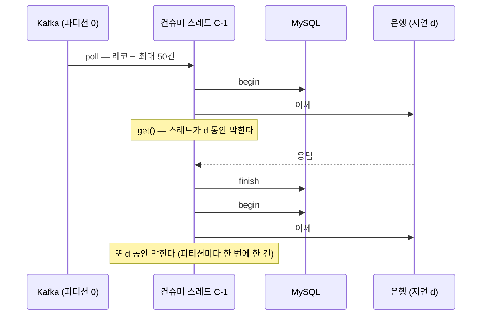
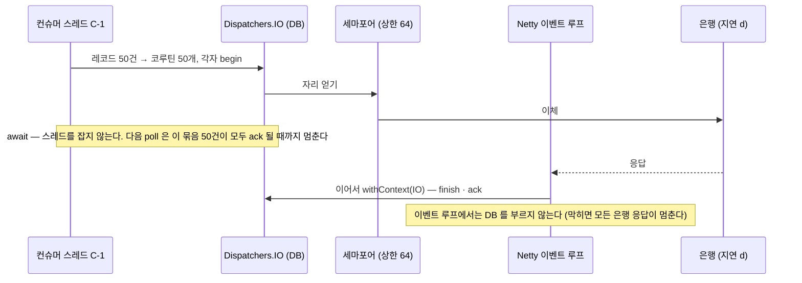
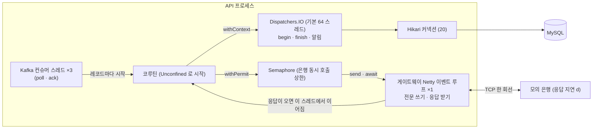
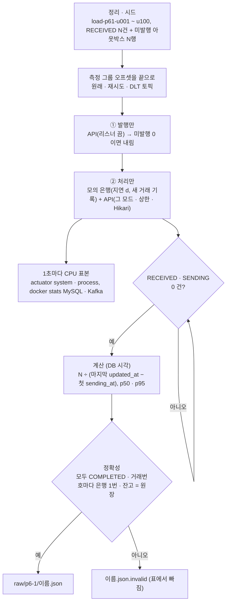

# P6-1 컨슈머 코루틴 — 구현 계획

> **For agentic workers:** REQUIRED SUB-SKILL: Use superpowers:subagent-driven-development (recommended) or superpowers:executing-plans to implement this plan task-by-task. Steps use checkbox (`- [ ]`) syntax for tracking.

**Goal:** 출금 컨슈머(`transfer.requested`)를 Kotlin `suspend` 리스너 버전으로도 만들어 `transfer.consumer.mode` 로 고르게 하고(기본 `blocking`), 같은 PC · 같은 도구로 "밀린 N건 비우기" 처리량을 재고, 코루틴 쪽의 용량 탐색(은행 동시 호출 상한 · Hikari)을 한다.

**Architecture:** 판정은 `TransferProcessor` 한 곳에 두고 `process` 를 `begin`(조회 · `RECEIVED → SENDING`) · `finish`(결과 기록 · CONFLICT)로 나눈다 — 블로킹 판은 셋을 이어 부르고, 코루틴 판(`SuspendingTransferRequestedListener`)은 `withContext(db) { begin }` → `semaphore.withPermit { suspendBank.transfer() /* await */ }` → `withContext(db) { finish }` 로 부른다. 두 리스너는 key 읽기 · 결과 마무리 · DLT 를 `TransferRequestedHandling` 하나로 같이 쓰고, `@ConditionalOnProperty` 로 하나만 빈이 된다. 측정은 `load/consumer/run.sh` 가 시드 → 오프셋 이동 → 발행만 → 처리만 → DB 시각 계산 → 정확성 확인을 한 번에 한다.

**Tech Stack:** Kotlin 2.3.21 · Java 21 · Spring Boot 4.1.1 (Spring 7.0.9) · Spring Kafka 4.1.1 (`suspend` `@KafkaListener`, `@RetryableTopic`) · kotlinx-coroutines 1.10.2 (`-core`, `-reactor` — Boot BOM 관리) · Netty 4.2 · Hibernate 7 · MySQL 8.4 · Kafka 4.1 · Testcontainers 2.0.5 · JUnit 5 · Gradle 9 Kotlin DSL

**Spec:** [docs/superpowers/specs/2026-11-04-p6-1-consumer-coroutines-design.md](../specs/2026-11-04-p6-1-consumer-coroutines-design.md) (승인 2026-11-04. 앞 단계: [P3 설계](../specs/2026-10-19-p3-transfer-design.md) · [P4-2 설계](../specs/2026-10-27-p4-2-lock-comparison-design.md) · [ADR-0005](../../adr/0005-kafka-delivery-and-consumer-idempotency.md). 결정 기록은 ADR-0012 — Task 9 에서 작성)

## 스펙과 다른 점 / 확인 필요

승인된 결정은 바꾸지 않는다. 아래는 코드 · 실제 jar 를 확인하다 드러난 스펙의 빈틈과 이 계획의 해결책이다 — 리뷰에서 확인해 달라.

1. **§4 "취소된 요청의 대기 표 항목이 남는지 확인" → 남지만 응답 시간 초과까지만이다. 고치지 않고 테스트로 고정한다 (Task 3).** `BankGatewayClient.send` 는 대기 표에 넣은 원래 future 에 `orTimeout(3초)` 를 걸고, 그 위에 `handle { pending.remove(…) }` · `thenApply` 를 잇는다. kotlinx `await()` 가 코루틴 취소 때 `cancel()` 하는 것은 맨 위(`thenApply`) future 뿐이라 원래 future 는 그대로 남지만, 늦어도 `orTimeout` 이 3초 뒤 그것을 끝내고 `handle` 이 항목을 지운다. 늦은 응답이 그 사이에 오면 그때 지워진다. 무한히 남지 않으므로 게이트웨이를 바꾸지 않는다 (스펙 §3 "은행 게이트웨이 바꾸지 않는 것").
2. **모드 값은 소문자 그대로만 받는다 (`enum` 이 아니다).** `wallet.debit-strategy` 는 대소문자 무관 `enum` 인데, Boot 의 느슨한 enum 바인딩은 `co-routine` 도 `COROUTINE` 으로 읽는 반면 `@ConditionalOnProperty` 는 `equalsIgnoreCase` 비교라 두 리스너 모두 빈이 되지 않는다 → 컨슈머 없이 조용히 뜬다. `TransferConsumerProperties.mode: String` + `init` 에서 `blocking` · `coroutine` 만 허용 (Task 6).
3. **모의 은행은 종료 로그에 더해 "동시 대기 최댓값이 바뀔 때마다" 한 줄을 남기고, 응답 지연을 띄운 뒤에도 바꿀 수 있다 (`responseDelay` 가 `var`).** 측정 스크립트가 Git Bash 에서 `kill` 로 내리는 Windows 자바 프로세스가 종료 훅을 돌리는지 확인하지 못했다(추정: 돌리지 않는다). 종료 로그에만 기대면 값을 잃는다. 런타임 변경은 공유 테스트 은행(`ApiIntegrationTest.bank`)으로 코루틴 흐름 테스트에서 지연을 주기 위해서다 (Task 3).
4. **측정은 전용 컨슈머 그룹 `transfer-processor-p61` 을 쓴다.** 스펙 §6 ① "컨슈머 그룹 오프셋을 끝으로" 를 개발용 그룹(`transfer-processor`)에 하면 개발 중 쌓인 미처리 메시지를 건너뛰는데, 그 출금은 `RECEIVED` · `sending_at NULL` 이라 재발행 대상도 아니어서 멈춘다. 측정 API 를 `--spring.kafka.consumer.group-id=transfer-processor-p61` 로 띄우고 그 그룹(+ `-retry-0/1/2` · `-dlt`)만 옮긴다. 개발용 그룹은 "붙은 컨슈머가 없는지"만 본다 (다른 API 인스턴스 감지) (Task 8).
5. **측정 API 는 은행 점검 시간도 끈다 (`--bank.maintenance.enabled=false`).** 23:50 ~ 00:10 에 걸리면 모든 출금이 `NotSent` → 재시도 토픽으로 가 측정이 깨진다. 스펙 §6 "다른 스케줄을 모두 끈다" 의 연장이다.
6. **대조 실험(coroutine · 상한 3 · 100ms)의 N 은 1,500** — blocking 100ms 와 같은 N 이다. 스펙 표는 "기본 5,000" 이지만 예상 처리량이 30건/s 로 blocking 100ms 와 같아 5,000 이면 칸마다 약 170초이고, 같은 일감이어야 비교가 곧다 (`run.sh` 기본값, Task 8).
7. **코루틴 모드 흐름 테스트는 별도 Spring 컨텍스트다** (`transfer.consumer.mode=coroutine` — 리스너가 설정으로 갈리므로 피할 수 없다). "컨텍스트 하나 공유" 원칙의 예외라 한 클래스에 모으고 `@DirtiesContext(AFTER_CLASS)` 로 끝나면 닫는다 (컨테이너도 함께 내려간다). Task 1 실험도 Kafka 만 있는 작은 컨텍스트다. 두 설정 클래스는 `@TestConfiguration`(또는 테스트 클래스 안의 중첩 클래스)이어야 한다 — 테스트 소스의 `@Configuration` · `@SpringBootConfiguration` 은 앱의 컴포넌트 스캔 · 다른 테스트의 설정 탐색(패키지를 아래로 훑는다)에 걸려 공유 컨텍스트를 깨뜨린다.
8. **코루틴 흐름 테스트의 "연결 없음" 은 점검 시간(보내기 문)으로 만든다.** 공유 모의 은행을 `pause()` 하면 블로킹 컨텍스트의 게이트웨이도 끊기고, 그 재접속 백오프(1초 → 2초 …)가 다음 테스트 클래스의 `@BeforeEach`(5초)를 흔들 수 있다. 보내기 문은 같은 `BankNotSentException` 길이고(`SendGate`, 어댑터는 두 이유를 구분하지 않는다), 복구 시점을 `testClock.release()` 로 정확히 정할 수 있다. 진짜 연결 끊김은 어댑터 테스트(닫힌 포트)와 기존 블로킹 흐름 테스트가 본다.
9. **`@RetryableTopic` · `@KafkaListener` 값은 상수 객체 `TransferListenerSettings` 에 한 번만 쓴다.** 애너테이션은 메타 애너테이션으로 묶을 수 없어(`@Target` 에 `ANNOTATION_TYPE` 없음) 두 리스너에 같은 애너테이션을 적되 값은 상수를 가리키고, 반사 테스트가 두 애너테이션이 같은지 본다 (Task 4 · 5).
10. **p50 · p95 는 스펙 정의대로 `updated_at − sending_at` 이다** — Kafka 에서 기다린 시간은 빠진다. blocking 은 은행 지연 + DB, coroutine 은 세마포어 대기 + 은행 지연 + DB 커넥션 대기다. 결과 문서 "읽는 법" 에 적는다 (Task 10).
11. **CPU 표본 간격**: Actuator 는 1초마다, `docker stats --no-stream` 은 한 번에 1 ~ 2초 걸려(추정) MySQL · Kafka 표본은 그보다 성기다. 결과 문서 조건 표에 적는다.

## Global Constraints

스펙에서 그대로 옮긴 프로젝트 전체 요구 (모든 Task 의 요구사항에 암묵적으로 포함된다):

- **고르는 법 (§2 · §5)**: `transfer.consumer.mode = blocking`(기본) | `coroutine`. 그 밖의 값은 **기동 실패**. 두 리스너는 `@ConditionalOnProperty` 로 하나만 빈이 된다 (`blocking` 은 `matchIfMissing = true`).
- **상한 (§2 · §5)**: `transfer.consumer.coroutine.max-in-flight-bank-calls` 기본 **64**, **1 ~ 1024** 밖이면 기동 실패. `Semaphore` 로 **은행에 동시에 보내는 수**를 지킨다.
- **모의 은행 (§5)**: 실행 인자 `--response-delay=<n>ms` (**0 ~ 2999ms**, 은행 타임아웃 3초 미만, 기본 0). **동시에 응답을 기다리는 요청 수의 최댓값**을 세어 메서드로 돌려주고(테스트용), 종료할 때 로그로 남긴다(측정용).
- **지우지 않는다 (§1)**: 지금의 블로킹 코드는 그대로 두고 기본값이다. **기존 동기 코드는 지우지 않는다** — 두 구현은 파일로 나뉘어 나란히 읽힌다.
- **판정 (§3)**: `TransferProcessor.process` 를 `begin(id): Begin`(`Begin.Started(transfer)` · `Begin.NotFound` · `Begin.AlreadyHandled`) · `finish(id, outcome): ProcessResult` 로 나눈다. **기존 `TransferProcessor` 테스트(`TransferProcessorTest.kt`)는 고치지 않고 통과**해야 한다.
- **의존성 (§3)**: `kotlinx-coroutines-core`, `kotlinx-coroutines-reactor` 만 `apps/api` 에. **WebFlux 는 넣지 않는다.** **`modules/transfer` 는 코루틴 라이브러리 의존 없음** (`suspend` 는 언어 기능이다 — `SuspendBankTransferPort` 는 거기 둔다).
- **바꾸지 않는 것 (§3)**: 웹, 정리 작업(결과조회는 블로킹 그대로), 1원인증, 파티션 수(3), `listener.concurrency`(3), `max-poll-records`(50), 은행 게이트웨이(단일 연결 · 이벤트 루프 1개). DLT 처리는 두 모드 모두 블로킹 그대로.
- **오류 처리 (§4)**: 코루틴 모드도 블로킹과 같은 결과. **코루틴 취소는 아무것도 기록하지 않고 취소를 다시 던진다 — `NotSent` 로 분류해 다시 보내는 일은 없어야 한다 (이중 지급).** 분류 규칙은 `classifyBankFailure` 한 함수를 두 어댑터가 같이 쓴다.
- **측정 비교 (§6)**: 모드 blocking / coroutine(상한 64) × 은행 지연 **0 / 20 / 100 / 500 ms** × 칸마다 **3회, 지표마다 중앙값**. 대조 실험 coroutine · **상한 3** · 100ms · 3회. N: 칸마다 20초 이상 — **기본 5,000, blocking 100ms 1,500, blocking 500ms 400** (첫 회차로 보정하면 문서에 적는다).
- **용량 탐색 (§6)**: coroutine · 지연 100ms · **N 20,000**. ① Hikari 20 에서 상한 **16 → 32 → 64 → 128 → 256** ② 가장 좋았던 상한에서 Hikari **10 / 20 / 40** ③ **멈춤: 시스템 CPU 평균 80% 도달 · 오류 · 처리량 증가 5% 미만 중 하나** ④ blocking 은 탐색하지 않는다 (한 줄로 적는다).
- **측정 한 회 (§6)**: 정리 · 시드(`load-p61-*`) → 오프셋을 원래 토픽 · 재시도 토픽 모두 끝으로 → 발행만 → 처리만 → DB 시각 계산(처리량 = N ÷ (마지막 `updated_at` − 첫 `sending_at`), 건별 p50 · p95, 1초마다 Actuator `system.cpu.usage` · `process.cpu.usage` 와 `docker stats`(MySQL · Kafka)) → 정확성(N건 모두 `COMPLETED`, 모의 은행 거래 기록에 거래번호마다 정확히 한 번, 잔고 = 원장 합). **하나라도 어긋나면 결과 파일을 `.invalid` 로.** 측정 API 는 다른 스케줄을 모두 끄고, 모의 은행은 **별도 `--bank-files` 디렉터리**, 다른 API 인스턴스는 끈다.
- **결과 문서 (§6)**: `docs/perf/p6-1-consumer-coroutines.md` + 원자료 `docs/perf/raw/p6-1/`. Mermaid 다이어그램 4종, "나타날 수 있는 현상과 읽는 법", 표 위에 **"이 PC 기준 상대 비교이며 운영 수치가 아니다"**.
- **문서 (§9)**: ADR-0012 (**제안** — 머지 때 채택), OPERATION 새 절, ARCHITECTURE · README(로드맵 P6-1 · 기술 스택에 코루틴) · HANDOVER · CHANGELOG · SETUP(테스트 수). 실행 구성 **`7. API (코루틴 컨슈머)`** (`--transfer.consumer.mode=coroutine`).
- **작업 규칙**: 브랜치 `feat/p6-1-consumer-coroutines` 에서만 (바꾸지 않는다). **push 하지 않는다.** 문서 · 주석 · 커밋은 한국어, 주석은 "왜" 를 쓰고 주변 코드의 밀도와 말투를 따른다 (CLAUDE.md). TDD. 설정 파일은 먼저 읽고 합친다(덮어쓰기 금지). 커밋 `type(scope): 한국어 요약`, 마지막 줄 `Co-Authored-By: Claude Opus 5.5 <noreply@anthropic.com>`. 비밀(DB 비밀번호 · 텔레그램 토큰)은 저장소 · 명령행에 넣지 않는다 (`infra/.env` → 컨테이너로만). `postman/` 아래에서 **Postman 앱이 다시 쓴 파일은 커밋하지 않는다** — 커밋 전 `git status` 로 확인하고 `git add` 는 경로를 적는다.
- **테스트는 Testcontainers 만** (자동 테스트가 로컬 인프라를 쓰지 않는다). **로컬 인프라 MySQL(3306)은 측정 스크립트(Task 8 연기 측정 · Task 10 측정)만 쓰고, 그것도 사용자 `load-p61-u001 ~ u100` 의 행(과 그 출금 · 원장 · 아웃박스 · 인증)만 만들고 지운다 — 다른 행은 건드리지 않는다.** `bootRun` 으로 앱을 띄워 확인하지 않는다.
- **명령 (Windows, Git Bash, 저장소 루트)**: 통합 테스트 전에 Docker Desktop 을 띄우고 `export PATH="/c/Users/user/AppData/Local/Programs/DockerDesktop/resources/bin:$PATH"`. 대상 테스트 `./gradlew :apps:api:test --tests '*이름*'` (첫 컨테이너 기동 포함 약 1분, 추정). 전체 `./gradlew build` — P5-2 끝에 411개 · 5분 안팎이었고, 이 계획이 컨텍스트 2개(실험 · 코루틴)를 더해 **6 ~ 8분으로 추정** (Bash 도구 기본 시간 제한 2분을 넘으므로 `timeout` 600000 으로 돌린다).

**버전 · API 확인 결과 (계획 작성 때 실제 jar 로 확인함 — 구현자는 다시 찾지 않아도 된다)**

확인 방법: `~/.gradle/caches/modules-2/files-2.1/` 의 `spring-boot-dependencies-4.1.1.pom`, `spring-core-7.0.9-sources.jar`, `spring-kafka-4.1.1.jar`(`javap -p -c`). **코드는 컴파일하지 않았다.**

1. **kotlinx-coroutines 버전**: Boot BOM 이 `kotlin-coroutines.version = 1.10.2` 로 `kotlinx-coroutines-bom` 을 들여온다 → `build.gradle.kts` 에 버전을 적지 않는다 (이 저장소에 `libs.versions.toml` 은 없다 — 버전은 BOM 과 `build.gradle.kts`). 1.10.2 는 Kotlin 2.3.21 과 함께 쓸 수 있다 (라이브러리는 더 낮은 Kotlin 으로 컴파일됐다). `-core-jvm` 1.10.2 는 캐시에 있고, **`-reactor` 는 캐시에 없어 첫 빌드 때 받는다** (reactor-core 는 BOM 의 3.8.7, 캐시에 있음).
2. **Spring 이 suspend 리스너를 부르는 디스패처**: `CoroutinesUtils.invokeSuspendingFunction(Method, Object, Object...)` 가 `Dispatchers.getUnconfined()`(context-propagation 이 있으면 `+ PropagationContextElement`)로 `MonoKt.mono(…)` 를 만든다 (`spring-core-7.0.9-sources.jar` 74 · 99 ~ 101줄). → 첫 suspend 지점까지는 부른 스레드(컨슈머)에서, **`await()` 뒤는 future 를 완료한 스레드(게이트웨이의 Netty 이벤트 루프)에서 이어진다.** 이것이 `withContext(db)` 의 근거다 (Task 1 실험 ③ 이 진짜 브로커로 확인). `kotlinx.coroutines.reactor.MonoKt` 를 import 하므로 `-reactor` 가 없으면 `NoClassDefFoundError` 다.
3. **비동기 실패 경로 (바이트코드로 확인)**: `MessagingMessageListenerAdapter.asyncFailure` 는 `CompletionException` 을 벗기고 `ListenerExecutionFailedException("Async Fail", cause)` 를 만들어 → (리스너 오류 처리기가 없으면) 레코드를 ack 한 뒤 `asyncRetryCallback`(컨테이너의 `callbackForAsyncFailure` → `failedRecords` 큐 → 컨슈머 스레드의 `handleAsyncFailure` → `invokeErrorHandlerBySingleRecord`)으로 넘긴다. 즉 컨테이너 오류 처리기(재시도 토픽의 `DefaultErrorHandler` + `DeadLetterPublishingRecoverer`)가 받는다 — **재시도 토픽이 동작할 것으로 추정**하지만 문서에 없으므로 Task 1 이 진행 조건이다. `ListenerConsumer` 에 `pauseForPending` 필드가 있다 (poll 묶음 단위 정지 — Task 1 ② 가 확인).
4. **Boot 4 자동 설정 이름**: `org.springframework.boot.kafka.autoconfigure.KafkaAutoConfiguration`, `org.springframework.boot.testcontainers.service.connection.ServiceConnectionAutoConfiguration` (실험 컨텍스트가 이 둘만 들여온다).
5. **코드 사실**: 기존 `TransferRequestedListenerTest` 는 `captureLogs(TransferRequestedListener::class.java)` 로 DLT 로그를 찾는다 → 공용 코드는 **부르는 리스너의 로거**를 받아 쓴다 (테스트를 고치지 않게). `MockBankServer` 는 `respond()` 로 입금을 먼저 기록하고 응답만 `responseDelay` 뒤에 쓴다. 거래 기록 줄은 `D` + 거래번호 20자 + …(`ReconFileFormat.journalLine`, 줄바꿈 `0x0A`) → 거래번호는 `cut -c2-21`. MySQL 재귀 CTE 기본 깊이는 1,000 이라 시드는 `cte_max_recursion_depth` 를 올린다.

## 결정(계획) 모음

스펙이 정하지 않은 곳의 판단이다. 각 Task 안에도 같은 표시로 다시 적는다.

- 결정(계획): `Begin` 은 `TransferProcessor` 안의 중첩 `sealed interface` (`TransferProcessor.Begin.Started` …) — 패키지 최상위에 `Begin` 이라는 넓은 이름을 두지 않는다.
- 결정(계획): `SuspendBankTransferPort` 는 `fun interface` 가 아닌 보통 `interface` 다 — `suspend` 추상 멤버를 가진 `fun interface` 의 지원 여부에 기대지 않는다.
- 결정(계획): 공용 코드 이름 = `TransferRequestedHandling(alerts, log)` (`transferIdOf` · `conclude` · `onDlt`) 와 상수 객체 `TransferListenerSettings`. `RetryLaterException` · `InvalidTransferKeyException` · `dltKind` · `logSafe` · `rootMessage` 는 같은 패키지의 `TransferRequestedHandling.kt` 로 옮긴다 (기존 테스트는 패키지만 보므로 그대로 컴파일된다).
- 결정(계획): 코루틴 판은 `conclude`(CONFLICT 알림 = 텔레그램 HTTP)도 `withContext(db)` 안에서 부른다 — 막는 호출이라 이벤트 루프에 두지 않는다.
- 결정(계획): 설정 · 조립은 새 `messaging/ConsumerConfiguration.kt` (`TransferConsumerProperties` + 리스너 빈 둘). 블로킹 리스너 빈(`transferRequestedListener`)은 `MessagingConfiguration` 에서 옮긴다 (이름 그대로). 코루틴 어댑터 · 세마포어는 빈으로 올리지 않고 리스너 빈 안에서 만든다 — 원래 토픽 · 재시도 토픽 컨테이너가 같은 리스너 빈 = 같은 세마포어를 쓴다.
- 결정(계획): `/actuator/info` 에 `transfer.consumer.mode` · `max-in-flight-bank-calls` · `datasource.maximum-pool-size` 를 보인다 — 측정 스크립트가 띄운 앱의 조건을 확인한 뒤에만 숫자를 남긴다 (P4-2 의 `debit-strategy` 와 같다).
- 결정(계획): 모의 은행의 동시 대기 수는 폴링(`PollRequest`)을 세지 않는다. 지연 0 이어도 센다(받자마자 쓰므로 1).
- 결정(계획): 측정 산출물 이름 `blocking-d<지연>-h<hikari>-<회차>.json` · `coroutine-d<지연>-c<상한>-h<hikari>-<회차>.json`. 회차가 숫자면 비교 표, `sweep` 으로 시작하면 용량 탐색 표, 그 밖(`drift` · `smoke`)은 표에서 빠진다. 측정 포트는 API 8080 · 모의 은행 **9190** (개발용 9090 과 겹치지 않게).
- 결정(계획): 변이 검사 3종은 Task 7 에서 돌리고 결과를 그 커밋 메시지에, Task 9 에서 ADR-0012 에 옮긴다. 변이는 커밋하지 않는다.
- 결정(계획): 측정(Task 10)은 **컨트롤러가 직접** 돌린다 — 두 시간 넘게 백그라운드 프로세스를 다루고, 중간 판단(N 보정 · 탐색 멈춤)이 있다.

## 파일 구조

| 파일 | 책임 |
|---|---|
| `apps/api/build.gradle.kts` (수정, Task 1) | `kotlinx-coroutines-core` · `-reactor` |
| `apps/api/src/test/.../api/messaging/experiment/SuspendListenerExperimentTest.kt` (신규, Task 1) | Spring Kafka suspend 리스너 실험 3종 (재시도 토픽 · poll 묶음 · 스레드) — 남겨 둔다 |
| `modules/transfer/.../transfer/TransferProcessor.kt` (수정, Task 2) | `begin` · `finish` · `Begin`, `process` 는 이어 부르기만 |
| `modules/transfer/.../transfer/Transfer.kt` (수정, Task 2) | `SuspendBankTransferPort` |
| `modules/transfer/src/test/.../TransferProcessorBeginFinishTest.kt` (신규, Task 2) | `begin` · `finish` (기존 `TransferProcessorTest.kt` 는 고치지 않는다) |
| `apps/api/.../api/config/BankTransferAdapter.kt` (수정, Task 3) | `classifyBankFailure` · `outcomeOf` (두 어댑터 공용) |
| `apps/api/.../api/config/SuspendBankTransferAdapter.kt` (신규, Task 3) | `await()`, 취소는 다시 던진다 |
| `apps/mock-bank/.../mockbank/MockBankServer.kt` · `MockBankOptions.kt` (수정, Task 3) | `--response-delay`, `responseDelay` var, 동시 대기 최댓값 |
| 테스트 (Task 3) | `config/SuspendBankTransferAdapterTest.kt`(신규), `BankGatewayClientTest.kt`(+2), `MockBankOptionsTest.kt`(+1) |
| `apps/api/.../api/messaging/TransferRequestedHandling.kt` (신규, Task 4) | 두 리스너 공용 (key · 결과 마무리 · DLT · 예외 · 상수) |
| `apps/api/.../api/messaging/TransferRequestedListener.kt` (수정, Task 4) | 블로킹 판 — 공용 코드를 부른다 |
| `apps/api/.../api/messaging/SuspendingTransferRequestedListener.kt` (신규, Task 5) | 코루틴 판 |
| `apps/api/src/test/.../messaging/SuspendingTransferRequestedListenerTest.kt` (신규, Task 5) | 결과 · 스레드 · 상한 · 취소 · 알림 · 애너테이션 |
| `apps/api/.../api/messaging/ConsumerConfiguration.kt` (신규, Task 6) | `TransferConsumerProperties`, 리스너 하나만 조립 |
| `apps/api/.../api/messaging/MessagingConfiguration.kt` (수정, Task 6) | 블로킹 리스너 빈을 옮긴다 |
| `apps/api/src/main/resources/application.yml` (수정, Task 6) | `transfer.consumer.*`, `info.transfer.consumer.*` · `info.datasource.*` |
| 테스트 (Task 6) | `messaging/ConsumerConfigurationTest.kt`, `messaging/ConsumerModeWiringTest.kt` |
| `.run/7. API (코루틴 컨슈머).run.xml` (신규, Task 6) | `bootRun --transfer.consumer.mode=coroutine` |
| `apps/api/src/test/.../messaging/CoroutineConsumerFlowTest.kt` (신규, Task 7) | 코루틴 모드 흐름 (별도 컨텍스트) |
| `load/consumer/run.sh` · `seed.sql` · `cleanup.sql` · `verify.sql` · `stats.sql` · `summarize.sh` (신규, Task 8) | 측정 도구 |
| 문서 (Task 9) | ADR-0012, OPERATION §2 · §11, ARCHITECTURE, README, HANDOVER, CHANGELOG, SETUP |
| 결과 (Task 10) | `docs/perf/p6-1-consumer-coroutines.md`, `docs/perf/raw/p6-1/*.json`, ADR-0012 결과 절, HANDOVER · README · CHANGELOG |

`…` 경로는 모두 `src/main/kotlin/io/github/hyeokjinon/banktransfer` (테스트는 `src/test/kotlin/io/github/hyeokjinon/banktransfer`) 아래다.

---

### Task 1: 실험 게이트 — 의존성 · Spring Kafka suspend 리스너 실험 3종 (결과에 따라 진행)

스펙 §7.1 · §8: suspend 리스너 + `@RetryableTopic` 조합은 문서에 없다. 진짜 브로커로 확인하고 테스트로 남긴다. **이 Task 가 통과해야 Task 2 이후를 한다.**

**Files:**
- Modify: `apps/api/build.gradle.kts`
- Create: `apps/api/src/test/kotlin/io/github/hyeokjinon/banktransfer/api/messaging/experiment/SuspendListenerExperimentTest.kt`

**Interfaces:**
- Consumes: `support/KafkaTestContainer` (`@TestConfiguration`, `KafkaContainer("apache/kafka:4.1.0")` `@ServiceConnection`), `support/TopicReader.kt` 의 `KafkaAdmin.committedOffset(group, partition): Long?`
- Produces: `apps/api` 의 의존성 `kotlinx-coroutines-core` · `kotlinx-coroutines-reactor` (Task 3 · 5 가 `kotlinx.coroutines.future.await`, `kotlinx.coroutines.sync.Semaphore` 를 쓴다). 실험 결과(관찰값) — 커밋 메시지에 적어 Task 9 (ADR-0012) 가 옮긴다.

**멈춤 조건 (컨트롤러가 사용자에게 돌아간다):**
- **BLOCKED — 구현을 멈추고 보고한다**: 실험 ① 에서 suspend 리스너가 던진 예외가 (a) 재시도 토픽(`p61x.retry-retry-0`)에 한 번도 가지 않거나, (b) 30초 안에 DLT(`@DltHandler`)에 닿지 않거나, (c) `exclude` 예외가 재시도 없이 DLT 로 가지 않거나, (d) 성공 레코드의 오프셋이 커밋되지 않는다. 보고에는 관찰한 동작(로그의 `Async Fail` · 재전달 반복 등)과 아래 선택지를 붙인다. 테스트의 기대값을 관찰값에 맞춰 고쳐 커밋하지 않는다.
  - 선택지 A: 블로킹 배치 리스너(`List<ConsumerRecord>`) 안에서 `runBlocking { records.map { async { … } }.awaitAll() }` — 동시성은 poll 묶음 단위, `RETRY_LATER` 는 `KafkaTemplate` 으로 재시도 토픽에 직접 발행.
  - 선택지 B: `CompletableFuture<Unit>` 반환 리스너(`future { }` 빌더)로 다시 실험 — 같은 비동기 반환 경로라 결과가 같을 가능성이 크다(추정).
  - 선택지 C: 코루틴 모드에서는 `@RetryableTopic` 대신 `DefaultErrorHandler` + `DeadLetterPublishingRecoverer` 로 재시도 토픽 체인을 직접 조립.
  - 선택지 D: 코루틴 모드의 `NotSent` 는 재시도 토픽 없이 `RECEIVED` 로 두고 정리 작업의 재발행(5분)에 맡긴다 — 재시도 간격이 크게 길어진다.
- **보고 후 컨트롤러 판단 (DONE_WITH_CONCERNS — 기대값을 고치지 않는다)**: 단계별 호출 횟수가 1이 아님(스펙 §4 "한 번 더 받는다"), DLT 의 `EXCEPTION_CAUSE_FQCN` 헤더가 원래 예외가 아님(→ `dltKind` 가 깨져 Task 4 에 수정이 필요), 실험 ② 의 최대가 `4..150` 밖, 실험 ③ 의 이어지는 스레드가 가짜 은행 스레드가 아님(→ `withContext` 는 그래도 둔다).

- [ ] **Step 1: 기준선 — 의존성을 넣기 전 전체 빌드**

Run: `./gradlew build` (timeout 600000)
Expected: BUILD SUCCESSFUL, 테스트 411개 (`apps:api` · 모듈 합). 숫자가 다르면 그 수를 기준선으로 적고 진행한다.

- [ ] **Step 2: 의존성 추가**

`apps/api/build.gradle.kts` 의 `implementation("org.redisson:redisson:4.8.0")` 줄 뒤에 추가 (나머지는 그대로):
```kotlin
    // 컨슈머 코루틴 (P6-1, ADR-0012). 버전은 Boot BOM (kotlinx-coroutines 1.10.2). WebFlux 는 넣지 않는다 —
    // core: CompletionStage.await() · Semaphore · withContext. reactor: Spring 이 suspend 리스너를 Mono 로 감싸 부를 때 쓴다 (CoroutinesUtils)
    implementation("org.jetbrains.kotlinx:kotlinx-coroutines-core")
    implementation("org.jetbrains.kotlinx:kotlinx-coroutines-reactor")
```

- [ ] **Step 3: 의존성만 넣고 전체 빌드 — 기존 동작이 바뀌지 않았는지 (reactor-core 가 클래스패스에 들어온다)**

Run: `./gradlew build` (timeout 600000)
Expected: BUILD SUCCESSFUL, Step 1 과 같은 테스트 수.

- [ ] **Step 4: 실험 테스트 작성**

`apps/api/src/test/kotlin/io/github/hyeokjinon/banktransfer/api/messaging/experiment/SuspendListenerExperimentTest.kt`:
```kotlin
package io.github.hyeokjinon.banktransfer.api.messaging.experiment

import io.github.hyeokjinon.banktransfer.api.support.KafkaTestContainer
import io.github.hyeokjinon.banktransfer.api.support.committedOffset
import kotlinx.coroutines.future.await
import org.apache.kafka.clients.admin.NewTopic
import org.apache.kafka.clients.consumer.ConsumerRecord
import org.apache.kafka.clients.producer.ProducerRecord
import org.apache.kafka.common.TopicPartition
import org.awaitility.kotlin.await
import org.awaitility.kotlin.until
import org.awaitility.kotlin.untilAsserted
import org.springframework.beans.factory.annotation.Autowired
import org.springframework.boot.autoconfigure.ImportAutoConfiguration
import org.springframework.boot.kafka.autoconfigure.KafkaAutoConfiguration
import org.springframework.boot.test.context.SpringBootTest
import org.springframework.boot.test.context.TestConfiguration
import org.springframework.boot.testcontainers.service.connection.ServiceConnectionAutoConfiguration
import org.springframework.context.annotation.Bean
import org.springframework.context.annotation.Import
import org.springframework.kafka.annotation.BackOff
import org.springframework.kafka.annotation.DltHandler
import org.springframework.kafka.annotation.KafkaListener
import org.springframework.kafka.annotation.RetryableTopic
import org.springframework.kafka.config.KafkaListenerEndpointRegistry
import org.springframework.kafka.config.TopicBuilder
import org.springframework.kafka.core.KafkaAdmin
import org.springframework.kafka.core.KafkaTemplate
import org.springframework.kafka.retrytopic.RetryTopicSchedulerWrapper
import org.springframework.kafka.retrytopic.SameIntervalTopicReuseStrategy
import org.springframework.kafka.retrytopic.TopicSuffixingStrategy
import org.springframework.kafka.support.Acknowledgment
import org.springframework.kafka.support.KafkaHeaders
import org.springframework.scheduling.concurrent.ThreadPoolTaskScheduler
import org.springframework.test.annotation.DirtiesContext
import java.time.Duration
import java.util.UUID
import java.util.concurrent.CompletableFuture
import java.util.concurrent.ConcurrentHashMap
import java.util.concurrent.Executors
import java.util.concurrent.ScheduledExecutorService
import java.util.concurrent.TimeUnit
import java.util.concurrent.atomic.AtomicInteger
import kotlin.test.Test
import kotlin.test.assertEquals
import kotlin.test.assertTrue

/**
 * P6-1 실험 (설계 §7.1, Task 1 — 진행 조건): Spring Kafka 4.1.1 의 suspend @KafkaListener 가 이 저장소의 쓰임새대로 동작하는지 진짜 브로커로 본다.
 * 문서에 명시되지 않은 세 가지 (설계 §8):
 * ① @RetryableTopic: await 뒤에 던진 예외가 재시도 토픽 → DLT 로 가는가, 단계마다 몇 번 불리는가, DLT 원인 헤더가 원래 예외인가 (dltKind 가 이 헤더로 가른다)
 * ② 비동기 ack 의 poll 묶음 단위 정지: 처리 중인 레코드가 컨슈머 3 × max-poll-records 50 = 150 에 묶이는가
 * ③ 스레드: await 뒤 코드가 future 를 완료한 스레드(게이트웨이의 Netty 이벤트 루프 자리)에서 이어지는가 — 코루틴 리스너의 withContext(db) 근거
 * 앱 컨텍스트와 섞이지 않게 Kafka 자동 설정만 있는 작은 컨텍스트와 실험용 토픽 · 그룹(p61x.*)을 쓴다. spring.kafka.* 는 application.yml 그대로 (concurrency 3 · max-poll-records 50 · manual_immediate).
 * 설정 클래스는 테스트 안의 @TestConfiguration 이다 — 테스트 소스의 @Configuration · @SpringBootConfiguration 은 앱의 컴포넌트 스캔과 다른 테스트의 설정 탐색에 걸린다.
 */
@SpringBootTest(classes = [SuspendListenerExperimentTest.ExperimentConfig::class], webEnvironment = SpringBootTest.WebEnvironment.NONE)
@DirtiesContext(classMode = DirtiesContext.ClassMode.AFTER_CLASS)   // 이 클래스만 쓰는 컨텍스트 — 끝나면 Kafka 컨테이너까지 내린다
class SuspendListenerExperimentTest {

    @TestConfiguration(proxyBeanMethods = false)
    @ImportAutoConfiguration(ServiceConnectionAutoConfiguration::class, KafkaAutoConfiguration::class)
    @Import(KafkaTestContainer::class)
    class ExperimentConfig {
        @Bean fun retryExperimentTopic(): NewTopic = TopicBuilder.name(RETRY_TOPIC).partitions(3).replicas(1).build()
        @Bean fun inFlightExperimentTopic(): NewTopic = TopicBuilder.name(IN_FLIGHT_TOPIC).partitions(3).replicas(1).build()
        @Bean fun threadExperimentTopic(): NewTopic = TopicBuilder.name(THREAD_TOPIC).partitions(1).replicas(1).build()

        @Bean fun retryExperimentListener() = RetryExperimentListener()
        @Bean fun inFlightExperimentListener() = InFlightExperimentListener()
        @Bean fun threadExperimentListener() = ThreadExperimentListener()

        /** 앱(MessagingConfiguration)과 같이 재시도 토픽 전용 스케줄러를 둔다. */
        @Bean
        fun retryTopicSchedulerWrapper() = RetryTopicSchedulerWrapper(
            ThreadPoolTaskScheduler().apply {
                poolSize = 1
                setThreadNamePrefix("x-retry-topic-")
            },
        )
    }

    @Autowired private lateinit var kafka: KafkaTemplate<String, String>
    @Autowired private lateinit var kafkaAdmin: KafkaAdmin
    @Autowired private lateinit var registry: KafkaListenerEndpointRegistry
    @Autowired private lateinit var retry: RetryExperimentListener
    @Autowired private lateinit var inFlight: InFlightExperimentListener
    @Autowired private lateinit var thread: ThreadExperimentListener

    @Test
    fun `① await 뒤에 던진 예외는 재시도 토픽 2개를 한 번씩 거쳐 DLT 로 간다 - DLT 원인 헤더는 원래 예외`() {
        val key = "fail-" + UUID.randomUUID()
        kafka.send(RETRY_TOPIC, key, "{}").get(5, TimeUnit.SECONDS)

        await.atMost(Duration.ofSeconds(30)) untilAsserted { assertTrue(retry.dlt.containsKey(key), "DLT 에 오지 않았다. 호출: ${retry.callsOf(key)}") }
        Thread.sleep(1_000)   // 늦게 오는 중복 호출이 있는지 조금 더 본다 (설계 §4 "실패 레코드를 한 번 더 받는다")

        println("[P6-1 실험 ①] 토픽별 호출 = ${retry.callsOf(key)}, DLT 원인 = ${retry.dlt.getValue(key).header(KafkaHeaders.EXCEPTION_CAUSE_FQCN)}")
        assertEquals(mapOf(RETRY_TOPIC to 1, "$RETRY_TOPIC-retry-0" to 1, "$RETRY_TOPIC-retry-1" to 1), retry.callsOf(key))
        assertEquals(ExperimentRetryException::class.java.name, retry.dlt.getValue(key).header(KafkaHeaders.EXCEPTION_CAUSE_FQCN))
    }

    @Test
    fun `① exclude 예외는 재시도 없이 바로 DLT`() {
        val key = "fatal-" + UUID.randomUUID()
        kafka.send(RETRY_TOPIC, key, "{}").get(5, TimeUnit.SECONDS)

        await.atMost(Duration.ofSeconds(30)) untilAsserted { assertTrue(retry.dlt.containsKey(key), "DLT 에 오지 않았다. 호출: ${retry.callsOf(key)}") }
        Thread.sleep(1_000)

        assertEquals(mapOf(RETRY_TOPIC to 1), retry.callsOf(key))
        assertEquals(ExperimentFatalException::class.java.name, retry.dlt.getValue(key).header(KafkaHeaders.EXCEPTION_CAUSE_FQCN))
    }

    @Test
    fun `① 정상으로 끝난 레코드는 한 번 불리고 오프셋이 커밋된다 (프레임워크가 ack)`() {
        val key = "ok-" + UUID.randomUUID()
        val sent = kafka.send(RETRY_TOPIC, key, "{}").get(5, TimeUnit.SECONDS).recordMetadata
        val partition = TopicPartition(RETRY_TOPIC, sent.partition())

        await.atMost(Duration.ofSeconds(15)) untilAsserted {
            val committed = kafkaAdmin.committedOffset(RETRY_GROUP, partition)
            assertTrue(committed != null && committed > sent.offset(), "커밋 = $committed, 레코드 offset = ${sent.offset()}")
        }
        assertEquals(mapOf(RETRY_TOPIC to 1), retry.callsOf(key))
    }

    @Test
    fun `② 처리 중인 레코드는 poll 묶음 단위로 묶인다 - 컨슈머 3 × max-poll-records 50 이하, 컨슈머 스레드 3 보다는 많다`() {
        // 컨테이너가 서기 전에 모두 넣는다: 첫 poll 이 파티션마다 50건을 한 번에 받게 (조금씩 받으면 묶음이 작아진다)
        (0 until PER_PARTITION * 3)
            .map { i -> kafka.send(ProducerRecord(IN_FLIGHT_TOPIC, i % 3, "k-$i", "{}")) }
            .forEach { it.get(5, TimeUnit.SECONDS) }
        registry.getListenerContainer(IN_FLIGHT_ID)!!.start()

        // 문이 닫혀 있어 아무것도 끝나지 않는다 — 처리 중 수가 늘다가 2초 동안 그대로면 멈춘 것이다
        var last = -1
        await.atMost(Duration.ofSeconds(30)).pollDelay(Duration.ofSeconds(2)).pollInterval(Duration.ofSeconds(2)) until {
            val now = inFlight.inFlight.get()
            (now > 0 && now == last).also { last = now }
        }
        val stalled = inFlight.maxInFlight.get()
        println("[P6-1 실험 ②] 문을 닫은 채 처리 중 최대 = $stalled (150 이면 컨슈머 3 × 50 에서 poll 묶음 단위로 멈춤)")
        assertTrue(stalled in 4..150, "처리 중 최대 $stalled")

        inFlight.gate.complete(Unit)
        await.atMost(Duration.ofSeconds(60)) untilAsserted { assertEquals(PER_PARTITION * 3, inFlight.done.size) }
        assertTrue(inFlight.done.values.all { it.get() == 1 }, "같은 레코드를 두 번 처리했다")
        assertTrue(inFlight.maxInFlight.get() <= 150, "문을 연 뒤 최대 ${inFlight.maxInFlight.get()}")
        for (p in 0 until 3) {
            await.atMost(Duration.ofSeconds(15)) untilAsserted {
                assertEquals(PER_PARTITION.toLong(), kafkaAdmin.committedOffset(IN_FLIGHT_GROUP, TopicPartition(IN_FLIGHT_TOPIC, p)))
            }
        }
    }

    @Test
    fun `③ await 뒤 코드는 future 를 완료한 스레드에서 이어진다 - Spring 은 Dispatchers Unconfined 로 부른다`() {
        kafka.send(THREAD_TOPIC, "t-" + UUID.randomUUID(), "{}").get(5, TimeUnit.SECONDS)

        val (before, after) = thread.threads.get(30, TimeUnit.SECONDS)

        println("[P6-1 실험 ③] await 전 = $before, await 뒤 = $after")
        assertTrue("-C-" in before, "await 전은 컨슈머 스레드여야 한다: $before")
        assertEquals(FAKE_BANK_THREAD, after)
    }

    companion object {
        const val RETRY_TOPIC = "p61x.retry"
        const val RETRY_GROUP = "p61x-retry"
        const val IN_FLIGHT_TOPIC = "p61x.inflight"
        const val IN_FLIGHT_GROUP = "p61x-inflight"
        const val IN_FLIGHT_ID = "p61x-inflight"
        const val THREAD_TOPIC = "p61x.thread"
        const val FAKE_BANK_THREAD = "x-fake-bank-loop"
        const val PER_PARTITION = 100
    }
}

/** 재시도 토픽으로 넘길 예외 (실제 코드의 RetryLaterException 자리). */
class ExperimentRetryException : RuntimeException("experiment: retry later")

/** 재시도하지 않는 예외 (실제 코드의 InvalidTransferKeyException 자리 — @RetryableTopic exclude). */
class ExperimentFatalException : RuntimeException("experiment: not retryable")

private fun namedLoop(name: String): ScheduledExecutorService =
    Executors.newSingleThreadScheduledExecutor { r -> Thread(r, name).apply { isDaemon = true } }

/** 은행 응답처럼 다른 스레드가 조금 뒤에 완료하는 future. 이미 완료된 future 는 await 가 멈추지 않고 그 자리에서 이어 가 실험이 되지 않는다. */
private fun later(loop: ScheduledExecutorService): CompletableFuture<String> =
    CompletableFuture<String>().also { f -> loop.schedule(Runnable { f.complete("bank") }, 50, TimeUnit.MILLISECONDS) }

private fun ConsumerRecord<*, *>.header(name: String): String? = headers().lastHeader(name)?.value()?.toString(Charsets.UTF_8)

/** ① 실제 리스너와 같은 모양: key 검사(멈추기 전) → 은행 응답 기다림(다른 스레드) → 결과에 따라 예외. DLT 는 블로킹 핸들러. */
class RetryExperimentListener {
    private val calls = ConcurrentHashMap<String, ConcurrentHashMap<String, AtomicInteger>>()
    val dlt = ConcurrentHashMap<String, ConsumerRecord<String, String>>()
    private val loop = namedLoop("x-retry-bank")

    fun callsOf(key: String): Map<String, Int> = calls[key].orEmpty().mapValues { it.value.get() }

    @RetryableTopic(
        attempts = "3",
        backOff = BackOff(delayString = "200"),
        numPartitions = "3",
        replicationFactor = "1",
        topicSuffixingStrategy = TopicSuffixingStrategy.SUFFIX_WITH_INDEX_VALUE,
        sameIntervalTopicReuseStrategy = SameIntervalTopicReuseStrategy.MULTIPLE_TOPICS,
        exclude = [ExperimentFatalException::class],
    )
    @KafkaListener(topics = [SuspendListenerExperimentTest.RETRY_TOPIC], groupId = SuspendListenerExperimentTest.RETRY_GROUP)
    suspend fun on(record: ConsumerRecord<String, String>) {
        calls.computeIfAbsent(record.key()) { ConcurrentHashMap() }.computeIfAbsent(record.topic()) { AtomicInteger() }.incrementAndGet()
        if (record.key().startsWith("fatal-")) throw ExperimentFatalException()
        later(loop).await()
        if (record.key().startsWith("fail-")) throw ExperimentRetryException()
    }

    @DltHandler
    fun onDlt(record: ConsumerRecord<String, String>, ack: Acknowledgment) {
        dlt[record.key()] = record
        ack.acknowledge()
    }
}

/** ② 테스트가 문을 열 때까지 모든 호출이 기다린다. 동시에 처리 중인 수의 최댓값을 센다. */
class InFlightExperimentListener {
    val gate = CompletableFuture<Unit>()
    val inFlight = AtomicInteger()
    val maxInFlight = AtomicInteger()
    val done = ConcurrentHashMap<String, AtomicInteger>()

    @KafkaListener(
        id = SuspendListenerExperimentTest.IN_FLIGHT_ID,
        topics = [SuspendListenerExperimentTest.IN_FLIGHT_TOPIC],
        groupId = SuspendListenerExperimentTest.IN_FLIGHT_GROUP,
        autoStartup = "false",
    )
    suspend fun on(record: ConsumerRecord<String, String>) {
        maxInFlight.accumulateAndGet(inFlight.incrementAndGet()) { a, b -> maxOf(a, b) }
        try {
            gate.await()
        } finally {
            inFlight.decrementAndGet()
        }
        done.computeIfAbsent(record.key()) { AtomicInteger() }.incrementAndGet()
    }
}

/** ③ await 전 · 뒤의 스레드 이름. */
class ThreadExperimentListener {
    val threads = CompletableFuture<Pair<String, String>>()
    private val loop = namedLoop(SuspendListenerExperimentTest.FAKE_BANK_THREAD)

    @KafkaListener(topics = [SuspendListenerExperimentTest.THREAD_TOPIC], groupId = "p61x-thread")
    suspend fun on(record: ConsumerRecord<String, String>) {
        val before = Thread.currentThread().name
        later(loop).await()
        threads.complete(before to Thread.currentThread().name)
    }
}
```

- [ ] **Step 5: 실험 실행**

Run: `./gradlew :apps:api:test --tests '*SuspendListenerExperimentTest*'` (첫 실행은 `kotlinx-coroutines-reactor` 다운로드 포함)
Expected: 5 tests PASS. 출력의 `[P6-1 실험 ①] 토픽별 호출 = {p61x.retry=1, p61x.retry-retry-0=1, p61x.retry-retry-1=1}, DLT 원인 = …ExperimentRetryException`, `[P6-1 실험 ②] … 최대 = 150` (추정), `[P6-1 실험 ③] await 전 = …-C-…, await 뒤 = x-fake-bank-loop` 를 적어 둔다 (`apps/api/build/test-results/test/TEST-*SuspendListenerExperimentTest.xml` 의 `system-out`).
- 실패하면 위 "멈춤 조건" 표대로: BLOCKED 이면 멈추고 보고, 그 밖이면 관찰값과 함께 DONE_WITH_CONCERNS 로 보고한다. 컴파일 오류 · 컨텍스트 기동 오류(실험 장치 자체의 문제)는 고쳐도 되지만, 고친 내용을 보고에 적는다.

- [ ] **Step 6: 커밋**

```bash
git add apps/api/build.gradle.kts apps/api/src/test/kotlin/io/github/hyeokjinon/banktransfer/api/messaging/experiment/SuspendListenerExperimentTest.kt
git commit -m "test(p6-1): suspend 리스너 실험 — 재시도 토픽 · poll 묶음 정지 · await 뒤 스레드 (진행 조건)

kotlinx-coroutines-core · -reactor 추가 (Boot BOM 1.10.2, WebFlux 없음).
Spring Kafka 4.1.1 suspend @KafkaListener 를 Kafka 만 있는 작은 컨텍스트에서 진짜 브로커로 확인해 남긴다.
관찰: ① 토픽별 호출 <Step 5 값>, DLT 원인 헤더 <값> ② 처리 중 최대 <값> ③ await 뒤 스레드 <값>

Co-Authored-By: Claude Opus 5.5 <noreply@anthropic.com>"
```
(`<…>` 는 Step 5 에서 적어 둔 관찰값으로 바꿔 쓴다.)

---

### Task 2: 도메인 — `TransferProcessor` 를 `begin` · `finish` 로 나누고 `SuspendBankTransferPort` 를 둔다

`modules/transfer` 는 코루틴 라이브러리 없이 언어의 `suspend` 만 쓴다. 기존 `TransferProcessorTest.kt` 는 **고치지 않는다** — 그대로 통과하는 것이 "`process` 의 동작이 같다" 의 근거다.

**Files:**
- Modify: `modules/transfer/src/main/kotlin/io/github/hyeokjinon/banktransfer/transfer/TransferProcessor.kt` (전체)
- Modify: `modules/transfer/src/main/kotlin/io/github/hyeokjinon/banktransfer/transfer/Transfer.kt` (`BankTransferPort` 뒤)
- Create: `modules/transfer/src/test/kotlin/io/github/hyeokjinon/banktransfer/transfer/TransferProcessorBeginFinishTest.kt`
- Test (고치지 않는다): `modules/transfer/src/test/kotlin/io/github/hyeokjinon/banktransfer/transfer/TransferProcessorTest.kt`

**Interfaces:**
- Consumes: 기존 `TransferStore`, `BankTransferPort`, `BankTransferOutcome`, `ProcessResult`, `Transfer`
- Produces (패키지 `io.github.hyeokjinon.banktransfer.transfer`):
  - `class TransferProcessor(store: TransferStore, bank: BankTransferPort, clock: Clock = Clock.systemUTC())` — 생성자 그대로
  - `fun process(transferId: UUID): ProcessResult` (그대로)
  - `fun begin(transferId: UUID): TransferProcessor.Begin`
  - `fun finish(transferId: UUID, outcome: BankTransferOutcome): ProcessResult`
  - `sealed interface TransferProcessor.Begin { data class Started(val transfer: Transfer); data object NotFound; data object AlreadyHandled }`
  - `interface SuspendBankTransferPort { suspend fun transfer(bankCode: String, accountNo: String, amount: Long, memo: String, reference: String): BankTransferOutcome }`

- [ ] **Step 1: 실패하는 테스트 작성**

`modules/transfer/src/test/kotlin/io/github/hyeokjinon/banktransfer/transfer/TransferProcessorBeginFinishTest.kt`:
```kotlin
package io.github.hyeokjinon.banktransfer.transfer

import java.time.Clock
import java.time.Instant
import java.time.ZoneOffset
import java.util.UUID
import kotlin.test.Test
import kotlin.test.assertEquals
import kotlin.test.assertIs

/**
 * begin · finish (P6-1). 코루틴 컨슈머는 이 둘 사이에서 은행만 suspend 로 부른다 — 판정은 여기 한 곳이다.
 * process 의 동작이 같다는 근거는 고치지 않은 TransferProcessorTest 이고, 여기서는 나눈 두 단계와 "process 와 같은 결과" 를 본다.
 */
class TransferProcessorBeginFinishTest {

    /** TransferProcessorTest 의 가짜 저장소와 같은 규칙 (그 테스트는 고치지 않고 통과해야 해서 따로 둔다). */
    private class FakeStore : TransferStore {
        val transfers = linkedMapOf<UUID, Transfer>()
        val failCalls = mutableListOf<Triple<UUID, TransferStatus, String>>()

        override fun saveWithEvent(transfer: Transfer, event: TransferEvent): Transfer = transfer.also { transfers[it.id] = it }
        override fun findById(id: UUID) = transfers[id]
        override fun findByIdempotencyKey(userId: String, key: String) =
            transfers.values.firstOrNull { it.userId == userId && it.idempotencyKey == key }

        override fun transition(id: UUID, from: TransferStatus, to: TransferStatus, at: Instant, bankResponseCode: String?, sentWithin: OpenEndRange<Instant>?): Boolean {
            require(to != TransferStatus.FAILED) { "FAILED 는 fail() 로만 간다 (환불을 빠뜨리지 않게)" }
            val current = transfers[id] ?: return false
            if (current.status != from) return false
            transfers[id] = current.copy(
                status = to,
                updatedAt = at,
                bankResponseCode = bankResponseCode,
                sendingAt = if (to == TransferStatus.SENDING) at else current.sendingAt,
            )
            return true
        }

        override fun fail(id: UUID, from: TransferStatus, at: Instant, bankResponseCode: String, sentWithin: OpenEndRange<Instant>?): Boolean {
            val current = transfers[id] ?: return false
            if (current.status != from) return false
            transfers[id] = current.copy(status = TransferStatus.FAILED, updatedAt = at, bankResponseCode = bankResponseCode)
            failCalls += Triple(id, from, bankResponseCode)
            return true
        }

        override fun findSendingBefore(cutoff: Instant, limit: Int): List<Transfer> = emptyList()
        override fun findUnknownForInquiry(maxAttempts: Int, sendingBefore: Instant, limit: Int): List<Transfer> = emptyList()
        override fun recordInquiryAttempt(id: UUID, at: Instant) = false
        override fun findRepublishable(updatedBefore: Instant, limit: Int): List<Transfer> = emptyList()
        override fun republish(id: UUID, expectedCount: Int, at: Instant) = false
    }

    private val now = Instant.parse("2026-11-04T01:00:00Z")
    private val clock = Clock.fixed(now, ZoneOffset.UTC)
    private val store = FakeStore()

    /** begin · finish 는 은행을 부르지 않는다 — 부르면 테스트가 깨진다 (코루틴 판은 블로킹 포트 없이 이 둘만 쓴다). */
    private val processor = TransferProcessor(store, BankTransferPort { _, _, _, _, _ -> error("begin · finish 는 은행을 부르지 않는다") }, clock)

    private fun received(): Transfer {
        val t = Transfer(
            id = UUID.randomUUID(), idempotencyKey = "k", reference = "T2611040000000000001", requestHash = "h",
            bankCode = "090", accountNo = "1002123456789", amount = 50_000, memo = "출금",
            status = TransferStatus.RECEIVED, createdAt = now, updatedAt = now,
        )
        store.transfers[t.id] = t
        return t
    }

    @Test
    fun `begin - RECEIVED 면 SENDING 으로 바꾸고 보낼 출금을 돌려준다`() {
        val t = received()

        assertEquals(TransferProcessor.Begin.Started(t), processor.begin(t.id))

        val after = store.transfers.getValue(t.id)
        assertEquals(TransferStatus.SENDING, after.status)
        assertEquals(now, after.sendingAt)
    }

    @Test
    fun `begin - 두 번째는 AlreadyHandled (같은 메시지가 다시 와도 은행에는 한 번)`() {
        val t = received()
        processor.begin(t.id)

        assertEquals(TransferProcessor.Begin.AlreadyHandled, processor.begin(t.id))
    }

    @Test
    fun `begin - 없는 출금은 NotFound`() {
        assertEquals(TransferProcessor.Begin.NotFound, processor.begin(UUID.randomUUID()))
    }

    @Test
    fun `finish - 은행 결과마다 process 와 같은 상태 · 응답코드 · 결과`() {
        val cases = listOf(
            BankTransferOutcome.Completed to ProcessResult.COMPLETED,
            BankTransferOutcome.Rejected("1001") to ProcessResult.FAILED,
            BankTransferOutcome.ResultUnknown to ProcessResult.UNKNOWN,
            BankTransferOutcome.NotSent to ProcessResult.RETRY_LATER,
        )
        for ((outcome, expected) in cases) {
            val split = received()
            assertIs<TransferProcessor.Begin.Started>(processor.begin(split.id))
            val splitResult = processor.finish(split.id, outcome)

            val whole = received()
            val wholeResult = TransferProcessor(store, BankTransferPort { _, _, _, _, _ -> outcome }, clock).process(whole.id)

            assertEquals(expected, splitResult, "$outcome")
            assertEquals(wholeResult, splitResult, "$outcome")
            assertEquals(store.transfers.getValue(whole.id).status, store.transfers.getValue(split.id).status, "$outcome")
            assertEquals(store.transfers.getValue(whole.id).bankResponseCode, store.transfers.getValue(split.id).bankResponseCode, "$outcome")
        }
    }

    @Test
    fun `finish - 거절은 SENDING 에서 fail() 로 확정한다 (환불 경로)`() {
        val t = received()
        processor.begin(t.id)

        assertEquals(ProcessResult.FAILED, processor.finish(t.id, BankTransferOutcome.Rejected("1001")))
        assertEquals(listOf(Triple(t.id, TransferStatus.SENDING, "1001")), store.failCalls)
    }

    @Test
    fun `finish - 정리 작업이 먼저 UNKNOWN 으로 바꿨어도 은행의 확정 결과로 기록한다`() {
        val t = received()
        processor.begin(t.id)
        store.transition(t.id, TransferStatus.SENDING, TransferStatus.UNKNOWN, now)   // 응답이 30초 넘게 늦은 사이에 정리 작업이 끼어듦

        assertEquals(ProcessResult.COMPLETED, processor.finish(t.id, BankTransferOutcome.Completed))
        assertEquals(TransferStatus.COMPLETED, store.transfers.getValue(t.id).status)
        assertEquals("0000", store.transfers.getValue(t.id).bankResponseCode)
    }

    @Test
    fun `finish - 이미 다른 결과로 확정됐으면 CONFLICT, 잔고는 더 건드리지 않는다`() {
        val t = received()
        processor.begin(t.id)
        store.transition(t.id, TransferStatus.SENDING, TransferStatus.UNKNOWN, now)
        store.fail(t.id, TransferStatus.UNKNOWN, now, "2001")   // 결과조회가 먼저 FAILED 로 확정 (환불까지)

        assertEquals(ProcessResult.CONFLICT, processor.finish(t.id, BankTransferOutcome.Completed))
        assertEquals(TransferStatus.FAILED, store.transfers.getValue(t.id).status)
        assertEquals(1, store.failCalls.size)
    }

    @Test
    fun `finish - 미전송이면 RECEIVED 로 되돌려 다음 begin 이 다시 Started`() {
        val t = received()
        processor.begin(t.id)

        assertEquals(ProcessResult.RETRY_LATER, processor.finish(t.id, BankTransferOutcome.NotSent))
        assertEquals(TransferStatus.RECEIVED, store.transfers.getValue(t.id).status)
        assertIs<TransferProcessor.Begin.Started>(processor.begin(t.id))
    }
}
```

- [ ] **Step 2: 실패 확인**

Run: `./gradlew :modules:transfer:test --tests '*TransferProcessorBeginFinishTest*'`
Expected: 컴파일 FAIL — `Unresolved reference 'Begin'` · `'begin'` · `'finish'`.

- [ ] **Step 3: `TransferProcessor.kt` 전체를 아래로 바꾼다**

```kotlin
package io.github.hyeokjinon.banktransfer.transfer

import io.github.hyeokjinon.banktransfer.transfer.TransferStatus.COMPLETED
import io.github.hyeokjinon.banktransfer.transfer.TransferStatus.FAILED
import io.github.hyeokjinon.banktransfer.transfer.TransferStatus.RECEIVED
import io.github.hyeokjinon.banktransfer.transfer.TransferStatus.SENDING
import io.github.hyeokjinon.banktransfer.transfer.TransferStatus.UNKNOWN
import java.time.Clock
import java.time.Instant
import java.util.UUID

/** 처리 결과. 컨슈머는 [RETRY_LATER] 일 때만 메시지를 다시 처리하게 한다. */
enum class ProcessResult {
    COMPLETED,
    FAILED,
    UNKNOWN,
    ALREADY_HANDLED,

    /** 은행이 준 확정 결과가 이미 확정된 상태와 다르다 (예: 결과조회로 FAILED 확정 뒤 은행의 늦은 응답이 완료) → 사람이 확인해야 한다. */
    CONFLICT,
    NOT_FOUND,
    RETRY_LATER,
}

/**
 * TransferRequested 처리 (P3-2).
 * 1. RECEIVED -> SENDING 을 조건부로 바꾼다. false 면 다른 소비자가 이미 집어 갔거나 끝난 건 → 은행에 보내지 않는다.
 * 2. 은행 호출은 DB 트랜잭션 밖에서 한다 (응답을 기다리는 동안 커넥션을 붙잡지 않는다).
 * 3. 결과를 기록한다. 결과를 모르면 UNKNOWN — 다시 보내지 않는다 (P3-3 결과조회로 확정).
 *    보내지도 못했으면 RECEIVED 로 되돌려 재시도하게 한다.
 *    은행이 거절하면 FAILED 와 함께 차감한 금액을 돌려준다 — [TransferStore.fail] 이 한 트랜잭션에서 한다 (P4-1).
 * 은행 응답 뒤 DB 기록이 실패하면 SENDING 으로 남는다 — 정리 작업(TransferReconciler)이 30초 넘게 SENDING 인 건을 UNKNOWN 으로 바꾸고 결과조회로 확정한다.
 *
 * 1 은 [begin], 3 은 [finish] 다 (P6-1). 블로킹 컨슈머는 [process] 가 셋을 이어 부르고,
 * 코루틴 컨슈머는 [begin] · [finish] 를 부르고 그 사이의 은행 호출만 suspend 로 한다 (SuspendBankTransferPort).
 * 판정(조건부 전이 · CONFLICT)은 이 클래스 하나에만 있다 — 두 모드가 복사본을 갖지 않는다.
 */
class TransferProcessor(
    private val store: TransferStore,
    private val bank: BankTransferPort,
    private val clock: Clock = Clock.systemUTC(),
) {

    /** [begin] 의 결과 (P6-1). */
    sealed interface Begin {
        /** RECEIVED → SENDING 으로 바꿨다 — 이 출금을 은행에 보낸다. [transfer] 는 바꾸기 전에 읽은 값이다 (은행에 보낼 내용만 쓴다). */
        data class Started(val transfer: Transfer) : Begin

        /** 없는 출금 — 은행을 부르지 않는다. */
        data object NotFound : Begin

        /** 다른 소비자가 이미 집어 갔거나 끝난 건 — 은행을 부르지 않는다. */
        data object AlreadyHandled : Begin
    }

    fun process(transferId: UUID): ProcessResult {
        val transfer = when (val begun = begin(transferId)) {
            Begin.NotFound -> return ProcessResult.NOT_FOUND
            Begin.AlreadyHandled -> return ProcessResult.ALREADY_HANDLED
            is Begin.Started -> begun.transfer
        }
        val outcome = try {
            bank.transfer(transfer.bankCode, transfer.accountNo, transfer.amount, transfer.memo, transfer.reference)
        } catch (e: Exception) {
            // 포트가 결과를 분류하지 못하고 예외를 던졌다 = 은행이 받았는지 모른다 → 다시 보내지 않고 UNKNOWN (P3-3 결과조회로 확정)
            BankTransferOutcome.ResultUnknown
        }
        return finish(transferId, outcome)
    }

    /** 1단계: 조회 · RECEIVED → SENDING 조건부 전이 (P6-1 에서 [process] 에서 나눔). 은행은 부르지 않는다. */
    fun begin(transferId: UUID): Begin {
        val transfer = store.findById(transferId) ?: return Begin.NotFound
        if (!store.transition(transferId, RECEIVED, SENDING, clock.instant())) return Begin.AlreadyHandled
        return Begin.Started(transfer)
    }

    /** 3단계: 은행 결과를 기록하고 판정한다 (P6-1 에서 [process] 에서 나눔). [begin] 이 Started 를 돌려준 출금에만 부른다. 은행은 부르지 않는다. */
    fun finish(transferId: UUID, outcome: BankTransferOutcome): ProcessResult = when (outcome) {
        BankTransferOutcome.Completed -> record(transferId, COMPLETED, BANK_OK, ProcessResult.COMPLETED)
        is BankTransferOutcome.Rejected -> record(transferId, FAILED, outcome.responseCode, ProcessResult.FAILED)
        BankTransferOutcome.ResultUnknown -> record(transferId, UNKNOWN, null, ProcessResult.UNKNOWN)
        BankTransferOutcome.NotSent -> record(transferId, RECEIVED, null, ProcessResult.RETRY_LATER)
    }

    /**
     * SENDING 에서 결과로 옮긴다. false 면 정리 작업이 먼저 SENDING → UNKNOWN 으로 바꾼 것이다 (은행 응답이 30초 넘게 늦은 경우).
     * 그때 은행이 직접 준 확정 결과(완료 · 거절)는 결과조회보다 정확하므로 UNKNOWN 에서 바로 확정한다.
     * 그 밖(모름 · 미전송)은 정리 작업이 결과조회로 맡으므로 손대지 않는다.
     * 확정 결과를 UNKNOWN 에서도 옮기지 못했는데 현재 상태가 이미 다른 확정(완료 ↔ 거절)이면 [ProcessResult.CONFLICT] 다:
     * 결과조회 결과와 은행의 확정 결과가 엇갈린 것이라 조용히 넘기면 DB 와 은행이 어긋난 채 남는다.
     * 같은 확정 결과였거나 아직 확정 전이면 [ProcessResult.ALREADY_HANDLED] 다.
     */
    private fun record(id: UUID, to: TransferStatus, bankResponseCode: String?, result: ProcessResult): ProcessResult {
        val now = clock.instant()
        if (move(id, SENDING, to, now, bankResponseCode)) return result
        if ((to == COMPLETED || to == FAILED) && move(id, UNKNOWN, to, now, bankResponseCode)) return result
        if (to == COMPLETED || to == FAILED) {
            val current = store.findById(id)?.status
            if ((current == COMPLETED || current == FAILED) && current != to) return ProcessResult.CONFLICT
        }
        return ProcessResult.ALREADY_HANDLED
    }

    /**
     * FAILED 는 환불과 한 트랜잭션이어야 하므로 [TransferStore.fail] 로만 간다 (P4-1, transition 은 FAILED 를 거부한다).
     * 거절(Rejected)은 늘 은행 응답코드가 있다.
     */
    private fun move(id: UUID, from: TransferStatus, to: TransferStatus, at: Instant, bankResponseCode: String?): Boolean =
        if (to == FAILED) {
            store.fail(id, from, at, checkNotNull(bankResponseCode) { "FAILED needs a bank response code" })
        } else {
            store.transition(id, from, to, at, bankResponseCode)
        }

    private companion object {
        const val BANK_OK = "0000"
    }
}
```

- [ ] **Step 4: `Transfer.kt` 에 포트 추가** — `fun interface BankTransferPort { … }` 블록 바로 뒤(`/** 결과조회 결과. …` 앞)에:

```kotlin

/**
 * 은행 출금이체 포트의 suspend 판 (P6-1, ADR-0012). 응답을 기다리는 동안 스레드를 잡지 않는다 — 코루틴 컨슈머가 부른다.
 * 결과 분류는 [BankTransferPort] 와 같다. 기다리는 중 코루틴이 취소되면 분류하지 않고 취소를 그대로 던진다 (은행에 갔는지 모른다 — NotSent 면 다시 보내진다).
 * 이 모듈은 코루틴 라이브러리를 쓰지 않는다: suspend 는 언어 기능이다.
 */
interface SuspendBankTransferPort {
    /** [reference] = 이용기관 거래번호. 결과를 모를 때 이 번호로 결과조회한다. */
    suspend fun transfer(bankCode: String, accountNo: String, amount: Long, memo: String, reference: String): BankTransferOutcome
}
```
그리고 `BankTransferPort` 의 KDoc 첫 줄을 `/** 은행 출금이체 포트. 결과가 나올 때까지 호출 스레드에서 기다린다 (블로킹 컨슈머 · Kafka 컨슈머 스레드가 부른다). */` 로 바꾼다.

- [ ] **Step 5: 통과 확인 — 새 테스트와 고치지 않은 기존 테스트**

Run: `./gradlew :modules:transfer:test`
Expected: BUILD SUCCESSFUL. `TransferProcessorBeginFinishTest` 8 PASS, `TransferProcessorTest` 전부 PASS. `git diff --stat modules/transfer/src/test/kotlin/io/github/hyeokjinon/banktransfer/transfer/TransferProcessorTest.kt` → 출력 없음 (고치지 않았다). `modules/transfer/build.gradle.kts` 의 `dependencies { }` 는 비어 있는 그대로다.

- [ ] **Step 6: 커밋**

```bash
git add modules/transfer/src/main/kotlin/io/github/hyeokjinon/banktransfer/transfer/TransferProcessor.kt \
  modules/transfer/src/main/kotlin/io/github/hyeokjinon/banktransfer/transfer/Transfer.kt \
  modules/transfer/src/test/kotlin/io/github/hyeokjinon/banktransfer/transfer/TransferProcessorBeginFinishTest.kt
git commit -m "feat(p6-1): TransferProcessor 를 begin · finish 로 나누고 SuspendBankTransferPort 를 둔다

process 는 begin → 은행 → finish 를 이어 부를 뿐이다 (기존 TransferProcessorTest 는 고치지 않고 통과).
코루틴 컨슈머가 판정을 복사하지 않고 은행 호출만 suspend 로 바꿔 끼울 수 있게 한다. 도메인 모듈은 코루틴 라이브러리 없이 언어의 suspend 만 쓴다.

Co-Authored-By: Claude Opus 5.5 <noreply@anthropic.com>"
```

---

### Task 3: 은행 쪽 — 분류 규칙 한 곳(`classifyBankFailure`) · `SuspendBankTransferAdapter` · 게이트웨이 취소 확인 · 모의 은행 지연 · 동시 대기 최댓값

**Files:**
- Modify: `apps/api/src/main/kotlin/io/github/hyeokjinon/banktransfer/api/config/BankTransferAdapter.kt` (전체)
- Create: `apps/api/src/main/kotlin/io/github/hyeokjinon/banktransfer/api/config/SuspendBankTransferAdapter.kt`
- Create: `apps/api/src/test/kotlin/io/github/hyeokjinon/banktransfer/api/config/SuspendBankTransferAdapterTest.kt`
- Modify: `apps/mock-bank/src/main/kotlin/io/github/hyeokjinon/banktransfer/mockbank/MockBankServer.kt`, `MockBankOptions.kt`
- Modify (테스트 추가만): `modules/bank-gateway/src/test/kotlin/io/github/hyeokjinon/banktransfer/gateway/BankGatewayClientTest.kt`, `apps/mock-bank/src/test/kotlin/io/github/hyeokjinon/banktransfer/mockbank/MockBankOptionsTest.kt`
- Test (고치지 않는다): `apps/api/src/test/.../config/BankTransferAdapterTest.kt`

**Interfaces:**
- Consumes: Task 1 의 `kotlinx-coroutines-core`, Task 2 의 `SuspendBankTransferPort`
- Produces:
  - `internal fun classifyBankFailure(cause: Throwable, accountNo: String): BankTransferOutcome` (패키지 `api.config`) — `BankNotSentException` → `NotSent`, 그 밖 → `ResultUnknown`
  - `internal fun outcomeOf(response: TransferResponse): BankTransferOutcome`
  - `class SuspendBankTransferAdapter(client: BankGatewayClient) : SuspendBankTransferPort`
  - `MockBankServer(…, responseDelay: Duration = Duration.ZERO, …)` 생성자 이름 그대로 + `@Volatile var responseDelay: Duration`, `fun peakPendingResponses(): Int`, `fun resetPeakPendingResponses()`; 로그 `mock bank peak pending responses: <n>` (최댓값이 바뀔 때마다 · 닫을 때)
  - `MockBankOptions(port, bankFiles, closeDay, responseDelay: Duration = Duration.ZERO)`, 인자 `--response-delay=<0~2999>ms`

- [ ] **Step 1: 실패하는 테스트 작성 (어댑터)**

`apps/api/src/test/kotlin/io/github/hyeokjinon/banktransfer/api/config/SuspendBankTransferAdapterTest.kt`:
```kotlin
package io.github.hyeokjinon.banktransfer.api.config

import io.github.hyeokjinon.banktransfer.gateway.BankGatewayClient
import io.github.hyeokjinon.banktransfer.gateway.BankGatewayConfig
import io.github.hyeokjinon.banktransfer.mockbank.MockBankServer
import io.github.hyeokjinon.banktransfer.transfer.BankTransferOutcome
import kotlinx.coroutines.CancellationException
import kotlinx.coroutines.cancelAndJoin
import kotlinx.coroutines.delay
import kotlinx.coroutines.launch
import kotlinx.coroutines.runBlocking
import kotlinx.coroutines.withTimeout
import java.time.Duration
import kotlin.test.Test
import kotlin.test.assertEquals
import kotlin.test.assertIs
import kotlin.test.assertNull

/**
 * 코루틴 판 어댑터 (P6-1). 분류는 블로킹 판과 같은 classifyBankFailure 를 쓴다 — 결과가 같은지 모의 은행으로 본다.
 * 다른 것은 취소 하나: 기다리는 중 코루틴이 취소되면 분류하지 않고 취소를 다시 던진다 (설계 §4 — NotSent 로 돌려주면 다시 보내져 이중 지급).
 */
class SuspendBankTransferAdapterTest {

    private val silent = "9990000000001"
    private val reference = "T2611040000000000099"

    private fun newClient(bank: MockBankServer, timeout: Duration = Duration.ofMillis(500)) =
        BankGatewayClient(BankGatewayConfig(host = "localhost", port = bank.boundPort, responseTimeout = timeout)).start()

    private fun awaitConnected(client: BankGatewayClient) {
        val deadline = System.currentTimeMillis() + 5_000
        while (!client.isConnected) {
            check(System.currentTimeMillis() < deadline) { "not connected" }
            Thread.sleep(20)
        }
    }

    private fun mockBank() = MockBankServer(silentAccounts = setOf(silent)).start()

    private fun transfer(client: BankGatewayClient, accountNo: String) =
        runBlocking { SuspendBankTransferAdapter(client).transfer("090", accountNo, 1_000, "m", reference) }

    @Test
    fun `연결이 없으면 NotSent`() {
        val closedPort = MockBankServer().start().use { it.boundPort }   // 닫힌 포트
        BankGatewayClient(BankGatewayConfig(host = "localhost", port = closedPort)).start().use { client ->
            assertEquals(BankTransferOutcome.NotSent, transfer(client, "1002123456789"))
        }
    }

    @Test
    fun `등록된 계좌면 Completed`() {
        mockBank().use { bank ->
            newClient(bank).use { client ->
                awaitConnected(client)
                assertEquals(BankTransferOutcome.Completed, transfer(client, "1002123456789"))
            }
        }
    }

    @Test
    fun `등록 안 된 계좌면 Rejected 1001`() {
        mockBank().use { bank ->
            newClient(bank).use { client ->
                awaitConnected(client)
                assertEquals(BankTransferOutcome.Rejected("1001"), transfer(client, "5500000000009"))
            }
        }
    }

    @Test
    fun `은행이 응답하지 않으면(시간 초과) ResultUnknown`() {
        mockBank().use { bank ->
            newClient(bank).use { client ->
                awaitConnected(client)
                assertEquals(BankTransferOutcome.ResultUnknown, transfer(client, silent))
            }
        }
    }

    @Test
    fun `기다리는 중에 코루틴이 취소되면 분류하지 않고 취소를 다시 던진다 - NotSent 로 돌려주면 다시 보내져 이중 지급`() {
        mockBank().use { bank ->
            newClient(bank, timeout = Duration.ofSeconds(5)).use { client ->
                awaitConnected(client)
                var returned: BankTransferOutcome? = null
                var thrown: Throwable? = null
                runBlocking {
                    val job = launch {
                        try {
                            returned = SuspendBankTransferAdapter(client).transfer("090", silent, 1_000, "m", reference)
                        } catch (e: Throwable) {
                            thrown = e
                            throw e
                        }
                    }
                    withTimeout(5_000) { while (client.pendingCount == 0) delay(10) }   // 요청이 은행으로 나가 응답을 기다리는 중
                    job.cancelAndJoin()
                }
                assertNull(returned)   // 어떤 결과로도 분류해 돌려주지 않았다
                assertIs<CancellationException>(thrown)
            }
        }
    }
}
```

- [ ] **Step 2: 실패하는 테스트 작성 (게이트웨이 · 모의 은행)**

`modules/bank-gateway/src/test/kotlin/io/github/hyeokjinon/banktransfer/gateway/BankGatewayClientTest.kt` 의 마지막 `private fun freePort()` 앞에 두 테스트를 더한다 (기존 테스트 · 도우미는 그대로):
```kotlin
    @Test
    fun `돌려받은 future 를 취소해도 대기 표의 항목은 응답 시간 초과 뒤 지워진다 (P6-1 - 코루틴 취소 때 await 가 하는 일)`() {
        val bank = MockBankServer(silentAccounts = setOf("9990000000001")).start().closeLater()
        val client = client(bank.boundPort, timeout = Duration.ofMillis(500)).start()
        waitUntil { client.isConnected }

        val future = client.transfer("090", "9990000000001", 1_000, "m", "T2611040000000000001")
        waitUntil { client.pendingCount == 1 }
        assertTrue(future.cancel(false))

        // 취소는 돌려준 future(thenApply 단계)에만 닿는다. 대기 표의 원래 future 에는 orTimeout 이 걸려 있어 시간 초과 때 handle 이 항목을 지운다 — 무한히 남지 않는다
        assertEquals(1, client.pendingCount)
        waitUntil(timeoutMs = 3_000) { client.pendingCount == 0 }
    }

    @Test
    fun `모의 은행은 응답 지연 중 동시에 응답을 기다린 요청 수의 최댓값을 센다 - 지연은 띄운 뒤에도 바꿀 수 있다 (P6-1)`() {
        val bank = MockBankServer().start().closeLater()
        val client = client(bank.boundPort).start()
        waitUntil { client.isConnected }
        fun reference(i: Int) = "P61PEAK" + "%013d".format(i)

        client.transfer("090", "1002123456789", 1, "seq", reference(0)).get(3, TimeUnit.SECONDS)
        assertEquals(1, bank.peakPendingResponses())   // 지연 없음: 받자마자 응답한다

        bank.responseDelay = Duration.ofMillis(300)
        bank.resetPeakPendingResponses()
        val futures = (1..20).map { i -> client.transfer("090", "1002123456789", i.toLong(), "P$i", reference(i)) }
        futures.forEach { it.get(5, TimeUnit.SECONDS) }

        assertEquals(20, bank.peakPendingResponses())   // 20건이 300ms 동안 함께 응답을 기다렸다
    }
```

`apps/mock-bank/src/test/kotlin/io/github/hyeokjinon/banktransfer/mockbank/MockBankOptionsTest.kt` 에 `import java.time.Duration` 을 더하고 테스트 하나를 더한다:
```kotlin
    @Test
    fun `응답 지연 --response-delay=n ms 는 0 ~ 2999 만 받는다 (P6-1 - 게이트웨이 응답 시간 초과 3초 미만)`() {
        assertEquals(Duration.ZERO, MockBankOptions.parse(emptyArray()).responseDelay)
        assertEquals(Duration.ofMillis(100), MockBankOptions.parse(arrayOf("--response-delay=100ms")).responseDelay)
        assertEquals(Duration.ZERO, MockBankOptions.parse(arrayOf("--response-delay=0ms")).responseDelay)
        assertEquals(Duration.ofMillis(2999), MockBankOptions.parse(arrayOf("9190", "--response-delay=2999ms")).responseDelay)
        for (bad in listOf("3000ms", "100", "-1ms", "1s", "ms", "12345ms")) {
            assertFailsWith<IllegalArgumentException>(bad) { MockBankOptions.parse(arrayOf("--response-delay=$bad")) }
        }
    }
```

- [ ] **Step 3: 실패 확인**

Run: `./gradlew :apps:mock-bank:test :modules:bank-gateway:test :apps:api:test --tests '*SuspendBankTransferAdapterTest*'`
Expected: 컴파일 FAIL — `responseDelay`(MockBankOptions) · `peakPendingResponses` · `resetPeakPendingResponses` · `val cannot be reassigned`(responseDelay) · `SuspendBankTransferAdapter` 가 없다. (게이트웨이의 취소 테스트는 지금 코드로도 통과할 것이다 — 고정용 테스트다.)

- [ ] **Step 4: `BankTransferAdapter.kt` 전체를 아래로 바꾼다 (분류를 공용 함수로)**

```kotlin
package io.github.hyeokjinon.banktransfer.api.config

import io.github.hyeokjinon.banktransfer.gateway.BankGatewayClient
import io.github.hyeokjinon.banktransfer.gateway.BankNotSentException
import io.github.hyeokjinon.banktransfer.protocol.TransferResponse
import io.github.hyeokjinon.banktransfer.transfer.BankTransferOutcome
import io.github.hyeokjinon.banktransfer.transfer.BankTransferPort
import org.slf4j.LoggerFactory
import java.util.concurrent.ExecutionException

/**
 * transfer 모듈의 BankTransferPort 를 Netty 게이트웨이에 연결한다 — 블로킹 판 (컨슈머 스레드가 .get() 으로 기다린다).
 * 예외를 "보냈나 / 모르나"로 나누는 규칙은 [classifyBankFailure] 하나를 코루틴 판(SuspendBankTransferAdapter)과 같이 쓴다 (P6-1).
 * 응답 시간 초과는 게이트웨이(bank.gateway.response-timeout)가 건다.
 */
class BankTransferAdapter(private val client: BankGatewayClient) : BankTransferPort {

    override fun transfer(bankCode: String, accountNo: String, amount: Long, memo: String, reference: String): BankTransferOutcome =
        try {
            outcomeOf(client.transfer(bankCode, accountNo, amount, memo, reference).get())
        } catch (e: ExecutionException) {
            // 예외를 던지지 않고 분류해 돌려줘야 한다: 프로세서는 포트가 던진 예외를 전부 "결과 모름(UNKNOWN)"으로 취급한다
            classifyBankFailure(e.cause ?: e, accountNo)
        } catch (e: InterruptedException) {
            // 기다리다 중단됐다. 보냈는지 알 수 없으니 UNKNOWN 으로 두고, 스레드의 중단 표시는 되살려 상위(컨슈머)가 알아채게 한다
            Thread.currentThread().interrupt()
            classifyBankFailure(e, accountNo)
        } catch (e: Exception) {
            // 그 밖의 예상 못 한 예외도 "보냈을 수 있다"로 본다 (다시 보내는 쪽이 더 위험하다)
            classifyBankFailure(e, accountNo)
        }
}

/** 은행 응답 → 결과. 0000 이면 완료, 아니면 거절 (응답코드 그대로). */
internal fun outcomeOf(response: TransferResponse): BankTransferOutcome =
    if (response.header.isOk) BankTransferOutcome.Completed else BankTransferOutcome.Rejected(response.header.responseCode)

/**
 * 은행 호출 실패를 "보냈나 / 모르나"로 나눈다 — 블로킹 · 코루틴 어댑터가 이 함수 하나를 쓴다 (P6-1). 규칙이 둘로 갈라지면 한쪽만 고쳐 이중 지급이 생길 수 있다.
 * - BankNotSentException (연결 없음 · 점검 시간): 은행에 가지 않았다 → NotSent (다시 보내도 안전)
 * - 그 밖 전부 (응답 시간 초과, 보낸 뒤 연결 끊김, 쓰기 실패, 기다리다 중단 …): 은행이 받았을 수 있다 → ResultUnknown (다시 보내지 않는다)
 * 코루틴 취소는 여기로 오지 않는다 — 코루틴 판이 분류하지 않고 다시 던진다 (설계 §4).
 */
internal fun classifyBankFailure(cause: Throwable, accountNo: String): BankTransferOutcome =
    if (cause is BankNotSentException) {
        log.info("bank transfer not sent: account={}", mask(accountNo))
        BankTransferOutcome.NotSent
    } else {
        log.warn("bank transfer result unknown: account={} cause={}", mask(accountNo), "${cause.javaClass.name}: ${cause.message}")
        BankTransferOutcome.ResultUnknown
    }

/** 로그는 지금처럼 BankTransferAdapter 이름으로 남긴다 (두 판이 같은 줄을 남긴다). */
private val log = LoggerFactory.getLogger(BankTransferAdapter::class.java)

/** 뒤 4자리만 남긴다. transfer 모듈의 maskAccountNo 는 internal 이라 여기서 따로 둔다. */
private fun mask(accountNo: String): String =
    if (accountNo.length <= 4) "*".repeat(accountNo.length) else "*".repeat(accountNo.length - 4) + accountNo.takeLast(4)
```

- [ ] **Step 5: `SuspendBankTransferAdapter.kt` 작성**

```kotlin
package io.github.hyeokjinon.banktransfer.api.config

import io.github.hyeokjinon.banktransfer.gateway.BankGatewayClient
import io.github.hyeokjinon.banktransfer.transfer.BankTransferOutcome
import io.github.hyeokjinon.banktransfer.transfer.SuspendBankTransferPort
import kotlinx.coroutines.CancellationException
import kotlinx.coroutines.future.await
import java.util.concurrent.CompletionException

/**
 * SuspendBankTransferPort 를 Netty 게이트웨이에 연결한다 — 코루틴 판 (P6-1, ADR-0012). 응답은 await 로 기다린다: 스레드를 잡지 않는다.
 * 분류는 블로킹 판과 같은 [classifyBankFailure] 다. 다른 것은 취소 하나:
 * 기다리는 중 코루틴이 취소되면(앱 종료 등) 은행에 갔는지 모른다 — 분류하지 않고 취소를 다시 던진다.
 * NotSent 로 돌려주면 RECEIVED 로 되돌아가 다시 보내진다(이중 지급). 출금은 SENDING 으로 남고 정리 작업이 30초 뒤 UNKNOWN → 결과조회로 확정한다.
 * await 는 취소될 때 게이트웨이의 future 도 취소한다 — 대기 표 항목은 응답 시간 초과(3초) 뒤 지워진다 (BankGatewayClientTest 가 고정).
 */
class SuspendBankTransferAdapter(private val client: BankGatewayClient) : SuspendBankTransferPort {

    override suspend fun transfer(bankCode: String, accountNo: String, amount: Long, memo: String, reference: String): BankTransferOutcome =
        try {
            outcomeOf(client.transfer(bankCode, accountNo, amount, memo, reference).await())
        } catch (e: CancellationException) {
            throw e
        } catch (e: Exception) {
            // await 는 CompletionException 을 벗겨 던지지만, 한 겹 더 감싸여 와도 같은 규칙이 되게 벗긴다 (CLAUDE.md)
            classifyBankFailure(if (e is CompletionException) e.cause ?: e else e, accountNo)
        }
}
```

- [ ] **Step 6: 모의 은행 — `MockBankOptions.kt` 전체를 아래로 바꾼다**

```kotlin
package io.github.hyeokjinon.banktransfer.mockbank

import java.nio.file.Path
import java.time.Duration
import java.time.LocalDate
import java.time.format.DateTimeFormatter
import java.time.format.DateTimeParseException

/**
 * 모의 은행 실행 인자 (P5-1, P6-1): `[포트] [--bank-files=디렉터리] [--close-day=yyyyMMdd] [--response-delay=<n>ms]`.
 * `--close-day` 가 있으면 서버를 띄우지 않고 그 날짜의 대사 파일만 만들고 끝난다 (손 확인 · 재생성용).
 * 디렉터리 기본값 `./bank-files` 는 작업 디렉터리 = 저장소 루트 기준이다 (Gradle run 이 루트에서 돈다 — API 의 daily-recon.file-dir 과 같은 곳).
 * `--response-delay` 는 모든 응답을 그만큼 늦춘다 (P6-1 측정). 0 ~ 2999ms — 게이트웨이 응답 시간 초과(3초) 이상이면 모든 출금이 결과 모름이 된다.
 */
data class MockBankOptions(
    val port: Int = 9090,
    val bankFiles: Path = Path.of("./bank-files"),
    val closeDay: LocalDate? = null,
    val responseDelay: Duration = Duration.ZERO,
) {
    companion object {
        private const val USAGE = "usage: [port] [--bank-files=dir] [--close-day=yyyyMMdd] [--response-delay=<0~2999>ms]"
        private const val MAX_DELAY_MS = 2999L
        private val DELAY = Regex("""(\d{1,4})ms""")

        fun parse(args: Array<String>): MockBankOptions =
            args.fold(MockBankOptions()) { options, arg ->
                when {
                    arg.startsWith("--bank-files=") -> options.copy(bankFiles = Path.of(arg.substringAfter('=')))
                    arg.startsWith("--close-day=") -> options.copy(closeDay = closeDayOf(arg.substringAfter('=')))
                    arg.startsWith("--response-delay=") -> options.copy(responseDelay = responseDelayOf(arg.substringAfter('=')))
                    arg.startsWith("--") -> throw IllegalArgumentException("unknown option '$arg' — $USAGE")
                    else -> options.copy(port = arg.toIntOrNull() ?: throw IllegalArgumentException("port must be a number: '$arg' — $USAGE"))
                }
            }

        private fun closeDayOf(text: String): LocalDate =
            try {
                LocalDate.parse(text, DateTimeFormatter.BASIC_ISO_DATE)
            } catch (e: DateTimeParseException) {
                throw IllegalArgumentException("close-day must be yyyyMMdd: '$text'", e)
            }

        private fun responseDelayOf(text: String): Duration {
            val ms = DELAY.matchEntire(text)?.groupValues?.get(1)?.toLong()
                ?: throw IllegalArgumentException("response-delay must be <n>ms (0 ~ $MAX_DELAY_MS): '$text'")
            require(ms <= MAX_DELAY_MS) { "response-delay must be below the gateway timeout (3s): ${ms}ms" }
            return Duration.ofMillis(ms)
        }
    }
}
```

- [ ] **Step 7: 모의 은행 — `MockBankServer.kt` 의 지연 · 최댓값**

(a) KDoc 목록의 `- pause/resume: …` 줄 뒤에 한 줄 추가:
```kotlin
 * - responseDelay (P6-1): 모든 응답을 이만큼 늦춘다 (띄운 뒤에도 바꿀 수 있다). 그동안 "동시에 응답을 기다리는 요청 수" 의 최댓값을 센다 — 테스트는 [peakPendingResponses], 측정은 로그
```
(b) 생성자의 `private val responseDelay: Duration = Duration.ZERO,` 를 `responseDelay: Duration = Duration.ZERO,` 로 바꾼다 (이름 그대로 — 기존 호출 `MockBankServer(responseDelay = …)` 가 그대로 컴파일된다).
(c) `private val pollCounter = AtomicInteger()` 줄 뒤에 추가:
```kotlin

    /** 응답 지연 (P6-1: 측정 · 테스트가 바꾼다). 범위 검사는 실행 인자(MockBankOptions)가 한다. */
    @Volatile
    var responseDelay: Duration = responseDelay

    /** 응답을 쓰려고 기다리는 요청 수와 그 최댓값 (폴링은 세지 않는다). 은행 쪽에서 본 "동시에 붙잡힌 출금 수" 다. */
    private val pendingResponses = AtomicInteger()
    private val peakPending = AtomicInteger()
```
(d) `fun hasProcessed(…)` 뒤에 추가:
```kotlin

    /** 지금까지(또는 마지막 [resetPeakPendingResponses] 뒤) 동시에 응답을 기다린 요청 수의 최댓값 (P6-1). */
    fun peakPendingResponses(): Int = peakPending.get()

    /** 최댓값을 지금 기다리는 수로 되돌린다 (공유 테스트 은행에서 한 테스트의 값만 보려고). */
    fun resetPeakPendingResponses() = peakPending.set(pendingResponses.get())
```
(e) `override fun close()` 의 첫 줄로 추가:
```kotlin
        log.info("mock bank peak pending responses: {} (closing)", peakPending.get())
```
(f) `BankHandler.channelRead0` 를 아래로 바꾼다:
```kotlin
        override fun channelRead0(ctx: ChannelHandlerContext, msg: BankMessage) {
            val reply = respond(msg) ?: return
            val counted = msg !is PollRequest   // 회선 확인은 출금이 아니다
            if (counted) markPending()
            val send = Runnable {
                if (counted) pendingResponses.decrementAndGet()
                ctx.writeAndFlush(reply)
            }
            val delay = responseDelay
            if (delay.isZero) send.run() else ctx.executor().schedule(send, delay.toMillis(), TimeUnit.MILLISECONDS)
        }

        /**
         * 최댓값이 바뀔 때마다 한 줄 남긴다 (값이 늘 때만이라 줄 수는 최댓값 이하다).
         * 측정 스크립트가 Windows 에서 프로세스를 내리면 종료 로그(close)가 남지 않을 수 있어 이것에 기댄다.
         */
        private fun markPending() {
            val now = pendingResponses.incrementAndGet()
            if (now > peakPending.getAndAccumulate(now) { a, b -> maxOf(a, b) }) log.info("mock bank peak pending responses: {}", now)
        }
```
(g) `fun main` 의 서버 시작 두 줄을 아래로 바꾼다:
```kotlin
    val server = MockBankServer(options.port, responseDelay = options.responseDelay, bankFiles = options.bankFiles).start()
    // 정상 종료(Ctrl+C) 때 동시 대기 최댓값을 남긴다 (측정용). 강제 종료면 남지 않는다 — 최댓값이 바뀔 때마다 남기는 줄이 대신한다
    Runtime.getRuntime().addShutdownHook(Thread { server.close() })
    println(
        "Mock bank FEP started on port ${options.port}. Accounts: ${MockBankServer.DEFAULT_ACCOUNTS}. " +
            "Bank files: ${options.bankFiles.toAbsolutePath()}. Response delay: ${options.responseDelay.toMillis()}ms",
    )
```

- [ ] **Step 8: 통과 확인**

Run: `./gradlew :apps:mock-bank:test :modules:bank-gateway:test :apps:api:test --tests '*SuspendBankTransferAdapterTest*' --tests '*BankTransferAdapterTest*' --tests '*BankGatewayAdapterTest*'`
Expected: BUILD SUCCESSFUL. `MockBankOptionsTest` 4 · `BankGatewayClientTest` (기존 + 2) · `SuspendBankTransferAdapterTest` 5 · 고치지 않은 `BankTransferAdapterTest` 5 PASS.

- [ ] **Step 9: 커밋**

```bash
git add apps/api/src/main/kotlin/io/github/hyeokjinon/banktransfer/api/config/BankTransferAdapter.kt \
  apps/api/src/main/kotlin/io/github/hyeokjinon/banktransfer/api/config/SuspendBankTransferAdapter.kt \
  apps/api/src/test/kotlin/io/github/hyeokjinon/banktransfer/api/config/SuspendBankTransferAdapterTest.kt \
  apps/mock-bank/src/main/kotlin/io/github/hyeokjinon/banktransfer/mockbank/MockBankServer.kt \
  apps/mock-bank/src/main/kotlin/io/github/hyeokjinon/banktransfer/mockbank/MockBankOptions.kt \
  apps/mock-bank/src/test/kotlin/io/github/hyeokjinon/banktransfer/mockbank/MockBankOptionsTest.kt \
  modules/bank-gateway/src/test/kotlin/io/github/hyeokjinon/banktransfer/gateway/BankGatewayClientTest.kt
git commit -m "feat(p6-1): 은행 호출 suspend 어댑터 · 분류 규칙 한 곳 · 모의 은행 응답 지연과 동시 대기 최댓값

classifyBankFailure 를 블로킹 · 코루틴 어댑터가 같이 쓴다. 코루틴 취소는 분류하지 않고 다시 던진다 (NotSent 면 이중 지급).
await 가 취소한 future 의 게이트웨이 대기 표 항목은 응답 시간 초과 뒤 지워진다 — 게이트웨이는 바꾸지 않고 테스트로 고정.
모의 은행: --response-delay=<0~2999>ms, 띄운 뒤에도 바꿀 수 있는 지연, 동시에 응답을 기다린 수의 최댓값(메서드 · 로그).

Co-Authored-By: Claude Opus 5.5 <noreply@anthropic.com>"
```

---

### Task 4: 리스너 공용 로직을 `TransferRequestedHandling` 으로 뽑는다 (블로킹 동작 변화 없음, 리팩터링만)

리뷰어가 이 Task 만 따로 거절할 수 있게 다른 일을 섞지 않는다. 새 테스트는 없다 — 고치지 않은 리스너 · 흐름 테스트가 안전망이다.

**Files:**
- Create: `apps/api/src/main/kotlin/io/github/hyeokjinon/banktransfer/api/messaging/TransferRequestedHandling.kt`
- Modify: `apps/api/src/main/kotlin/io/github/hyeokjinon/banktransfer/api/messaging/TransferRequestedListener.kt` (전체)
- Test (고치지 않는다): `messaging/TransferRequestedListenerTest.kt`, `messaging/RetryTopicFlowTest.kt`, `messaging/TransferProcessingFlowTest.kt`, `messaging/BankMaintenanceFlowTest.kt`

**Interfaces:**
- Consumes: `AlertNotifier` · `Alert` · `AlertLevel` · `notifySafely` (`api.alert`), `ProcessResult`
- Produces (패키지 `api.messaging`):
  - `class RetryLaterException(transferId: UUID)`, `class InvalidTransferKeyException` (옮김, 그대로)
  - `object TransferListenerSettings { const val ATTEMPTS; DELAY_MS; MULTIPLIER; MAX_DELAY_MS; GROUP_ID }`
  - `internal class TransferRequestedHandling(alerts: AlertNotifier, log: org.slf4j.Logger) { fun transferIdOf(key: String?): UUID; fun conclude(record: ConsumerRecord<String, String>, transferId: UUID, result: ProcessResult); fun onDlt(record: ConsumerRecord<String, String>) }`
  - `internal enum class DltKind`, `internal fun dltKind(String?)`, `internal fun logSafe(String?, Int)`, `internal fun rootMessage(String?)` (옮김, 그대로)
  - `TransferRequestedListener(alerts: AlertNotifier = AlertNotifier { }, process: (UUID) -> ProcessResult)` 시그니처 그대로

- [ ] **Step 1: 기준선**

Run: `./gradlew :apps:api:test --tests '*TransferRequestedListenerTest*' --tests '*RetryTopicFlowTest*' --tests '*TransferProcessingFlowTest*' --tests '*BankMaintenanceFlowTest*'`
Expected: BUILD SUCCESSFUL

- [ ] **Step 2: `TransferRequestedHandling.kt` 작성**

```kotlin
package io.github.hyeokjinon.banktransfer.api.messaging

import io.github.hyeokjinon.banktransfer.api.alert.Alert
import io.github.hyeokjinon.banktransfer.api.alert.AlertLevel
import io.github.hyeokjinon.banktransfer.api.alert.AlertNotifier
import io.github.hyeokjinon.banktransfer.api.alert.notifySafely
import io.github.hyeokjinon.banktransfer.transfer.ProcessResult
import org.apache.kafka.clients.consumer.ConsumerRecord
import org.slf4j.Logger
import org.springframework.kafka.support.KafkaHeaders
import java.nio.ByteBuffer
import java.util.UUID

/** 은행에 보내지 못해 나중에 다시 처리해야 한다. 재시도 토픽으로 넘어간다 (P3-3b). */
class RetryLaterException(transferId: UUID) : RuntimeException("bank not reachable, transfer $transferId will be retried")

/** key 가 이체 id(UUID)가 아니다. 몇 번 다시 해도 같은 결과라 재시도 없이 DLT 로 보낸다 (@RetryableTopic exclude). */
class InvalidTransferKeyException : RuntimeException("message key is not a transfer id (UUID)")   // 키 값은 담지 않는다: 외부 입력이라 DLT 핸들러가 정리해서 한 번만 남긴다

/**
 * transfer.requested 리스너 두 판(블로킹 TransferRequestedListener · 코루틴 SuspendingTransferRequestedListener)의 @RetryableTopic · @KafkaListener 값 (P6-1).
 * 애너테이션은 상수만 받고 메타 애너테이션으로 묶을 수 없어 값을 여기 한 곳에 둔다 — 두 판의 재시도 단계 · 그룹이 따로 놀지 않게 (테스트가 두 애너테이션이 같은지 본다).
 */
object TransferListenerSettings {
    const val ATTEMPTS = "\${transfer.retry.attempts:4}"
    const val DELAY_MS = "\${transfer.retry.delay-ms:5000}"
    const val MULTIPLIER = "\${transfer.retry.multiplier:6.0}"
    const val MAX_DELAY_MS = "\${transfer.retry.max-delay-ms:60000}"

    /** 그룹 · 동시성은 application.yml 한 곳에서 정한다 (이 값은 그것을 가리킬 뿐이다 — 재시도 · DLT 그룹이 접미사로 나뉘게). */
    const val GROUP_ID = "\${spring.kafka.consumer.group-id}"
}

/**
 * transfer.requested 컨슈머의 모드 공통 부분 (P6-1 에서 TransferRequestedListener 에서 뽑았다): key 읽기 · 처리 결과 마무리 · DLT.
 * 두 판의 경고 · 알림 · DLT 분기가 같아야 해서 한 곳에 둔다. 로그는 부르는 리스너의 로거로 남긴다 — 운영 로그와 테스트가 리스너 이름으로 찾는다.
 * 사람이 봐야 하는 두 경우(CONFLICT, 은행 장애가 아닌 이유의 DLT)는 로그와 함께 WARN 알림을 보낸다 (P5-1). 알림 실패는 처리 결과를 바꾸지 않는다.
 */
internal class TransferRequestedHandling(
    private val alerts: AlertNotifier,
    private val log: Logger,
) {

    fun transferIdOf(key: String?): UUID {
        if (key == null) throw InvalidTransferKeyException()
        return try {
            UUID.fromString(key)
        } catch (e: IllegalArgumentException) {
            throw InvalidTransferKeyException()
        }
    }

    /**
     * 처리 결과로 메시지를 마무리한다. RETRY_LATER 면 [RetryLaterException] 을 던진다 → 재시도 토픽 (리스너는 ack 하지 않는다).
     * CONFLICT 는 재시도로 풀 수 없어 경고 · 알림만 남기고 넘긴다. 그 밖은 처리 로그 한 줄.
     */
    fun conclude(record: ConsumerRecord<String, String>, transferId: UUID, result: ProcessResult) {
        if (result == ProcessResult.RETRY_LATER) throw RetryLaterException(transferId)
        if (result == ProcessResult.CONFLICT) {
            // 재시도로 풀 수 없다: 은행이 확정한 결과가 이미 기록된 최종 상태와 다르다. 오프셋은 넘기고 사람이 확인하게 경고만 남긴다.
            // 잔고도 자동으로 고치지 않는다 (P4-1): 예컨대 FAILED 로 확정 · 환불한 뒤 은행이 완료라고 답했다면 환불된 돈이 실제로 나간 상태다 → 수동 확인 · P5 대사
            log.warn("transfer {} conflict: bank result differs from the recorded final status — wallet balance left as is, needs manual check", transferId)
            alerts.notifySafely(
                Alert(
                    AlertLevel.WARN, "출금 확정과 은행 결과가 어긋남 (CONFLICT)",
                    listOf("transferId=$transferId", "잔고는 그대로 — 수동 확인, 일마감 대사가 다음 날 다시 맞춘다"),
                ),
            )
        }
        log.info("transfer {} processed: {} ({} partition {}, offset {})", transferId, result, record.topic(), record.partition(), record.offset())
    }

    /**
     * 재시도를 다 쓴 메시지 · 재시도하지 않는 메시지. 로그만 남긴다 — ack 는 리스너가 항상 한다 (안 하면 DLT 오프셋이 커밋되지 않아 재시작마다 다시 온다).
     * DLT 에 온 이유에 따라 이체의 다음이 다르므로 로그 수준도 다르다 ([dltKind]):
     * - 은행 연결 없음: 은행에 보내려 한 흔적(sending_at)이 있어 5분 뒤 정리 작업이 아웃박스로 다시 발행한다 → WARN
     * - 잘못된 key: 이체가 없다. 보낸 쪽 버그 → WARN
     * - 그 밖(DB 장애 등): 재발행 대상이 아니다 (sending_at 이 NULL 이면 정리 작업이 건드리지 않는다) → ERROR, 사람이 확인
     * 한 줄로만 남긴다: 예외 헤더는 줄바꿈이 섞일 수 있어 정리하고 길이를 자른다. 메시지 값 · 계좌번호는 남기지 않는다. 은행 장애가 아닌 이유는 WARN 알림도 보낸다 (P5-1).
     */
    fun onDlt(record: ConsumerRecord<String, String>) {
        val causeFqcn = record.headerText(KafkaHeaders.EXCEPTION_CAUSE_FQCN) ?: record.headerText(KafkaHeaders.EXCEPTION_FQCN)
        val original = "${record.headerText(KafkaHeaders.ORIGINAL_TOPIC)}-${record.headerInt(KafkaHeaders.ORIGINAL_PARTITION)}@${record.headerLong(KafkaHeaders.ORIGINAL_OFFSET)}"
        when (dltKind(causeFqcn)) {
            DltKind.BANK_NOT_CONNECTED -> log.warn(
                "transfer {} moved to DLT: bank not connected. stays RECEIVED, reconcile will republish it. original={}",
                record.key(), original,
            )
            // 키가 UUID 가 아니라 이체 id 로 쓸 수 없다. 키는 남길 값이 이것뿐이라 한 번만, 정리해서 짧게
            DltKind.INVALID_KEY -> log.warn(
                "message moved to DLT: key is not a transfer id (UUID), no transfer is affected. key={} original={}",
                logSafe(record.key(), KEY_LOG_MAX), original,
            )
            DltKind.OTHER -> {
                log.error(
                    "transfer {} moved to DLT and is not retried automatically - check transfer status. " +
                        "republish covers only bank-not-connected: a RECEIVED transfer with sending_at NULL is skipped. exception={} cause={} original={}",
                    record.key(), causeFqcn, logSafe(rootMessage(record.headerText(KafkaHeaders.EXCEPTION_MESSAGE)), MESSAGE_LOG_MAX), original,
                )
                // 자동으로 다시 하지 않는 유일한 DLT 경우라 사람에게 알린다 (P5-1). 메시지 값 · 계좌번호는 싣지 않는다
                alerts.notifySafely(
                    Alert(
                        AlertLevel.WARN, "DLT: 자동으로 다시 처리하지 않는 출금",
                        listOf("transferId=${logSafe(record.key(), KEY_LOG_MAX)}", "exception=$causeFqcn", "출금 상태를 확인하고 손으로 다시 처리한다 (OPERATION §6)"),
                    ),
                )
            }
        }
    }
}

private fun ConsumerRecord<*, *>.headerText(name: String): String? =
    headers().lastHeader(name)?.value()?.toString(Charsets.UTF_8)

private fun ConsumerRecord<*, *>.headerInt(name: String): Int? =
    headers().lastHeader(name)?.value()?.takeIf { it.size == Int.SIZE_BYTES }?.let { ByteBuffer.wrap(it).int }

private fun ConsumerRecord<*, *>.headerLong(name: String): Long? =
    headers().lastHeader(name)?.value()?.takeIf { it.size == Long.SIZE_BYTES }?.let { ByteBuffer.wrap(it).long }

private const val KEY_LOG_MAX = 64
private const val MESSAGE_LOG_MAX = 200

/** DLT 로 온 이유. 로그 수준 · 안내가 갈린다 (테스트에서 분기만 따로 확인할 수 있게 순수 함수로 뺐다). */
internal enum class DltKind { BANK_NOT_CONNECTED, INVALID_KEY, OTHER }

internal fun dltKind(causeFqcn: String?): DltKind = when (causeFqcn) {
    RetryLaterException::class.java.name -> DltKind.BANK_NOT_CONNECTED
    InvalidTransferKeyException::class.java.name -> DltKind.INVALID_KEY
    else -> DltKind.OTHER
}

/** 로그에 남길 외부 입력: 줄바꿈 · 제어문자를 `?` 로 바꾸고 길이를 자른다 (로그 위조 · 한 줄 깨짐 방지). */
internal fun logSafe(text: String?, max: Int): String {
    if (text == null) return "null"
    val cleaned = text.map { if (it.isISOControl()) '?' else it }.joinToString("")
    return if (cleaned.length <= max) cleaned else cleaned.take(max) + "..."
}

/**
 * DLT 헤더 메시지에서 원래 예외의 메시지만 남긴다.
 * spring-kafka 4.1 은 "<리스너 래퍼 메시지>; <원래 예외 메시지>" 로 붙이고, 래퍼 메시지는
 * "Listener method '…' threw exception\nEndpoint handler details:\nMethod […]\nBean […]" 처럼 길어서
 * 그대로 자르면 원인이 잘려 나간다. 원래 메시지 안에도 "; " 가 있을 수 있으니 마지막이 아니라 `Bean [` 뒤의 첫 "]; " 로 가른다.
 */
internal fun rootMessage(message: String?): String? {
    if (message == null) return null
    val bean = message.indexOf("\nBean [")
    val separator = if (bean < 0) -1 else message.indexOf("]; ", bean)
    return if (separator < 0) message else message.substring(separator + 3)
}
```

- [ ] **Step 3: `TransferRequestedListener.kt` 전체를 아래로 바꾼다**

```kotlin
package io.github.hyeokjinon.banktransfer.api.messaging

import io.github.hyeokjinon.banktransfer.api.alert.AlertNotifier
import io.github.hyeokjinon.banktransfer.transfer.ProcessResult
import org.apache.kafka.clients.consumer.ConsumerRecord
import org.slf4j.LoggerFactory
import org.springframework.kafka.annotation.BackOff
import org.springframework.kafka.annotation.DltHandler
import org.springframework.kafka.annotation.KafkaListener
import org.springframework.kafka.annotation.RetryableTopic
import org.springframework.kafka.retrytopic.SameIntervalTopicReuseStrategy
import org.springframework.kafka.retrytopic.TopicSuffixingStrategy
import org.springframework.kafka.support.Acknowledgment
import java.util.UUID

/**
 * transfer.requested 컨슈머 — 블로킹 판, 기본 (transfer.consumer.mode=blocking). key = 이체 id. 처리가 끝난 뒤에만 오프셋을 커밋한다 (수동 ack):
 * 처리 중에 죽으면 같은 메시지를 다시 받고, 조건부 상태 변경이 중복 처리를 막는다.
 *
 * 은행에 보내지 못한 경우(RETRY_LATER)는 예외를 던져 **재시도 토픽**으로 넘긴다 (P3-3b, 논블로킹):
 * 원래 토픽의 같은 파티션 뒤 메시지는 기다리지 않는다. 간격 5s → 30s → 60s 뒤에도 안 되면 DLT 로 가고,
 * 이체는 RECEIVED 로 남아 정리 작업의 재발행이 이어받는다. 넘긴 레코드의 오프셋은 프레임워크가 커밋한다(commitRecovered).
 * 은행 응답은 이 컨슈머 스레드가 기다린다(최대 3초) — 동시에 기다릴 수 있는 출금은 컨슈머 수(3)다. 코루틴 판은 SuspendingTransferRequestedListener (P6-1).
 * key 읽기 · 결과 마무리(CONFLICT 경고 · 알림) · DLT 는 코루틴 판과 같은 [TransferRequestedHandling] 을 쓴다. 재시도 · 그룹 값은 [TransferListenerSettings].
 */
class TransferRequestedListener(
    /** 사람이 봐야 하는 경고를 알린다 (P5-1). 기본은 아무것도 하지 않는다 — 테스트 · 조립 전 기본값. 앞에 두어 `TransferRequestedListener { … }` 가 그대로 컴파일된다. */
    alerts: AlertNotifier = AlertNotifier { },
    private val process: (UUID) -> ProcessResult,
) {
    private val handling = TransferRequestedHandling(alerts, LoggerFactory.getLogger(javaClass))

    @RetryableTopic(
        attempts = TransferListenerSettings.ATTEMPTS,
        backOff = BackOff(
            delayString = TransferListenerSettings.DELAY_MS,
            multiplierString = TransferListenerSettings.MULTIPLIER,
            maxDelayString = TransferListenerSettings.MAX_DELAY_MS,
        ),
        // 브로커 자동 생성은 꺼져 있다. DLT 로 보낼 때 원래 파티션 번호를 그대로 쓰므로 원래 토픽과 같은 수
        numPartitions = TransferTopics.PARTITIONS_STR,
        replicationFactor = "1",
        // -retry-0/1/2: 간격 설정을 바꿔도 토픽 이름이 같다 (기본값은 간격 값을 이름에 붙인다)
        topicSuffixingStrategy = TopicSuffixingStrategy.SUFFIX_WITH_INDEX_VALUE,
        sameIntervalTopicReuseStrategy = SameIntervalTopicReuseStrategy.MULTIPLE_TOPICS,
        exclude = [InvalidTransferKeyException::class],
    )
    @KafkaListener(topics = [TransferTopics.REQUESTED], groupId = TransferListenerSettings.GROUP_ID)
    fun on(record: ConsumerRecord<String, String>, ack: Acknowledgment) {
        val transferId = handling.transferIdOf(record.key())
        handling.conclude(record, transferId, process(transferId))   // RETRY_LATER 면 여기서 던진다 → ack 하지 않는다
        ack.acknowledge()
    }

    /** DLT: 로그 · 알림은 [TransferRequestedHandling.onDlt]. 항상 ack 한다 (안 하면 DLT 오프셋이 커밋되지 않아 재시작마다 다시 온다). */
    @DltHandler
    fun onDlt(record: ConsumerRecord<String, String>, ack: Acknowledgment) {
        handling.onDlt(record)
        ack.acknowledge()
    }
}
```

- [ ] **Step 4: 통과 확인 — 고치지 않은 테스트**

Run: `./gradlew :apps:api:test --tests '*TransferRequestedListenerTest*' --tests '*RetryTopicFlowTest*' --tests '*TransferProcessingFlowTest*' --tests '*BankMaintenanceFlowTest*'`
Expected: BUILD SUCCESSFUL. `git diff --stat -- apps/api/src/test` → 출력 없음.

- [ ] **Step 5: 커밋**

```bash
git add apps/api/src/main/kotlin/io/github/hyeokjinon/banktransfer/api/messaging/TransferRequestedHandling.kt \
  apps/api/src/main/kotlin/io/github/hyeokjinon/banktransfer/api/messaging/TransferRequestedListener.kt
git commit -m "refactor(p6-1): 출금 리스너의 key 읽기 · 결과 마무리 · DLT 를 TransferRequestedHandling 으로 뽑는다

코루틴 판이 경고 · 알림 · DLT 분기를 복사하지 않게 한다. 로그는 부르는 리스너의 로거로 남긴다 (기존 테스트 그대로 통과).
@RetryableTopic · 그룹 값은 TransferListenerSettings 상수 하나로. 블로킹 동작 변화 없음.

Co-Authored-By: Claude Opus 5.5 <noreply@anthropic.com>"
```

---

### Task 5: 코루틴 리스너 `SuspendingTransferRequestedListener` — DB 는 `db` 디스패처, 은행은 세마포어 안에서 await

**Files:**
- Create: `apps/api/src/main/kotlin/io/github/hyeokjinon/banktransfer/api/messaging/SuspendingTransferRequestedListener.kt`
- Create: `apps/api/src/test/kotlin/io/github/hyeokjinon/banktransfer/api/messaging/SuspendingTransferRequestedListenerTest.kt`

**Interfaces:**
- Consumes: Task 2 `TransferProcessor.begin` · `finish` · `Begin`, `SuspendBankTransferPort`; Task 4 `TransferRequestedHandling`, `TransferListenerSettings`, `InvalidTransferKeyException`, `RetryLaterException`; `support/LogCapture.kt` 의 `captureLogs`
- Produces: `class SuspendingTransferRequestedListener(processor: TransferProcessor, bank: SuspendBankTransferPort, bankCalls: kotlinx.coroutines.sync.Semaphore, db: CoroutineDispatcher = Dispatchers.IO, alerts: AlertNotifier = AlertNotifier { })` — `suspend fun on(record: ConsumerRecord<String, String>)`, `fun onDlt(record: ConsumerRecord<String, String>, ack: Acknowledgment)`

- [ ] **Step 1: 실패하는 테스트 작성**

`apps/api/src/test/kotlin/io/github/hyeokjinon/banktransfer/api/messaging/SuspendingTransferRequestedListenerTest.kt`:
```kotlin
package io.github.hyeokjinon.banktransfer.api.messaging

import ch.qos.logback.classic.Level
import io.github.hyeokjinon.banktransfer.api.alert.Alert
import io.github.hyeokjinon.banktransfer.api.alert.AlertLevel
import io.github.hyeokjinon.banktransfer.api.alert.AlertNotifier
import io.github.hyeokjinon.banktransfer.api.support.captureLogs
import io.github.hyeokjinon.banktransfer.transfer.BankTransferOutcome
import io.github.hyeokjinon.banktransfer.transfer.BankTransferPort
import io.github.hyeokjinon.banktransfer.transfer.SuspendBankTransferPort
import io.github.hyeokjinon.banktransfer.transfer.Transfer
import io.github.hyeokjinon.banktransfer.transfer.TransferEvent
import io.github.hyeokjinon.banktransfer.transfer.TransferProcessor
import io.github.hyeokjinon.banktransfer.transfer.TransferStatus
import io.github.hyeokjinon.banktransfer.transfer.TransferStore
import kotlinx.coroutines.CancellationException
import kotlinx.coroutines.CompletableDeferred
import kotlinx.coroutines.Dispatchers
import kotlinx.coroutines.asCoroutineDispatcher
import kotlinx.coroutines.awaitCancellation
import kotlinx.coroutines.cancelAndJoin
import kotlinx.coroutines.delay
import kotlinx.coroutines.joinAll
import kotlinx.coroutines.launch
import kotlinx.coroutines.runBlocking
import kotlinx.coroutines.suspendCancellableCoroutine
import kotlinx.coroutines.sync.Semaphore
import kotlinx.coroutines.withContext
import kotlinx.coroutines.withTimeout
import org.apache.kafka.clients.consumer.ConsumerRecord
import org.springframework.kafka.annotation.KafkaListener
import org.springframework.kafka.annotation.RetryableTopic
import org.springframework.kafka.support.Acknowledgment
import org.springframework.kafka.support.KafkaHeaders
import java.time.Clock
import java.time.Instant
import java.time.ZoneOffset
import java.util.Collections
import java.util.UUID
import java.util.concurrent.ConcurrentHashMap
import java.util.concurrent.Executors
import java.util.concurrent.TimeUnit
import java.util.concurrent.atomic.AtomicInteger
import kotlin.coroutines.Continuation
import kotlin.coroutines.resume
import kotlin.test.AfterTest
import kotlin.test.Test
import kotlin.test.assertEquals
import kotlin.test.assertFailsWith
import kotlin.test.assertIs
import kotlin.test.assertNull
import kotlin.test.assertTrue

/**
 * 코루틴 판 리스너 (P6-1). 결과는 블로킹 판과 같아야 하고(같은 판정 · 같은 공용 코드), 다른 것 셋을 본다:
 * DB 호출이 어느 스레드에서 도는가, 은행 동시 호출 상한, 기다리는 중 취소.
 * Spring 7 은 suspend 리스너를 Dispatchers.Unconfined 로 부른다(CoroutinesUtils, Task 1 실험 ③) — 테스트도 같은 조건으로 부른다 ([consume]).
 */
class SuspendingTransferRequestedListenerTest {

    /** 조건부 전이를 흉내 내는 가짜 저장소 + 부른 스레드 기록 (DB 호출이 어디서 돌았나). 여러 코루틴이 함께 부르므로 스레드 안전하게. */
    private class ThreadRecordingStore : TransferStore {
        val transfers = ConcurrentHashMap<UUID, Transfer>()
        val callThreads: MutableList<String> = Collections.synchronizedList(mutableListOf())
        val failCalls = AtomicInteger()

        private fun touch() {
            callThreads += Thread.currentThread().name
        }

        override fun saveWithEvent(transfer: Transfer, event: TransferEvent): Transfer = transfer.also { transfers[it.id] = it }
        override fun findById(id: UUID): Transfer? {
            touch()
            return transfers[id]
        }

        override fun findByIdempotencyKey(userId: String, key: String): Transfer? = null

        override fun transition(id: UUID, from: TransferStatus, to: TransferStatus, at: Instant, bankResponseCode: String?, sentWithin: OpenEndRange<Instant>?): Boolean {
            touch()
            require(to != TransferStatus.FAILED) { "FAILED 는 fail() 로만 간다" }
            var moved = false
            transfers.computeIfPresent(id) { _, current ->
                if (current.status != from) {
                    current
                } else {
                    moved = true
                    current.copy(status = to, updatedAt = at, bankResponseCode = bankResponseCode, sendingAt = if (to == TransferStatus.SENDING) at else current.sendingAt)
                }
            }
            return moved
        }

        override fun fail(id: UUID, from: TransferStatus, at: Instant, bankResponseCode: String, sentWithin: OpenEndRange<Instant>?): Boolean {
            touch()
            var moved = false
            transfers.computeIfPresent(id) { _, current ->
                if (current.status != from) {
                    current
                } else {
                    moved = true
                    current.copy(status = TransferStatus.FAILED, updatedAt = at, bankResponseCode = bankResponseCode)
                }
            }
            if (moved) failCalls.incrementAndGet()
            return moved
        }

        override fun findSendingBefore(cutoff: Instant, limit: Int): List<Transfer> = emptyList()
        override fun findUnknownForInquiry(maxAttempts: Int, sendingBefore: Instant, limit: Int): List<Transfer> = emptyList()
        override fun recordInquiryAttempt(id: UUID, at: Instant) = false
        override fun findRepublishable(updatedBefore: Instant, limit: Int): List<Transfer> = emptyList()
        override fun republish(id: UUID, expectedCount: Int, at: Instant) = false
    }

    private class CountingAck : Acknowledgment {
        var count = 0
        override fun acknowledge() {
            count++
        }
    }

    private val now = Instant.parse("2026-11-04T01:00:00Z")
    private val store = ThreadRecordingStore()
    private val processor = TransferProcessor(
        store,
        BankTransferPort { _, _, _, _, _ -> error("코루틴 판은 블로킹 포트를 부르지 않는다") },
        Clock.fixed(now, ZoneOffset.UTC),
    )
    private val dbThreads = AtomicInteger()
    private val dbPool = Executors.newFixedThreadPool(2) { r -> Thread(r, "test-db-${dbThreads.incrementAndGet()}").apply { isDaemon = true } }
    private val db = dbPool.asCoroutineDispatcher()
    private val bankLoop = Executors.newSingleThreadScheduledExecutor { r -> Thread(r, BANK_LOOP).apply { isDaemon = true } }

    @AfterTest
    fun tearDown() {
        dbPool.shutdownNow()
        bankLoop.shutdownNow()
    }

    /** 은행 응답을 다른 스레드(이름 fake-bank-loop)에서 조금 뒤에 완료한다 — 게이트웨이의 Netty 이벤트 루프처럼. */
    private inner class LoopBank(private val outcome: BankTransferOutcome) : SuspendBankTransferPort {
        val calls = AtomicInteger()
        override suspend fun transfer(bankCode: String, accountNo: String, amount: Long, memo: String, reference: String): BankTransferOutcome {
            calls.incrementAndGet()
            return suspendCancellableCoroutine { cont -> bankLoop.schedule(Runnable { cont.resume(outcome) }, 20, TimeUnit.MILLISECONDS) }
        }
    }

    private fun received(): Transfer {
        val t = Transfer(
            id = UUID.randomUUID(), userId = "u-1", idempotencyKey = UUID.randomUUID().toString(), reference = "T2611040000000000001",
            requestHash = "h", bankCode = "090", accountNo = "1002123456789", amount = 1_000, memo = "m",
            status = TransferStatus.RECEIVED, createdAt = now, updatedAt = now,
        )
        store.transfers[t.id] = t
        return t
    }

    private fun record(id: UUID) = ConsumerRecord(TransferTopics.REQUESTED, 0, 0L, id.toString(), """{"transferId":"$id"}""")

    private fun listener(bank: SuspendBankTransferPort, permits: Int = 64, alerts: AlertNotifier = AlertNotifier { }) =
        SuspendingTransferRequestedListener(processor, bank, Semaphore(permits), db, alerts)

    /** Spring 7 이 suspend 리스너를 부르는 방식과 같게: CoroutinesUtils.invokeSuspendingFunction 은 Dispatchers.Unconfined 다. */
    private fun consume(listener: SuspendingTransferRequestedListener, record: ConsumerRecord<String, String>) =
        runBlocking { withContext(Dispatchers.Unconfined) { listener.on(record) } }

    @Test
    fun `완료 · 거절 · 모름은 블로킹 판과 같은 상태로 기록하고 정상으로 끝난다 (예외 없음 = 프레임워크가 ack)`() {
        val cases = mapOf(
            BankTransferOutcome.Completed to TransferStatus.COMPLETED,
            BankTransferOutcome.Rejected("1001") to TransferStatus.FAILED,
            BankTransferOutcome.ResultUnknown to TransferStatus.UNKNOWN,
        )
        for ((outcome, expected) in cases) {
            val t = received()
            consume(listener(LoopBank(outcome)), record(t.id))
            assertEquals(expected, store.transfers.getValue(t.id).status, "$outcome")
        }
        assertEquals(1, store.failCalls.get())   // 거절만 fail() — 환불 경로
    }

    @Test
    fun `미전송이면 RECEIVED 로 되돌리고 RetryLaterException - 재시도 토픽으로`() {
        val t = received()

        assertFailsWith<RetryLaterException> { consume(listener(LoopBank(BankTransferOutcome.NotSent)), record(t.id)) }
        assertEquals(TransferStatus.RECEIVED, store.transfers.getValue(t.id).status)
    }

    @Test
    fun `은행 포트가 분류하지 못한 예외를 던지면 UNKNOWN 이고 다시 보내지 않는다 (블로킹 process 와 같다)`() {
        val t = received()
        val calls = AtomicInteger()
        val throwing = object : SuspendBankTransferPort {
            override suspend fun transfer(bankCode: String, accountNo: String, amount: Long, memo: String, reference: String): BankTransferOutcome {
                calls.incrementAndGet()
                throw IllegalStateException("boom")
            }
        }

        consume(listener(throwing), record(t.id))
        consume(listener(throwing), record(t.id))   // 같은 메시지가 다시 와도

        assertEquals(TransferStatus.UNKNOWN, store.transfers.getValue(t.id).status)
        assertEquals(1, calls.get())
    }

    @Test
    fun `없는 출금 · 이미 처리된 출금은 은행을 부르지 않는다`() {
        val bank = LoopBank(BankTransferOutcome.Completed)
        val t = received()
        consume(listener(bank), record(t.id))

        consume(listener(bank), record(t.id))               // 이미 COMPLETED
        consume(listener(bank), record(UUID.randomUUID()))  // 없는 출금

        assertEquals(1, bank.calls.get())
    }

    @Test
    fun `key 가 UUID 가 아니면 InvalidTransferKeyException - 재시도 없이 DLT`() {
        val bank = LoopBank(BankTransferOutcome.Completed)

        assertFailsWith<InvalidTransferKeyException> {
            consume(listener(bank), ConsumerRecord(TransferTopics.REQUESTED, 0, 0L, "not-a-uuid", "{}"))
        }
        assertEquals(0, bank.calls.get())
    }

    @Test
    fun `DB 호출(begin · finish)은 은행 응답을 완료한 스레드가 아니라 db 디스패처에서 돈다 - 이벤트 루프를 막지 않는다`() {
        val bank = LoopBank(BankTransferOutcome.Completed)
        // 전제: Unconfined 에서 이 가짜 은행을 기다리면 응답을 완료한 스레드에서 이어진다 (게이트웨이의 Netty 이벤트 루프와 같은 상황)
        val resumedOn = runBlocking {
            withContext(Dispatchers.Unconfined) {
                bank.transfer("090", "1", 1, "m", "r")
                Thread.currentThread().name
            }
        }
        assertEquals(BANK_LOOP, resumedOn)

        val t = received()
        store.callThreads.clear()
        consume(listener(bank), record(t.id))

        assertEquals(TransferStatus.COMPLETED, store.transfers.getValue(t.id).status)
        assertTrue(store.callThreads.isNotEmpty())
        assertTrue(store.callThreads.all { it.startsWith("test-db-") }, "DB 를 부른 스레드: ${store.callThreads}")
    }

    @Test
    fun `은행 동시 호출은 세마포어 상한을 넘지 않는다 - 나머지는 자리를 기다린다`() {
        val gate = CompletableDeferred<Unit>()
        val inBank = AtomicInteger()
        val maxInBank = AtomicInteger()
        val bank = object : SuspendBankTransferPort {
            override suspend fun transfer(bankCode: String, accountNo: String, amount: Long, memo: String, reference: String): BankTransferOutcome {
                maxInBank.accumulateAndGet(inBank.incrementAndGet()) { a, b -> maxOf(a, b) }
                try {
                    gate.await()
                } finally {
                    inBank.decrementAndGet()
                }
                return BankTransferOutcome.Completed
            }
        }
        val transfers = (1..10).map { received() }
        val listener = listener(bank, permits = 2)

        runBlocking {
            val jobs = transfers.map { t -> launch(Dispatchers.Unconfined) { listener.on(record(t.id)) } }
            withTimeout(5_000) { while (inBank.get() < 2) delay(10) }
            delay(300)   // 상한이 없다면 나머지 8건도 이 사이에 은행에 들어온다
            assertEquals(2, maxInBank.get())
            gate.complete(Unit)
            jobs.joinAll()
        }

        assertEquals(2, maxInBank.get())
        assertTrue(transfers.all { store.transfers.getValue(it.id).status == TransferStatus.COMPLETED })
    }

    @Test
    fun `은행 응답을 기다리는 중에 취소되면 아무것도 기록하지 않고 취소를 다시 던진다 - SENDING 으로 남는다`() {
        val t = received()
        val called = CompletableDeferred<Unit>()
        val never = object : SuspendBankTransferPort {
            override suspend fun transfer(bankCode: String, accountNo: String, amount: Long, memo: String, reference: String): BankTransferOutcome {
                called.complete(Unit)
                awaitCancellation()
            }
        }
        var thrown: Throwable? = null

        runBlocking {
            val job = launch(Dispatchers.Unconfined) {
                try {
                    listener(never).on(record(t.id))
                } catch (e: Throwable) {
                    thrown = e
                    throw e
                }
            }
            withTimeout(5_000) { called.await() }
            job.cancelAndJoin()
        }

        assertIs<CancellationException>(thrown)
        assertEquals(TransferStatus.SENDING, store.transfers.getValue(t.id).status)   // 정리 작업이 30초 뒤 UNKNOWN → 결과조회로 확정한다
        assertNull(store.transfers.getValue(t.id).bankResponseCode)
    }

    @Test
    fun `CONFLICT 면 블로킹 판과 같은 WARN 알림 하나 - 이체 id 만 싣는다`() {
        val alerts = mutableListOf<Alert>()
        val t = received()
        val racing = object : SuspendBankTransferPort {
            override suspend fun transfer(bankCode: String, accountNo: String, amount: Long, memo: String, reference: String): BankTransferOutcome {
                store.transition(t.id, TransferStatus.SENDING, TransferStatus.UNKNOWN, now)
                store.fail(t.id, TransferStatus.UNKNOWN, now, "2001")   // 결과조회가 먼저 FAILED 로 확정
                return BankTransferOutcome.Completed                      // 은행의 늦은 응답은 완료
            }
        }

        consume(listener(racing, alerts = AlertNotifier { alerts += it }), record(t.id))

        val alert = alerts.single()
        assertEquals(AlertLevel.WARN, alert.level)
        assertTrue(alert.lines.any { t.id.toString() in it })
    }

    @Test
    fun `DLT 는 블로킹 판과 같은 공용 코드 - 이 리스너의 로거로 남기고 ack 한다`() {
        val ack = CountingAck()
        val id = UUID.randomUUID().toString()
        val dlt = ConsumerRecord(TransferTopics.DLT, 1, 7L, id, "{}").apply {
            headers().add(KafkaHeaders.EXCEPTION_CAUSE_FQCN, RetryLaterException::class.java.name.toByteArray())
        }

        val logs = captureLogs(SuspendingTransferRequestedListener::class.java) { listener(LoopBank(BankTransferOutcome.Completed)).onDlt(dlt, ack) }

        assertEquals(1, ack.count)
        assertEquals(Level.WARN, logs.single().level)
        assertTrue(logs.single().formattedMessage.contains("reconcile will republish"))
    }

    @Test
    fun `두 리스너의 재시도 토픽 · 리스너 설정이 같다 - 같은 토픽 · 그룹 · 재시도 단계`() {
        val blocking = TransferRequestedListener::class.java.getMethod("on", ConsumerRecord::class.java, Acknowledgment::class.java)
        val suspending = SuspendingTransferRequestedListener::class.java.getMethod("on", ConsumerRecord::class.java, Continuation::class.java)

        assertEquals(blocking.getAnnotation(RetryableTopic::class.java), suspending.getAnnotation(RetryableTopic::class.java))
        assertEquals(blocking.getAnnotation(KafkaListener::class.java), suspending.getAnnotation(KafkaListener::class.java))
    }

    private companion object {
        const val BANK_LOOP = "fake-bank-loop"
    }
}
```

- [ ] **Step 2: 실패 확인**

Run: `./gradlew :apps:api:test --tests '*SuspendingTransferRequestedListenerTest*'`
Expected: 컴파일 FAIL — `Unresolved reference 'SuspendingTransferRequestedListener'`.

- [ ] **Step 3: 리스너 작성**

`apps/api/src/main/kotlin/io/github/hyeokjinon/banktransfer/api/messaging/SuspendingTransferRequestedListener.kt`:
```kotlin
package io.github.hyeokjinon.banktransfer.api.messaging

import io.github.hyeokjinon.banktransfer.api.alert.AlertNotifier
import io.github.hyeokjinon.banktransfer.transfer.BankTransferOutcome
import io.github.hyeokjinon.banktransfer.transfer.ProcessResult
import io.github.hyeokjinon.banktransfer.transfer.SuspendBankTransferPort
import io.github.hyeokjinon.banktransfer.transfer.TransferProcessor
import kotlinx.coroutines.CancellationException
import kotlinx.coroutines.CoroutineDispatcher
import kotlinx.coroutines.Dispatchers
import kotlinx.coroutines.sync.Semaphore
import kotlinx.coroutines.sync.withPermit
import kotlinx.coroutines.withContext
import org.apache.kafka.clients.consumer.ConsumerRecord
import org.slf4j.LoggerFactory
import org.springframework.kafka.annotation.BackOff
import org.springframework.kafka.annotation.DltHandler
import org.springframework.kafka.annotation.KafkaListener
import org.springframework.kafka.annotation.RetryableTopic
import org.springframework.kafka.retrytopic.SameIntervalTopicReuseStrategy
import org.springframework.kafka.retrytopic.TopicSuffixingStrategy
import org.springframework.kafka.support.Acknowledgment
import java.util.UUID

/**
 * transfer.requested 컨슈머 — 코루틴 판 (P6-1, ADR-0012). transfer.consumer.mode=coroutine 일 때만 빈이 된다 (기본은 블로킹 [TransferRequestedListener]).
 *
 * 블로킹 판과 다른 것은 은행 응답을 기다리는 방법 하나다: 컨슈머 스레드가 `.get()` 으로 최대 3초 막히는 대신 `await()` 로 코루틴만 멈춘다.
 * 그래서 동시에 기다리는 출금 수가 컨슈머 스레드 수(3)에 묶이지 않는다. 대신
 * - 은행에 동시에 보내는 수는 [bankCalls] 로 묶는다 (transfer.consumer.coroutine.max-in-flight-bank-calls, 기본 64 — 실제 은행도 기관별 동시 요청을 제한한다).
 *   처리 중인 메시지 수 자체는 Spring Kafka 비동기 ack 의 poll 묶음 단위 정지로 컨슈머 3 × max-poll-records 50 에 묶인다 (Task 1 실험 ②).
 * - DB 호출(begin · finish)과 결과 마무리(CONFLICT 알림 = 텔레그램 HTTP)는 [db] 에서 돈다. Spring 7 은 suspend 리스너를 Dispatchers.Unconfined 로 부르므로
 *   은행 응답 뒤의 코드는 그 응답을 완료한 Netty 이벤트 루프 스레드(게이트웨이에 하나뿐)에서 이어진다 — 거기서 JDBC 를 기다리면 모든 은행 응답이 멈춘다 (실험 ③).
 *   세마포어를 놓으면 기다리던 코루틴이 놓은 스레드에서 이어지지만, 그 구간은 전문 쓰기뿐이라 막지 않는다.
 * - ack 는 프레임워크가 한다: 함수가 정상으로 끝나면 ack, 예외를 던지면 오류 처리기 → 재시도 토픽 (블로킹 판의 수동 ack 와 같은 결과, 실험 ①).
 * - 같은 파티션 안 메시지의 처리 순서를 지키지 않는다. 출금은 서로 독립이고 상태 전이가 조건부라 영향이 없다 (ADR-0012).
 * 판정은 [TransferProcessor] 의 begin · finish, key 읽기 · 결과 마무리 · DLT 는 [TransferRequestedHandling] — 블로킹 판과 같은 코드다. DLT 처리는 블로킹 그대로(드물고 짧다).
 */
class SuspendingTransferRequestedListener(
    private val processor: TransferProcessor,
    private val bank: SuspendBankTransferPort,
    /** 은행 동시 호출 상한. 원래 토픽 · 재시도 토픽 컨테이너가 이 빈 하나를 같이 쓴다. 테스트가 작은 값으로 바꿔 끼운다. */
    private val bankCalls: Semaphore,
    /** DB · 알림처럼 스레드를 막는 호출을 돌릴 곳. 기본 Dispatchers.IO, 테스트는 이름 붙인 스레드로 바꿔 어디서 돌았는지 본다. */
    private val db: CoroutineDispatcher = Dispatchers.IO,
    alerts: AlertNotifier = AlertNotifier { },
) {
    private val handling = TransferRequestedHandling(alerts, LoggerFactory.getLogger(javaClass))

    @RetryableTopic(
        attempts = TransferListenerSettings.ATTEMPTS,
        backOff = BackOff(
            delayString = TransferListenerSettings.DELAY_MS,
            multiplierString = TransferListenerSettings.MULTIPLIER,
            maxDelayString = TransferListenerSettings.MAX_DELAY_MS,
        ),
        numPartitions = TransferTopics.PARTITIONS_STR,
        replicationFactor = "1",
        topicSuffixingStrategy = TopicSuffixingStrategy.SUFFIX_WITH_INDEX_VALUE,
        sameIntervalTopicReuseStrategy = SameIntervalTopicReuseStrategy.MULTIPLE_TOPICS,
        exclude = [InvalidTransferKeyException::class],
    )
    @KafkaListener(topics = [TransferTopics.REQUESTED], groupId = TransferListenerSettings.GROUP_ID)
    suspend fun on(record: ConsumerRecord<String, String>) {
        val transferId = handling.transferIdOf(record.key())
        val result = process(transferId)
        // RETRY_LATER 면 여기서 던진다 → 프레임워크가 재시도 토픽으로. CONFLICT 알림(텔레그램 HTTP)도 막는 호출이라 db 에서
        withContext(db) { handling.conclude(record, transferId, result) }
    }

    private suspend fun process(transferId: UUID): ProcessResult {
        val transfer = when (val begun = withContext(db) { processor.begin(transferId) }) {
            TransferProcessor.Begin.NotFound -> return ProcessResult.NOT_FOUND
            TransferProcessor.Begin.AlreadyHandled -> return ProcessResult.ALREADY_HANDLED
            is TransferProcessor.Begin.Started -> begun.transfer
        }
        val outcome = try {
            bankCalls.withPermit { bank.transfer(transfer.bankCode, transfer.accountNo, transfer.amount, transfer.memo, transfer.reference) }
        } catch (e: CancellationException) {
            // 은행에 갔는지 모른다: 아무것도 기록하지 않는다 → SENDING 으로 남아 정리 작업이 30초 뒤 UNKNOWN → 결과조회 (설계 §4). NotSent 로 다시 보내면 이중 지급
            throw e
        } catch (e: Exception) {
            // 블로킹 process() 와 같다: 포트가 분류하지 못한 예외 = 받았는지 모른다 → UNKNOWN
            BankTransferOutcome.ResultUnknown
        }
        return withContext(db) { processor.finish(transferId, outcome) }
    }

    /** DLT: 블로킹 판과 같다 (로그 · 알림은 [TransferRequestedHandling.onDlt]). 항상 ack 한다. */
    @DltHandler
    fun onDlt(record: ConsumerRecord<String, String>, ack: Acknowledgment) {
        handling.onDlt(record)
        ack.acknowledge()
    }
}
```

- [ ] **Step 4: 통과 확인**

Run: `./gradlew :apps:api:test --tests '*SuspendingTransferRequestedListenerTest*' --tests '*TransferRequestedListenerTest*'`
Expected: BUILD SUCCESSFUL, `SuspendingTransferRequestedListenerTest` 11 PASS.

- [ ] **Step 5: 커밋**

```bash
git add apps/api/src/main/kotlin/io/github/hyeokjinon/banktransfer/api/messaging/SuspendingTransferRequestedListener.kt \
  apps/api/src/test/kotlin/io/github/hyeokjinon/banktransfer/api/messaging/SuspendingTransferRequestedListenerTest.kt
git commit -m "feat(p6-1): 출금 컨슈머의 코루틴 판 — 은행은 세마포어 안에서 await, DB 는 IO 디스패처

판정(begin · finish)과 결과 마무리 · DLT 는 블로킹 판과 같은 코드다. 은행 응답 뒤 코드가 Netty 이벤트 루프에서 이어지므로
DB 호출은 withContext(db) 로 옮긴다. 기다리는 중 취소는 기록하지 않고 다시 던진다 (SENDING → 정리 작업).
아직 빈으로 조립하지 않는다 (다음 커밋에서 transfer.consumer.mode 로).

Co-Authored-By: Claude Opus 5.5 <noreply@anthropic.com>"
```

---

### Task 6: 설정 · 조립 — `transfer.consumer.*` 검증, 모드마다 리스너 하나, actuator info, 실행 구성 7

**Files:**
- Create: `apps/api/src/main/kotlin/io/github/hyeokjinon/banktransfer/api/messaging/ConsumerConfiguration.kt`
- Modify: `apps/api/src/main/kotlin/io/github/hyeokjinon/banktransfer/api/messaging/MessagingConfiguration.kt` (리스너 빈 제거 · KDoc 한 줄)
- Modify: `apps/api/src/main/resources/application.yml` (`transfer:` 아래 · `info:` 아래 — 먼저 읽고 합친다)
- Create: `apps/api/src/test/kotlin/io/github/hyeokjinon/banktransfer/api/messaging/ConsumerConfigurationTest.kt`, `ConsumerModeWiringTest.kt`
- Create: `.run/7. API (코루틴 컨슈머).run.xml`

**Interfaces:**
- Consumes: Task 3 `SuspendBankTransferAdapter`, Task 4 `TransferRequestedListener`, Task 5 `SuspendingTransferRequestedListener`, 빈 `TransferProcessor` · `BankGatewayClient` · `AlertNotifier`
- Produces:
  - `@ConfigurationProperties("transfer.consumer") data class TransferConsumerProperties(mode: String = "blocking", coroutine: Coroutine = Coroutine())`, `data class Coroutine(maxInFlightBankCalls: Int = 64)`, `companion { BLOCKING; COROUTINE; MODES; MAX_IN_FLIGHT = 1024 }`
  - `@Configuration ConsumerConfiguration` — 빈 `transferRequestedListener`(blocking, `matchIfMissing`) · `suspendingTransferRequestedListener`(coroutine)
  - `/actuator/info` 의 `transfer.consumer.mode` · `transfer.consumer.max-in-flight-bank-calls` · `datasource.maximum-pool-size` (Task 8 의 `run.sh` 가 확인)

- [ ] **Step 1: 실패하는 테스트 작성**

`apps/api/src/test/kotlin/io/github/hyeokjinon/banktransfer/api/messaging/ConsumerConfigurationTest.kt`:
```kotlin
package io.github.hyeokjinon.banktransfer.api.messaging

import io.github.hyeokjinon.banktransfer.api.alert.AlertNotifier
import io.github.hyeokjinon.banktransfer.gateway.BankGatewayClient
import io.github.hyeokjinon.banktransfer.gateway.BankGatewayConfig
import io.github.hyeokjinon.banktransfer.transfer.BankTransferPort
import io.github.hyeokjinon.banktransfer.transfer.TransferProcessor
import io.github.hyeokjinon.banktransfer.transfer.TransferStore
import org.junit.jupiter.params.ParameterizedTest
import org.junit.jupiter.params.provider.ValueSource
import org.springframework.boot.test.context.runner.ApplicationContextRunner
import org.springframework.context.ApplicationContext
import java.lang.reflect.Proxy
import java.util.function.Supplier
import kotlin.test.Test
import kotlin.test.assertEquals
import kotlin.test.assertNotNull
import kotlin.test.assertNull

/**
 * 컨슈머 모드 설정 (P6-1). 같은 토픽 · 같은 그룹이라 두 리스너가 함께 뜨면 메시지를 나눠 가진다 — 모드마다 정확히 하나.
 * 모드 값은 소문자 그대로만: 느슨한 enum 바인딩과 @ConditionalOnProperty 비교가 어긋나 리스너 없이 조용히 뜨는 일을 막는다.
 * 빈 선택만 보므로 저장소 · 게이트웨이는 쓰지 않는 객체를 넣는다 (게이트웨이는 start() 하지 않아 은행에 붙지 않는다).
 */
class ConsumerConfigurationTest {

    private val unusedStore = Proxy.newProxyInstance(TransferStore::class.java.classLoader, arrayOf(TransferStore::class.java)) { _, method, _ ->
        error("설정 테스트는 저장소를 부르지 않는다: ${method.name}")
    } as TransferStore

    private val runner = ApplicationContextRunner()
        .withUserConfiguration(ConsumerConfiguration::class.java)
        .withBean(TransferProcessor::class.java, Supplier { TransferProcessor(unusedStore, BankTransferPort { _, _, _, _, _ -> error("not used") }) })
        .withBean(BankGatewayClient::class.java, Supplier { BankGatewayClient(BankGatewayConfig(host = "localhost", port = 1)) })
        .withBean(AlertNotifier::class.java, Supplier { AlertNotifier { } })

    private fun ApplicationContext.listenerCounts() =
        getBeanNamesForType(TransferRequestedListener::class.java).size to getBeanNamesForType(SuspendingTransferRequestedListener::class.java).size

    @Test
    fun `설정이 없으면 blocking - 블로킹 리스너 하나만, 상한 기본 64`() {
        runner.run { ctx ->
            assertNull(ctx.startupFailure)
            assertEquals(1 to 0, ctx.listenerCounts())
            val props = ctx.getBean(TransferConsumerProperties::class.java)
            assertEquals(TransferConsumerProperties.BLOCKING, props.mode)
            assertEquals(64, props.coroutine.maxInFlightBankCalls)
        }
    }

    @Test
    fun `coroutine 이면 코루틴 리스너 하나만`() {
        runner.withPropertyValues("transfer.consumer.mode=coroutine").run { ctx ->
            assertNull(ctx.startupFailure)
            assertEquals(0 to 1, ctx.listenerCounts())
        }
    }

    @ParameterizedTest(name = "mode={0}")
    @ValueSource(strings = ["Coroutine", "COROUTINE", "co-routine", "virtual", ""])
    fun `모르는 모드 · 대소문자가 다른 모드는 기동 실패 - 리스너 없이 조용히 뜨지 않게`(value: String) {
        runner.withPropertyValues("transfer.consumer.mode=$value").run { ctx ->
            assertNotNull(ctx.startupFailure)
        }
    }

    @ParameterizedTest(name = "max-in-flight-bank-calls={0}")
    @ValueSource(ints = [0, -1, 1025])
    fun `상한이 1 ~ 1024 밖이면 기동 실패 (모드와 무관)`(value: Int) {
        runner.withPropertyValues("transfer.consumer.coroutine.max-in-flight-bank-calls=$value").run { ctx ->
            assertNotNull(ctx.startupFailure)
        }
    }

    @ParameterizedTest(name = "max-in-flight-bank-calls={0}")
    @ValueSource(ints = [1, 1024])
    fun `상한 경계 1 · 1024 는 받는다`(value: Int) {
        runner.withPropertyValues("transfer.consumer.mode=coroutine", "transfer.consumer.coroutine.max-in-flight-bank-calls=$value").run { ctx ->
            assertNull(ctx.startupFailure)
            assertEquals(value, ctx.getBean(TransferConsumerProperties::class.java).coroutine.maxInFlightBankCalls)
        }
    }
}
```

`apps/api/src/test/kotlin/io/github/hyeokjinon/banktransfer/api/messaging/ConsumerModeWiringTest.kt`:
```kotlin
package io.github.hyeokjinon.banktransfer.api.messaging

import io.github.hyeokjinon.banktransfer.api.support.ApiIntegrationTest
import org.springframework.beans.factory.annotation.Autowired
import org.springframework.context.ApplicationContext
import kotlin.test.Test
import kotlin.test.assertEquals
import kotlin.test.assertTrue

/** 실제 application.yml 로 뜬 앱의 컨슈머 모드 (P6-1). 측정 스크립트(load/consumer/run.sh)는 /actuator/info 로 띄운 조건을 확인한 뒤에만 잰다. */
class ConsumerModeWiringTest : ApiIntegrationTest() {

    @Autowired private lateinit var context: ApplicationContext

    @Test
    fun `기본 설정이면 블로킹 리스너 하나만 뜨고 actuator info 에 모드 · 상한 · 커넥션 풀 크기가 보인다`() {
        assertEquals(1, context.getBeanNamesForType(TransferRequestedListener::class.java).size)
        assertEquals(0, context.getBeanNamesForType(SuspendingTransferRequestedListener::class.java).size)

        val info = client.get().uri("/actuator/info").retrieve().body(String::class.java)!!

        assertTrue("\"mode\":\"blocking\"" in info, info)
        assertTrue(Regex("\"max-in-flight-bank-calls\":\"?64\"?").containsMatchIn(info), info)
        assertTrue(Regex("\"maximum-pool-size\":\"?20\"?").containsMatchIn(info), info)
    }
}
```

- [ ] **Step 2: 실패 확인**

Run: `./gradlew :apps:api:test --tests '*ConsumerConfigurationTest*'`
Expected: 컴파일 FAIL — `Unresolved reference 'ConsumerConfiguration'` · `'TransferConsumerProperties'`.

- [ ] **Step 3: `ConsumerConfiguration.kt` 작성**

```kotlin
package io.github.hyeokjinon.banktransfer.api.messaging

import io.github.hyeokjinon.banktransfer.api.alert.AlertNotifier
import io.github.hyeokjinon.banktransfer.api.config.SuspendBankTransferAdapter
import io.github.hyeokjinon.banktransfer.gateway.BankGatewayClient
import io.github.hyeokjinon.banktransfer.transfer.TransferProcessor
import kotlinx.coroutines.sync.Semaphore
import org.springframework.boot.autoconfigure.condition.ConditionalOnProperty
import org.springframework.boot.context.properties.ConfigurationProperties
import org.springframework.boot.context.properties.EnableConfigurationProperties
import org.springframework.context.annotation.Bean
import org.springframework.context.annotation.Configuration

/**
 * 출금 컨슈머 설정 (P6-1, ADR-0012). 범위를 벗어나면 기동에 실패한다.
 * [mode] 는 소문자 그대로만 받는다 (wallet.debit-strategy 의 enum 과 다르다): 리스너 빈은 @ConditionalOnProperty 가 고르는데,
 * enum 으로 받으면 바인딩은 느슨해("co-routine" 도 COROUTINE) 두 리스너가 모두 빈이 되지 않은 채 — 컨슈머 없이 — 조용히 뜰 수 있다.
 */
@ConfigurationProperties("transfer.consumer")
data class TransferConsumerProperties(
    /** blocking(기본) | coroutine. */
    val mode: String = BLOCKING,
    val coroutine: Coroutine = Coroutine(),
) {
    init {
        require(mode in MODES) { "transfer.consumer.mode must be one of $MODES (lower case): '$mode'" }
    }

    data class Coroutine(
        /** 코루틴 모드에서 은행에 동시에 보내는 최대 수. 처리 중 메시지 수(최대 3 × 50)와 별개로 은행 쪽을 지킨다. */
        val maxInFlightBankCalls: Int = 64,
    ) {
        init {
            require(maxInFlightBankCalls in 1..MAX_IN_FLIGHT) {
                "transfer.consumer.coroutine.max-in-flight-bank-calls must be within 1..$MAX_IN_FLIGHT: $maxInFlightBankCalls"
            }
        }
    }

    companion object {
        const val BLOCKING = "blocking"
        const val COROUTINE = "coroutine"
        val MODES = listOf(BLOCKING, COROUTINE)
        const val MAX_IN_FLIGHT = 1024
    }
}

/**
 * 컨슈머 조립 (P6-1). transfer.consumer.mode 하나로 두 리스너 중 하나만 빈이 된다 — 같은 토픽 · 같은 그룹이라 둘 다 뜨면 메시지를 나눠 가진다.
 * 판정(TransferProcessor)은 두 모드가 같이 쓴다 (MessagingConfiguration). 측정 · 비교용으로 고르는 것이고 기본은 블로킹이다.
 * (TransferConsumerProperties 는 @ConfigurationPropertiesScan 도 등록하지만, 이 클래스만 떼어 쓰는 테스트를 위해 여기서도 켠다 — 같은 이름이라 한 번만 등록된다.)
 */
@Configuration(proxyBeanMethods = false)
@EnableConfigurationProperties(TransferConsumerProperties::class)
class ConsumerConfiguration {

    @Bean
    @ConditionalOnProperty(prefix = "transfer.consumer", name = ["mode"], havingValue = TransferConsumerProperties.BLOCKING, matchIfMissing = true)
    fun transferRequestedListener(processor: TransferProcessor, alerts: AlertNotifier) = TransferRequestedListener(alerts, processor::process)

    /** 어댑터 · 세마포어는 빈으로 올리지 않는다: 원래 토픽 · 재시도 토픽 컨테이너가 이 리스너 빈 하나 = 같은 상한을 쓴다. */
    @Bean
    @ConditionalOnProperty(prefix = "transfer.consumer", name = ["mode"], havingValue = TransferConsumerProperties.COROUTINE)
    fun suspendingTransferRequestedListener(
        processor: TransferProcessor,
        client: BankGatewayClient,
        alerts: AlertNotifier,
        props: TransferConsumerProperties,
    ) = SuspendingTransferRequestedListener(
        processor,
        SuspendBankTransferAdapter(client),
        Semaphore(props.coroutine.maxInFlightBankCalls),
        alerts = alerts,
    )
}
```

- [ ] **Step 4: `MessagingConfiguration.kt` 에서 블로킹 리스너 빈을 지운다**

다음 블록을 지운다 (그 앞의 `transferProcessor` 빈은 그대로):
```kotlin
    @Bean
    fun transferRequestedListener(processor: TransferProcessor, alerts: AlertNotifier) = TransferRequestedListener(alerts, processor::process)

```
`import io.github.hyeokjinon.banktransfer.api.alert.AlertNotifier` 가 더 쓰이지 않으면 지운다. `transferProcessor` 빈 바로 위에 KDoc 한 줄을 단다:
```kotlin
    /** 판정은 두 컨슈머 모드가 같이 쓴다 (P6-1). 리스너 조립은 ConsumerConfiguration — 블로킹 판만 이 BankTransferAdapter 를 부른다. */
```

- [ ] **Step 5: `application.yml` — 먼저 읽고 합친다**

(a) `transfer:` 의 `retry:` 블록(`max-delay-ms: 60000` 줄) 바로 뒤, `outbox:` 앞에 넣는다:
```yaml
  consumer:                    # 출금 컨슈머 (P6-1, ADR-0012)
    mode: blocking             # blocking | coroutine (소문자 그대로). 그 밖의 값은 기동 실패. coroutine 은 측정 · 비교용 — 기본은 blocking
    coroutine:
      max-in-flight-bank-calls: 64   # coroutine 에서 은행에 동시에 보내는 최대 수. 1 ~ 1024 밖이면 기동 실패
```
(b) 파일 끝 `info:` 블록을 아래로 바꾼다 (`wallet` 줄은 그대로 두고 둘을 더한다):
```yaml
info:
  wallet:
    debit-strategy: ${wallet.debit-strategy}   # /actuator/info 로 지금 전략을 본다 (load/run.sh 가 측정 전에 확인)
  transfer:
    consumer:                                  # 지금 컨슈머 조건 (P6-1, load/consumer/run.sh 가 측정 전에 확인)
      mode: ${transfer.consumer.mode}
      max-in-flight-bank-calls: ${transfer.consumer.coroutine.max-in-flight-bank-calls}
  datasource:
    maximum-pool-size: ${spring.datasource.hikari.maximum-pool-size}
```

- [ ] **Step 6: 실행 구성 7**

`.run/7. API (코루틴 컨슈머).run.xml` (신규 — `6. API (대사 손 확인)` 과 같은 Gradle 형식):
```xml
<component name="ProjectRunConfigurationManager">
  <configuration default="false" name="7. API (코루틴 컨슈머)" type="GradleRunConfiguration" factoryName="Gradle">
    <ExternalSystemSettings>
      <option name="executionName" />
      <option name="externalProjectPath" value="$PROJECT_DIR$" />
      <option name="externalSystemIdString" value="GRADLE" />
      <option name="scriptParameters" value="--args=&quot;--transfer.consumer.mode=coroutine&quot;" />
      <option name="taskDescriptions">
        <list />
      </option>
      <option name="taskNames">
        <list>
          <option value=":apps:api:bootRun" />
        </list>
      </option>
      <option name="vmOptions" />
    </ExternalSystemSettings>
    <ExternalSystemDebugServerProcess>true</ExternalSystemDebugServerProcess>
    <ExternalSystemReattachDebugProcess>true</ExternalSystemReattachDebugProcess>
    <DebugAllEnabled>false</DebugAllEnabled>
    <RunAsTest>false</RunAsTest>
    <method v="2" />
  </configuration>
</component>
```

- [ ] **Step 7: 통과 확인**

Run: `./gradlew :apps:api:test --tests '*ConsumerConfigurationTest*' --tests '*ConsumerModeWiringTest*' --tests '*WalletDebitWiringTest*' --tests '*TransferProcessingFlowTest*' --tests '*RetryTopicFlowTest*'`
Expected: BUILD SUCCESSFUL. `ConsumerConfigurationTest` 12 PASS (매개변수 포함), `ConsumerModeWiringTest` 1, 기존 흐름 · 전략 확인 테스트 그대로.
- `ConsumerModeWiringTest` 의 정규식이 맞지 않으면 실패 메시지의 `info` JSON 을 보고, 값이 다른 경로(예: `info.transfer.consumer.max-in-flight-bank-calls` 가 아닌 곳)에 있으면 yml 을 고친다. 숫자 · 문자열 어느 쪽이든 정규식이 받는다.

- [ ] **Step 8: 커밋**

```bash
git add apps/api/src/main/kotlin/io/github/hyeokjinon/banktransfer/api/messaging/ConsumerConfiguration.kt \
  apps/api/src/main/kotlin/io/github/hyeokjinon/banktransfer/api/messaging/MessagingConfiguration.kt \
  apps/api/src/main/resources/application.yml \
  apps/api/src/test/kotlin/io/github/hyeokjinon/banktransfer/api/messaging/ConsumerConfigurationTest.kt \
  apps/api/src/test/kotlin/io/github/hyeokjinon/banktransfer/api/messaging/ConsumerModeWiringTest.kt \
  ".run/7. API (코루틴 컨슈머).run.xml"
git commit -m "feat(p6-1): transfer.consumer.mode 로 컨슈머 하나만 조립 — 기본 blocking, 상한 1 ~ 1024 (기본 64)

모드 값은 소문자 그대로만 받는다 (그 밖은 기동 실패 — 리스너 없이 조용히 뜨지 않게). /actuator/info 에 모드 · 상한 · 풀 크기.
실행 구성 7. API (코루틴 컨슈머).

Co-Authored-By: Claude Opus 5.5 <noreply@anthropic.com>"
```

---

### Task 7: 코루틴 모드 흐름 테스트 · 전체 빌드 · 변이 검사 3종

**Files:**
- Create: `apps/api/src/test/kotlin/io/github/hyeokjinon/banktransfer/api/messaging/CoroutineConsumerFlowTest.kt`

**Interfaces:**
- Consumes: `ApiIntegrationTest`(`bank` · `testClock` · `fundedUser` · `wallets` · `ledgerTypes` · `ledgerSum` · `unregisteredAccount` · `client`), `TopicReader.kt`(`awaitRecords` · `readAll` · `committedOffset`), Task 3 `MockBankServer.responseDelay` · `peakPendingResponses` · `resetPeakPendingResponses`, Task 6 `transfer.consumer.mode`
- Produces: 전체 테스트 수(Task 9 가 문서에 적는다), 변이 검사 결과(커밋 메시지 → Task 9 ADR)

- [ ] **Step 1: 흐름 테스트 작성**

`apps/api/src/test/kotlin/io/github/hyeokjinon/banktransfer/api/messaging/CoroutineConsumerFlowTest.kt`:
```kotlin
package io.github.hyeokjinon.banktransfer.api.messaging

import io.github.hyeokjinon.banktransfer.api.support.ApiIntegrationTest
import io.github.hyeokjinon.banktransfer.api.support.awaitRecords
import io.github.hyeokjinon.banktransfer.api.support.committedOffset
import io.github.hyeokjinon.banktransfer.api.support.readAll
import io.github.hyeokjinon.banktransfer.transfer.RandomReferenceGenerator
import io.github.hyeokjinon.banktransfer.transfer.Transfer
import io.github.hyeokjinon.banktransfer.transfer.TransferEvent
import io.github.hyeokjinon.banktransfer.transfer.TransferStatus
import io.github.hyeokjinon.banktransfer.transfer.TransferStore
import org.apache.kafka.common.TopicPartition
import org.awaitility.kotlin.await
import org.awaitility.kotlin.untilAsserted
import org.springframework.beans.factory.annotation.Autowired
import org.springframework.context.ApplicationContext
import org.springframework.kafka.core.ConsumerFactory
import org.springframework.kafka.core.KafkaAdmin
import org.springframework.kafka.core.KafkaTemplate
import org.springframework.kafka.support.KafkaHeaders
import org.springframework.test.annotation.DirtiesContext
import org.springframework.test.context.TestPropertySource
import java.time.Duration
import java.time.Instant
import java.time.LocalDate
import java.time.ZoneId
import java.util.UUID
import java.util.concurrent.TimeUnit
import kotlin.test.Test
import kotlin.test.assertEquals
import kotlin.test.assertFalse
import kotlin.test.assertNotNull
import kotlin.test.assertNull
import kotlin.test.assertTrue

/**
 * 코루틴 모드 흐름 (P6-1, 설계 §7.6): 아웃박스 → Kafka → suspend 리스너 → 모의 은행(TCP) → 상태 기록, 블로킹 흐름 테스트와 같은 결과인지.
 * 리스너가 설정으로 갈려 이 클래스만 별도 컨텍스트다(컨테이너도 따로) — 끝나면 닫는다. 모의 은행은 공유 은행(ApiIntegrationTest.bank)이다.
 * "보내지 못함" 은 은행 점검 시간(보내기 문)으로 만든다: 연결 없음과 같은 BankNotSentException 길이고, 공유 은행을 내리지 않아 블로킹 컨텍스트의 게이트웨이를 끊지 않는다.
 */
@TestPropertySource(properties = ["transfer.consumer.mode=coroutine"])
@DirtiesContext(classMode = DirtiesContext.ClassMode.AFTER_CLASS)
class CoroutineConsumerFlowTest : ApiIntegrationTest() {

    @Autowired private lateinit var relay: OutboxRelay
    @Autowired private lateinit var store: TransferStore
    @Autowired private lateinit var kafka: KafkaTemplate<String, String>
    @Autowired private lateinit var kafkaAdmin: KafkaAdmin
    @Autowired private lateinit var consumerFactory: ConsumerFactory<String, String>
    @Autowired private lateinit var context: ApplicationContext

    private val references = RandomReferenceGenerator()
    private val user by lazy { fundedUser(FUNDED) }

    /** 접수 API 를 거치지 않고 RECEIVED 이체 + 아웃박스 행을 만든다 (Kafka 경로만 본다). saveWithEvent 가 잔고도 뺀다. */
    private fun receivedTransfer(accountNo: String, amount: Long = 1_000): Transfer {
        val now = Instant.now()
        val t = Transfer(
            id = UUID.randomUUID(), userId = user, idempotencyKey = UUID.randomUUID().toString(), reference = references.next(),
            requestHash = "h".repeat(64), bankCode = "090", accountNo = accountNo, amount = amount, memo = "co",
            status = TransferStatus.RECEIVED, createdAt = now, updatedAt = now,
        )
        return store.saveWithEvent(t, TransferEvent.TransferRequested(t.id, now))
    }

    private fun awaitStatus(id: UUID, expected: TransferStatus, timeout: Duration = Duration.ofSeconds(20)) {
        await.atMost(timeout) untilAsserted {
            relay.publishPending()
            assertEquals(expected, store.findById(id)!!.status)
        }
    }

    /** 오늘(KST) 23:55 — 은행 점검 중. 게이트웨이가 보내지 않고 BankNotSentException (연결 없음과 같은 길). */
    private fun duringMaintenance(): Instant = LocalDate.now(SEOUL).atTime(23, 55).atZone(SEOUL).toInstant()

    @Test
    fun `코루틴 모드로 뜬다 - 코루틴 리스너 하나만, actuator info 의 mode 는 coroutine`() {
        assertEquals(0, context.getBeanNamesForType(TransferRequestedListener::class.java).size)
        assertEquals(1, context.getBeanNamesForType(SuspendingTransferRequestedListener::class.java).size)

        val info = client.get().uri("/actuator/info").retrieve().body(String::class.java)!!
        assertTrue("\"mode\":\"coroutine\"" in info, info)
    }

    @Test
    fun `완료 - 은행 처리 후 COMPLETED 0000, 은행에는 한 번`() {
        val t = receivedTransfer(REGISTERED)

        awaitStatus(t.id, TransferStatus.COMPLETED)

        assertEquals("0000", store.findById(t.id)!!.bankResponseCode)
        assertEquals(1, bank.depositsOf(REGISTERED).count { it.reference == t.reference })
    }

    @Test
    fun `거절 - FAILED 1001 과 같은 트랜잭션의 환불, 잔고 = 원장 합`() {
        val t = receivedTransfer(unregisteredAccount())

        awaitStatus(t.id, TransferStatus.FAILED)

        assertEquals("1001", store.findById(t.id)!!.bankResponseCode)
        assertEquals(listOf("WITHDRAW", "REFUND"), ledgerTypes(t.id))
        assertEquals(FUNDED, wallets.balanceOf(user))
        assertEquals(wallets.balanceOf(user), ledgerSum(user))
    }

    @Test
    fun `시간 초과 - UNKNOWN 이고 다시 보내지 않는다, 돈은 보류로 묶인다`() {
        val t = receivedTransfer(SILENT)

        awaitStatus(t.id, TransferStatus.UNKNOWN)

        assertNull(store.findById(t.id)!!.bankResponseCode)
        assertEquals(t.amount, wallets.pendingOf(user))
    }

    @Test
    fun `보내지 못함이 이어지면 재시도 토픽 3개를 거쳐 DLT - 출금은 RECEIVED 로 남고 은행에는 가지 않았다`() {
        val t = receivedTransfer(unregisteredAccount())   // 혹시 나중에 처리돼도 거절 → 공용 계좌에 입금이 생기지 않게
        val key = t.id.toString()
        testClock.fix(duringMaintenance())

        relay.publishPending()
        val dlt = consumerFactory.awaitRecords(TransferTopics.DLT, key).single()

        assertEquals(RetryLaterException::class.java.name, dlt.headers().lastHeader(KafkaHeaders.EXCEPTION_CAUSE_FQCN)?.value()?.toString(Charsets.UTF_8))
        for (topic in listOf(TransferTopics.RETRY_0, TransferTopics.RETRY_1, TransferTopics.RETRY_2)) {
            assertEquals(1, consumerFactory.readAll(topic).count { it.key() == key }, topic)
        }
        val after = store.findById(t.id)!!
        assertEquals(TransferStatus.RECEIVED, after.status)   // 정리 작업의 재발행이 이어받는다
        assertNotNull(after.sendingAt)
        assertFalse(bank.hasProcessed(t.reference))
    }

    @Test
    fun `보내지 못함 - 재시도 토픽으로 넘어갔다가 보낼 수 있게 되면 COMPLETED, 은행에는 한 번`() {
        val t = receivedTransfer(REGISTERED)
        testClock.fix(duringMaintenance())

        relay.publishPending()
        consumerFactory.awaitRecords(TransferTopics.RETRY_0, t.id.toString())   // 첫 시도가 보내지 못해 재시도 토픽으로 넘어갔다
        await.atMost(Duration.ofSeconds(10)) untilAsserted {
            val now = store.findById(t.id)!!
            assertEquals(TransferStatus.RECEIVED, now.status)
            assertNotNull(now.sendingAt)
        }
        testClock.release()   // 점검이 끝났다: 남은 재시도(0.5 · 1 · 2초 뒤) 중 하나가 보낸다

        awaitStatus(t.id, TransferStatus.COMPLETED)
        assertEquals(1, bank.depositsOf(REGISTERED).count { it.reference == t.reference })
    }

    @Test
    fun `key 가 UUID 가 아닌 메시지는 재시도 없이 바로 DLT, 원래 토픽도 막히지 않는다`() {
        val key = "not-a-uuid-" + UUID.randomUUID()
        val sent = kafka.send(TransferTopics.REQUESTED, key, "{}").get(5, TimeUnit.SECONDS).recordMetadata

        val dlt = consumerFactory.awaitRecords(TransferTopics.DLT, key).single()

        assertEquals(InvalidTransferKeyException::class.java.name, dlt.headers().lastHeader(KafkaHeaders.EXCEPTION_CAUSE_FQCN)?.value()?.toString(Charsets.UTF_8))
        assertTrue(consumerFactory.readAll(TransferTopics.RETRY_0).none { it.key() == key })
        await.atMost(Duration.ofSeconds(15)) untilAsserted {
            val committed = kafkaAdmin.committedOffset(GROUP, TopicPartition(TransferTopics.REQUESTED, sent.partition()))
            assertTrue(committed != null && committed > sent.offset())
        }
    }

    @Test
    fun `은행이 느리면 컨슈머 스레드 3개보다 많은 출금이 함께 은행 응답을 기다린다 - 거래번호마다 은행에 한 번`() {
        bank.responseDelay = Duration.ofMillis(200)   // 테스트 응답 시간 초과(500ms) 안
        try {
            bank.resetPeakPendingResponses()
            val transfers = (1..30).map { receivedTransfer(REGISTERED, amount = 1) }

            await.atMost(Duration.ofSeconds(30)) untilAsserted {
                relay.publishPending()
                assertTrue(transfers.all { store.findById(it.id)!!.status == TransferStatus.COMPLETED })
            }

            val peak = bank.peakPendingResponses()
            assertTrue(peak > TransferTopics.PARTITIONS, "모의 은행의 최대 동시 대기 $peak — 블로킹이면 컨슈머 수(3)를 넘지 못한다")
            transfers.forEach { t -> assertEquals(1, bank.depositsOf(REGISTERED).count { it.reference == t.reference }, t.reference) }
        } finally {
            bank.responseDelay = Duration.ZERO
        }
    }

    private companion object {
        const val FUNDED = 1_000_000L
        const val REGISTERED = "1002123456789"   // 모의 은행 기본 계좌 (0000)
        const val SILENT = "9990000000001"       // ApiIntegrationTest 의 모의 은행: 무응답 · 처리 안 함
        const val GROUP = "transfer-processor"
        val SEOUL: ZoneId = ZoneId.of("Asia/Seoul")
    }
}
```

- [ ] **Step 2: 실행**

Run: `./gradlew :apps:api:test --tests '*CoroutineConsumerFlowTest*'` (새 컨텍스트 · 컨테이너 기동 포함 약 1 ~ 2분, 추정)
Expected: 8 PASS.
- 실패하면 `superpowers:systematic-debugging` 으로 원인을 찾는다. 특히 "재시도 → DLT" · "복구" 가 깨지면 Task 1 실험 ① 과 무엇이 다른지(실제 리스너는 재시도 4단계 · 간격 0.5/1/2초 · 앱 컨텍스트)부터 본다. 테스트 기대값을 관찰값으로 바꾸지 않는다 — 스펙 §4 의 "블로킹과 같은 결과" 가 기준이다.

- [ ] **Step 3: 전체 빌드**

Run: `./gradlew build` (timeout 600000)
Expected: BUILD SUCCESSFUL. 테스트 수를 센다 (계획 기준 411 + 53 = 약 464):
```bash
cat apps/*/build/test-results/test/TEST-*.xml modules/*/build/test-results/test/TEST-*.xml \
  | grep -o '<testsuite [^>]*' | grep -o ' tests="[0-9]*"' | awk -F'"' '{ s += $2 } END { print s }'
```
이 수를 적어 둔다 (Task 9 가 README · SETUP · CHANGELOG · HANDOVER 에 쓴다).

- [ ] **Step 4: 변이 검사 3종 (커밋하지 않고 되돌린다)** — 셋 모두 테스트가 잡아야 한다 (스펙 §7.8)

1. **`withContext(db)` 제거**: `SuspendingTransferRequestedListener.kt` 의 `return withContext(db) { processor.finish(transferId, outcome) }` 를 `return processor.finish(transferId, outcome)` 으로 바꾼다.
   Run: `./gradlew :apps:api:test --tests '*SuspendingTransferRequestedListenerTest*'`
   Expected: FAIL — `DB 호출(begin · finish)은 …` 이 `DB 를 부른 스레드: [test-db-…, test-db-…, fake-bank-loop, …]` 로 실패.
   되돌리기: `git checkout -- apps/api/src/main/kotlin/io/github/hyeokjinon/banktransfer/api/messaging/SuspendingTransferRequestedListener.kt`
2. **취소를 `NotSent` 로 분류**: `SuspendBankTransferAdapter.kt` 의 `catch (e: CancellationException) { throw e }` 를 `catch (e: CancellationException) { BankTransferOutcome.NotSent }` 로 바꾼다.
   Run: `./gradlew :apps:api:test --tests '*SuspendBankTransferAdapterTest*'`
   Expected: FAIL — `기다리는 중에 코루틴이 취소되면 …` 이 `Expected value to be null, but was: <NotSent>` 로 실패.
   되돌리기: `git checkout -- apps/api/src/main/kotlin/io/github/hyeokjinon/banktransfer/api/config/SuspendBankTransferAdapter.kt`
3. **`Semaphore` 제거**: `SuspendingTransferRequestedListener.kt` 의 `bankCalls.withPermit { bank.transfer(transfer.bankCode, transfer.accountNo, transfer.amount, transfer.memo, transfer.reference) }` 를 `bank.transfer(transfer.bankCode, transfer.accountNo, transfer.amount, transfer.memo, transfer.reference)` 로 바꾼다.
   Run: `./gradlew :apps:api:test --tests '*SuspendingTransferRequestedListenerTest*'`
   Expected: FAIL — `은행 동시 호출은 세마포어 상한을 넘지 않는다 …` 가 `expected: <2> but was: <10>` 으로 실패.
   되돌리기: `git checkout -- apps/api/src/main/kotlin/io/github/hyeokjinon/banktransfer/api/messaging/SuspendingTransferRequestedListener.kt`

마지막에 `git status --short` → `CoroutineConsumerFlowTest.kt` 만 새 파일로 보여야 한다 (변이가 남지 않았다). 셋 중 하나라도 테스트가 잡지 못하면 멈추고 보고한다 (테스트 보강이 먼저다).

- [ ] **Step 5: 커밋**

```bash
git add apps/api/src/test/kotlin/io/github/hyeokjinon/banktransfer/api/messaging/CoroutineConsumerFlowTest.kt
git commit -m "test(p6-1): 코루틴 모드 흐름 — 완료 · 거절 환불 · 시간 초과 · 재시도 → DLT · 복구 · 잘못된 key · 느린 은행 동시 대기

별도 컨텍스트(transfer.consumer.mode=coroutine). 느린 은행(200ms)에 30건 → 모의 은행 최대 동시 대기 > 3 (컨슈머 수), 거래번호마다 은행 한 번.
전체 빌드 테스트 <수>개.
변이 검사 (커밋하지 않음): withContext(db) 제거 → 스레드 테스트 실패 / 취소를 NotSent 로 → 어댑터 취소 테스트 실패 /
Semaphore 제거 → 상한 테스트 실패 (최대 10). 셋 모두 잡혔다.

Co-Authored-By: Claude Opus 5.5 <noreply@anthropic.com>"
```
(`<수>` 는 Step 3 에서 센 실제 테스트 수로 바꿔 쓴다.)

---

### Task 8: 측정 도구 — `load/consumer/` 스크립트 · SQL · 요약, 연기 측정

이 Task 의 "테스트"는 짧은 연기 측정(smoke)이다: 스크립트 · SQL 이 실제 로컬 인프라 · jar 로 끝까지 돌고 정확성 확인을 통과하는지 본다. **로컬 MySQL 에서는 `load-p61-u001 ~ u100` 의 행만 만들고 지운다.**

**Files:**
- Create: `load/consumer/run.sh`, `load/consumer/seed.sql`, `load/consumer/cleanup.sql`, `load/consumer/verify.sql`, `load/consumer/stats.sql`, `load/consumer/summarize.sh`

**Interfaces:**
- Consumes: Task 3 모의 은행 `--response-delay` · 로그 `mock bank peak pending responses: <n>` · 거래 기록 `<bank-files>/journal/*.log`, Task 6 `/actuator/info` 의 `mode` · `max-in-flight-bank-calls` · `maximum-pool-size`, Actuator `metrics`(측정 API 만 노출)
- Produces:
  - `bash load/consumer/run.sh <blocking|coroutine> <지연ms> <회차> [상한=64] [hikari=20]` → `docs/perf/raw/p6-1/<이름>.json`, 실패면 `.json.invalid` 로 바꾸고 exit 1. 이름 = `blocking-d<지연>-h<hikari>-<회차>` / `coroutine-d<지연>-c<상한>-h<hikari>-<회차>`. 로그 · 표본 `build/load-p61/<이름>/`
  - `bash load/consumer/run.sh cleanup`
  - `bash load/consumer/summarize.sh` → 표 ① 비교(회차가 숫자) · 표 ② 용량 탐색(회차가 `sweep…`)
  - 요약 JSON 키: `run, mode, delay_ms, round, cap, hikari, n, seconds, tps, p50_ms, p95_ms, sys_cpu_avg, sys_cpu_max, api_cpu_avg, api_cpu_max, mysql_cpu_avg, mysql_cpu_max, kafka_cpu_avg, kafka_cpu_max, cpu_samples, bank_peak, api_warn_error_lines, code`
  - 환경변수 `N`(기본: 설계 §6 표 + 대조 1,500) · `TIMEOUT`(900) · `API_PORT`(8080) · `BANK_PORT`(9190)

- [ ] **Step 1: SQL**

`load/consumer/cleanup.sql`:
```sql
-- P6-1 컨슈머 측정 데이터 지우기 (측정 사용자 100명만: load-p61-u001 ~ load-p61-u100). load/consumer/run.sh 가 매 회차 앞에 부르고, 측정이 끝나면 한 번 더 부른다.
-- 사용자 조건: 접두사(LIKE)는 인덱스 범위로 후보를 줄이고, REGEXP 가 그 안에서 정확한 100명만 남긴다 (P4-2 cleanup.sql 과 같은 방식 — 다른 행은 지우지 않는다).
-- outbox_event.aggregate_id 에는 인덱스가 없어 transfer 와 조인해 지운다 (transfer 는 idx_transfer_user 로 범위를 찾는다).
DELETE o FROM outbox_event o JOIN transfer t ON t.id = o.aggregate_id
 WHERE t.user_id LIKE 'load-p61-u%' AND t.user_id REGEXP '^load-p61-u(00[1-9]|0[1-9][0-9]|100)$';
DELETE FROM wallet_ledger
 WHERE user_id LIKE 'load-p61-u%' AND user_id REGEXP '^load-p61-u(00[1-9]|0[1-9][0-9]|100)$';
DELETE FROM transfer
 WHERE user_id LIKE 'load-p61-u%' AND user_id REGEXP '^load-p61-u(00[1-9]|0[1-9][0-9]|100)$';
DELETE FROM account_verification
 WHERE user_id LIKE 'load-p61-u%' AND user_id REGEXP '^load-p61-u(00[1-9]|0[1-9][0-9]|100)$';
DELETE FROM wallet
 WHERE user_id LIKE 'load-p61-u%' AND user_id REGEXP '^load-p61-u(00[1-9]|0[1-9][0-9]|100)$';
```

`load/consumer/seed.sql`:
```sql
-- P6-1 컨슈머 측정 시드 (설계 §6 ①). load/consumer/run.sh 가 앞에 `SET @n := N;` 을 붙여 cleanup.sql 뒤에 부른다.
-- 출금 N건을 측정 사용자 100명(load-p61-u001 ~ u100)에 고르게 나눈다 (i 번째 → u((i - 1) % 100 + 1)). 출금마다 RECEIVED + 미발행 아웃박스 1행 —
-- 접수 API 를 거친 것과 같은 상태다: 지갑 = 충전 10억 − 출금 합, 원장 = DEPOSIT 1줄 + 출금마다 WITHDRAW 1줄 (잔고 = 원장 합).
-- 받는 계좌 1002123456789 는 모의 은행에 있는 계좌라 처리되면 COMPLETED 0000 이다. 금액 1원. 거래번호 P61 + 17자리 (앱의 T · V 접두와 겹치지 않는다).
-- 시각은 세션 시간대(KST, 서버 기본) NOW(6).
SET SESSION cte_max_recursion_depth = 200000;   -- 기본 1000 — N 이 그보다 크면 재귀 CTE 가 멈춘다

INSERT INTO transfer
  (id, user_id, idempotency_key, reference, request_hash, bank_code, account_no, amount, memo, status,
   bank_response_code, sending_at, inquiry_attempts, created_at, updated_at, version, republish_count, republished_at)
WITH RECURSIVE n (i) AS (SELECT 1 UNION ALL SELECT i + 1 FROM n WHERE i < @n)
SELECT UUID(), CONCAT('load-p61-u', LPAD((i - 1) % 100 + 1, 3, '0')), CONCAT('p61-', i), CONCAT('P61', LPAD(i, 17, '0')),
       REPEAT('0', 64), '090', '1002123456789', 1, 'p61', 'RECEIVED',
       NULL, NULL, 0, NOW(6), NOW(6), 0, 0, NULL
  FROM n;

-- 앱의 아웃박스와 같은 모양 {"transferId", "occurredAt"(UTC)} — 발행기가 eventId 를 붙인다. 거래번호 순으로 넣어 발행 순서 = i 순서
INSERT INTO outbox_event (aggregate_id, event_type, payload, created_at, published_at)
SELECT id, 'TransferRequested',
       JSON_OBJECT('transferId', id, 'occurredAt', DATE_FORMAT(CONVERT_TZ(created_at, '+09:00', '+00:00'), '%Y-%m-%dT%H:%i:%s.%fZ')),
       NOW(6), NULL
  FROM transfer
 WHERE user_id LIKE 'load-p61-u%' AND user_id REGEXP '^load-p61-u(00[1-9]|0[1-9][0-9]|100)$'
 ORDER BY reference;

INSERT INTO wallet (user_id, balance, version, created_at, updated_at)
SELECT user_id, 1000000000 - SUM(amount), 0, NOW(6), NOW(6)
  FROM transfer
 WHERE user_id LIKE 'load-p61-u%' AND user_id REGEXP '^load-p61-u(00[1-9]|0[1-9][0-9]|100)$'
 GROUP BY user_id;

INSERT INTO wallet_ledger (user_id, type, amount, balance_after, transfer_id, created_at)
SELECT user_id, 'DEPOSIT', 1000000000, 1000000000, NULL, NOW(6)
  FROM wallet
 WHERE user_id LIKE 'load-p61-u%' AND user_id REGEXP '^load-p61-u(00[1-9]|0[1-9][0-9]|100)$';

INSERT INTO wallet_ledger (user_id, type, amount, balance_after, transfer_id, created_at)
SELECT user_id, 'WITHDRAW', amount, 1000000000 - SUM(amount) OVER (PARTITION BY user_id ORDER BY reference), id, NOW(6)
  FROM transfer
 WHERE user_id LIKE 'load-p61-u%' AND user_id REGEXP '^load-p61-u(00[1-9]|0[1-9][0-9]|100)$';

INSERT INTO account_verification
  (id, user_id, bank_code, account_no, holder_name, code_hash, status, failed_attempts, expires_at, verified_at, created_at)
SELECT UUID(), user_id, '090', '1002123456789', 'LOAD', REPEAT('0', 64), 'VERIFIED', 0, NOW(6), NOW(6), NOW(6)
  FROM wallet
 WHERE user_id LIKE 'load-p61-u%' AND user_id REGEXP '^load-p61-u(00[1-9]|0[1-9][0-9]|100)$';

SELECT 'seeded_transfers', COUNT(*) FROM transfer
 WHERE user_id LIKE 'load-p61-u%' AND user_id REGEXP '^load-p61-u(00[1-9]|0[1-9][0-9]|100)$';
```

`load/consumer/stats.sql`:
```sql
-- P6-1 측정 계산 (DB 시각, 설계 §6 ④). 측정 사용자 load-p61-* 의 출금만 읽는다. load/consumer/run.sh 가 부른다.
-- start_ms · end_ms = 처리 구간 (첫 sending_at ~ 마지막 updated_at, epoch 밀리초). 세션 시간대가 KST(서버 기본)라 UNIX_TIMESTAMP 가 KST 로 읽는다.
-- p50 · p95 = 건별 지연(updated_at − sending_at)의 가장 가까운 순위값 (ceil(n × p) 번째). Kafka 에서 기다린 시간은 들어가지 않는다.
SELECT 'start_ms', ROUND(UNIX_TIMESTAMP(MIN(sending_at)) * 1000) FROM transfer WHERE user_id LIKE 'load-p61-u%';
SELECT 'end_ms', ROUND(UNIX_TIMESTAMP(MAX(updated_at)) * 1000) FROM transfer WHERE user_id LIKE 'load-p61-u%';
WITH l AS (
  SELECT TIMESTAMPDIFF(MICROSECOND, sending_at, updated_at) / 1000 AS ms,
         ROW_NUMBER() OVER (ORDER BY TIMESTAMPDIFF(MICROSECOND, sending_at, updated_at)) AS rn,
         COUNT(*) OVER () AS n
    FROM transfer
   WHERE user_id LIKE 'load-p61-u%' AND status = 'COMPLETED'
)
SELECT 'p50_ms', ROUND(MAX(CASE WHEN rn = CEIL(n * 0.50) THEN ms END), 1) FROM l
UNION ALL
SELECT 'p95_ms', ROUND(MAX(CASE WHEN rn = CEIL(n * 0.95) THEN ms END), 1) FROM l;
```

`load/consumer/verify.sql`:
```sql
-- P6-1 측정 뒤 정확성 확인 (측정 사용자 100명만 — cleanup.sql 과 같은 조건, 설계 §6 ⑤). 'transfers' 를 뺀 줄은 모두 0 이어야 한다.
-- 은행에 두 번 간 출금이 없는지는 run.sh 가 모의 은행 거래 기록(거래번호 열)으로 따로 본다. 'transfers' 는 run.sh 가 N 과 맞춰 본다.
SELECT 'not_completed', COUNT(*) FROM transfer
 WHERE user_id LIKE 'load-p61-u%' AND user_id REGEXP '^load-p61-u(00[1-9]|0[1-9][0-9]|100)$' AND status <> 'COMPLETED';
SELECT 'refunds', COUNT(*) FROM wallet_ledger
 WHERE user_id LIKE 'load-p61-u%' AND user_id REGEXP '^load-p61-u(00[1-9]|0[1-9][0-9]|100)$' AND type = 'REFUND';
SELECT 'negative_balance', COUNT(*) FROM wallet
 WHERE user_id LIKE 'load-p61-u%' AND user_id REGEXP '^load-p61-u(00[1-9]|0[1-9][0-9]|100)$' AND balance < 0;
SELECT 'balance_ne_ledger', COUNT(*)
  FROM wallet w
  LEFT JOIN (SELECT user_id, SUM(CASE type WHEN 'WITHDRAW' THEN -amount ELSE amount END) AS total
               FROM wallet_ledger
              WHERE user_id LIKE 'load-p61-u%' AND user_id REGEXP '^load-p61-u(00[1-9]|0[1-9][0-9]|100)$'
              GROUP BY user_id) l ON l.user_id = w.user_id
 WHERE w.user_id LIKE 'load-p61-u%' AND w.user_id REGEXP '^load-p61-u(00[1-9]|0[1-9][0-9]|100)$'
   AND w.balance <> COALESCE(l.total, 0);
SELECT 'transfer_ne_withdraw',
       ABS((SELECT COUNT(*) FROM transfer
             WHERE user_id LIKE 'load-p61-u%' AND user_id REGEXP '^load-p61-u(00[1-9]|0[1-9][0-9]|100)$')
         - (SELECT COUNT(*) FROM wallet_ledger
             WHERE user_id LIKE 'load-p61-u%' AND user_id REGEXP '^load-p61-u(00[1-9]|0[1-9][0-9]|100)$' AND type = 'WITHDRAW'));
SELECT 'unpublished_outbox', COUNT(*)
  FROM outbox_event o JOIN transfer t ON t.id = o.aggregate_id
 WHERE t.user_id LIKE 'load-p61-u%' AND t.user_id REGEXP '^load-p61-u(00[1-9]|0[1-9][0-9]|100)$' AND o.published_at IS NULL;
SELECT 'transfers', COUNT(*) FROM transfer
 WHERE user_id LIKE 'load-p61-u%' AND user_id REGEXP '^load-p61-u(00[1-9]|0[1-9][0-9]|100)$';
```

- [ ] **Step 2: 실행 보조 `load/consumer/run.sh`**

```bash
#!/usr/bin/env bash
# P6-1 컨슈머 측정 1회 (설계 §6): 정리 · 시드 → 측정 그룹 오프셋을 끝으로 → ① 발행만 → ② 처리만 → 계산(DB 시각) · 정확성 확인.
# 결과: docs/perf/raw/p6-1/<이름>.json (이름 = blocking-d<지연>-h<hikari>-<회차> | coroutine-d<지연>-c<상한>-h<hikari>-<회차>).
#       정확성 확인을 통과하기 전에 끝나면(어긋남 · 시간 초과 · Ctrl+C · 오류) .json.invalid 로 바꾼다 — summarize.sh 는 .json 만 읽는다.
#       로그 · CPU 표본은 build/load-p61/<이름>/ (git 제외).
#
# 사용 (Git Bash, 저장소 루트):
#   bash load/consumer/run.sh <blocking|coroutine> <지연ms 0~2999> <회차> [상한=64] [hikari=20]
#   bash load/consumer/run.sh cleanup      # 측정이 끝나면 반드시 (아래 경고)
# 먼저 (OPERATION §11): infra up, ./gradlew :apps:api:bootJar :apps:mock-bank:installDist.
#   포트 8080 · 9190 을 쓰는 프로세스와 다른 API 인스턴스(IntelliJ 등)는 끈다 — 같은 DB 의 측정 출금을 건드리거나 메시지를 나눠 가진다.
#   이 스크립트가 API 와 모의 은행을 직접 띄우고 내린다 (모의 은행은 회차마다 새 거래 기록 디렉터리).
# 경고: 측정 데이터는 사용자 load-p61-u001 ~ u100 으로만 만들고 지운다. 회차가 끝나면 그 출금은 COMPLETED 로 남는다 —
#       지우지 않고 두면 다음 날 개발용 API 의 일마감 대사가 "은행 파일에 없는 COMPLETED" 로 잡는다. 끝나면 cleanup.
# 환경변수: N(건수 — 기본은 설계 §6 표) TIMEOUT(처리 대기 최대 초, 900) API_PORT(8080) BANK_PORT(9190)
set -euo pipefail
export MSYS_NO_PATHCONV=1   # Git Bash 가 /opt/... 를 Windows 경로로 바꾸지 않게 (그래서 taskkill 도 /F 로 쓴다)
cd "$(dirname "$0")/../.."

ENV_FILE=infra/.env
[ -f "$ENV_FILE" ] || ENV_FILE=infra/.env.example
dc() { docker compose -f infra/docker-compose.yml --env-file "$ENV_FILE" "$@"; }
# 비밀번호는 mysql 컨테이너가 이미 가진 환경변수를 컨테이너 안 셸이 읽는다 — PC 쪽 명령행에 나타나지 않는다 (load/run.sh 와 같다)
sql() { dc exec -T mysql sh -c 'MYSQL_PWD="$MYSQL_PASSWORD" exec mysql -u"$MYSQL_USER" "$MYSQL_DATABASE" --default-character-set=utf8mb4 -N'; }
rootsql() { dc exec -T mysql sh -c 'MYSQL_PWD="$MYSQL_ROOT_PASSWORD" exec mysql -uroot -N'; }
kgroups() { dc exec -T kafka /opt/kafka/bin/kafka-consumer-groups.sh --bootstrap-server localhost:9092 "$@"; }
RUN=consumer
die() { echo "[$RUN] $*" >&2; exit 1; }

if [ "${1:-}" = cleanup ]; then
  sql < load/consumer/cleanup.sql
  echo "cleanup 완료 (측정 사용자 load-p61-u001 ~ u100 의 지갑 · 원장 · 출금 · 아웃박스 · 인증)"
  exit 0
fi

MODE=${1:?모드: blocking | coroutine}
DELAY=${2:?은행 지연 ms: 0 ~ 2999}
ROUND=${3:?회차: 1, 2, 3, sweep1 …}
CAP=${4:-64}
HIKARI=${5:-20}
case "$MODE" in blocking|coroutine) ;; *) echo "모르는 모드: $MODE" >&2; exit 2 ;; esac
{ [[ "$DELAY" =~ ^[0-9]{1,4}$ ]] && [ "$DELAY" -le 2999 ]; } || { echo "지연은 0 ~ 2999 (ms): $DELAY" >&2; exit 2; }
[[ "$ROUND" =~ ^[A-Za-z0-9_-]{1,16}$ ]] || { echo "회차는 영문 · 숫자 · - _ 16자 이내: $ROUND" >&2; exit 2; }
{ [[ "$CAP" =~ ^[0-9]{1,4}$ ]] && [ "$CAP" -ge 1 ] && [ "$CAP" -le 1024 ]; } || { echo "상한은 1 ~ 1024: $CAP" >&2; exit 2; }
{ [[ "$HIKARI" =~ ^[0-9]{1,3}$ ]] && [ "$HIKARI" -ge 1 ]; } || { echo "hikari 는 1 ~ 999: $HIKARI" >&2; exit 2; }
if [ -z "${N:-}" ]; then
  # 설계 §6: 칸마다 20초 이상 걸리게 (예상 처리량 = 동시에 은행을 기다리는 수 ÷ 지연). 대조 실험(coroutine 상한 3)은 blocking 과 같은 N
  KIND=$MODE; { [ "$MODE" = coroutine ] && [ "$CAP" -le 3 ]; } && KIND=blocking
  case "$KIND-$DELAY" in blocking-100) N=1500 ;; blocking-500) N=400 ;; *) N=5000 ;; esac
fi
{ [[ "$N" =~ ^[0-9]{1,6}$ ]] && [ "$N" -ge 1 ] && [ "$N" -le 100000 ]; } || { echo "N 은 1 ~ 100000: $N" >&2; exit 2; }
TIMEOUT=${TIMEOUT:-900}
API_PORT=${API_PORT:-8080}
BANK_PORT=${BANK_PORT:-9190}
API="http://localhost:$API_PORT"
GROUP=transfer-processor-p61   # 측정 전용 그룹: 오프셋을 옮겨도 개발용 그룹(transfer-processor)의 밀린 메시지를 건너뛰지 않는다
if [ "$MODE" = blocking ]; then NAME="blocking-d$DELAY-h$HIKARI-$ROUND"; else NAME="coroutine-d$DELAY-c$CAP-h$HIKARI-$ROUND"; fi
RUN=$NAME
RAW=docs/perf/raw/p6-1
OUT="$RAW/$NAME.json"
WORK="build/load-p61/$NAME"
BANK_FILES="$WORK/bank-files"   # 개발용 ./bank-files 와 따로 — 측정 출금 수천 건이 다음 날 대사에 섞이지 않게 (설계 §6)
JAR=apps/api/build/libs/api-0.1.0-SNAPSHOT.jar
BANK_CP="apps/mock-bank/build/install/mock-bank/lib/*"
[ -f "$JAR" ] || die "API jar 가 없다 — ./gradlew :apps:api:bootJar"
ls apps/mock-bank/build/install/mock-bank/lib/*.jar >/dev/null 2>&1 || die "모의 은행 배포본이 없다 — ./gradlew :apps:mock-bank:installDist"

# --- 프로세스 · 정리 ---
API_PID=; BANK_PID=; SAMPLERS=()
OK=0
port_busy() { netstat -ano 2>/dev/null | grep -E "TCP +[^ ]+:$1 +[^ ]+ +LISTENING" >/dev/null; }
stop_pid() { [ -n "${1:-}" ] || return 0; kill "$1" 2>/dev/null || true; wait "$1" 2>/dev/null || true; }
free_port() {   # 그 포트를 쥔 프로세스가 끝날 때까지 (최대 15초). kill 이 듣지 않았으면 Windows PID 로 강제 종료
  for _ in $(seq 15); do port_busy "$1" || return 0; sleep 1; done
  local wpid; wpid=$(netstat -ano | grep -E "TCP +[^ ]+:$1 +[^ ]+ +LISTENING" | awk '{ print $NF }' | head -1)
  [ -n "$wpid" ] && taskkill /F /PID "$wpid" >/dev/null 2>&1 || true
  sleep 1; ! port_busy "$1"
}
finish() {
  for p in "${SAMPLERS[@]:-}"; do [ -n "$p" ] && kill "$p" 2>/dev/null || true; done
  stop_pid "$API_PID"; stop_pid "$BANK_PID"
  if [ "$OK" != 1 ] && [ -f "$OUT" ]; then mv -f "$OUT" "$OUT.invalid"; echo "[$RUN] 확인을 통과하지 못해 $OUT.invalid 로 바꿨다 — 이 회차 숫자는 쓰지 않는다" >&2; fi
  return 0
}
trap finish EXIT
trap 'exit 130' INT TERM

COMMON=(--server.port="$API_PORT" --bank.gateway.port="$BANK_PORT" --bank.maintenance.enabled=false
  --transfer.reconcile.enabled=false --daily-recon.schedule.enabled=false --data-retention.schedule.enabled=false
  --spring.kafka.consumer.group-id="$GROUP" --logging.level.io.github.hyeokjinon.banktransfer=WARN)
start_api() {   # $1 = 로그 파일, 나머지 = 추가 인자
  local log=$1; shift
  java -Xms1g -Xmx1g -Dstdout.encoding=UTF-8 -jar "$JAR" "${COMMON[@]}" "$@" > "$log" 2>&1 &
  API_PID=$!
  for _ in $(seq 120); do
    curl -sf "$API/actuator/health" >/dev/null 2>&1 && return 0
    kill -0 "$API_PID" 2>/dev/null || die "API 가 기동 중에 끝났다 — $log"
    sleep 1
  done
  die "API 가 120초 안에 뜨지 않았다 — $log"
}
stop_api() { stop_pid "$API_PID"; API_PID=; free_port "$API_PORT" || die "API 가 포트 $API_PORT 를 놓지 않는다"; }

# --- 0. 먼저 확인 ---
port_busy "$API_PORT" && die "포트 $API_PORT 를 이미 쓰고 있다 — 다른 API 인스턴스(IntelliJ 등)를 끈다"
port_busy "$BANK_PORT" && die "포트 $BANK_PORT 를 이미 쓰고 있다"
for g in transfer-processor "$GROUP"; do
  members=$(kgroups --describe --group "$g" --members 2>&1 || true)
  grep -qE "has no active members|does not exist" <<<"$members" || die "그룹 $g 에 붙은 컨슈머가 있다 — 다른 API 인스턴스를 끈다: $members"
done
mkdir -p "$RAW" "$WORK"
rm -f "$OUT" "$OUT.invalid"
rm -rf "$BANK_FILES"

# --- 1. 정리 · 시드 ---
echo "[$RUN] 1/6 정리 · 시드 (N=$N)"
sql < load/consumer/cleanup.sql
{ echo "SET @n := $N;"; cat load/consumer/seed.sql; } | sql
H=0
for _ in $(seq 60); do
  # 지운 행의 InnoDB 정리(purge)가 측정과 겹치지 않게 (load/run.sh 와 같다). INNODB_METRICS 는 PROCESS 권한이라 root 로 읽는다
  H=$(echo "SELECT COUNT FROM information_schema.INNODB_METRICS WHERE NAME = 'trx_rseg_history_len'" | rootsql)
  [ "${H:-0}" -lt 1000 ] && break
  sleep 1
done
[ "${H:-0}" -lt 1000 ] || echo "[$RUN] 경고: 60초가 지나도 InnoDB 정리가 끝나지 않았다 (history length=$H)" >&2

# --- 2. 측정 그룹 오프셋을 끝으로 ---
echo "[$RUN] 2/6 측정 그룹 $GROUP 의 오프셋을 끝으로 (원래 토픽 · 재시도 토픽 · DLT — 이전 회차 메시지가 섞이지 않게)"
TOPICS=$(dc exec -T kafka /opt/kafka/bin/kafka-topics.sh --bootstrap-server localhost:9092 --list | tr -d '\r')
reset_offsets() {   # $1 그룹 $2 토픽. 토픽이 아직 없으면(처음 띄운 인프라) 옛 메시지도 없다
  grep -qx "$2" <<<"$TOPICS" || return 0
  kgroups --group "$1" --topic "$2" --reset-offsets --to-latest --execute >/dev/null
}
reset_offsets "$GROUP" transfer.requested
for i in 0 1 2; do reset_offsets "$GROUP-retry-$i" "transfer.requested-retry-$i"; done
reset_offsets "$GROUP-dlt" transfer.requested-dlt

# --- 3. 발행만 ---
echo "[$RUN] 3/6 발행만 (리스너 끔)"
start_api "$WORK/api-publish.log" --spring.kafka.listener.auto-startup=false \
  --transfer.outbox.relay.enabled=true --transfer.outbox.relay.batch-size=500 --transfer.outbox.relay.interval-ms=100
PENDING_SQL="SELECT COUNT(*) FROM outbox_event o JOIN transfer t ON t.id = o.aggregate_id WHERE t.user_id LIKE 'load-p61-u%' AND o.published_at IS NULL"
P=-1
for _ in $(seq 300); do P=$(echo "$PENDING_SQL" | sql); [ "$P" = 0 ] && break; sleep 1; done
[ "$P" = 0 ] || die "300초 안에 발행이 끝나지 않았다 (남은 $P) — $WORK/api-publish.log"
stop_api

# --- 4. 처리만 ---
echo "[$RUN] 4/6 처리만 — 모의 은행 지연 ${DELAY}ms, $MODE (상한 $CAP · Hikari $HIKARI)"
java -Dstdout.encoding=UTF-8 -cp "$BANK_CP" io.github.hyeokjinon.banktransfer.mockbank.MockBankServerKt "$BANK_PORT" \
  --bank-files="$BANK_FILES" --response-delay="${DELAY}ms" > "$WORK/mock-bank.log" 2>&1 &
BANK_PID=$!
for _ in $(seq 30); do
  grep -q "mock bank listening on" "$WORK/mock-bank.log" && break
  kill -0 "$BANK_PID" 2>/dev/null || die "모의 은행이 기동 중에 끝났다 — $WORK/mock-bank.log"
  sleep 1
done
grep -q "mock bank listening on" "$WORK/mock-bank.log" || die "모의 은행이 30초 안에 뜨지 않았다"
start_api "$WORK/api-process.log" --transfer.outbox.relay.enabled=false \
  --transfer.consumer.mode="$MODE" --transfer.consumer.coroutine.max-in-flight-bank-calls="$CAP" \
  --spring.datasource.hikari.maximum-pool-size="$HIKARI" \
  --management.endpoints.web.exposure.include=health,info,metrics
INFO=$(curl -sf "$API/actuator/info") || die "actuator info 를 읽지 못했다"
grep -q "\"mode\":\"$MODE\"" <<<"$INFO" || die "앱의 모드가 $MODE 가 아니다: $INFO"
grep -qE "\"max-in-flight-bank-calls\":\"?$CAP\"?[,}]" <<<"$INFO" || die "앱의 상한이 $CAP 이 아니다: $INFO"
grep -qE "\"maximum-pool-size\":\"?$HIKARI\"?[,}]" <<<"$INFO" || die "앱의 Hikari 가 $HIKARI 가 아니다: $INFO"

metric() { curl -sf "$API/actuator/metrics/$1" | grep -o '"value":[-0-9.eE+]*' | head -1 | cut -d: -f2; }
( while :; do echo "$(date +%s%3N) $(metric system.cpu.usage) $(metric process.cpu.usage)"; sleep 1; done ) > "$WORK/cpu.txt" 2>/dev/null &
SAMPLERS+=($!)
MYSQL_NAME=$(dc ps --format '{{.Name}}' mysql)
KAFKA_NAME=$(dc ps --format '{{.Name}}' kafka)
# docker stats --no-stream 은 한 번에 1 ~ 2초 걸린다 — 쉬지 않고 이어 부른다
( while :; do T=$(date +%s%3N); docker stats --no-stream --format '{{.Name}} {{.CPUPerc}}' "$MYSQL_NAME" "$KAFKA_NAME" | sed "s/^/$T /"; done ) > "$WORK/docker.txt" 2>/dev/null &
SAMPLERS+=($!)

LEFT_SQL="SELECT COUNT(*) FROM transfer WHERE user_id LIKE 'load-p61-u%' AND status IN ('RECEIVED', 'SENDING')"
START=$(date +%s)
while :; do
  L=$(echo "$LEFT_SQL" | sql)
  [ "$L" = 0 ] && break
  [ $(( $(date +%s) - START )) -lt "$TIMEOUT" ] || die "${TIMEOUT}초 안에 끝나지 않았다 (남은 $L) — $WORK/api-process.log"
  kill -0 "$API_PID" 2>/dev/null || die "API 가 처리 중에 끝났다 — $WORK/api-process.log"
  sleep 1
done
sleep 2   # 마지막 표본
for p in "${SAMPLERS[@]}"; do kill "$p" 2>/dev/null || true; done
SAMPLERS=()
WARNS=$(grep -cE " (WARN|ERROR) " "$WORK/api-process.log" || true)
stop_api
stop_pid "$BANK_PID"; BANK_PID=

# --- 5. 계산 (DB 시각) ---
echo "[$RUN] 5/6 계산 (DB 시각)"
STATS=$(sql < load/consumer/stats.sql)
v() { awk -v k="$1" '$1 == k { print $2 }' <<<"$STATS"; }
START_MS=$(v start_ms); END_MS=$(v end_ms)
DURATION=$(awk -v s="$START_MS" -v e="$END_MS" 'BEGIN { printf "%.3f", (e - s) / 1000 }')
TPS=$(awk -v n="$N" -v d="$DURATION" 'BEGIN { printf "%.1f", (d > 0) ? n / d : 0 }')
# CPU 표본은 처리 구간(첫 sending_at ~ 마지막 updated_at) 안의 것만. Actuator 값은 0 ~ 1 → %, docker 는 이미 % (100% = 코어 1개)
cpu_stat() { awk -v s="$START_MS" -v e="$END_MS" -v c="$1" '$1 >= s && $1 <= e && $c != "" { x = $c * 100; t += x; n++; if (x > m) m = x } END { if (n) printf "%.1f %.1f %d", t / n, m, n; else print "null null 0" }' "$WORK/cpu.txt"; }
docker_stat() { awk -v s="$START_MS" -v e="$END_MS" -v name="$1" '$1 >= s && $1 <= e && $2 == name { x = $3; sub("%", "", x); x += 0; t += x; n++; if (x > m) m = x } END { if (n) printf "%.1f %.1f", t / n, m; else print "null null" }' "$WORK/docker.txt"; }
read -r SYS_AVG SYS_MAX SAMPLES < <(cpu_stat 2)
read -r API_AVG API_MAX _ < <(cpu_stat 3)
read -r MYSQL_AVG MYSQL_MAX < <(docker_stat "$MYSQL_NAME")
read -r KAFKA_AVG KAFKA_MAX < <(docker_stat "$KAFKA_NAME")
BANK_PEAK=$(grep -o 'mock bank peak pending responses: [0-9]*' "$WORK/mock-bank.log" | tail -1 | grep -o '[0-9]*$' || true)
cat > "$OUT" <<EOF
{
  "run": "$NAME", "mode": "$MODE", "delay_ms": $DELAY, "round": "$ROUND", "cap": $CAP, "hikari": $HIKARI, "n": $N,
  "seconds": $DURATION, "tps": $TPS, "p50_ms": $(v p50_ms), "p95_ms": $(v p95_ms),
  "sys_cpu_avg": $SYS_AVG, "sys_cpu_max": $SYS_MAX, "api_cpu_avg": $API_AVG, "api_cpu_max": $API_MAX,
  "mysql_cpu_avg": $MYSQL_AVG, "mysql_cpu_max": $MYSQL_MAX, "kafka_cpu_avg": $KAFKA_AVG, "kafka_cpu_max": $KAFKA_MAX,
  "cpu_samples": $SAMPLES, "bank_peak": ${BANK_PEAK:-0}, "api_warn_error_lines": ${WARNS:-0}, "code": "$(git rev-parse --short HEAD)"
}
EOF

# --- 6. 정확성 ---
echo "[$RUN] 6/6 정확성"
RESULT=$(sql < load/consumer/verify.sql)
echo "$RESULT"
BAD=$(awk '$1 != "transfers" && $2 != 0' <<<"$RESULT")
TRANSFERS=$(awk '$1 == "transfers" { print $2 }' <<<"$RESULT")
# 거래 기록 한 줄 = "D" + 거래번호 20자 + … → 측정 출금(P61…)이 정확히 N 줄, 같은 거래번호가 두 줄인 것은 0 (은행에 두 번 간 출금 없음)
journal() { cat "$BANK_FILES"/journal/*.log 2>/dev/null || true; }   # 기록이 없으면 빈 출력 (pipefail 로 여기서 끝나지 않게)
JOURNAL_LINES=$(journal | grep -c '^DP61' || true)
JOURNAL_DUP=$(journal | cut -c2-21 | sort | uniq -d | wc -l | tr -d ' ')
echo "journal_p61_lines ${JOURNAL_LINES:-0} (N=$N) · journal_duplicate_refs $JOURNAL_DUP"
if [ -n "$BAD" ] || [ "$TRANSFERS" != "$N" ] || [ "${JOURNAL_LINES:-0}" != "$N" ] || [ "$JOURNAL_DUP" != 0 ]; then
  die "정확성 확인 실패 — 이 회차 숫자는 버리고 원인을 찾는다 (출금 $TRANSFERS / N $N, 은행 기록 ${JOURNAL_LINES:-0}, 두 번 간 거래번호 $JOURNAL_DUP)"
fi
OK=1
if awk -v d="$DURATION" 'BEGIN { exit !(d < 20) }'; then
  echo "[$RUN] 주의: 처리 시간 ${DURATION}초 < 20초 — 설계 §6: 이 칸은 N 을 늘려 다시 잰다 (OPERATION §11-2)" >&2
fi
echo "[$RUN] 끝 — $TPS 건/s · p50 $(v p50_ms) ms · p95 $(v p95_ms) ms · 시스템 CPU 평균 $SYS_AVG% · 은행 최대 동시 ${BANK_PEAK:-0} → $OUT"
```

- [ ] **Step 3: 요약 `load/consumer/summarize.sh`**

```bash
#!/usr/bin/env bash
# P6-1 측정 결과를 중앙값 표(마크다운)로 만든다 → docs/perf/p6-1-consumer-coroutines.md 에 붙인다.
# 사용: bash load/consumer/summarize.sh     (docs/perf/raw/p6-1/*.json — .invalid 제외)
# 표 ① 비교: 회차가 숫자인 것. 표 ② 용량 탐색: 회차가 sweep 으로 시작하는 것. 그 밖(drift · smoke)은 넣지 않는다.
# 지표마다 따로 중앙값을 낸다 (한 회차의 값 묶음이 아니다). 편차 = 처리량 · p95 중 중앙값에서 가장 먼 회차의 차이(%) — 20% 이상이면 조건을 다시 확인한다 (P4-2 와 같다).
# 예상(리틀의 법칙) = 동시에 은행을 기다리는 수 ÷ 지연: blocking 3, coroutine min(상한, 150 = 컨슈머 3 × poll 50). 지연 0 은 계산하지 않는다.
set -euo pipefail
cd "$(dirname "$0")/../.."
RAW=docs/perf/raw/p6-1

num() { grep -o "\"$2\": *[-0-9.eE+]*" "$1" | head -1 | sed 's/.*: *//'; }
str() { grep -o "\"$2\": *\"[^\"]*\"" "$1" | head -1 | sed 's/.*: *"//; s/"$//'; }
median() { sort -g | awk '{ v[NR] = $1 } END { if (NR == 0) print "nan"; else print v[int((NR + 1) / 2)] }'; }
maxdev() { awk -v m="$1" '{ d = (m == 0) ? 0 : ($1 - m) / m * 100; if (d < 0) d = -d; if (d > x) x = d } END { printf "%.0f", x }'; }
key() { echo "$(str "$1" mode) $(num "$1" delay_ms) $(num "$1" cap) $(num "$1" hikari)"; }

table() {   # $1 = 회차 정규식, $2 = 제목
  local files=() f
  for f in "$RAW"/*.json; do
    [ -f "$f" ] || continue
    [[ "$(str "$f" round)" =~ $1 ]] && files+=("$f")
  done
  echo
  echo "### $2"
  echo
  echo "| 모드 | 지연 (ms) | 상한 | Hikari | N | 회차 | 처리량 (건/s) | 예상 (건/s) | p50 (ms) | p95 (ms) | 시스템 CPU 평균 / 최대 (%) | API CPU 평균 (%) | MySQL CPU 평균 (%) | 은행 최대 동시 | 편차 |"
  echo "|---|---|---|---|---|---|---|---|---|---|---|---|---|---|---|"
  [ ${#files[@]} -gt 0 ] || return 0
  # 파이프 뒤 while 은 하위 셸이라 local 을 쓰지 않는다 (변수는 그 안에서만 산다)
  for f in "${files[@]}"; do key "$f"; done | sort -u -k1,1 -k2,2n -k3,3n -k4,4n | while read -r mode delay cap hikari; do
    group=()
    for g in "${files[@]}"; do [ "$(key "$g")" = "$mode $delay $cap $hikari" ] && group+=("$g"); done
    med() { for g in "${group[@]}"; do num "$g" "$1"; done | median; }
    tps=$(med tps); p95=$(med p95_ms)
    if [ "$mode" = blocking ]; then conc=3; capcol="-"; else conc=$(( cap < 150 ? cap : 150 )); capcol=$cap; fi
    if [ "$delay" = 0 ]; then expect="-"; else expect=$(awk -v c="$conc" -v d="$delay" 'BEGIN { printf "%.0f", c * 1000 / d }'); fi
    d1=$(for g in "${group[@]}"; do num "$g" tps; done | maxdev "$tps")
    d2=$(for g in "${group[@]}"; do num "$g" p95_ms; done | maxdev "$p95")
    printf '| %s | %s | %s | %s | %.0f | %d | %.1f | %s | %.1f | %.1f | %.1f / %.1f | %.1f | %.1f | %.0f | %s%% |\n' \
      "$mode" "$delay" "$capcol" "$hikari" "$(med n)" "${#group[@]}" "$tps" "$expect" "$(med p50_ms)" "$p95" \
      "$(med sys_cpu_avg)" "$(med sys_cpu_max)" "$(med api_cpu_avg)" "$(med mysql_cpu_avg)" "$(med bank_peak)" "$(( d1 > d2 ? d1 : d2 ))"
  done
}

table '^[0-9]+$' "① 비교 — 모드 × 은행 지연 (대조: coroutine 상한 3)"
table '^sweep[0-9]+$' "② 용량 탐색 — coroutine · 지연 100ms · N 20,000"
```

- [ ] **Step 4: 연기 측정 (smoke)** — Git Bash, 저장소 루트. 개발용 API · 모의 은행 · IntelliJ 실행이 꺼져 있는지 먼저 본다.
```bash
export PATH="/c/Users/user/AppData/Local/Programs/DockerDesktop/resources/bin:$PATH"
docker compose -f infra/docker-compose.yml --env-file infra/.env up -d --wait
./gradlew :apps:api:bootJar :apps:mock-bank:installDist
N=300 bash load/consumer/run.sh blocking 20 smoke
N=300 bash load/consumer/run.sh coroutine 20 smoke
bash load/consumer/run.sh coroutine 5000 smoke; echo "exit=$?"      # 지연 범위 밖 → 측정 전에 멈춘다
bash load/consumer/run.sh coroutine 20 smoke 2000; echo "exit=$?"   # 상한 범위 밖
bash load/consumer/summarize.sh
bash load/consumer/run.sh cleanup
rm -f docs/perf/raw/p6-1/*-smoke.json docs/perf/raw/p6-1/*-smoke.json.invalid
```
Expected:
- 두 `smoke` 회차 모두 `6/6 정확성` 에서 `not_completed 0` · `refunds 0` · `negative_balance 0` · `balance_ne_ledger 0` · `transfer_ne_withdraw 0` · `unpublished_outbox 0` · `transfers 300`, `journal_p61_lines 300 (N=300) · journal_duplicate_refs 0`, 마지막 줄 `끝 — … 건/s … → docs/perf/raw/p6-1/…-smoke.json`. N 이 작아 "처리 시간 < 20초" 주의가 나와도 된다.
- 코루틴 쪽의 `은행 최대 동시` 는 3 보다 크고(지연 20ms · 300건이면 수십, 추정), blocking 쪽은 3 이하.
- 범위 밖 두 줄은 `지연은 0 ~ 2999 …` · `상한은 1 ~ 1024 …` 와 `exit=2`.
- `summarize.sh` 는 표 머리만 내고 줄은 없다 (`smoke` 는 표에 넣지 않는다).
- 에이전트로 돌릴 때는 각 `run.sh` 를 긴 timeout(600000)으로 부른다 (스크립트 안에서 API · 모의 은행을 띄우고 내린다). API 가 포트를 놓지 않아 `free_port` 가 실패하면 `netstat -ano | grep :8080` 의 PID 로 `taskkill //F //PID <pid>` (스크립트 밖 Git Bash 에서는 `//F`).
- 실패하면 `build/load-p61/<이름>/` 의 `api-publish.log` · `api-process.log` · `mock-bank.log` 를 본다. 스크립트 버그를 고쳤으면 고친 내용을 커밋 메시지에 적는다.

- [ ] **Step 5: 커밋**

```bash
git add load/consumer
git status --short   # load/consumer 6개만. docs/perf/raw/p6-1 에 smoke 가 남지 않았다
git commit -m "infra(load): P6-1 컨슈머 측정 도구 — 시드 → 오프셋 이동 → 발행만 → 처리만 → DB 시각 계산 · 정확성

측정 사용자 load-p61-u001 ~ u100 만 만들고 지운다. 측정 전용 그룹 transfer-processor-p61 (개발용 그룹의 밀린 메시지를 건너뛰지 않게),
회차마다 새 모의 은행 거래 기록 디렉터리, 다른 스케줄 · 점검 시간 끔, 띄운 앱의 모드 · 상한 · 풀을 actuator info 로 확인.
처리량 = N ÷ (마지막 updated_at − 첫 sending_at), p50 · p95, CPU(actuator · docker stats), 은행 최대 동시.
N건 모두 COMPLETED · 거래번호마다 은행 한 번 · 잔고 = 원장 합이 아니면 .invalid.

Co-Authored-By: Claude Opus 5.5 <noreply@anthropic.com>"
```

---

### Task 9: 결정 기록 · 문서 — ADR-0012(제안) · OPERATION · ARCHITECTURE · README · HANDOVER · CHANGELOG · SETUP

**Files:**
- Create: `docs/adr/0012-consumer-coroutines.md`
- Modify: `OPERATION.md`, `ARCHITECTURE.md`, `README.md`, `HANDOVER.md`, `CHANGELOG.md`, `SETUP.md`

**Interfaces:**
- Consumes: Task 1 커밋 메시지의 실험 관찰값 (`git log --format=%B -n 1 <Task 1 커밋>`), Task 7 커밋 메시지의 테스트 수 · 변이 검사 결과, Task 6 · 8 의 이름 · 설정 · 명령
- Produces: ADR-0012 (상태: 제안) — Task 10 이 `## 결과` 의 측정 절을 채운다. OPERATION §11 — Task 10 이 따른다.

- [ ] **Step 1: `docs/adr/0012-consumer-coroutines.md`** — 아래 전문을 쓰고 `<Task 1 …>` · `<Task 7 …>` 자리를 커밋 메시지의 실제 값으로 바꾼다:

```markdown
# ADR-0012 출금 컨슈머의 은행 대기를 suspend 리스너로도 만든다 — 설정으로 고르고, 판정은 한 곳, DB 는 IO 디스패처에서

- 상태: 제안 (2026-11-04)
- 단계: P6-1 · 설계: [P6-1 설계](../superpowers/specs/2026-11-04-p6-1-consumer-coroutines-design.md) · [ADR-0005](0005-kafka-delivery-and-consumer-idempotency.md) (컨슈머 · 조건부 전이) · [ADR-0007](0007-retry-topic-and-bounded-republish.md) (재시도 토픽) · [측정 결과](../perf/p6-1-consumer-coroutines.md)

## 맥락
- 출금 컨슈머는 은행 응답을 `CompletableFuture.get()` 으로 최대 3초 기다린다. 파티션 3 · 컨슈머 스레드 3이라 **동시에 기다릴 수 있는 출금은 3건**이고, 처리량은 대략 `3 ÷ 은행 응답 시간` 에서 막힌다 (ADR-0005 결과 절 "P6 · P7 에서 비교").
- 컨슈머를 늘려도 파티션 수를 넘으면 논다. 파티션을 늘리는 것은 브로커 · 리밸런스 · 운영 비용이 따른다.
- 이 단계는 그 경로 하나만 코루틴 버전으로도 만들어 같은 PC · 같은 도구로 비교한다. 웹(P6-2) · 가상 스레드(P7)는 범위 밖이다.

## 결정
1. **바꾸는 경로는 컨슈머의 은행 이체 호출 하나.** 정리 작업의 결과조회 · 1원인증 · 웹은 블로킹 그대로다. 파티션 3 · 컨슈머 3 · `max-poll-records` 50 · 은행 게이트웨이(단일 연결 · 이벤트 루프 1개)는 바꾸지 않는다.
2. **Spring Kafka 4.1.1 의 `suspend` `@KafkaListener`** (비동기 반환). 은행 호출은 `CompletionStage.await()`. 레코드 단위 ack 와 `@RetryableTopic` 을 그대로 쓴다 — 문서에 명시돼 있지 않아 진짜 브로커로 실험했다 (`SuspendListenerExperimentTest`, 저장소에 남김): ① await 뒤에 던진 예외는 재시도 토픽을 거쳐 DLT 로 갔다 — 토픽별 호출 <Task 1 ①>, DLT 원인 헤더 <Task 1 ①> ② 비동기 ack 는 이전 poll 의 오프셋이 모두 커밋될 때까지 컨슈머를 멈춰, 처리 중 레코드 최대 <Task 1 ②> (컨슈머 3 × 50 = 150) ③ await 뒤 코드는 future 를 완료한 스레드에서 이어졌다 (<Task 1 ③>) — Spring 7 의 `CoroutinesUtils` 가 `Dispatchers.Unconfined` 로 부르기 때문이다.
3. **설정으로 고른다**: `transfer.consumer.mode = blocking`(기본) | `coroutine`. 두 리스너는 `@ConditionalOnProperty` 로 하나만 빈이 된다. 값은 소문자 그대로만 받고 그 밖은 기동 실패 — enum 의 느슨한 바인딩(`co-routine` → `COROUTINE`)과 조건 비교가 어긋나면 리스너 없이 조용히 뜨기 때문이다. 지금 값은 `/actuator/info`.
4. **판정은 한 곳**: `TransferProcessor.process` 를 `begin`(조회 · `RECEIVED → SENDING` 조건부 전이) · `finish`(결과 기록 · CONFLICT 판정)로 나눴다. 블로킹은 셋을 이어 부르고, 코루틴은 `begin` · `finish` 사이의 은행 호출만 suspend 로 한다. 기존 `TransferProcessor` 테스트는 고치지 않고 통과했다. key 읽기 · 결과 마무리(CONFLICT 경고 · `RETRY_LATER` → `RetryLaterException`) · DLT 로그 · 알림도 `TransferRequestedHandling` 하나를 두 리스너가 쓴다. 예외를 "보냈나 / 모르나"로 나누는 규칙도 `classifyBankFailure` 한 함수다.
5. **DB 호출은 `withContext(Dispatchers.IO)`**: 결정 2-③ 대로 은행 응답 뒤 코드는 **Netty 이벤트 루프 스레드**(게이트웨이에 하나뿐)에서 이어진다. 거기서 JDBC 를 기다리면 그동안 모든 은행 응답이 멈춘다. `begin` · `finish` · 결과 마무리(텔레그램 알림도 막는 호출)를 IO 디스패처로 옮긴다. 디스패처는 생성자로 받아 테스트가 이름 붙인 스레드로 바꿔 끼운다.
6. **은행 동시 호출 상한 `Semaphore`** — `transfer.consumer.coroutine.max-in-flight-bank-calls` 기본 64, 1 ~ 1024 밖이면 기동 실패. 처리 중 메시지 수는 결정 2-② 의 poll 묶음 정지로 이미 150 에 묶이지만, 상한은 그와 별개로 **은행에 동시에 보내는 수**를 지킨다 (실제 은행도 기관별 동시 요청을 제한한다). 원래 토픽 · 재시도 토픽 컨테이너가 같은 리스너 빈 = 같은 세마포어를 쓴다.
7. **취소는 분류하지 않고 다시 던진다.** 은행 응답을 기다리는 중 코루틴이 취소되면(앱 종료 등) 보냈는지 모른다. 아무것도 기록하지 않아 출금은 `SENDING` 으로 남고, 정리 작업이 30초 뒤 `UNKNOWN` → 결과조회로 확정한다. `NotSent` 로 분류하면 `RECEIVED` 로 되돌아가 다시 보내져 이중 지급이다. `await()` 가 취소한 게이트웨이 future 의 대기 표 항목은 응답 시간 초과(3초) 뒤 지워진다 — 대기 표의 원래 future 에 `orTimeout` 이 걸려 있어서다 (게이트웨이는 바꾸지 않고 테스트로 고정).
8. **알려 두는 차이 — 같은 파티션 안 처리 순서를 지키지 않는다.** 출금은 서로 독립이고 상태 전이가 조건부라 영향이 없다 (같은 출금의 중복 메시지는 `begin` 의 조건부 전이가 한 번만 통과시킨다). 처리 중 앱이 죽으면 ack 하지 않은 레코드는 다시 오고, 이미 `SENDING` 인 건은 `AlreadyHandled` 로 걸러져 은행에 다시 가지 않는다 (블로킹 장애와 같은 길).
9. **측정 방법**: "밀린 N건 비우기" (은행 장애 복구 뒤 쌓인 출금을 처리하는 상황) — 발행을 먼저 끝내고 처리만 따로 띄워, 처리량을 DB 시각(N ÷ (마지막 `updated_at` − 첫 `sending_at`))으로 잰다. API 기동 시간이 섞이지 않는다. 측정 전용 컨슈머 그룹 · 별도 은행 거래 기록 · 정확성 확인(N건 모두 `COMPLETED`, 거래번호마다 은행 한 번, 잔고 = 원장 합)은 [OPERATION §11](../../OPERATION.md).

## 결과
- 좋아진 것: 은행이 느릴 때 동시에 기다리는 출금 수가 컨슈머 스레드 수에 묶이지 않는다. 판정 · 경고 · 분류 규칙은 한 벌이라 두 모드가 갈라지지 않는다. 블로킹 코드는 지우지 않고 기본값이다.
- 대가: 같은 파티션 순서를 지키지 않는다 (결정 8). 스레드 경계를 손으로 지켜야 한다 — `withContext(db)` 를 빠뜨리면 이벤트 루프가 막힌다 (테스트가 지킨다). 상한을 키우면 다음 한계는 DB(IO 디스패처 64 · Hikari)로 넘어간다. kotlinx-coroutines · reactor-core 가 클래스패스에 들어온다 (WebFlux 는 아니다).
- **변이 검사** (커밋하지 않고 되돌림): `withContext(db)` 제거 → 스레드 테스트 실패 / 취소를 `NotSent` 로 분류 → 어댑터 취소 테스트 실패 / `Semaphore` 제거 → 상한 테스트 실패. <Task 7 커밋의 결과 문장>
- 측정 결과와 운영 기본 판단은 측정 뒤 이 절에 적는다 ([결과 문서](../perf/p6-1-consumer-coroutines.md)).

## 검토한 대안
- **파티션 · 컨슈머를 늘린 블로킹**: 가장 단순하지만 브로커 · 리밸런스 비용과 "파티션 수 = 동시성 상한" 이 그대로다. 이 단계의 비교 대상이 아니다 (범위 밖).
- **WebFlux · Reactor Kafka 컨슈머**: 컨슈머 전체를 리액티브로 다시 써야 하고 JPA · 블로킹 판정을 그대로 쓰기 어렵다. 웹 쪽 비교는 P6-2 (별도 앱 모듈).
- **가상 스레드**: 블로킹 코드를 그대로 두고 스레드 비용만 줄인다 — P7 에서 같은 측정 도구로 비교한다.
- **블로킹 리스너에서 스레드 풀로 넘기기 / `runBlocking`**: 오프셋 커밋 순서 · 재시도 토픽을 직접 관리해야 한다. 프레임워크의 비동기 반환 지원을 쓰는 쪽이 덜 위험하다.
- **`CompletableFuture` 반환 리스너**: 코루틴 없이도 같은 비동기 반환 경로를 쓸 수 있지만, DB 호출 위치 · 상한 · 취소를 `thenApplyAsync` 사슬로 써야 해서 판정 코드가 읽기 어려워진다.
- **배치 리스너 + `coroutineScope`**: 동시성은 쉽지만 레코드 단위 재시도 토픽 · DLT 를 직접 만들어야 한다.
```

- [ ] **Step 2: `OPERATION.md`**

(a) §2 표의 `transfer.reconcile.max-republish` 줄 바로 뒤에 두 줄:
```markdown
| `transfer.consumer.mode` | `blocking` | 출금 컨슈머 (P6-1, [ADR-0012](docs/adr/0012-consumer-coroutines.md)): `blocking` · `coroutine` (소문자 그대로). 그 밖의 값은 기동 실패. 지금 값은 `GET /actuator/info` (§11) |
| `transfer.consumer.coroutine.max-in-flight-bank-calls` | `64` | `coroutine` 에서 은행에 동시에 보내는 최대 수. 1 ~ 1024 밖이면 기동 실패 |
```
(b) §8 첫 문단 끝에 한 줄: `컨슈머 처리량 측정(P6-1)은 [§11](#11-컨슈머-모드--코루틴-측정-p6-1).`
(c) 파일 끝(§10 다음)에 새 절:
```markdown
## 11. 컨슈머 모드 · 코루틴 측정 (P6-1)
출금 컨슈머는 두 판이 있다 ([ADR-0012](docs/adr/0012-consumer-coroutines.md)). 결과는 [docs/perf/p6-1-consumer-coroutines.md](docs/perf/p6-1-consumer-coroutines.md).

### 11-1. 모드 전환
- `blocking` (기본): 컨슈머 스레드 3개가 은행 응답을 기다린다 — 동시에 기다리는 출금 ≤ 3.
- `coroutine`: suspend 리스너. 은행은 `await`, DB 는 IO 디스패처. 은행에 동시에 보내는 수 ≤ `max-in-flight-bank-calls`(64), 처리 중 메시지 ≤ 컨슈머 3 × `max-poll-records` 50.
- 띄우기: IntelliJ 실행 구성 `7. API (코루틴 컨슈머)` 또는 `./gradlew :apps:api:bootRun --args="--transfer.consumer.mode=coroutine"`. 확인: `curl -s localhost:8080/actuator/info` → `"consumer":{"mode":"coroutine", …}`.
- 알아 둘 것: 같은 파티션 안 처리 순서를 지키지 않는다 (출금은 독립이라 무해). 재시도 토픽 · DLT · 알림 · 로그 문구는 블로킹과 같고, 로그 이름만 `SuspendingTransferRequestedListener` 다. 두 판을 동시에 띄우지 않는다 — 같은 그룹이면 메시지를 나눠 가진다.
- 은행 응답을 기다리는 중 앱을 내리면 그 출금은 `SENDING` 으로 남고 정리 작업이 30초 뒤 `UNKNOWN` → 결과조회로 확정한다 (다시 보내지 않는다).

### 11-2. 측정 절차
"밀린 N건 비우기" 를 한 회씩 잰다: 정리 · 시드 → 측정 그룹 오프셋을 끝으로 → 발행만(리스너 끔) → 처리만(그 모드 · 그 은행 지연) → DB 시각으로 처리량 · p50 · p95 → 정확성 확인. 스크립트가 API 와 모의 은행을 직접 띄우고 내린다.

**준비** (측정 중에는 빌드 · 테스트 · IDE 인덱싱 같은 무거운 작업을 하지 않는다. 개발용 API · 모의 은행(9090) · IntelliJ 실행은 모두 끈다):
```bash
docker compose -f infra/docker-compose.yml --env-file infra/.env up -d --wait
./gradlew :apps:api:bootJar :apps:mock-bank:installDist
```

**회차 실행** (Git Bash): `bash load/consumer/run.sh <blocking|coroutine> <지연ms 0~2999> <회차> [상한=64] [hikari=20]`
```bash
bash load/consumer/run.sh blocking 100 1
bash load/consumer/run.sh coroutine 100 1             # 상한 64 · Hikari 20
bash load/consumer/run.sh coroutine 100 1 3           # 대조 실험: 상한 3
N=20000 bash load/consumer/run.sh coroutine 100 sweep1 128 20   # 용량 탐색
bash load/consumer/summarize.sh                       # 비교 · 용량 탐색 중앙값 표
```
- N 기본값: 5,000, blocking 100ms 1,500, blocking 500ms 400 (대조 실험은 blocking 과 같은 값). 처리 시간이 20초보다 짧으면 스크립트가 알린다 — 그 칸은 `N=…` 을 늘려 다시 잰다.
- 측정 API 는 발행기(처리 단계) · 정리 작업 · 일마감 대사 · 보존 배치 스케줄 · 은행 점검 시간을 끄고, 측정 전용 컨슈머 그룹 `transfer-processor-p61` 을 쓴다 (개발용 그룹 `transfer-processor` 의 오프셋은 건드리지 않는다). 모의 은행은 포트 9190, 회차마다 새 거래 기록 디렉터리(`build/load-p61/<이름>/bank-files`).
- 정확성: N건 모두 `COMPLETED`, 모의 은행 거래 기록에 거래번호마다 정확히 한 번, 환불 0, 잔고 = 원장 합, 미발행 아웃박스 0. 하나라도 어긋나면 결과가 `.json.invalid` 로 바뀌어 표에서 빠진다. 원본은 `docs/perf/raw/p6-1/`, 로그 · CPU 표본은 `build/load-p61/<이름>/`.
- 스크립트는 띄운 앱의 모드 · 상한 · 풀 크기를 `/actuator/info` 로 확인한 뒤에만 잰다. 8080 · 9190 이 이미 쓰이거나 개발용 그룹에 붙은 컨슈머가 있으면 시작하지 않는다.

> **끝나면 반드시** `bash load/consumer/run.sh cleanup`. 측정 출금은 `COMPLETED` 로 남는데, 개발용 은행 대사 파일에는 없어 다음 날 개발용 API 의 일마감 대사가 어긋남으로 잡는다. 이 명령은 측정 사용자 정확히 100명(`load-p61-u001` ~ `u100`)의 데이터만 지운다.

- CI 에서는 돌리지 않는다 (CI 는 두 모드의 정확성 테스트만).
```

- [ ] **Step 3: `ARCHITECTURE.md`**

(a) 모듈 표의 `modules/transfer` 줄 포트 목록 `BankTransferPort, BankInquiryPort` 를 `` `BankTransferPort` · `SuspendBankTransferPort`(P6-1), `BankInquiryPort` `` 로, 처리 설명 `처리(`TransferProcessor`)` 를 `처리(`TransferProcessor` — begin · finish 로 나뉨, P6-1)` 로 고친다.
(b) 파일 목록에서 `config/BankTransferAdapter.kt` 줄을 `config/BankTransferAdapter.kt     # BankTransferPort 구현 + 분류 규칙 classifyBankFailure (두 판 공용): 완료 · 거절 · 결과 모름 · 미전송` 으로 바꾸고 그 뒤에 한 줄:
```
  config/SuspendBankTransferAdapter.kt  # SuspendBankTransferPort 구현 (await, 취소는 다시 던짐, P6-1)
```
`messaging/TransferRequestedListener.kt` 줄을 아래 넷으로 바꾼다:
```
  messaging/TransferRequestedListener.kt  # transfer.requested 컨슈머 — 블로킹 판, 기본 (수동 ack, @RetryableTopic 재시도 토픽 · @DltHandler)
  messaging/SuspendingTransferRequestedListener.kt  # 같은 컨슈머의 코루틴 판 (P6-1): 은행 await · DB 는 IO 디스패처 · 은행 동시 호출 상한
  messaging/TransferRequestedHandling.kt  # 두 판의 공용: key 읽기 · 결과 마무리(CONFLICT · RETRY_LATER) · DLT 로그 · 알림, @RetryableTopic 값
  messaging/ConsumerConfiguration.kt      # transfer.consumer.* 설정, 모드에 맞는 리스너 하나만 조립
```
(c) P3-2 처리 흐름의 `- 근거와 한계: [ADR-0005](…)` 줄 바로 앞에 한 줄:
```markdown
- 컨슈머는 두 판이 있다 (P6-1, [ADR-0012](docs/adr/0012-consumer-coroutines.md)): 위 그림은 기본인 블로킹 판이다. `transfer.consumer.mode=coroutine` 이면 `SuspendingTransferRequestedListener` 가 `begin`(DB, IO 디스패처) → 은행 `await`(세마포어 안, 스레드를 잡지 않음) → `finish`(DB, IO 디스패처) 로 같은 판정을 부른다. 은행 응답 뒤 코드는 Netty 이벤트 루프에서 이어지므로 DB 호출을 거기서 옮긴다. 같은 파티션 안 처리 순서는 지키지 않는다.
```
(d) ADR 색인 표 마지막 줄 뒤에:
```markdown
| [0012](docs/adr/0012-consumer-coroutines.md) | 출금 컨슈머의 은행 대기를 suspend 리스너로도 만들어 설정으로 고르고, 판정은 한 곳, DB 는 IO 디스패처, 은행 동시 호출 상한 (제안) |
```

- [ ] **Step 4: `README.md`**
  - "지금 되는 것" 의 `보존 배치 (P5-2)` 줄 뒤에: `- **컨슈머 코루틴 (P6-1)**: 출금 컨슈머를 Kotlin suspend 리스너로도 만들어 설정(`transfer.consumer.mode`)으로 고른다 (기본 블로킹). 은행 응답은 await · DB 는 IO 디스패처 · 은행 동시 호출 상한 64, 판정 코드는 한 벌. "밀린 N건 비우기" 처리량을 은행 지연별로 비교 → [측정 결과](docs/perf/p6-1-consumer-coroutines.md) ([ADR-0012](docs/adr/0012-consumer-coroutines.md))`
  - `테스트 411개` 세 곳(지금 되는 것 · 실행 구성 `3. All Tests` · `./gradlew build` 주석)을 Task 7 의 실제 수로. 지금 되는 것의 괄호 끝 `UTC 시계 → KST 판정)` 앞에 `코루틴 컨슈머 × 재시도 토픽 · DLT · 느린 은행 동시 대기, ` 를 더한다.
  - 실행 구성 목록에 `6. API (대사 손 확인)` 다음 줄로 `` - `7. API (코루틴 컨슈머)` : `--transfer.consumer.mode=coroutine` 으로 API 실행 `` (목록 형식은 주변 줄을 따른다).
  - 로드맵: `- [ ] **P6** WebFlux / Coroutines 버전과 성능 비교` 아래에 `  - [ ] P6-1 컨슈머 코루틴: suspend 리스너 · 은행 지연별 처리량 · 용량 탐색 → [ADR-0012](docs/adr/0012-consumer-coroutines.md)` (측정 뒤 Task 10 에서 `[x]` 와 결과 링크).
  - 기술 스택: `Spring Batch 6 (일마감 대사)` 뒤에 ` · Kotlin Coroutines 1.10 (컨슈머 suspend 리스너)` 를 넣는다.
- [ ] **Step 5: `SETUP.md`** — `테스트 411개 통과해야 정상` 의 수를 Task 7 의 실제 수로.
- [ ] **Step 6: `HANDOVER.md`**
  - 맨 위 `마지막 갱신:` 을 오늘 날짜로.
  - §1 표의 `| P6 ~ P9 | ⬜ 예정 | README 로드맵 |` 앞에: `| P6-1 컨슈머 코루틴 | 🔄 구현 완료 · 측정 전 (브랜치 `feat/p6-1-consumer-coroutines`) | ADR-0012 제안, 테스트 <수>개. suspend 리스너 · begin/finish · 은행 동시 호출 상한 · 측정 도구 `load/consumer/`. 측정은 OPERATION §11 |` 그리고 `P6 ~ P9` 줄을 `| P6-2 ~ P9 | ⬜ 예정 | README 로드맵 |` 로.
  - §3 "다음 할 일" 의 `3. 다음 단계 P6 … 설계.` 를 `3. P6-1 측정(OPERATION §11) → 결과 문서 · ADR-0012 결과 절 → PR. 그다음 P6-2 (웹 — WebFlux 별도 앱 모듈) 설계.` 로.
  - 위험 · 한계 목록의 `- (P3-2) 컨슈머 스레드가 은행 응답을 블로킹으로 기다린다(최대 3초) → P4 에서 측정, P6 · P7 에서 비교.` 뒤에 `- (P6-1) 코루틴 모드는 같은 파티션 순서를 지키지 않고, 처리 중 메시지가 최대 150(컨슈머 3 × poll 50)이다. 상한을 키우면 DB(IO 디스패처 64 · Hikari 20)가 다음 한계다. 기본은 블로킹 그대로 — 운영 기본을 바꿀지는 ADR-0012 의 측정 판단을 본다.`
- [ ] **Step 7: `CHANGELOG.md`** — `## [Unreleased]` 블록 다음, `## [P5-2] …` 앞에:
```markdown
## [P6-1] 컨슈머 코루틴 — (머지 전)
### Added
- 출금 컨슈머의 코루틴 판 `SuspendingTransferRequestedListener` (Spring Kafka suspend 리스너): 은행은 `await`, DB 는 IO 디스패처, 은행 동시 호출 상한 `Semaphore`.
- 설정 `transfer.consumer.mode`(`blocking` 기본 · `coroutine`) · `transfer.consumer.coroutine.max-in-flight-bank-calls`(64, 1 ~ 1024), 범위를 벗어나면 기동 실패. `/actuator/info` 에 모드 · 상한 · 풀 크기.
- `SuspendBankTransferPort` · `SuspendBankTransferAdapter`(취소는 분류하지 않고 다시 던짐), 모의 은행 `--response-delay=<0~2999>ms` · 동시 대기 최댓값.
- Spring Kafka suspend 리스너 실험 테스트(재시도 토픽 · poll 묶음 정지 · await 뒤 스레드), 코루틴 모드 흐름 테스트, 측정 도구 `load/consumer/`, 실행 구성 `7. API (코루틴 컨슈머)`, ADR-0012, OPERATION §11. 테스트 411 → <수>개.
- 의존성 kotlinx-coroutines-core · -reactor 1.10.2 (Boot BOM).
### Changed
- `TransferProcessor.process` 를 `begin` · `finish` 로 나눴다 (동작 변화 없음). 리스너의 key · 결과 마무리 · DLT 를 `TransferRequestedHandling` 으로, 예외 분류를 `classifyBankFailure` 로 뽑아 두 판이 같이 쓴다. 블로킹 리스너 빈은 `ConsumerConfiguration` 으로 옮겼다.
```

- [ ] **Step 8: 확인 · 커밋**

Run: `git diff --stat` → 위 7개 파일. `grep -n "411" README.md SETUP.md` → 출력 없음 (테스트 수를 모두 바꿨다).
```bash
git add docs/adr/0012-consumer-coroutines.md OPERATION.md ARCHITECTURE.md README.md HANDOVER.md CHANGELOG.md SETUP.md
git status --short   # postman/ 아래 변경이 보이면 커밋하지 않는다
git commit -m "docs(p6-1): ADR-0012(제안) · OPERATION §11 모드 전환 · 측정 절차, 구조 · 로드맵 · 인수인계 · 변경 이력

Co-Authored-By: Claude Opus 5.5 <noreply@anthropic.com>"
```

---

### Task 10: 측정 · 결과 문서 (컨트롤러가 직접 실행 — 서브에이전트에 맡기지 않는다)

코드 변경이 아니라 운영 절차다. API · MySQL · Kafka · 모의 은행이 한 PC 의 CPU 를 나눠 쓰므로 **측정 중에는 다른 무거운 작업(빌드 · 테스트 · IDE 인덱싱 · 브라우저 다수)을 하지 않는다.** 로컬 MySQL 에서는 `load-p61-u001 ~ u100` 의 행만 만들고 지운다 (스크립트가 지킨다).
예상 소요 (추정): 회차당 정리 · 시드 · 발행 · 기동 2번 ≈ 1분 + 처리 20 ~ 60초. 비교 24 + 대조 3 ≈ 50분, 용량 탐색 최대 8단계 × 3 (N 20,000) ≈ 70분, 합 2시간 안팎.

**Files:**
- Create: `docs/perf/p6-1-consumer-coroutines.md`, `docs/perf/raw/p6-1/*.json` (비교 24 + 대조 3 + 용량 탐색 + drift 1)
- Modify: `docs/adr/0012-consumer-coroutines.md` (`## 결과` 의 측정 절), `HANDOVER.md`, `README.md`, `CHANGELOG.md`

**Interfaces:**
- Consumes: Task 8 `load/consumer/run.sh` · `summarize.sh`, Task 9 OPERATION §11 · ADR-0012

- [ ] **Step 1: 준비와 PC 환경 기록** (Git Bash, 저장소 루트)
```bash
export PATH="/c/Users/user/AppData/Local/Programs/DockerDesktop/resources/bin:$PATH"
git status --short                      # 깨끗해야 한다 (측정한 코드 = 커밋된 코드)
git rev-parse --short HEAD              # 결과 문서에 적는다
docker compose -f infra/docker-compose.yml --env-file infra/.env up -d --wait
./gradlew :apps:api:bootJar :apps:mock-bank:installDist
java -version 2>&1 | head -1
docker info --format 'Docker: {{.NCPU}} CPU, {{.MemTotal}} bytes'
docker compose -f infra/docker-compose.yml --env-file infra/.env exec -T mysql mysql --version
netstat -ano | grep -E ':(8080|9090|9190) .*LISTENING' || echo "포트 비어 있음"   # 비어 있어야 한다
```
PowerShell 로 CPU · 메모리 (P4-2 와 같은 칸):
```powershell
Get-CimInstance Win32_Processor | Select-Object Name, NumberOfCores, NumberOfLogicalProcessors
[math]::Round((Get-CimInstance Win32_ComputerSystem).TotalPhysicalMemory / 1GB, 1)
```
Docker Desktop 자원(`.wslconfig` 의 `memory` · `processors`, 없으면 "기본값")과 전원 구성도 적는다.

- [ ] **Step 2: 1회차로 N 보정** — 8칸 + 대조를 1회차로 한 번씩:
```bash
for d in 0 20 100 500; do
  bash load/consumer/run.sh blocking $d 1
  bash load/consumer/run.sh coroutine $d 1
done
bash load/consumer/run.sh coroutine 100 1 3
grep -h '"seconds"' docs/perf/raw/p6-1/*-1.json | head -20   # 각 칸의 처리 시간
```
- 처리 시간이 20초 미만인 칸은 `N_new = ceil(N × 25 ÷ 처리 시간 ÷ 1000) × 1000` (약 25초 목표)으로 정하고 그 칸의 `-1.json` 을 지운 뒤 `N=<N_new> bash load/consumer/run.sh <모드> <지연> 1` 로 다시 잰다. 그 N 을 2 · 3회차에도 쓰고 결과 문서 "조건" 표의 "N 보정" 칸에 칸별로 적는다 (설계 §6 "첫 회차로 보정하면 문서에 적는다"). 지연 0 칸이 대상일 가능성이 크다 (추정).
- `.invalid` 가 나오면: `build/load-p61/<이름>/` 의 로그와 `verify.sql` 결과로 원인을 찾아 결과 문서 "이상 회차" 에 적고 같은 회차를 다시 돈다. **원인이 코드 버그(예: 두 번 간 거래번호, COMPLETED 아닌 출금)면 측정을 멈추고 보고한다** — 측정보다 정확성이 먼저다.

- [ ] **Step 3: 2 · 3회차 (칸을 번갈아)** — 시간에 따라 PC 상태가 바뀌어도 한 칸에 몰리지 않게:
```bash
declare -A N_OVERRIDE=()   # Step 2 에서 보정한 칸만 넣는다. 예: N_OVERRIDE[blocking-0]=15000 N_OVERRIDE[coroutine-0]=20000 (대조는 coroutine-100-c3)
cell() {   # cell <모드> <지연> <회차> [상한] — 보정한 칸이면 그 N, 아니면 기본값 (빈 N = 기본값)
  local key="$1-$2"; [ -n "${4:-}" ] && key="$key-c$4"
  N="${N_OVERRIDE[$key]:-}" bash load/consumer/run.sh "$@"
}
for r in 2 3; do
  for d in 0 20 100 500; do
    cell blocking $d $r
    cell coroutine $d $r
  done
  cell coroutine 100 $r 3
done
bash load/consumer/summarize.sh     # 표 ① — 편차 20% 이상인 칸은 4 · 5회차를 더 돌고(cell … 4) 중앙값은 전체로
```

- [ ] **Step 4: 용량 탐색 (설계 §6)** — coroutine · 지연 100ms · N 20,000, 단계마다 3회:
```bash
for c in 16 32 64 128 256; do
  for r in 1 2 3; do N=20000 bash load/consumer/run.sh coroutine 100 sweep$r $c 20; done
  bash load/consumer/summarize.sh | sed -n '/② 용량 탐색/,$p'
  # 멈춤 판단 (중앙값으로): ① 시스템 CPU 평균 ≥ 80% ② .invalid · 시간 초과 · API WARN/ERROR 줄 급증 ③ 처리량이 앞 단계보다 5% 미만 증가 — 하나라도면 상한을 더 키우지 않는다
done
```
- 멈춘 단계까지에서 처리량 중앙값이 가장 큰 상한 = `BEST`. 그 상한으로 Hikari 10 · 40 을 3회씩 (Hikari 20 은 이미 있다):
```bash
for h in 10 40; do for r in 1 2 3; do N=20000 bash load/consumer/run.sh coroutine 100 sweep$r $BEST $h; done; done
bash load/consumer/summarize.sh
```
- Hikari 40 이 멈춤 ①(CPU 80%)에 걸리면 그 사실을 적고 그 값까지만 쓴다. blocking 은 탐색하지 않는다 — 결과 문서에 한 줄로 적는다.
- 각 단계에서 무엇이 먼저 바닥났는지 `build/load-p61/<이름>/` 의 `cpu.txt` · `docker.txt` · `api-process.log`(Hikari 대기 경고 등)로 확인해 적는다 (확인한 것과 추정을 나눈다).

- [ ] **Step 5: drift 확인 · 정리**
```bash
bash load/consumer/run.sh blocking 100 drift        # 처음과 같은 칸을 마지막에 한 번 더 (표에는 넣지 않는다)
bash load/consumer/run.sh cleanup                   # 반드시
ls docs/perf/raw/p6-1/*.json | wc -l                 # 비교 24 + 대조 3 + 용량 탐색 + drift 1
ls docs/perf/raw/p6-1/*.invalid 2>/dev/null          # 다시 돈 회차의 .invalid 는 이상 회차 기록 뒤 지운다
```

- [ ] **Step 6: `docs/perf/p6-1-consumer-coroutines.md` 작성** — 아래 틀에 실제 값을 채운다. `(측정값)` · `(관찰)` 은 측정 · 확인한 값으로 바꾸고, 추정은 "추정" 이라고 쓴다. Mermaid 다이어그램과 "읽는 법" 문단은 그대로 둔다 (측정과 다르게 나타난 현상은 "이번 측정에서는" 문장으로 덧붙인다):

````markdown
# P6-1 컨슈머 코루틴 — 측정 결과

> 측정: 2026-11-(측정값) · 코드: `(git rev-parse --short HEAD)` · 설계: [P6-1 설계](../superpowers/specs/2026-11-04-p6-1-consumer-coroutines-design.md) · 결정: [ADR-0012](../adr/0012-consumer-coroutines.md) · 절차: [OPERATION §11](../../OPERATION.md#11-컨슈머-모드--코루틴-측정-p6-1)
> 숫자는 **이 PC 기준 상대 비교이며 운영 수치가 아니다.** API · MySQL · Kafka · 모의 은행이 한 PC 의 CPU 를 나눠 쓰고, API 는 인스턴스 하나다.

## 1. 한 줄 결론
- 은행이 느릴수록: (측정값 — 예: 지연 100ms 에서 blocking 약 30건/s, coroutine 약 …건/s)
- 은행이 빠르면(0ms): (측정값 — 두 모드의 차이와 병목)
- 대조 실험(상한 3): (측정값) — 차이를 만든 것은 "코루틴" 이 아니라 동시에 은행을 기다릴 수 있는 수다 / 아니다.
- 용량: (측정값 — 가장 좋았던 상한 · Hikari, 먼저 바닥난 자원)

## 2. 무엇을 왜 재는가
- **막히는 지점**: 출금 컨슈머는 은행 응답을 최대 3초 기다린다. 블로킹 판은 컨슈머 스레드 3개(= 파티션 3)가 기다리는 동안 아무것도 하지 않으므로, 동시에 은행을 기다리는 출금이 3건을 넘지 못한다. 리틀의 법칙으로 처리량 ≈ 동시성 ÷ 지연 = 3 ÷ 은행 응답 시간이다.
- **왜 웹이 아니라 컨슈머인가**: 웹 접수는 DB 에 쓰고 202 로 끝난다 — 은행을 기다리지 않는다. 은행을 기다리는 곳은 컨슈머뿐이고, 그것이 ADR-0005 에 남겨 둔 실제 병목이다. 측정 대상이 하나라 결과가 선명하다. 웹 쪽 비교는 P6-2 · P7.
- **왜 "밀린 N건 비우기" 인가**: 은행 장애가 끝나면 쌓인 출금이 한꺼번에 처리된다 — 컨슈머 처리량이 가장 중요한 순간이다. 발행을 먼저 끝내 두고 처리만 따로 띄우면, 처리량을 DB 시각(첫 `sending_at` ~ 마지막 `updated_at`)으로 재서 API 기동 · 발행 속도가 섞이지 않는다. 평소처럼 "초당 몇 건씩 도착하는" 모양(열린 모델)은 재지 않는다 (§10).

## 3. 그림으로 보기
### 3-1. 은행을 기다리는 모습
블로킹 — 스레드 하나가 한 건씩, 기다리는 동안 아무것도 하지 않는다:

코루틴 — 레코드마다 코루틴, 기다리는 동안 스레드를 놓는다:


### 3-2. 시간축 (지연 100ms, 처음 300ms — 예시)

```mermaid
gantt
    title 은행 지연 100ms 일 때 처음 300ms (예시, DB 시간은 뺐다)
    dateFormat x
    axisFormat %L ms
    section blocking C-1
    #1 :0, 100
    #4 :100, 200
    #7 :200, 300
    section blocking C-2
    #2 :0, 100
    #5 :100, 200
    #8 :200, 300
    section blocking C-3
    #3 :0, 100
    #6 :100, 200
    #9 :200, 300
    section coroutine (상한 64)
    #1 ~ #64 :0, 100
    #65 ~ #128 :100, 200
    #129 ~ #150 :200, 300
```

같은 300ms 에 블로킹은 9건, 코루틴은 상한만큼씩 — 단, poll 묶음(컨슈머마다 50건)이 모두 끝나야 다음 묶음이 온다 (§7-3).

### 3-3. 스레드 · 디스패처 · 이벤트 루프


### 3-4. 측정 한 회


## 4. 조건
| 항목 | 값 |
|---|---|
| PC | (측정값: CPU · 코어 · 메모리 · Windows · 전원 구성) |
| Docker Desktop | (측정값: 버전, WSL2, CPU · 메모리, .wslconfig) |
| JDK · 앱 | (측정값) · `bootJar`, `-Xms1g -Xmx1g`, 컨슈머 3 · 파티션 3 · `max-poll-records` 50, 응답 시간 초과 3초, 로그 WARN |
| 끈 것 | 처리 단계의 발행기 · 정리 작업 · 일마감 대사 · 보존 배치 · 은행 점검 시간. 개발용 API · 모의 은행 · IntelliJ 실행 |
| 인프라 | (측정값: MySQL · Kafka 4.1), 모의 은행 포트 9190 · 회차마다 새 거래 기록 |
| 데이터 | 사용자 100명에 출금 N건(1원, 모의 은행 계좌 → COMPLETED), 미발행 아웃박스 N행. 회차마다 정리 → 시드 → InnoDB 정리 대기 → 측정 그룹 오프셋을 끝으로 |
| N | 기본 5,000 · blocking 100ms 1,500 · blocking 500ms 400 · 대조 1,500 · 용량 탐색 20,000. **N 보정**: (측정값 — 보정한 칸과 값, 없으면 "없음") |
| 지표 | 처리량 = N ÷ (마지막 `updated_at` − 첫 `sending_at`), 건별 p50 · p95 (`updated_at − sending_at`), CPU 평균 · 최대 (Actuator 1초 · `docker stats` 약 1 ~ 2초 간격, 처리 구간 안의 표본만), 은행 최대 동시 (모의 은행) |
| 회차 | 칸마다 3회, 회차를 칸 사이에 번갈아. 지표마다 중앙값 (편차 = 처리량 · p95 중 중앙값에서 가장 먼 회차의 차이) |

## 5. 결과
### 5-1. 비교 — 모드 × 은행 지연
| (load/consumer/summarize.sh 의 표 ① 을 붙인다) |

- 은행 최대 동시: blocking (측정값 — 3 이하여야 한다), coroutine (측정값).
- 앱 로그 WARN · ERROR 줄 (`api_warn_error_lines` 중앙값): (측정값)
- 이상 회차: 없음 / (회차 · 원인 · 조치)
- drift: 마지막에 blocking 100ms 를 다시 돌린 값 (측정값) — 1회차와의 차이 (측정값 %).

```mermaid
xychart-beta
    title "blocking — 지연별 처리량 (건/s): 막대 = 예상(3 ÷ 지연), 선 = 측정"
    x-axis "은행 지연 (ms)" [20, 100, 500]
    y-axis "건/s"
    bar [150, 30, 6]
    line [(측정값), (측정값), (측정값)]
```
```mermaid
xychart-beta
    title "coroutine 상한 64 — 지연별 처리량 (건/s): 막대 = 예상(64 ÷ 지연), 선 = 측정"
    x-axis "은행 지연 (ms)" [20, 100, 500]
    y-axis "건/s"
    bar [3200, 640, 128]
    line [(측정값), (측정값), (측정값)]
```
(GitHub 가 `xychart-beta` 를 그리지 못하면 이 두 블록을 지우고 §6 표로 대신한다.)

## 6. 예상과 비교 (리틀의 법칙: 처리량 = 동시성 ÷ 지연)
| 칸 | 동시성 | 예상 (건/s) | 측정 (건/s) | 비율 | 다르면 이유 |
|---|---|---|---|---|---|
| blocking 20ms | 3 | 150 | (측정값) | (측정값) | (관찰) |
| blocking 100ms | 3 | 30 | (측정값) | | |
| blocking 500ms | 3 | 6 | (측정값) | | |
| coroutine 20ms | 64 | 3,200 | (측정값) | | DB 가 먼저 막힐 것으로 예상 (§7-2) |
| coroutine 100ms | 64 | 640 | (측정값) | | |
| coroutine 500ms | 64 | 128 | (측정값) | | |
| 대조 coroutine 상한 3 · 100ms | 3 | 30 | (측정값) | | |

## 7. 나타날 수 있는 현상과 읽는 법
### 7-1. 지연 0ms 에서 두 모드가 비슷하다
은행이 바로 답하면 기다림이 없어 동시성의 이점이 없다. 그때 한 건의 비용은 DB 왕복(`begin` 의 조회 + UPDATE, `finish` 의 UPDATE — 각각 커밋) · Kafka 커밋 · 전문 왕복이고, 병목은 DB 다. 코루틴은 디스패처 전환(`withContext` 두세 번)만큼 조금 느릴 수도 있다. **읽는 법**: 지연 0 의 처리량은 "이 PC 의 DB 한계" 로 보고 MySQL CPU · 시스템 CPU 를 같이 본다. 이번 측정에서는 (관찰).

### 7-2. 상한을 키우면 다음 한계가 DB 로 넘어간다
동시에 은행을 기다리는 수가 늘면 응답이 몰려 `finish` 가 한꺼번에 온다. DB 호출은 `Dispatchers.IO`(기본 64 스레드)에서 Hikari 커넥션(20)을 기다린다. 상한 128 · 256 에서 처리량이 늘지 않고 p95 가 커지면 커넥션 대기다 — 처리량 ≤ 커넥션 수 ÷ DB 한 건 시간. Hikari 10 / 20 / 40 단계가 이것을 확인한다: 커넥션이 병목이면 Hikari 에 따라 처리량이 움직이고, 아니면 그대로다. 이번 측정에서는 (관찰).

### 7-3. poll 묶음 50건 중 가장 늦은 건이 다음 묶음을 붙잡는다
비동기 ack 는 이전 poll 의 오프셋이 모두 커밋될 때까지 그 컨슈머를 멈춘다 (실험 ②). 묶음 단위로 "출발 → 모두 도착 → 다음 출발" 이라 처리량 상한은 대략 컨슈머 3 × 50 ÷ (지연 + 묶음 마무리 시간)이다. 모의 은행은 고정 지연이라 꼬리가 짧지만, 실제 은행처럼 응답이 들쭉날쭉하면 가장 늦은 한 건이 묶음 전체를 늦춘다 (측정 밖 — §10). **읽는 법**: "은행 최대 동시" 가 상한(64)보다 작거나 150 근처에서 멈추면 이 효과다. 이번 측정에서는 (관찰).

### 7-4. CPU 가 먼저 찰 수 있다
부하를 만드는 쪽(모의 은행 · Kafka)과 인프라(MySQL)가 API 와 같은 CPU 를 쓴다. 시스템 CPU 평균이 80% 에 닿은 단계는 "API 의 한계" 가 아니라 "이 PC 의 한계" 다 — 그래서 용량 탐색의 멈춤 조건이다. API CPU 와 MySQL CPU 를 나눠 본다. 이번 측정에서는 (관찰).

### 7-5. 지연이 크면 리틀의 법칙이 그대로 보인다
블로킹 500ms 는 거의 정확히 6건/s(3 ÷ 0.5)여야 한다 — DB 시간이 지연에 비해 작아서다. 크게 다르면 측정 조건(다른 인스턴스 · 오프셋 · 스케줄)을 먼저 의심한다.

### 7-6. 대조 실험을 읽는 법
코루틴 · 상한 3 이 블로킹과 비슷하면 차이를 만든 것은 "코루틴이라서" 가 아니라 **동시에 은행을 기다릴 수 있는 수**다. 상한 3 이 블로킹보다 조금 빠를 수 있다: 블로킹은 한 컨슈머가 자기 파티션만 보지만 상한 3 은 파티션과 무관하게 3건을 함께 보내고, DB 시간이 다른 건의 은행 대기와 겹친다.

### 7-7. p50 · p95 는 은행에 보낸 순간부터다
건별 지연은 `sending_at` 부터라 Kafka 에서 기다린 시간은 빠진다. 블로킹의 p50 ≈ 지연 + DB, 코루틴의 p50 은 세마포어 대기 + 지연 + DB 커넥션 대기라 상한이 크면 커진다. 처리량과 지연을 같이 본다 — "빨리 비우지만 한 건은 더 오래 걸린다" 가 정상일 수 있다.

### 7-8. 첫 회차가 느리면
JIT 워밍업 · 커넥션 풀 데우기다. 회차마다 API 를 새로 띄우므로 모든 회차에 같이 들어가고, 중앙값으로 본다.

## 8. 해석
- (측정값으로 — 지연별로 어느 쪽이 얼마나, 왜. 확인한 것과 추정을 나눈다)

## 9. 용량 탐색 — 어디가 먼저 바닥나나
### 9-1. 표
| (load/consumer/summarize.sh 의 표 ② 를 붙인다) |

- 멈춘 단계와 이유: (측정값 — CPU 80% / 오류 / 증가 5% 미만)
- 가장 좋았던 상한: (측정값), 그때 Hikari 10 / 20 / 40: (측정값)
- 먼저 바닥난 자원: (관찰 — cpu.txt · docker.txt · 로그 근거)
- blocking 은 탐색하지 않았다 — 파티션 수(3)에서 막히는 것 자체가 결과다 (동시성 3 은 상한 · 풀과 무관하다).

## 10. 한계
- 한 PC · API 인스턴스 하나 (상대 비교만). 서버 여러 대의 효과(인스턴스 사이 경합 · 네트워크 · 로드밸런서)는 재지 않았다.
- 모의 은행은 고정 지연이다 — 실제 은행의 들쭉날쭉한 응답(꼬리 지연)은 §7-3 의 묶음 효과를 더 키울 수 있다.
- "밀린 N건 비우기" 만 쟀다. 평소처럼 초당 몇 건씩 도착하는 모양(열린 모델)은 웹 비교(P6-2 · P7)에서 다룬다.
- 은행 게이트웨이는 단일 연결 · 이벤트 루프 1개다. 상한을 크게 키우면 그 한 회선이 병목일 수 있다 (구조는 바꾸지 않았다).
- 지표마다 따로 낸 중앙값이라 한 행의 값들이 같은 회차에서 나온 것은 아니다.

## 11. 원자료
- [raw/p6-1/](raw/p6-1/) — `<모드>-d<지연>[-c<상한>]-h<hikari>-<회차>.json` (회차가 숫자 = 비교, `sweep…` = 용량 탐색, `drift` = 마지막 재측정)
````

- [ ] **Step 7: ADR-0012 · 나머지 문서 갱신**
  - ADR-0012 `## 결과` 의 `측정 결과와 운영 기본 판단은 측정 뒤 이 절에 적는다 …` 줄을 `### 측정 (2026-11-…, [결과 문서](../perf/p6-1-consumer-coroutines.md))` 소절로 바꾼다: 지연별 두 모드 처리량 한 줄씩(중앙값), 대조 실험 결론, 용량 탐색(가장 좋았던 상한 · Hikari · 먼저 바닥난 자원), 예상과 다른 점, 그리고 **운영 기본은 `blocking` 유지 / 변경 제안** 과 그 근거(측정값으로) — 판단만 남기고 기본값은 이 PR 에서 바꾸지 않는다 (설계 §8).
  - `HANDOVER.md` P6-1 행을 `🔄 측정 완료 · 머지 전` 으로, 비고에 핵심 한 줄과 `[docs/perf](docs/perf/p6-1-consumer-coroutines.md)`. §3 다음 할 일 3번을 `P6-1 PR → 머지 뒤 ADR-0012 채택 · README 로드맵 [x]` 로.
  - `README.md` 로드맵 P6-1 줄 끝에 ` · [측정 결과](docs/perf/p6-1-consumer-coroutines.md)` 를 더하고 `[ ]` → `[x]` (머지 전이어도 이 저장소는 단계 PR 안에서 체크한다 — P5-2 와 같다. 사람이 다르게 정하면 따른다). "지금 되는 것" P6-1 줄에 핵심 수치 한 괄호.
  - `CHANGELOG.md` [P6-1] Added 에 `측정 결과 docs/perf/p6-1-consumer-coroutines.md · docs/perf/raw/p6-1/ (비교 24 + 대조 3 + 용량 탐색 …회)` 를 더한다.
- [ ] **Step 8: 커밋**
```bash
git add docs/perf/p6-1-consumer-coroutines.md docs/perf/raw/p6-1 docs/adr/0012-consumer-coroutines.md HANDOVER.md README.md CHANGELOG.md
git status --short   # 측정 뒤 남은 변경이 이것뿐인지 (postman/ · build/ 는 넣지 않는다)
git commit -m "docs(p6-1): 컨슈머 코루틴 측정 결과 — 모드 × 은행 지연 × 3회, 대조 실험, 용량 탐색, 현상과 읽는 법

<지연별 결론 한 줄 — 결과 문서 §1 과 같은 문장>
<용량 탐색 결론 한 줄>

Co-Authored-By: Claude Opus 5.5 <noreply@anthropic.com>"
```
(`<…>` 는 측정 뒤에만 알 수 있는 결론 문장으로 바꿔 쓴다. push · PR 없음.)

---

## 스펙 대응표 (계획 자체 점검)

| 스펙 | 내용 | Task |
|---|---|---|
| §1 범위 · 지우지 않는다 | 블로킹 그대로 기본, 파일로 나란히, 범위 밖 항목 손대지 않음 | 4 (리팩터링만), 5 (새 파일), 6 (기본 blocking) |
| §2 방식 · 고르는 법 | suspend `@KafkaListener` + `await`, `transfer.consumer.mode` | 1 (실험), 3, 5, 6 |
| §2 판정 · DB 위치 · 상한 · 측정 방식 | begin/finish, `withContext(Dispatchers.IO)`, `Semaphore` 64, 밀린 N건 · DB 시각 | 2, 5, 6, 8 |
| §3 구조 | `modules/transfer` 코루틴 의존 없음, `SuspendBankTransferPort`, `SuspendBankTransferAdapter` + `classifyBankFailure`, 공용 코드, `@ConditionalOnProperty`, 의존성 2개 · WebFlux 없음, 바꾸지 않는 것 | 1, 2, 3, 4, 5, 6 |
| §4 오류 처리 | NotSent → 재시도 토픽 → DLT, 시간 초과 → UNKNOWN, 취소 → 기록 없음 · 다시 던짐, 처리 중 종료 → AlreadyHandled, CONFLICT · DLT 공용, 대기 표 확인, 순서 차이, 재시도 컨테이너 호출 횟수 | 1 (호출 횟수), 2 (AlreadyHandled), 3 (취소 · 대기 표), 4 · 5 (공용), 7 (흐름), 9 (ADR 순서 차이) |
| §5 설정 | 모드 · 상한 범위 · 기동 실패, 모의 은행 `--response-delay` 0 ~ 2999 · 최댓값 메서드 · 종료 로그 | 3, 6 |
| §6 측정 한 회 | 정리 · 시드 · 오프셋 · 발행만 · 처리만 · DB 시각 · CPU · 정확성 · `.invalid` · 다른 스케줄 끔 · 별도 bank-files · 다른 인스턴스 | 8, 10 |
| §6 비교 · 대조 · N | 24회 + 대조 3회, 중앙값, N 기본값 · 보정 기록 | 8 (기본값), 10 Step 2 · 3 |
| §6 용량 탐색 | 상한 16 → 256 · Hikari 10/20/40 · 멈춤 3가지 · blocking 안 함 | 10 Step 4 |
| §6 결과 문서 | 무엇을 왜 · Mermaid 4종(시퀀스 · 시간축 · 스레드 관계 · xychart) · 현상과 읽는 법 · P4-2 형식 · "이 PC 기준 상대 비교" · raw | 10 Step 6 |
| §7.1 실험 · 진행 조건 | 재시도 토픽 → DLT, 호출 횟수, poll 묶음, 스레드, 멈춤 조건 | 1 |
| §7.2 ~ 7.7 테스트 | TransferProcessor(기존 그대로 + begin/finish), 어댑터 5종, 스레드, 상한, 흐름(완료 · 거절 환불 · 연결 없음 → 재시도 → 복구 · 시간 초과 · DLT · 지연 30건 > 3 · 거래번호 한 번), 설정 | 2, 3, 5, 6, 7 |
| §7.8 변이 검사 | 셋, 커밋하지 않음 | 7 Step 4, 9 (ADR) |
| §8 위험과 한계 | 실험 진행 조건, 순서, 한 PC, 게이트웨이 회선, 기본값 아님 | 1, 9 (ADR · HANDOVER), 10 (§10 한계) |
| §9 결정 기록 · 문서 | ADR-0012 제안, perf 문서 · raw, OPERATION 새 절, ARCHITECTURE · README · HANDOVER · CHANGELOG · SETUP, 실행 구성 7, `p5-done` 태그 | 6 (실행 구성), 9, 10. 태그 `p5-done` 은 이미 `main` 의 지금 커밋(`68edc19`)에 있다 — 원격에 올리는 것은 사용자 확인 뒤 (이 계획은 push 하지 않는다) |

**스펙에서 정하지 않아 계획에서 정한 것** (Task 9 에서 ADR-0012 · OPERATION 에 반영된다): 위 "스펙과 다른 점" 1 ~ 11 과 "결정(계획) 모음" 을 본다.
